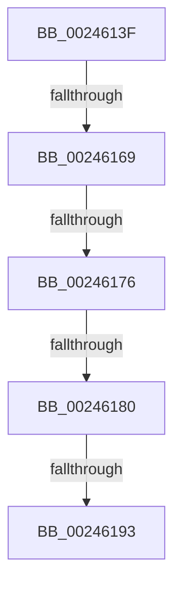

# sub_0024613F

- RVA: `0x0024613F`–`0x002461C2` (길이 `131` bytes)
- VA: `0x000000014024613F`
- 실행 섹션: `.text`
- PDB 이름 있음: `아니요`; PDB Function 태그: `아니요`
- unwind 정보 RVA: `0x00061F10`
- 디코드: `29`개 명령, `131/131` bytes 표시
- 미해석 바이트: `0` (있으면 어셈블리에 `.byte`로 보존)

> 이 문서는 커널 이미지의 기계어와 PDB 기호를 분석해 생성했습니다. 4번과 5번은 함수 원형과 자료형을 바이너리 사용 방식에서 추정한 C 해석이며 원본 소스 복구 결과는 아닙니다.

## 1. Dependencies

- 직접 호출 지점: **0**; 고유 호출 대상: **0**
- 직접 호출자로 확인된 함수: **0**
- RIP 상대 이미지 참조: **0**

### Outgoing calls
- 직접 디코드된 call 명령이 없습니다.

### Direct callers
- 이 함수 시작 RVA로 연결되는 직접 call은 확인되지 않았습니다. 간접 호출은 완전히 역산할 수 없습니다.

### Static image references
- 디코드된 RIP-relative 메모리 참조가 없습니다.

## 2. Other-region calls and transfers

- 다른 실행 섹션으로 향하는 call: **0**
- call이 아닌 외부 분기/꼬리 이동: **5**
  - `0x00246163` → [sub_002466C1](Unknown_function_002466C1.md) (`tail-transfer`)
  - `0x00246170` → [sub_00246828](Unknown_function_00246828.md) (`tail-transfer`)
  - `0x0024617A` → [sub_00246828](Unknown_function_00246828.md) (`tail-transfer`)
  - `0x0024618D` → [sub_00246788](Unknown_function_00246788.md) (`tail-transfer`)
  - `0x002461BD` → [sub_002460E6 + 0x24](Unknown_function_002460E6.md) (`tail-transfer`)

## 3. Assembly (complete function range)

```asm
0024613F  48 83 E0 FE                     and rax, 0xfffffffffffffffe
00246143  48 B9 00 00 00 00 00 F0 FF FF   movabs rcx, 0xfffff00000000000
0024614D  48 0B C1                        or rax, rcx
00246150  48 8B 0C C5 00 00 00 00         mov rcx, qword ptr [rax*8]
00246158  4C 8D 34 C5 00 00 00 00         lea r14, [rax*8]
00246160  49 3B CE                        cmp rcx, r14
00246163  0F 84 58 05 00 00               je 0x1402466c1
00246169  48 8B 01                        mov rax, qword ptr [rcx]
0024616C  4C 39 71 08                     cmp qword ptr [rcx + 8], r14
00246170  0F 85 B2 06 00 00               jne 0x140246828
00246176  48 39 48 08                     cmp qword ptr [rax + 8], rcx
0024617A  0F 85 A8 06 00 00               jne 0x140246828
00246180  49 89 06                        mov qword ptr [r14], rax
00246183  4C 89 70 08                     mov qword ptr [rax + 8], r14
00246187  49 8B 06                        mov rax, qword ptr [r14]
0024618A  49 3B C6                        cmp rax, r14
0024618D  0F 85 F5 05 00 00               jne 0x140246788
00246193  48 89 09                        mov qword ptr [rcx], rcx
00246196  48 8B C1                        mov rax, rcx
00246199  48 89 41 08                     mov qword ptr [rcx + 8], rax
0024619D  48 BA 01 00 00 00 00 F0 FF FF   movabs rdx, 0xfffff00000000001
002461A7  48 8B 03                        mov rax, qword ptr [rbx]
002461AA  48 C1 E9 04                     shr rcx, 4
002461AE  48 03 C9                        add rcx, rcx
002461B1  48 33 C1                        xor rax, rcx
002461B4  48 23 C2                        and rax, rdx
002461B7  48 33 C1                        xor rax, rcx
002461BA  48 89 03                        mov qword ptr [rbx], rax
002461BD  E9 48 FF FF FF                  jmp 0x14024610a
```

## 4. C-style interpretation (structured pseudocode)

```c
__int64 __fastcall sub_0024613F(void)
{
    __int64 result;

    result = (result) & (-2);
    result = (result) | (a1);
    *(unsigned __int64 *)(result * 8) = *(unsigned __int64 *)(*(unsigned __int64 *)(result * 8));
    *(unsigned __int64 *)(*(unsigned __int64 *)(*(unsigned __int64 *)(result * 8)) + 8) = result * 8;
    *(unsigned __int64 *)(*(unsigned __int64 *)(result * 8)) = *(unsigned __int64 *)(result * 8);
    *(unsigned __int64 *)(*(unsigned __int64 *)(result * 8) + 8) = *(unsigned __int64 *)(result * 8);
    a1 = (*(unsigned __int64 *)(result * 8)) >> (4);
    a1 = (a1) + (a1);
    result = (*(unsigned __int64 *)(v_rbx)) ^ (a1);
    result = (result) & (a2);
    result = (result) ^ (a1);
    *(unsigned __int64 *)(v_rbx) = result;
}
```

## 5. (Beta) C Style

```c
void sub_0024613F(void)
{
    int64_t result;

    result = (result) & (-2);
    result = (result) | (a1);
    *(uint64_t *)(result * 8) = *(uint64_t *)(*(uint64_t *)(result * 8));
    *(uint64_t *)(*(uint64_t *)(*(uint64_t *)(result * 8)) + 0x8) = result * 8;
    *(uint64_t *)(*(uint64_t *)(result * 8)) = *(uint64_t *)(result * 8);
    *(uint64_t *)(*(uint64_t *)(result * 8) + 0x8) = *(uint64_t *)(result * 8);
    a1 = (*(uint64_t *)(result * 8)) >> (4);
    a1 = (a1) + (a1);
    result = (*(uint64_t *)(local_rbx)) ^ (a1);
    result = (result) & (a2);
    result = (result) ^ (a1);
    *(uint64_t *)(local_rbx) = result;
}
```

## 6. Execution-region graph

[열기: 2D/3D 그래프와 함수 탐색 컨트롤 패널](../../../control-panel.html?section=text&rva=0x0024613F&view=graph)

- 2D 그래프는 위에서 아래로 흐르고, 3D 그래프는 빈 공간을 드래그해 회전합니다. Shift+드래그는 이동, 휠은 확대·축소, 함수 노드 선택은 대상 보고서 이동입니다.

### Static fallback


