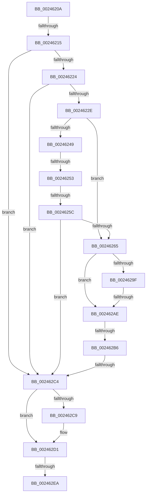

# sub_0024620A

- RVA: `0x0024620A`–`0x002462FC` (길이 `242` bytes)
- VA: `0x000000014024620A`
- 실행 섹션: `.text`
- PDB 이름 있음: `아니요`; PDB Function 태그: `아니요`
- unwind 정보 RVA: `0x00061F48`
- 디코드: `57`개 명령, `242/242` bytes 표시
- 미해석 바이트: `0` (있으면 어셈블리에 `.byte`로 보존)

> 이 문서는 커널 이미지의 기계어와 PDB 기호를 분석해 생성했습니다. 4번과 5번은 함수 원형과 자료형을 바이너리 사용 방식에서 추정한 C 해석이며 원본 소스 복구 결과는 아닙니다.

## 1. Dependencies

- 직접 호출 지점: **0**; 고유 호출 대상: **0**
- 직접 호출자로 확인된 함수: **0**
- RIP 상대 이미지 참조: **0**

### Outgoing calls
- 직접 디코드된 call 명령이 없습니다.

### Direct callers
- 이 함수 시작 RVA로 연결되는 직접 call은 확인되지 않았습니다. 간접 호출은 완전히 역산할 수 없습니다.

### Static image references
- 디코드된 RIP-relative 메모리 참조가 없습니다.

## 2. Other-region calls and transfers

- 다른 실행 섹션으로 향하는 call: **0**
- call이 아닌 외부 분기/꼬리 이동: **7**
  - `0x0024620F` → [sub_002463DF + 0x22](Unknown_function_002463DF.md) (`tail-transfer`)
  - `0x0024624D` → [sub_002463DF](Unknown_function_002463DF.md) (`tail-transfer`)
  - `0x00246256` → [sub_0024669B](Unknown_function_0024669B.md) (`tail-transfer`)
  - `0x002462AC` → [sub_002462FD](Unknown_function_002462FD.md) (`tail-transfer`)
  - `0x002462B4` → [sub_002462FD](Unknown_function_002462FD.md) (`tail-transfer`)
  - `0x002462BE` → [sub_002463DF + 0x6B](Unknown_function_002463DF.md) (`tail-transfer`)
  - `0x002462E4` → [sub_002463DF + 0x42](Unknown_function_002463DF.md) (`tail-transfer`)

## 3. Assembly (complete function range)

```asm
0024620A  4C 89 64 24 48                  mov qword ptr [rsp + 0x48], r12
0024620F  0F 84 EC 01 00 00               je 0x140246401
00246215  48 8B 43 28                     mov rax, qword ptr [rbx + 0x28]
00246219  48 0F BA E0 28                  bt rax, 0x28
0024621E  0F 82 A0 00 00 00               jb 0x1402462c4
00246224  48 85 4B 28                     test qword ptr [rbx + 0x28], rcx
00246228  0F 85 96 00 00 00               jne 0x1402462c4
0024622E  8B 53 20                        mov edx, dword ptr [rbx + 0x20]
00246231  49 BC FF FF FF FF FF FF FF 3F   movabs r12, 0x3fffffffffffffff
0024623B  48 8B 43 18                     mov rax, qword ptr [rbx + 0x18]
0024623F  33 C9                           xor ecx, ecx
00246241  49 23 C4                        and rax, r12
00246244  66 85 D2                        test dx, dx
00246247  74 1C                           je 0x140246265
00246249  66 83 FA 01                     cmp dx, 1
0024624D  0F 85 8C 01 00 00               jne 0x1402463df
00246253  48 85 C0                        test rax, rax
00246256  0F 84 3F 04 00 00               je 0x14024669b
0024625C  B9 01 00 00 00                  mov ecx, 1
00246261  85 C9                           test ecx, ecx
00246263  74 5F                           je 0x1402462c4
00246265  48 8B 4B 08                     mov rcx, qword ptr [rbx + 8]
00246269  49 BA 00 00 00 00 80 F6 FF FF   movabs r10, 0xfffff68000000000
00246273  49 8B C2                        mov rax, r10
00246276  48 BA 78 FF FF FF 3F 00 00 00   movabs rdx, 0x3fffffff78
00246280  49 B9 00 00 00 00 00 00 00 80   movabs r9, 0x8000000000000000
0024628A  48 03 D0                        add rdx, rax
0024628D  49 0B C9                        or rcx, r9
00246290  49 B8 00 00 00 00 00 00 00 40   movabs r8, 0x4000000000000000
0024629A  48 3B CA                        cmp rcx, rdx
0024629D  77 0F                           ja 0x1402462ae
0024629F  48 8B 4B 08                     mov rcx, qword ptr [rbx + 8]
002462A3  49 0B C9                        or rcx, r9
002462A6  49 8B C2                        mov rax, r10
002462A9  48 3B C8                        cmp rcx, rax
002462AC  73 4F                           jae 0x1402462fd
002462AE  0F B6 43 23                     movzx eax, byte ptr [rbx + 0x23]
002462B2  A8 20                           test al, 0x20
002462B4  74 47                           je 0x1402462fd
002462B6  24 DF                           and al, 0xdf
002462B8  88 43 23                        mov byte ptr [rbx + 0x23], al
002462BB  66 85 FF                        test di, di
002462BE  0F 84 86 01 00 00               je 0x14024644a
002462C4  4D 85 F6                        test r14, r14
002462C7  74 08                           je 0x1402462d1
002462C9  41 C7 46 10 01 00 00 00         mov dword ptr [r14 + 0x10], 1
002462D1  48 B8 FF FF FF FF FF FF FF 7F   movabs rax, 0x7fffffffffffffff
002462DB  F0 48 21 43 18                  lock and qword ptr [rbx + 0x18], rax
002462E0  40 80 FE 01                     cmp sil, 1
002462E4  0F 86 37 01 00 00               jbe 0x140246421
002462EA  4C 8B 64 24 48                  mov r12, qword ptr [rsp + 0x48]
002462EF  4C 8B 74 24 38                  mov r14, qword ptr [rsp + 0x38]
002462F4  48 83 C4 50                     add rsp, 0x50
002462F8  5F                              pop rdi
002462F9  5E                              pop rsi
002462FA  5B                              pop rbx
002462FB  C3                              ret
```

## 4. C-style interpretation (structured pseudocode)

```c
__int64 __fastcall sub_0024620A(__int64 a1, __int64 a2, __int64 a3, __int64 a4, __int64 a5, __int64 a6, __int64 a7, __int64 a8, __int64 a9)
{
    __int64 result;
    __int64 v_rsp;
    unsigned __int64 v_stack_p48;

    v_stack_p48 = v_r12;
    if (condition_is_below) goto loc_002462C4;
    if (((*(unsigned __int64 *)(v_rbx + 40)) & (a1)) != 0) goto loc_002462C4;
    a1 = 0;
    result = (*(unsigned __int64 *)(v_rbx + 24)) & (v_r12);
    if ((unsigned __int16)((unsigned int)(*(unsigned int *)(v_rbx + 32))) == 0) goto loc_00246265;
    if (1 == 0) goto loc_002462C4;
loc_00246265:
    a2 = ((unsigned int)(*(unsigned int *)(v_rbx + 32))) + (v_r10);
    a1 = (*(unsigned __int64 *)(v_rbx + 8)) | (a4);
    if (a1 > a2) goto loc_002462AE;
    a1 = (*(unsigned __int64 *)(v_rbx + 8)) | (a4);
loc_002462AE:
    result = (unsigned __int8)((*(unsigned __int8 *)(v_rbx + 35)) & (223));
    *(unsigned __int8 *)(v_rbx + 35) = (unsigned __int8)(result);
loc_002462C4:
    if (v_r14 != 0) {
        *(unsigned int *)(v_r14 + 16) = 1;
    }
    v_rsp = (v_rsp) + (80);
    return result;
}
```

## 5. (Beta) C Style

```c
int64_t sub_0024620A(int64_t Arg1, int64_t Arg2, int64_t Arg3, int64_t Arg4, uint64_t Arg5, uint64_t Arg6, int64_t Arg7, uint64_t Arg8, int64_t Arg9)
{
    int64_t result;
    int64_t local_rsp;
    uint64_t v_stack_p48;

    v_stack_p48 = local_r12;
    if (condition_is_below) goto loc_002462C4;
    if (((*(uint64_t *)(local_rbx + 0x28)) & (Arg1)) != 0) goto loc_002462C4;
    Arg1 = 0;
    result = (*(uint64_t *)(local_rbx + 0x18)) & (local_r12);
    if ((uint16_t)((uint32_t)(*(uint32_t *)(local_rbx + 0x20))) == 0) goto loc_00246265;
    if (1 == 0) goto loc_002462C4;
loc_00246265:
    Arg2 = ((uint32_t)(*(uint32_t *)(local_rbx + 0x20))) + (local_r10);
    Arg1 = (*(uint64_t *)(local_rbx + 0x8)) | (Arg4);
    if (Arg1 > Arg2) goto loc_002462AE;
    Arg1 = (*(uint64_t *)(local_rbx + 0x8)) | (Arg4);
loc_002462AE:
    result = (uint8_t)((*(uint8_t *)(local_rbx + 0x23)) & (223));
    *(uint8_t *)(local_rbx + 0x23) = (uint8_t)(result);
loc_002462C4:
    if (local_r14 != 0) {
        *(uint32_t *)(local_r14 + 0x10) = 1;
    }
    local_rsp = (local_rsp) + (80);
    return result;
}
```

## 6. Execution-region graph

[열기: 2D/3D 그래프와 함수 탐색 컨트롤 패널](../../../control-panel.html?section=text&rva=0x0024620A&view=graph)

- 2D 그래프는 위에서 아래로 흐르고, 3D 그래프는 빈 공간을 드래그해 회전합니다. Shift+드래그는 이동, 휠은 확대·축소, 함수 노드 선택은 대상 보고서 이동입니다.

### Static fallback


