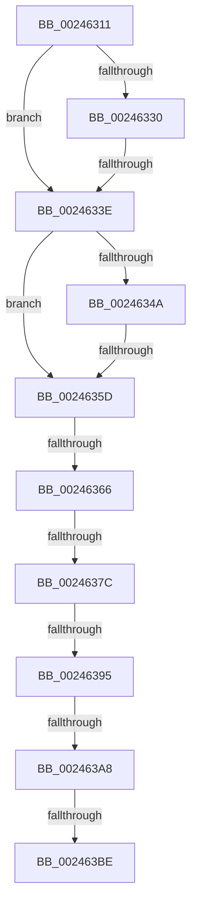

# sub_00246311

- RVA: `0x00246311`–`0x002463DF` (길이 `206` bytes)
- VA: `0x0000000140246311`
- 실행 섹션: `.text`
- PDB 이름 있음: `아니요`; PDB Function 태그: `아니요`
- unwind 정보 RVA: `0x00061F84`
- 디코드: `43`개 명령, `206/206` bytes 표시
- 미해석 바이트: `0` (있으면 어셈블리에 `.byte`로 보존)

> 이 문서는 커널 이미지의 기계어와 PDB 기호를 분석해 생성했습니다. 4번과 5번은 함수 원형과 자료형을 바이너리 사용 방식에서 추정한 C 해석이며 원본 소스 복구 결과는 아닙니다.

## 1. Dependencies

- 직접 호출 지점: **0**; 고유 호출 대상: **0**
- 직접 호출자로 확인된 함수: **0**
- RIP 상대 이미지 참조: **1**

### Outgoing calls
- 직접 디코드된 call 명령이 없습니다.

### Direct callers
- 이 함수 시작 RVA로 연결되는 직접 call은 확인되지 않았습니다. 간접 호출은 완전히 역산할 수 없습니다.

### Static image references
- `0x00246366` → RVA `0x00E38D00` (`.data`; read)

## 2. Other-region calls and transfers

- 다른 실행 섹션으로 향하는 call: **0**
- call이 아닌 외부 분기/꼬리 이동: **8**
  - `0x00246338` → [sub_00246508 + 0xD](Unknown_function_00246508.md) (`tail-transfer`)
  - `0x00246357` → [sub_002466AA + 0x8](Unknown_function_002466AA.md) (`tail-transfer`)
  - `0x00246360` → [sub_00246508](Unknown_function_00246508.md) (`tail-transfer`)
  - `0x00246376` → [sub_002465E2 + 0x6](Unknown_function_002465E2.md) (`tail-transfer`)
  - `0x0024638F` → [sub_002465E2](Unknown_function_002465E2.md) (`tail-transfer`)
  - `0x002463A2` → [sub_0024663D + 0x29](Unknown_function_0024663D.md) (`tail-transfer`)
  - `0x002463B8` → [sub_0024663D + 0x20](Unknown_function_0024663D.md) (`tail-transfer`)
  - `0x002463DA` → [sub_0024620A + 0xB1](Unknown_function_0024620A.md) (`tail-transfer`)

## 3. Assembly (complete function range)

```asm
00246311  48 89 AC 24 88 00 00 00         mov qword ptr [rsp + 0x88], rbp
00246319  4C 89 6C 24 40                  mov qword ptr [rsp + 0x40], r13
0024631E  4C 89 7C 24 30                  mov qword ptr [rsp + 0x30], r15
00246323  48 8B 2C C1                     mov rbp, qword ptr [rcx + rax*8]
00246327  48 8B 43 28                     mov rax, qword ptr [rbx + 0x28]
0024632B  48 85 C0                        test rax, rax
0024632E  79 0E                           jns 0x14024633e
00246330  8B 43 10                        mov eax, dword ptr [rbx + 0x10]
00246333  48 0F BA E0 0A                  bt rax, 0xa
00246338  0F 82 D7 01 00 00               jb 0x140246515
0024633E  48 8B 43 08                     mov rax, qword ptr [rbx + 8]
00246342  49 0B C1                        or rax, r9
00246345  48 3B C2                        cmp rax, rdx
00246348  77 13                           ja 0x14024635d
0024634A  48 8B 4B 08                     mov rcx, qword ptr [rbx + 8]
0024634E  49 0B C9                        or rcx, r9
00246351  49 8B C2                        mov rax, r10
00246354  48 3B C8                        cmp rcx, rax
00246357  0F 83 55 03 00 00               jae 0x1402466b2
0024635D  66 85 FF                        test di, di
00246360  0F 84 A2 01 00 00               je 0x140246508
00246366  4C 8D 2D 93 29 BF 00            lea r13, [rip + 0xbf2993]
0024636D  41 B9 01 00 00 00               mov r9d, 1
00246373  49 3B ED                        cmp rbp, r13
00246376  0F 85 6C 02 00 00               jne 0x1402465e8
0024637C  65 4C 8B 04 25 20 00 00 00      mov r8, qword ptr gs:[0x20]
00246385  41 8B 90 9C 8B 00 00            mov edx, dword ptr [r8 + 0x8b9c]
0024638C  83 FA FF                        cmp edx, -1
0024638F  0F 84 4D 02 00 00               je 0x1402465e2
00246395  48 63 CA                        movsxd rcx, edx
00246398  48 FF C1                        inc rcx
0024639B  48 81 F9 00 01 00 00            cmp rcx, 0x100
002463A2  0F 87 BE 02 00 00               ja 0x140246666
002463A8  8D 4A 01                        lea ecx, [rdx + 1]
002463AB  8B C2                           mov eax, edx
002463AD  F0 41 0F B1 88 9C 8B 00 00      lock cmpxchg dword ptr [r8 + 0x8b9c], ecx
002463B6  8B D0                           mov edx, eax
002463B8  0F 85 9F 02 00 00               jne 0x14024665d
002463BE  4C 8B 6C 24 40                  mov r13, qword ptr [rsp + 0x40]
002463C3  49 B8 00 00 00 00 00 00 00 40   movabs r8, 0x4000000000000000
002463CD  48 8B AC 24 88 00 00 00         mov rbp, qword ptr [rsp + 0x88]
002463D5  4C 8B 7C 24 30                  mov r15, qword ptr [rsp + 0x30]
002463DA  E9 DC FE FF FF                  jmp 0x1402462bb
```

## 4. C-style interpretation (structured pseudocode)

```c
__int64 __fastcall sub_00246311(__int64 a1, __int64 a2, __int64 a3, __int64 a4, __int64 a5, __int64 a6, __int64 a7, __int64 a8, __int64 a9, __int64 a10, __int64 a11, __int64 a12, __int64 a13, __int64 a14, __int64 a15, __int64 a16, __int64 a17)
{
    __int64 result;
    unsigned __int64 v_stack_p30;
    unsigned __int64 v_stack_p40;
    unsigned __int64 v_stack_p88;

    v_stack_p88 = v_rbp;
    v_stack_p40 = v_r13;
    v_stack_p30 = v_r15;
    if (!sign_flag) goto loc_0024633E;
loc_0024633E:
    result = (*(unsigned __int64 *)(v_rbx + 8)) | (a4);
    if (result > a2) goto loc_0024635D;
    a1 = (*(unsigned __int64 *)(v_rbx + 8)) | (a4);
loc_0024635D:
    a1 = ((int)((unsigned int)((unsigned int)(*(unsigned int *)(*(unsigned __int64 *)(gs_base + (0 + 32)) + 35740))))) + 1;
}
```

## 5. (Beta) C Style

```c
int64_t sub_00246311(void *Arg1, int64_t Arg2, int64_t Arg3, int64_t Arg4, uint64_t Arg5, int64_t Arg6, uint64_t Arg7, int64_t Arg8, uint64_t Arg9, uint64_t Arg10, uint64_t Arg11, uint64_t Arg12, uint64_t Arg13, uint64_t Arg14, uint64_t Arg15, uint64_t Arg16, int64_t Arg17)
{
    uint8_t *arg1 = (uint8_t *)Arg1;

    int64_t result;
    uint64_t v_stack_p30;
    uint64_t v_stack_p40;
    uint64_t v_stack_p88;

    v_stack_p88 = local_rbp;
    v_stack_p40 = local_r13;
    v_stack_p30 = local_r15;
    if (!sign_flag) goto loc_0024633E;
loc_0024633E:
    result = (*(uint64_t *)(local_rbx + 0x8)) | (Arg4);
    if (result > Arg2) goto loc_0024635D;
    Arg1 = (*(uint64_t *)(local_rbx + 0x8)) | (Arg4);
loc_0024635D:
    Arg1 = ((int32_t)((uint32_t)((uint32_t)(*(uint32_t *)(*(uint64_t *)(gs_base + (0 + 0x20)) + 0x8B9C))))) + 1;
}
```

### 관측된 메모리 오프셋

구조체 형식이 확인되지 않은 접근은 인자 기준의 오프셋으로만 기록했습니다.

| 기준 인자 | 오프셋 표현 | 폭 (bit) | 접근 |
|---|---:|---:|---|
| `Arg1` | `+ 0x0 + rax*8` | `64` | `R` |

## 6. Execution-region graph

[열기: 2D/3D 그래프와 함수 탐색 컨트롤 패널](../../../control-panel.html?section=text&rva=0x00246311&view=graph)

- 2D 그래프는 위에서 아래로 흐르고, 3D 그래프는 빈 공간을 드래그해 회전합니다. Shift+드래그는 이동, 휠은 확대·축소, 함수 노드 선택은 대상 보고서 이동입니다.

### Static fallback


