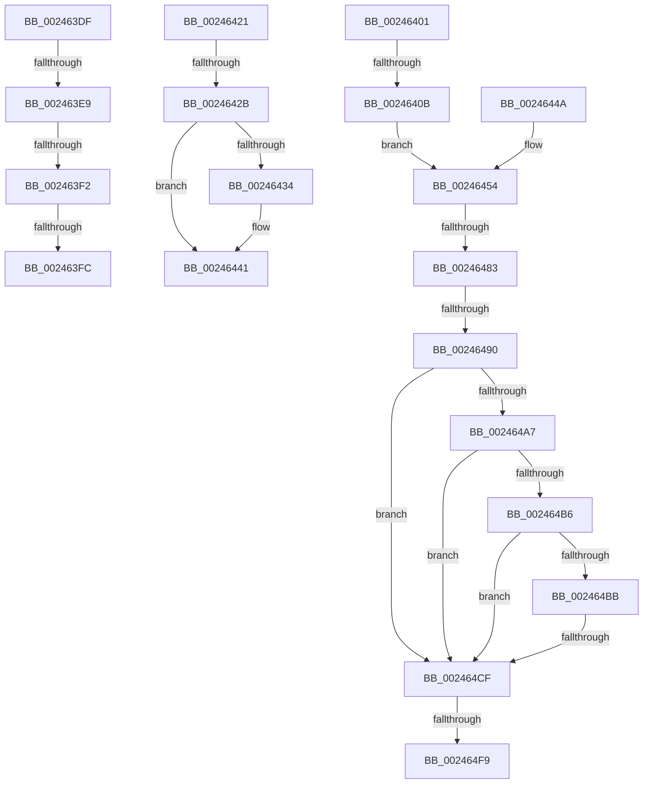

# sub_002463DF

- RVA: `0x002463DF`–`0x00246508` (길이 `297` bytes)
- VA: `0x00000001402463DF`
- 실행 섹션: `.text`
- PDB 이름 있음: `아니요`; PDB Function 태그: `아니요`
- unwind 정보 RVA: `0x00061FA0`
- 디코드: `62`개 명령, `297/297` bytes 표시
- 미해석 바이트: `0` (있으면 어셈블리에 `.byte`로 보존)

> 이 문서는 커널 이미지의 기계어와 PDB 기호를 분석해 생성했습니다. 4번과 5번은 함수 원형과 자료형을 바이너리 사용 방식에서 추정한 C 해석이며 원본 소스 복구 결과는 아닙니다.

## 1. Dependencies

- 직접 호출 지점: **2**; 고유 호출 대상: **2**
- 직접 호출자로 확인된 함수: **0**
- RIP 상대 이미지 참조: **1**

### Outgoing calls
- `0x0024643C` → [KiLowerIrqlProcessIrqlFlags](../4F/KiLowerIrqlProcessIrqlFlags_function_004F5698.md) (function, `0x004F5698`)
- `0x002464FE` → [MiInsertPageInList](../2B/MiInsertPageInList_function_002BA000.md) (function, `0x002BA000`)

### Direct callers
- 이 함수 시작 RVA로 연결되는 직접 call은 확인되지 않았습니다. 간접 호출은 완전히 역산할 수 없습니다.

### Static image references
- `0x0024642B` → RVA `0x00FC6D20` (`ALMOSTRO`; read)

## 2. Other-region calls and transfers

- 다른 실행 섹션으로 향하는 call: **0**
- call이 아닌 외부 분기/꼬리 이동: **12**
  - `0x002463E3` → [sub_0024620A + 0xBA](Unknown_function_0024620A.md) (`tail-transfer`)
  - `0x002463EC` → [sub_0024620A + 0xBA](Unknown_function_0024620A.md) (`tail-transfer`)
  - `0x002463F6` → [sub_0024620A + 0xBA](Unknown_function_0024620A.md) (`tail-transfer`)
  - `0x002463FC` → [sub_0024620A + 0x5B](Unknown_function_0024620A.md) (`tail-transfer`)
  - `0x00246405` → [sub_0024620A + 0xB](Unknown_function_0024620A.md) (`tail-transfer`)
  - `0x00246425` → [sub_0024620A + 0xE0](Unknown_function_0024620A.md) (`tail-transfer`)
  - `0x00246445` → [sub_0024620A + 0xE0](Unknown_function_0024620A.md) (`tail-transfer`)
  - `0x0024647D` → [sub_00246798](Unknown_function_00246798.md) (`tail-transfer`)
  - `0x0024648A` → [sub_002466D9](Unknown_function_002466D9.md) (`tail-transfer`)
  - `0x002464C9` → [sub_002465F5](Unknown_function_002465F5.md) (`tail-transfer`)
  - `0x002464F3` → [sub_002465D3](Unknown_function_002465D3.md) (`tail-transfer`)
  - `0x00246503` → [sub_0024620A + 0xBA](Unknown_function_0024620A.md) (`tail-transfer`)

## 3. Assembly (complete function range)

```asm
002463DF  66 83 FA 02                     cmp dx, 2
002463E3  0F 85 DB FE FF FF               jne 0x1402462c4
002463E9  48 85 C0                        test rax, rax
002463EC  0F 84 D2 FE FF FF               je 0x1402462c4
002463F2  F6 43 22 08                     test byte ptr [rbx + 0x22], 8
002463F6  0F 84 C8 FE FF FF               je 0x1402462c4
002463FC  E9 64 FE FF FF                  jmp 0x140246265
00246401  48 85 4B 28                     test qword ptr [rbx + 0x28], rcx
00246405  0F 84 0A FE FF FF               je 0x140246215
0024640B  49 BC FF FF FF FF FF FF FF 3F   movabs r12, 0x3fffffffffffffff
00246415  49 B8 00 00 00 00 00 00 00 40   movabs r8, 0x4000000000000000
0024641F  EB 33                           jmp 0x140246454
00246421  40 80 FE 12                     cmp sil, 0x12
00246425  0F 84 BF FE FF FF               je 0x1402462ea
0024642B  83 3D EE 08 D8 00 00            cmp dword ptr [rip + 0xd808ee], 0
00246432  74 0D                           je 0x140246441
00246434  44 0F 20 C1                     mov rcx, cr8
00246438  40 0F B6 D6                     movzx edx, sil
0024643C  E8 57 F2 2A 00                  call 0x1404f5698
00246441  44 0F 22 C6                     mov cr8, rsi
00246445  E9 A0 FE FF FF                  jmp 0x1402462ea
0024644A  48 B9 00 00 00 00 00 00 20 00   movabs rcx, 0x20000000000000
00246454  48 B8 00 00 00 00 00 DE FF FF   movabs rax, 0xffffde0000000000
0024645E  48 8B FB                        mov rdi, rbx
00246461  48 2B F8                        sub rdi, rax
00246464  48 B8 AB AA AA AA AA AA AA AA   movabs rax, 0xaaaaaaaaaaaaaaab
0024646E  48 C1 FF 04                     sar rdi, 4
00246472  48 0F AF F8                     imul rdi, rax
00246476  48 8B 43 18                     mov rax, qword ptr [rbx + 0x18]
0024647A  49 85 C4                        test r12, rax
0024647D  0F 85 15 03 00 00               jne 0x140246798
00246483  48 8B 43 18                     mov rax, qword ptr [rbx + 0x18]
00246487  49 85 C0                        test r8, rax
0024648A  0F 85 49 02 00 00               jne 0x1402466d9
00246490  48 8B 53 10                     mov rdx, qword ptr [rbx + 0x10]
00246494  4C 8D 43 10                     lea r8, [rbx + 0x10]
00246498  48 B8 00 D0 BE 7D FB F6 FF FF   movabs rax, 0xfffff6fb7dbed000
002464A2  4C 3B C0                        cmp r8, rax
002464A5  72 28                           jb 0x1402464cf
002464A7  48 B8 F8 D7 BE 7D FB F6 FF FF   movabs rax, 0xfffff6fb7dbed7f8
002464B1  4C 3B C0                        cmp r8, rax
002464B4  77 19                           ja 0x1402464cf
002464B6  F6 C2 01                        test dl, 1
002464B9  74 14                           je 0x1402464cf
002464BB  F6 C2 42                        test dl, 0x42
002464BE  0F 95 C1                        setne cl
002464C1  F6 C2 20                        test dl, 0x20
002464C4  0F 95 C0                        setne al
002464C7  84 C8                           test al, cl
002464C9  0F 84 26 01 00 00               je 0x1402465f5
002464CF  48 0F BA E2 0A                  bt rdx, 0xa
002464D4  48 C7 C1 FF F7 FF FF            mov rcx, 0xfffffffffffff7ff
002464DB  48 C7 C0 F7 FF FF FF            mov rax, 0xfffffffffffffff7
002464E2  48 0F 42 C1                     cmovb rax, rcx
002464E6  48 8B CB                        mov rcx, rbx
002464E9  48 23 C2                        and rax, rdx
002464EC  49 89 00                        mov qword ptr [r8], rax
002464EF  F6 43 22 10                     test byte ptr [rbx + 0x22], 0x10
002464F3  0F 84 DA 00 00 00               je 0x1402465d3
002464F9  BA 08 00 00 00                  mov edx, 8
002464FE  E8 FD 3A 07 00                  call 0x1402ba000
00246503  E9 BC FD FF FF                  jmp 0x1402462c4
```

## 4. C-style interpretation (structured pseudocode)

```c
__int64 __fastcall sub_002463DF(__int64 a1, unsigned __int16 a2)
{
}
```

## 5. (Beta) C Style

```c
int64_t sub_002463DF(int64_t Arg1, uint16_t Arg2)
{
}
```

## 6. Execution-region graph

[열기: 2D/3D 그래프와 함수 탐색 컨트롤 패널](../../../control-panel.html?section=text&rva=0x002463DF&view=graph)

- 2D 그래프는 위에서 아래로 흐르고, 3D 그래프는 빈 공간을 드래그해 회전합니다. Shift+드래그는 이동, 휠은 확대·축소, 함수 노드 선택은 대상 보고서 이동입니다.

### Static fallback


