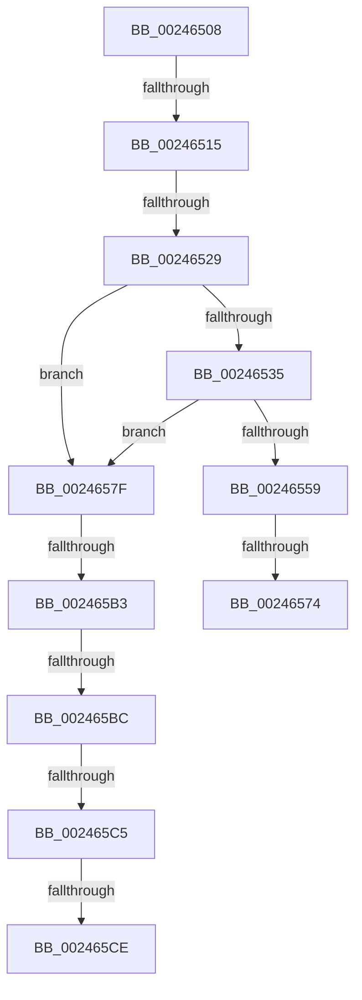

# sub_00246508

- RVA: `0x00246508`–`0x002465D3` (길이 `203` bytes)
- VA: `0x0000000140246508`
- 실행 섹션: `.text`
- PDB 이름 있음: `아니요`; PDB Function 태그: `아니요`
- unwind 정보 RVA: `0x00061FB0`
- 디코드: `40`개 명령, `203/203` bytes 표시
- 미해석 바이트: `0` (있으면 어셈블리에 `.byte`로 보존)

> 이 문서는 커널 이미지의 기계어와 PDB 기호를 분석해 생성했습니다. 4번과 5번은 함수 원형과 자료형을 바이너리 사용 방식에서 추정한 C 해석이며 원본 소스 복구 결과는 아닙니다.

## 1. Dependencies

- 직접 호출 지점: **0**; 고유 호출 대상: **0**
- 직접 호출자로 확인된 함수: **0**
- RIP 상대 이미지 참조: **1**

### Outgoing calls
- 직접 디코드된 call 명령이 없습니다.

### Direct callers
- 이 함수 시작 RVA로 연결되는 직접 call은 확인되지 않았습니다. 간접 호출은 완전히 역산할 수 없습니다.

### Static image references
- `0x00246529` → RVA `0x00E38D00` (`.data`; read)

## 2. Other-region calls and transfers

- 다른 실행 섹션으로 향하는 call: **0**
- call이 아닌 외부 분기/꼬리 이동: **9**
  - `0x0024650F` → [sub_00246311 + 0x55](Unknown_function_00246311.md) (`tail-transfer`)
  - `0x00246523` → [sub_002467B9](Unknown_function_002467B9.md) (`tail-transfer`)
  - `0x0024656E` → [sub_002466AA](Unknown_function_002466AA.md) (`tail-transfer`)
  - `0x0024657A` → [sub_00246311 + 0x6B](Unknown_function_00246311.md) (`tail-transfer`)
  - `0x002465AD` → [sub_0024663D](Unknown_function_0024663D.md) (`tail-transfer`)
  - `0x002465B6` → [sub_00246856 + 0x97](Unknown_function_00246856.md) (`tail-transfer`)
  - `0x002465BF` → [sub_00246311 + 0x5C](Unknown_function_00246311.md) (`tail-transfer`)
  - `0x002465C8` → [sub_00246311 + 0x5C](Unknown_function_00246311.md) (`tail-transfer`)
  - `0x002465CE` → [sub_00246856 + 0xA0](Unknown_function_00246856.md) (`tail-transfer`)

## 3. Assembly (complete function range)

```asm
00246508  48 8B 43 18                     mov rax, qword ptr [rbx + 0x18]
0024650C  49 85 C0                        test r8, rax
0024650F  0F 84 51 FE FF FF               je 0x140246366
00246515  48 83 BD 08 42 00 00 00         cmp qword ptr [rbp + 0x4208], 0
0024651D  41 BF 01 00 00 00               mov r15d, 1
00246523  0F 85 90 02 00 00               jne 0x1402467b9
00246529  4C 8D 2D D0 27 BF 00            lea r13, [rip + 0xbf27d0]
00246530  49 3B ED                        cmp rbp, r13
00246533  75 4A                           jne 0x14024657f
00246535  65 4C 8B 04 25 20 00 00 00      mov r8, qword ptr gs:[0x20]
0024653E  41 0F 0D 88 98 8B 00 00         prefetchw byte ptr [r8 + 0x8b98]
00246546  41 8B 90 98 8B 00 00            mov edx, dword ptr [r8 + 0x8b98]
0024654D  4A 8D 04 3A                     lea rax, [rdx + r15]
00246551  48 3D 00 01 00 00               cmp rax, 0x100
00246557  77 26                           ja 0x14024657f
00246559  42 8D 0C 3A                     lea ecx, [rdx + r15]
0024655D  8B C2                           mov eax, edx
0024655F  F0 41 0F B1 88 98 8B 00 00      lock cmpxchg dword ptr [r8 + 0x8b98], ecx
00246568  48 63 C8                        movsxd rcx, eax
0024656B  48 3B CA                        cmp rcx, rdx
0024656E  0F 85 36 01 00 00               jne 0x1402466aa
00246574  41 B9 01 00 00 00               mov r9d, 1
0024657A  E9 FD FD FF FF                  jmp 0x14024637c
0024657F  49 8B C7                        mov rax, r15
00246582  48 F7 D8                        neg rax
00246585  F0 48 01 85 80 4B 00 00         lock add qword ptr [rbp + 0x4b80], rax
0024658D  F0 48 0F C1 85 40 4B 00 00      lock xadd qword ptr [rbp + 0x4b40], rax
00246596  4C 8B 85 E0 41 00 00            mov r8, qword ptr [rbp + 0x41e0]
0024659D  48 8B D0                        mov rdx, rax
002465A0  48 8B 8D D8 41 00 00            mov rcx, qword ptr [rbp + 0x41d8]
002465A7  49 2B D7                        sub rdx, r15
002465AA  48 3B D0                        cmp rdx, rax
002465AD  0F 87 8A 00 00 00               ja 0x14024663d
002465B3  49 3B C0                        cmp rax, r8
002465B6  0F 83 31 03 00 00               jae 0x1402468ed
002465BC  48 3B C1                        cmp rax, rcx
002465BF  0F 82 A8 FD FF FF               jb 0x14024636d
002465C5  48 3B D1                        cmp rdx, rcx
002465C8  0F 83 9F FD FF FF               jae 0x14024636d
002465CE  E9 23 03 00 00                  jmp 0x1402468f6
```

## 4. C-style interpretation (structured pseudocode)

```c
__int64 __fastcall sub_00246508(__int64 a1, __int64 a2, __int64 a3)
{
    __int64 result;

    if (v_rbp != (v_rip + 12527568)) goto loc_0024657F;
    if (((unsigned int)(*(unsigned int *)(*(unsigned __int64 *)(gs_base + (0 + 32)) + 35736)) + 1 * 1) > 256) goto loc_0024657F;
loc_0024657F:
    result = -(1);
    a2 = (result) - (1);
}
```

## 5. (Beta) C Style

```c
int64_t sub_00246508(int64_t Arg1, int64_t Arg2, int64_t Arg3)
{
    int64_t result;

    if (local_rbp != (v_rip + 12527568)) goto loc_0024657F;
    if (((uint32_t)(*(uint32_t *)(*(uint64_t *)(gs_base + (0 + 0x20)) + 0x8B98)) + 1 * 1) > 256) goto loc_0024657F;
loc_0024657F:
    result = -(1);
    Arg2 = (result) - (1);
}
```

## 6. Execution-region graph

[열기: 2D/3D 그래프와 함수 탐색 컨트롤 패널](../../../control-panel.html?section=text&rva=0x00246508&view=graph)

- 2D 그래프는 위에서 아래로 흐르고, 3D 그래프는 빈 공간을 드래그해 회전합니다. Shift+드래그는 이동, 휠은 확대·축소, 함수 노드 선택은 대상 보고서 이동입니다.

### Static fallback


