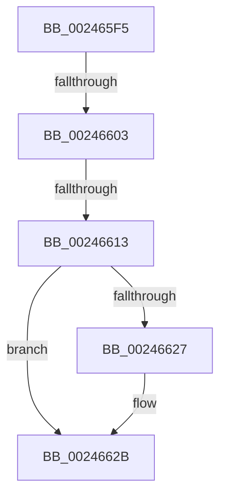

# sub_002465F5

- RVA: `0x002465F5`–`0x0024663D` (길이 `72` bytes)
- VA: `0x00000001402465F5`
- 실행 섹션: `.text`
- PDB 이름 있음: `아니요`; PDB Function 태그: `아니요`
- unwind 정보 RVA: `0x00061FF8`
- 디코드: `18`개 명령, `72/72` bytes 표시
- 미해석 바이트: `0` (있으면 어셈블리에 `.byte`로 보존)

> 이 문서는 커널 이미지의 기계어와 PDB 기호를 분석해 생성했습니다. 4번과 5번은 함수 원형과 자료형을 바이너리 사용 방식에서 추정한 C 해석이며 원본 소스 복구 결과는 아닙니다.

## 1. Dependencies

- 직접 호출 지점: **1**; 고유 호출 대상: **1**
- 직접 호출자로 확인된 함수: **0**
- RIP 상대 이미지 참조: **0**

### Outgoing calls
- `0x002465F5` → [MiPteHasShadow](../32/MiPteHasShadow_function_0032B998.md) (function, `0x0032B998`)

### Direct callers
- 이 함수 시작 RVA로 연결되는 직접 call은 확인되지 않았습니다. 간접 호출은 완전히 역산할 수 없습니다.

### Static image references
- 디코드된 RIP-relative 메모리 참조가 없습니다.

## 2. Other-region calls and transfers

- 다른 실행 섹션으로 향하는 call: **0**
- call이 아닌 외부 분기/꼬리 이동: **3**
  - `0x002465FD` → [sub_002463DF + 0xF0](Unknown_function_002463DF.md) (`tail-transfer`)
  - `0x0024660D` → [sub_002463DF + 0xF0](Unknown_function_002463DF.md) (`tail-transfer`)
  - `0x00246638` → [sub_002463DF + 0xF0](Unknown_function_002463DF.md) (`tail-transfer`)

## 3. Assembly (complete function range)

```asm
002465F5  E8 9E 53 0E 00                  call 0x14032b998
002465FA  48 85 C0                        test rax, rax
002465FD  0F 84 CC FE FF FF               je 0x1402464cf
00246603  48 8B 88 08 05 00 00            mov rcx, qword ptr [rax + 0x508]
0024660A  48 85 C9                        test rcx, rcx
0024660D  0F 84 BC FE FF FF               je 0x1402464cf
00246613  49 8B C0                        mov rax, r8
00246616  48 C1 E8 03                     shr rax, 3
0024661A  25 FF 01 00 00                  and eax, 0x1ff
0024661F  48 8B 04 C1                     mov rax, qword ptr [rcx + rax*8]
00246623  A8 20                           test al, 0x20
00246625  74 04                           je 0x14024662b
00246627  48 83 CA 20                     or rdx, 0x20
0024662B  48 8B CA                        mov rcx, rdx
0024662E  48 83 CA 42                     or rdx, 0x42
00246632  A8 42                           test al, 0x42
00246634  48 0F 44 D1                     cmove rdx, rcx
00246638  E9 92 FE FF FF                  jmp 0x1402464cf
```

## 4. C-style interpretation (structured pseudocode)

```c
__int64 __fastcall sub_002465F5(__int64 a1, __int64 a2, __int64 a3)
{
    __int64 result;

    result = MiPteHasShadow(a1, a2, a3, a4);
    result = (a3) >> (3);
    result = (unsigned int)((result) & (511));
    if ((((unsigned __int8)(*(unsigned __int64 *)(*(unsigned __int64 *)(result + 1288) + result * 8))) & (32)) != 0) {
        a2 = (a2) | (32);
    }
    a2 = (a2) | (66);
    if ((((unsigned __int8)(*(unsigned __int64 *)(*(unsigned __int64 *)(result + 1288) + result * 8))) & (66)) == 0) { a2 = a2; }
}
```

## 5. (Beta) C Style

```c
int64_t sub_002465F5(int64_t Arg1, int64_t Arg2, int64_t Arg3)
{
    int64_t result;

    result = MiPteHasShadow(Arg1, Arg2, Arg3, a4);
    result = (Arg3) >> (3);
    result = (uint32_t)((result) & (511));
    if ((((uint8_t)(*(uint64_t *)(*(uint64_t *)(result + 0x508) + result * 8))) & (32)) != 0) {
        Arg2 = (Arg2) | (32);
    }
    Arg2 = (Arg2) | (66);
    if ((((uint8_t)(*(uint64_t *)(*(uint64_t *)(result + 0x508) + result * 8))) & (66)) == 0) { Arg2 = Arg2; }
}
```

## 6. Execution-region graph

[열기: 2D/3D 그래프와 함수 탐색 컨트롤 패널](../../../control-panel.html?section=text&rva=0x002465F5&view=graph)

- 2D 그래프는 위에서 아래로 흐르고, 3D 그래프는 빈 공간을 드래그해 회전합니다. Shift+드래그는 이동, 휠은 확대·축소, 함수 노드 선택은 대상 보고서 이동입니다.

### Static fallback


