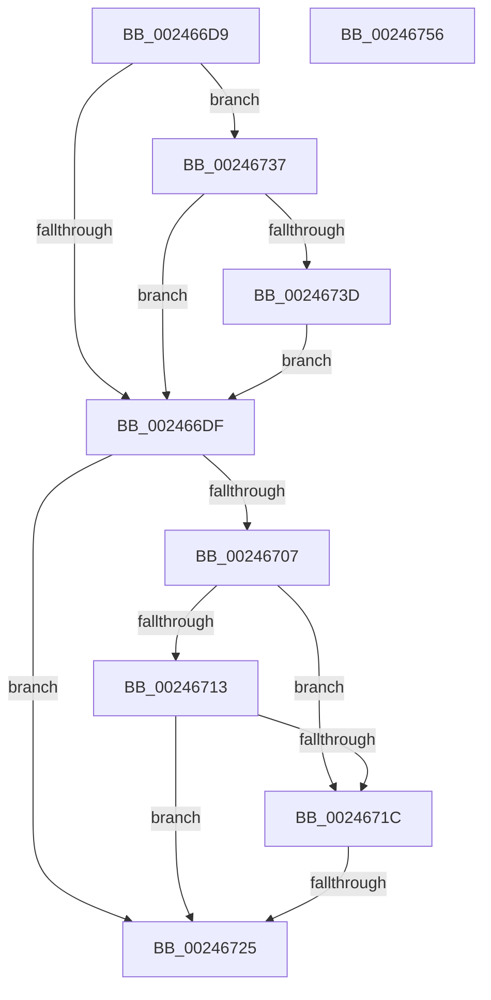

# sub_002466D9

- RVA: `0x002466D9`–`0x00246760` (길이 `135` bytes)
- VA: `0x00000001402466D9`
- 실행 섹션: `.text`
- PDB 이름 있음: `아니요`; PDB Function 태그: `아니요`
- unwind 정보 RVA: `0x00062060`
- 디코드: `36`개 명령, `135/135` bytes 표시
- 미해석 바이트: `0` (있으면 어셈블리에 `.byte`로 보존)

> 이 문서는 커널 이미지의 기계어와 PDB 기호를 분석해 생성했습니다. 4번과 5번은 함수 원형과 자료형을 바이너리 사용 방식에서 추정한 C 해석이며 원본 소스 복구 결과는 아닙니다.

## 1. Dependencies

- 직접 호출 지점: **1**; 고유 호출 대상: **1**
- 직접 호출자로 확인된 함수: **0**
- RIP 상대 이미지 참조: **1**

### Outgoing calls
- `0x0024672D` → [MiInsertPageInFreeOrZeroedList](../33/MiInsertPageInFreeOrZeroedList_function_00334D20.md) (function, `0x00334D20`)

### Direct callers
- 이 함수 시작 RVA로 연결되는 직접 call은 확인되지 않았습니다. 간접 호출은 완전히 역산할 수 없습니다.

### Static image references
- `0x002466E3` → RVA `0x00E30088` (`.data`; read)

## 2. Other-region calls and transfers

- 다른 실행 섹션으로 향하는 call: **0**
- call이 아닌 외부 분기/꼬리 이동: **2**
  - `0x0024671F` → [sub_002467FE](Unknown_function_002467FE.md) (`tail-transfer`)
  - `0x00246732` → [sub_0024620A + 0xBA](Unknown_function_0024620A.md) (`tail-transfer`)

## 3. Assembly (complete function range)

```asm
002466D9  F6 43 23 10                     test byte ptr [rbx + 0x23], 0x10
002466DD  75 58                           jne 0x140246737
002466DF  48 8B 43 28                     mov rax, qword ptr [rbx + 0x28]
002466E3  48 8B 0D 9E 99 BE 00            mov rcx, qword ptr [rip + 0xbe999e]
002466EA  48 C1 E8 2B                     shr rax, 0x2b
002466EE  25 FF 03 00 00                  and eax, 0x3ff
002466F3  48 8B 0C C1                     mov rcx, qword ptr [rcx + rax*8]
002466F7  48 8B 43 10                     mov rax, qword ptr [rbx + 0x10]
002466FB  48 89 44 24 70                  mov qword ptr [rsp + 0x70], rax
00246700  48 0F BA E0 0A                  bt rax, 0xa
00246705  72 1E                           jb 0x140246725
00246707  48 8B 54 24 70                  mov rdx, qword ptr [rsp + 0x70]
0024670C  C0 E8 02                        shr al, 2
0024670F  A8 01                           test al, 1
00246711  75 09                           jne 0x14024671c
00246713  0F B6 C2                        movzx eax, dl
00246716  D0 E8                           shr al, 1
00246718  A8 01                           test al, 1
0024671A  74 09                           je 0x140246725
0024671C  48 85 D2                        test rdx, rdx
0024671F  0F 85 D9 00 00 00               jne 0x1402467fe
00246725  BA 02 00 00 00                  mov edx, 2
0024672A  48 8B CF                        mov rcx, rdi
0024672D  E8 EE E5 0E 00                  call 0x140334d20
00246732  E9 8D FB FF FF                  jmp 0x1402462c4
00246737  48 85 4B 28                     test qword ptr [rbx + 0x28], rcx
0024673B  75 A2                           jne 0x1402466df
0024673D  8B 43 20                        mov eax, dword ptr [rbx + 0x20]
00246740  89 44 24 78                     mov dword ptr [rsp + 0x78], eax
00246744  C1 E8 18                        shr eax, 0x18
00246747  24 EF                           and al, 0xef
00246749  88 44 24 7B                     mov byte ptr [rsp + 0x7b], al
0024674D  8B 44 24 78                     mov eax, dword ptr [rsp + 0x78]
00246751  89 43 20                        mov dword ptr [rbx + 0x20], eax
00246754  EB 89                           jmp 0x1402466df
00246756  66 66 0F 1F 84 00 00 00 00 00   nop word ptr [rax + rax]
```

## 4. C-style interpretation (structured pseudocode)

```c
__int64 __fastcall sub_002466D9(__int64 a1, __int64 a2, __int64 a3, __int64 a4, __int64 a5, __int64 a6, __int64 a7, __int64 a8, __int64 a9, __int64 a10, __int64 a11, __int64 a12, __int64 a13, __int64 a14, unsigned int a15)
{
    __int64 result;
    unsigned __int64 v_stack_p70;
    unsigned int v_stack_p78;
    unsigned __int8 v_stack_p7B;

    if (((*(unsigned __int8 *)(v_rbx + 35)) & (16)) != 0) goto loc_00246737;
loc_002466DF:
    result = (*(unsigned __int64 *)(v_rbx + 40)) >> (43);
    result = (unsigned int)((result) & (0x3FFULL));
    v_stack_p70 = *(unsigned __int64 *)(v_rbx + 16);
    if (condition_is_below) goto loc_00246725;
    result = (unsigned __int8)((*(unsigned __int64 *)(v_rbx + 16)) >> (2));
    if ((((unsigned __int8)(result)) & (1)) != 0) goto loc_0024671C;
    result = (unsigned __int8)(((unsigned __int8)(a14)) >> (1));
    if ((((unsigned __int8)(result)) & (1)) == 0) goto loc_00246725;
loc_0024671C:
loc_00246725:
    result = MiInsertPageInFreeOrZeroedList(v_rdi, 2, a3, a4);
loc_00246737:
    if (((*(unsigned __int64 *)(v_rbx + 40)) & (v_rdi)) != 0) goto loc_002466DF;
    v_stack_p78 = (unsigned int)((unsigned int)(*(unsigned int *)(v_rbx + 32)));
    result = (unsigned int)(((unsigned int)(*(unsigned int *)(v_rbx + 32))) >> (24));
    result = (unsigned __int8)((result) & (239));
    v_stack_p7B = (unsigned __int8)(result);
    *(unsigned int *)(v_rbx + 32) = (unsigned int)((unsigned int)(a15));
    goto loc_002466DF;
}
```

## 5. (Beta) C Style

```c
int64_t sub_002466D9(int64_t Arg1, int64_t Arg2, int64_t Arg3, int64_t Arg4, uint64_t Arg5, uint64_t Arg6, uint64_t Arg7, uint64_t Arg8, uint64_t Arg9, uint64_t Arg10, uint64_t Arg11, uint64_t Arg12, uint64_t Arg13, int64_t Arg14, uint32_t Arg15)
{
    int64_t result;
    uint64_t v_stack_p70;
    uint32_t v_stack_p78;
    uint8_t v_stack_p7B;

    if (((*(uint8_t *)(local_rbx + 0x23)) & (16)) != 0) goto loc_00246737;
loc_002466DF:
    result = (*(uint64_t *)(local_rbx + 0x28)) >> (43);
    result = (uint32_t)((result) & (0x3FFULL));
    v_stack_p70 = *(uint64_t *)(local_rbx + 0x10);
    if (condition_is_below) goto loc_00246725;
    result = (uint8_t)((*(uint64_t *)(local_rbx + 0x10)) >> (2));
    if ((((uint8_t)(result)) & (1)) != 0) goto loc_0024671C;
    result = (uint8_t)(((uint8_t)(Arg14)) >> (1));
    if ((((uint8_t)(result)) & (1)) == 0) goto loc_00246725;
loc_0024671C:
loc_00246725:
    result = MiInsertPageInFreeOrZeroedList(local_rdi, 2, Arg3, Arg4);
loc_00246737:
    if (((*(uint64_t *)(local_rbx + 0x28)) & (local_rdi)) != 0) goto loc_002466DF;
    v_stack_p78 = (uint32_t)((uint32_t)(*(uint32_t *)(local_rbx + 0x20)));
    result = (uint32_t)(((uint32_t)(*(uint32_t *)(local_rbx + 0x20))) >> (24));
    result = (uint8_t)((result) & (239));
    v_stack_p7B = (uint8_t)(result);
    *(uint32_t *)(local_rbx + 0x20) = (uint32_t)((uint32_t)(Arg15));
    goto loc_002466DF;
}
```

## 6. Execution-region graph

[열기: 2D/3D 그래프와 함수 탐색 컨트롤 패널](../../../control-panel.html?section=text&rva=0x002466D9&view=graph)

- 2D 그래프는 위에서 아래로 흐르고, 3D 그래프는 빈 공간을 드래그해 회전합니다. Shift+드래그는 이동, 휠은 확대·축소, 함수 노드 선택은 대상 보고서 이동입니다.

### Static fallback


