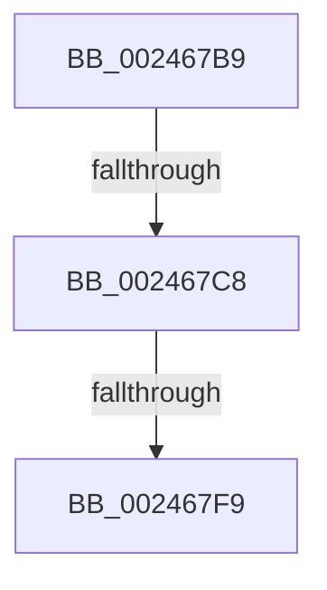

# sub_002467B9

- RVA: `0x002467B9`–`0x002467FE` (길이 `69` bytes)
- VA: `0x00000001402467B9`
- 실행 섹션: `.text`
- PDB 이름 있음: `아니요`; PDB Function 태그: `아니요`
- unwind 정보 RVA: `0x000620B0`
- 디코드: `16`개 명령, `69/69` bytes 표시
- 미해석 바이트: `0` (있으면 어셈블리에 `.byte`로 보존)

> 이 문서는 커널 이미지의 기계어와 PDB 기호를 분석해 생성했습니다. 4번과 5번은 함수 원형과 자료형을 바이너리 사용 방식에서 추정한 C 해석이며 원본 소스 복구 결과는 아닙니다.

## 1. Dependencies

- 직접 호출 지점: **3**; 고유 호출 대상: **3**
- 직접 호출자로 확인된 함수: **0**
- RIP 상대 이미지 참조: **0**

### Outgoing calls
- `0x002467C8` → [ExAcquireSpinLockExclusive](ExAcquireSpinLockExclusive_function_00248690.md) (function, `0x00248690`)
- `0x002467D7` → [MiRestockOverCommit](../40/MiRestockOverCommit_function_00407D94.md) (function, `0x00407D94`)
- `0x002467EB` → [MiReleaseSpinLockExclusive](MiReleaseSpinLockExclusive_function_002482C0.md) (function, `0x002482C0`)

### Direct callers
- 이 함수 시작 RVA로 연결되는 직접 call은 확인되지 않았습니다. 간접 호출은 완전히 역산할 수 없습니다.

### Static image references
- 디코드된 RIP-relative 메모리 참조가 없습니다.

## 2. Other-region calls and transfers

- 다른 실행 섹션으로 향하는 call: **0**
- call이 아닌 외부 분기/꼬리 이동: **3**
  - `0x002467C6` → [sub_0024680E](Unknown_function_0024680E.md) (`tail-transfer`)
  - `0x002467F3` → [sub_00246311 + 0x55](Unknown_function_00246311.md) (`tail-transfer`)
  - `0x002467F9` → [sub_00246508 + 0x21](Unknown_function_00246508.md) (`tail-transfer`)

## 3. Assembly (complete function range)

```asm
002467B9  44 0F 20 C0                     mov rax, cr8
002467BD  48 8D 8D F8 41 00 00            lea rcx, [rbp + 0x41f8]
002467C4  3C 02                           cmp al, 2
002467C6  74 46                           je 0x14024680e
002467C8  E8 C3 1E 00 00                  call 0x140248690
002467CD  88 44 24 78                     mov byte ptr [rsp + 0x78], al
002467D1  49 8B D7                        mov rdx, r15
002467D4  48 8B CD                        mov rcx, rbp
002467D7  E8 B8 15 1C 00                  call 0x140407d94
002467DC  0F B6 54 24 78                  movzx edx, byte ptr [rsp + 0x78]
002467E1  48 8D 8D F8 41 00 00            lea rcx, [rbp + 0x41f8]
002467E8  4C 8B F8                        mov r15, rax
002467EB  E8 D0 1A 00 00                  call 0x1402482c0
002467F0  4D 85 FF                        test r15, r15
002467F3  0F 84 6D FB FF FF               je 0x140246366
002467F9  E9 2B FD FF FF                  jmp 0x140246529
```

## 4. C-style interpretation (structured pseudocode)

```c
__int64 __fastcall sub_002467B9(__int64 a1, __int64 a2, __int64 a3, __int64 a4, __int64 a5, __int64 a6, __int64 a7, __int64 a8, __int64 a9, __int64 a10, __int64 a11, __int64 a12, __int64 a13, __int64 a14, unsigned __int8 a15)
{
    __int64 result;
    unsigned __int8 v_stack_p78;

    result = ExAcquireSpinLockExclusive(v_rbp + 16888, a2, a3, a4);
    v_stack_p78 = (unsigned __int8)(result);
    result = MiRestockOverCommit(v_rbp, v_r15, a3, a4);
    result = MiReleaseSpinLockExclusive(v_rbp + 16888, a15, a3, a4);
}
```

## 5. (Beta) C Style

```c
int64_t sub_002467B9(int64_t Arg1, int64_t Arg2, int64_t Arg3, int64_t Arg4, uint64_t Arg5, uint64_t Arg6, uint64_t Arg7, uint64_t Arg8, uint64_t Arg9, uint64_t Arg10, uint64_t Arg11, uint64_t Arg12, uint64_t Arg13, uint64_t Arg14, uint8_t Arg15)
{
    int64_t result;
    uint8_t v_stack_p78;

    result = ExAcquireSpinLockExclusive(local_rbp + 16888, Arg2, Arg3, Arg4);
    v_stack_p78 = (uint8_t)(result);
    result = MiRestockOverCommit(local_rbp, local_r15, Arg3, Arg4);
    result = MiReleaseSpinLockExclusive(local_rbp + 16888, Arg15, Arg3, Arg4);
}
```

## 6. Execution-region graph

[열기: 2D/3D 그래프와 함수 탐색 컨트롤 패널](../../../control-panel.html?section=text&rva=0x002467B9&view=graph)

- 2D 그래프는 위에서 아래로 흐르고, 3D 그래프는 빈 공간을 드래그해 회전합니다. Shift+드래그는 이동, 휠은 확대·축소, 함수 노드 선택은 대상 보고서 이동입니다.

### Static fallback


