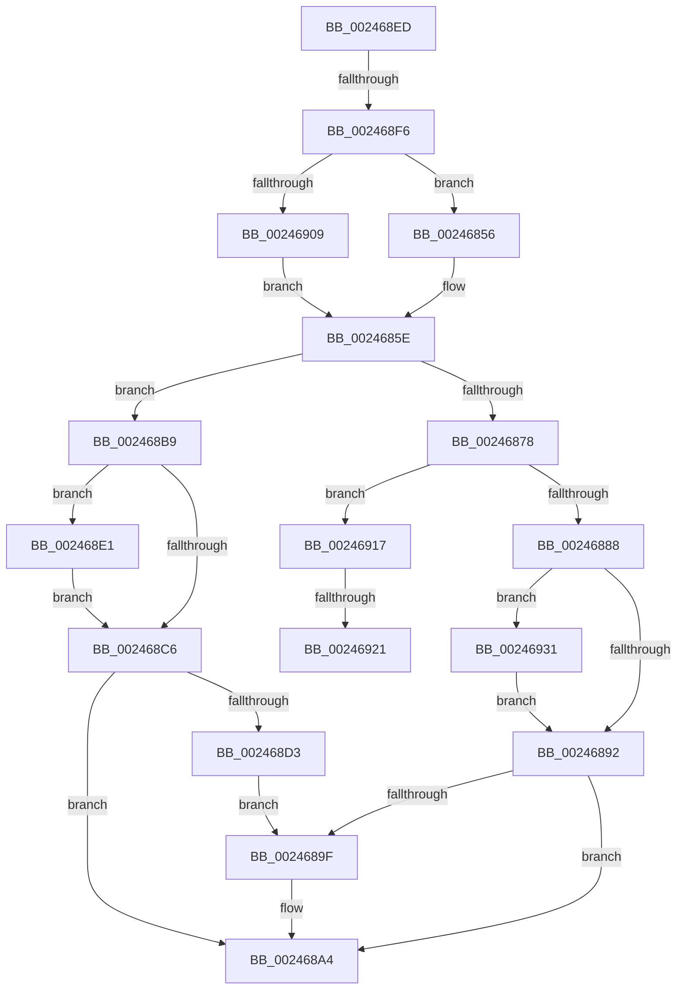

# sub_00246856

- RVA: `0x00246856`–`0x00246947` (길이 `241` bytes)
- VA: `0x0000000140246856`
- 실행 섹션: `.text`
- PDB 이름 있음: `아니요`; PDB Function 태그: `아니요`
- unwind 정보 RVA: `0x00062134`
- 디코드: `53`개 명령, `241/241` bytes 표시
- 미해석 바이트: `0` (있으면 어셈블리에 `.byte`로 보존)

> 이 문서는 커널 이미지의 기계어와 PDB 기호를 분석해 생성했습니다. 4번과 5번은 함수 원형과 자료형을 바이너리 사용 방식에서 추정한 C 해석이며 원본 소스 복구 결과는 아닙니다.

## 1. Dependencies

- 직접 호출 지점: **9**; 고유 호출 대상: **5**
- 직접 호출자로 확인된 함수: **0**
- RIP 상대 이미지 참조: **0**

### Outgoing calls
- `0x00246859` → [ExAcquireSpinLockExclusiveAtDpcLevel](ExAcquireSpinLockExclusiveAtDpcLevel_function_00248E80.md) (function, `0x00248E80`)
- `0x0024689F` → [KeResetEvent](KeResetEvent_function_00248350.md) (function, `0x00248350`)
- `0x002468AF` → [MiReleaseSpinLockExclusive](MiReleaseSpinLockExclusive_function_002482C0.md) (function, `0x002482C0`)
- `0x002468D3` → [KeResetEvent](KeResetEvent_function_00248350.md) (function, `0x00248350`)
- `0x002468E6` → [KeSetEvent](../33/KeSetEvent_function_0033F310.md) (function, `0x0033F310`)
- `0x00246909` → [ExAcquireSpinLockExclusive](ExAcquireSpinLockExclusive_function_00248690.md) (function, `0x00248690`)
- `0x00246926` → [KeSetEvent](../33/KeSetEvent_function_0033F310.md) (function, `0x0033F310`)
- `0x00246931` → [KeResetEvent](KeResetEvent_function_00248350.md) (function, `0x00248350`)
- `0x0024693D` → [KeResetEvent](KeResetEvent_function_00248350.md) (function, `0x00248350`)

### Direct callers
- 이 함수 시작 RVA로 연결되는 직접 call은 확인되지 않았습니다. 간접 호출은 완전히 역산할 수 없습니다.

### Static image references
- 디코드된 RIP-relative 메모리 참조가 없습니다.

## 2. Other-region calls and transfers

- 다른 실행 섹션으로 향하는 call: **0**
- call이 아닌 외부 분기/꼬리 이동: **4**
  - `0x002468B4` → [sub_00246311 + 0x5C](Unknown_function_00246311.md) (`tail-transfer`)
  - `0x002468F0` → [sub_00246508 + 0xB4](Unknown_function_00246508.md) (`tail-transfer`)
  - `0x0024691B` → [sub_006D7F90](../6D/Unknown_function_006D7F90.md) (`tail-transfer`)
  - `0x0024692C` → [sub_006D7F90](../6D/Unknown_function_006D7F90.md) (`tail-transfer`)

## 3. Assembly (complete function range)

```asm
00246856  41 B7 11                        mov r15b, 0x11
00246859  E8 22 26 00 00                  call 0x140248e80
0024685E  48 8B 95 40 4B 00 00            mov rdx, qword ptr [rbp + 0x4b40]
00246865  48 8B 8D D8 41 00 00            mov rcx, qword ptr [rbp + 0x41d8]
0024686C  4C 8B 85 E0 41 00 00            mov r8, qword ptr [rbp + 0x41e0]
00246873  48 3B D1                        cmp rdx, rcx
00246876  72 41                           jb 0x1402468b9
00246878  48 8B 8D 30 01 00 00            mov rcx, qword ptr [rbp + 0x130]
0024687F  49 3B D0                        cmp rdx, r8
00246882  0F 83 8F 00 00 00               jae 0x140246917
00246888  83 79 04 01                     cmp dword ptr [rcx + 4], 1
0024688C  0F 84 9F 00 00 00               je 0x140246931
00246892  48 8B 8D 28 01 00 00            mov rcx, qword ptr [rbp + 0x128]
00246899  83 79 04 01                     cmp dword ptr [rcx + 4], 1
0024689D  75 05                           jne 0x1402468a4
0024689F  E8 AC 1A 00 00                  call 0x140248350
002468A4  48 8D 8D F8 41 00 00            lea rcx, [rbp + 0x41f8]
002468AB  41 0F B6 D7                     movzx edx, r15b
002468AF  E8 0C 1A 00 00                  call 0x1402482c0
002468B4  E9 B4 FA FF FF                  jmp 0x14024636d
002468B9  48 8B 8D 28 01 00 00            mov rcx, qword ptr [rbp + 0x128]
002468C0  83 79 04 00                     cmp dword ptr [rcx + 4], 0
002468C4  74 1B                           je 0x1402468e1
002468C6  48 8B 8D 30 01 00 00            mov rcx, qword ptr [rbp + 0x130]
002468CD  83 79 04 01                     cmp dword ptr [rcx + 4], 1
002468D1  75 D1                           jne 0x1402468a4
002468D3  E8 78 1A 00 00                  call 0x140248350
002468D8  48 8B 8D 38 01 00 00            mov rcx, qword ptr [rbp + 0x138]
002468DF  EB BE                           jmp 0x14024689f
002468E1  45 33 C0                        xor r8d, r8d
002468E4  33 D2                           xor edx, edx
002468E6  E8 25 8A 0F 00                  call 0x14033f310
002468EB  EB D9                           jmp 0x1402468c6
002468ED  49 3B D0                        cmp rdx, r8
002468F0  0F 83 C6 FC FF FF               jae 0x1402465bc
002468F6  44 0F 20 C0                     mov rax, cr8
002468FA  48 8D 8D F8 41 00 00            lea rcx, [rbp + 0x41f8]
00246901  3C 02                           cmp al, 2
00246903  0F 84 4D FF FF FF               je 0x140246856
00246909  E8 82 1D 00 00                  call 0x140248690
0024690E  44 0F B6 F8                     movzx r15d, al
00246912  E9 47 FF FF FF                  jmp 0x14024685e
00246917  83 79 04 00                     cmp dword ptr [rcx + 4], 0
0024691B  0F 85 6F 16 49 00               jne 0x1406d7f90
00246921  45 33 C0                        xor r8d, r8d
00246924  33 D2                           xor edx, edx
00246926  E8 E5 89 0F 00                  call 0x14033f310
0024692B  90                              nop
0024692C  E9 5F 16 49 00                  jmp 0x1406d7f90
00246931  E8 1A 1A 00 00                  call 0x140248350
00246936  48 8B 8D 38 01 00 00            mov rcx, qword ptr [rbp + 0x138]
0024693D  E8 0E 1A 00 00                  call 0x140248350
00246942  E9 4B FF FF FF                  jmp 0x140246892
```

## 4. C-style interpretation (structured pseudocode)

```c
__int64 __fastcall sub_00246856(void)
{
    __int64 result;

    result = ExAcquireSpinLockExclusiveAtDpcLevel(a1, a2, a3, a4);
loc_0024685E:
    if ((*(unsigned __int64 *)(v_rbp + 19264)) < (*(unsigned __int64 *)(v_rbp + 16856))) goto loc_002468B9;
    if ((*(unsigned __int64 *)(v_rbp + 19264)) >= (*(unsigned __int64 *)(v_rbp + 16864))) goto loc_00246917;
    if ((*(unsigned int *)(*(unsigned __int64 *)(v_rbp + 304) + 4)) == 1) goto loc_00246931;
loc_00246892:
    if ((*(unsigned int *)(*(unsigned __int64 *)(v_rbp + 296) + 4)) == 1) {
        result = KeResetEvent(*(unsigned __int64 *)(v_rbp + 296), *(unsigned __int64 *)(v_rbp + 19264), *(unsigned __int64 *)(v_rbp + 16864), a4);
    }
    result = MiReleaseSpinLockExclusive(v_rbp + 16888, 17, *(unsigned __int64 *)(v_rbp + 16864), a4);
loc_002468B9:
    if ((*(unsigned int *)(*(unsigned __int64 *)(v_rbp + 296) + 4)) == 0) goto loc_002468E1;
loc_002468C6:
    if ((*(unsigned int *)(*(unsigned __int64 *)(v_rbp + 304) + 4)) != 1) goto loc_002468A4;
    result = KeResetEvent(*(unsigned __int64 *)(v_rbp + 304), 17, *(unsigned __int64 *)(v_rbp + 16864), a4);
    goto loc_0024689F;
loc_002468E1:
    a3 = 0;
    a2 = 0;
    result = KeSetEvent(*(unsigned __int64 *)(v_rbp + 312), a2, a3, a4);
    goto loc_002468C6;
loc_00246917:
    a3 = 0;
    a2 = 0;
    result = KeSetEvent(*(unsigned __int64 *)(v_rbp + 312), a2, a3, a4);
loc_00246931:
    result = KeResetEvent(*(unsigned __int64 *)(v_rbp + 312), a2, a3, a4);
    result = KeResetEvent(*(unsigned __int64 *)(v_rbp + 312), a2, a3, a4);
    goto loc_00246892;
}
```

## 5. (Beta) C Style

```c
void sub_00246856(void)
{
    int64_t result;

    result = ExAcquireSpinLockExclusiveAtDpcLevel(a1, a2, a3, a4);
loc_0024685E:
    if ((*(uint64_t *)(local_rbp + 0x4B40)) < (*(uint64_t *)(local_rbp + 0x41D8))) goto loc_002468B9;
    if ((*(uint64_t *)(local_rbp + 0x4B40)) >= (*(uint64_t *)(local_rbp + 0x41E0))) goto loc_00246917;
    if ((*(uint32_t *)(*(uint64_t *)(local_rbp + 0x130) + 0x4)) == 1) goto loc_00246931;
loc_00246892:
    if ((*(uint32_t *)(*(uint64_t *)(local_rbp + 0x128) + 0x4)) == 1) {
        result = KeResetEvent(*(uint64_t *)(local_rbp + 0x128), *(uint64_t *)(local_rbp + 0x4B40), *(uint64_t *)(local_rbp + 0x41E0), a4);
    }
    result = MiReleaseSpinLockExclusive(local_rbp + 16888, 17, *(uint64_t *)(local_rbp + 0x41E0), a4);
loc_002468B9:
    if ((*(uint32_t *)(*(uint64_t *)(local_rbp + 0x128) + 0x4)) == 0) goto loc_002468E1;
loc_002468C6:
    if ((*(uint32_t *)(*(uint64_t *)(local_rbp + 0x130) + 0x4)) != 1) goto loc_002468A4;
    result = KeResetEvent(*(uint64_t *)(local_rbp + 0x130), 17, *(uint64_t *)(local_rbp + 0x41E0), a4);
    goto loc_0024689F;
loc_002468E1:
    a3 = 0;
    a2 = 0;
    result = KeSetEvent(*(uint64_t *)(local_rbp + 0x138), a2, a3, a4);
    goto loc_002468C6;
loc_00246917:
    a3 = 0;
    a2 = 0;
    result = KeSetEvent(*(uint64_t *)(local_rbp + 0x138), a2, a3, a4);
loc_00246931:
    result = KeResetEvent(*(uint64_t *)(local_rbp + 0x138), a2, a3, a4);
    result = KeResetEvent(*(uint64_t *)(local_rbp + 0x138), a2, a3, a4);
    goto loc_00246892;
}
```

## 6. Execution-region graph

[열기: 2D/3D 그래프와 함수 탐색 컨트롤 패널](../../../control-panel.html?section=text&rva=0x00246856&view=graph)

- 2D 그래프는 위에서 아래로 흐르고, 3D 그래프는 빈 공간을 드래그해 회전합니다. Shift+드래그는 이동, 휠은 확대·축소, 함수 노드 선택은 대상 보고서 이동입니다.

### Static fallback


