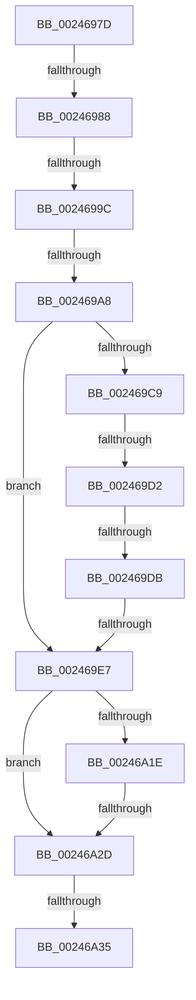

# sub_0024697D

- RVA: `0x0024697D`–`0x00246A4B` (길이 `206` bytes)
- VA: `0x000000014024697D`
- 실행 섹션: `.text`
- PDB 이름 있음: `아니요`; PDB Function 태그: `아니요`
- unwind 정보 RVA: `0x00062184`
- 디코드: `50`개 명령, `206/206` bytes 표시
- 미해석 바이트: `0` (있으면 어셈블리에 `.byte`로 보존)

> 이 문서는 커널 이미지의 기계어와 PDB 기호를 분석해 생성했습니다. 4번과 5번은 함수 원형과 자료형을 바이너리 사용 방식에서 추정한 C 해석이며 원본 소스 복구 결과는 아닙니다.

## 1. Dependencies

- 직접 호출 지점: **0**; 고유 호출 대상: **0**
- 직접 호출자로 확인된 함수: **0**
- RIP 상대 이미지 참조: **0**

### Outgoing calls
- 직접 디코드된 call 명령이 없습니다.

### Direct callers
- 이 함수 시작 RVA로 연결되는 직접 call은 확인되지 않았습니다. 간접 호출은 완전히 역산할 수 없습니다.

### Static image references
- 디코드된 RIP-relative 메모리 참조가 없습니다.

## 2. Other-region calls and transfers

- 다른 실행 섹션으로 향하는 call: **0**
- call이 아닌 외부 분기/꼬리 이동: **8**
  - `0x00246982` → [sub_00246B37](Unknown_function_00246B37.md) (`tail-transfer`)
  - `0x00246996` → [sub_00246B1B + 0x15](Unknown_function_00246B1B.md) (`tail-transfer`)
  - `0x002469A2` → [sub_00246B1B + 0x15](Unknown_function_00246B1B.md) (`tail-transfer`)
  - `0x002469CC` → [sub_00246B1B](Unknown_function_00246B1B.md) (`tail-transfer`)
  - `0x002469D5` → [sub_00246C79](Unknown_function_00246C79.md) (`tail-transfer`)
  - `0x002469E1` → [sub_00246B1B + 0x15](Unknown_function_00246B1B.md) (`tail-transfer`)
  - `0x00246A2B` → [sub_00246A4C](Unknown_function_00246A4C.md) (`tail-transfer`)
  - `0x00246A33` → [sub_00246A4C](Unknown_function_00246A4C.md) (`tail-transfer`)

## 3. Assembly (complete function range)

```asm
0024697D  48 89 7C 24 38                  mov qword ptr [rsp + 0x38], rdi
00246982  0F 84 AF 01 00 00               je 0x140246b37
00246988  48 8B 41 28                     mov rax, qword ptr [rcx + 0x28]
0024698C  48 0F BA E0 28                  bt rax, 0x28
00246991  48 89 5C 24 58                  mov qword ptr [rsp + 0x58], rbx
00246996  0F 82 94 01 00 00               jb 0x140246b30
0024699C  48 0F BA 61 28 35               bt qword ptr [rcx + 0x28], 0x35
002469A2  0F 82 88 01 00 00               jb 0x140246b30
002469A8  8B 41 20                        mov eax, dword ptr [rcx + 0x20]
002469AB  33 DB                           xor ebx, ebx
002469AD  48 8B 51 18                     mov rdx, qword ptr [rcx + 0x18]
002469B1  49 B9 FF FF FF FF FF FF FF 3F   movabs r9, 0x3fffffffffffffff
002469BB  49 23 D1                        and rdx, r9
002469BE  44 8B CB                        mov r9d, ebx
002469C1  8D 7B 01                        lea edi, [rbx + 1]
002469C4  66 85 C0                        test ax, ax
002469C7  74 1E                           je 0x1402469e7
002469C9  66 3B C7                        cmp ax, di
002469CC  0F 85 49 01 00 00               jne 0x140246b1b
002469D2  48 85 D2                        test rdx, rdx
002469D5  0F 84 9E 02 00 00               je 0x140246c79
002469DB  44 8B CF                        mov r9d, edi
002469DE  45 85 C9                        test r9d, r9d
002469E1  0F 84 49 01 00 00               je 0x140246b30
002469E7  48 8B 51 08                     mov rdx, qword ptr [rcx + 8]
002469EB  66 45 85 C0                     test r8w, r8w
002469EF  49 BB 00 00 00 00 80 F6 FF FF   movabs r11, 0xfffff68000000000
002469F9  0F 94 C3                        sete bl
002469FC  49 8B C3                        mov rax, r11
002469FF  49 B9 78 FF FF FF 3F 00 00 00   movabs r9, 0x3fffffff78
00246A09  49 BA 00 00 00 00 00 00 00 80   movabs r10, 0x8000000000000000
00246A13  4C 03 C8                        add r9, rax
00246A16  49 0B D2                        or rdx, r10
00246A19  49 3B D1                        cmp rdx, r9
00246A1C  77 0F                           ja 0x140246a2d
00246A1E  48 8B 51 08                     mov rdx, qword ptr [rcx + 8]
00246A22  49 0B D2                        or rdx, r10
00246A25  49 8B C3                        mov rax, r11
00246A28  48 3B D0                        cmp rdx, rax
00246A2B  73 1F                           jae 0x140246a4c
00246A2D  0F B6 41 23                     movzx eax, byte ptr [rcx + 0x23]
00246A31  A8 20                           test al, 0x20
00246A33  74 17                           je 0x140246a4c
00246A35  24 DF                           and al, 0xdf
00246A37  88 41 23                        mov byte ptr [rcx + 0x23], al
00246A3A  8B C3                           mov eax, ebx
00246A3C  48 8B 5C 24 58                  mov rbx, qword ptr [rsp + 0x58]
00246A41  48 8B 7C 24 38                  mov rdi, qword ptr [rsp + 0x38]
00246A46  48 83 C4 48                     add rsp, 0x48
00246A4A  C3                              ret
```

## 4. C-style interpretation (structured pseudocode)

```c
__int64 __fastcall sub_0024697D(__int64 a1, __int64 a2, unsigned __int16 a3, __int64 a4, __int64 a5, __int64 a6, __int64 a7, __int64 a8, __int64 a9, __int64 a10, __int64 a11)
{
    __int64 result;
    __int64 v_rbx;
    __int64 v_rsp;
    unsigned __int64 v_stack_p38;
    unsigned __int64 v_stack_p58;

    v_stack_p38 = v_rdi;
    v_stack_p58 = v_rbx;
    v_rbx = 0;
    a2 = (*(unsigned __int64 *)(a1 + 24)) & (a4);
    if ((unsigned __int16)((unsigned int)(*(unsigned int *)(a1 + 32))) == 0) goto loc_002469E7;
loc_002469E7:
    v_rbx = (a3 == 0) ? 1 : 0;
    a4 = ((unsigned int)((unsigned int)(v_rbx + 1))) + (v_r11);
    a2 = (*(unsigned __int64 *)(a1 + 8)) | (v_r10);
    if (a2 > a4) goto loc_00246A2D;
    a2 = (*(unsigned __int64 *)(a1 + 8)) | (v_r10);
loc_00246A2D:
    result = (unsigned __int8)((*(unsigned __int8 *)(a1 + 35)) & (223));
    *(unsigned __int8 *)(a1 + 35) = (unsigned __int8)(result);
    v_rsp = (v_rsp) + (72);
    return (unsigned int)((unsigned int)(v_rbx));
}
```

## 5. (Beta) C Style

```c
int64_t sub_0024697D(void *Arg1, int64_t Arg2, uint16_t Arg3, int64_t Arg4, uint64_t Arg5, uint64_t Arg6, int64_t Arg7, uint64_t Arg8, uint64_t Arg9, uint64_t Arg10, int64_t Arg11)
{
    uint8_t *arg1 = (uint8_t *)Arg1;

    int64_t result;
    int64_t local_rbx;
    int64_t local_rsp;
    uint64_t v_stack_p38;
    uint64_t v_stack_p58;

    v_stack_p38 = local_rdi;
    v_stack_p58 = local_rbx;
    local_rbx = 0;
    Arg2 = (*(uint64_t *)(arg1 + 0x18)) & (Arg4);
    if ((uint16_t)((uint32_t)(*(uint32_t *)(arg1 + 0x20))) == 0) goto loc_002469E7;
loc_002469E7:
    local_rbx = (Arg3 == 0) ? 1 : 0;
    Arg4 = ((uint32_t)((uint32_t)(local_rbx + 1))) + (local_r11);
    Arg2 = (*(uint64_t *)(arg1 + 0x8)) | (local_r10);
    if (Arg2 > Arg4) goto loc_00246A2D;
    Arg2 = (*(uint64_t *)(arg1 + 0x8)) | (local_r10);
loc_00246A2D:
    result = (uint8_t)((*(uint8_t *)(arg1 + 0x23)) & (223));
    *(uint8_t *)(arg1 + 0x23) = (uint8_t)(result);
    local_rsp = (local_rsp) + (72);
    return (uint32_t)((uint32_t)(local_rbx));
}
```

### 관측된 메모리 오프셋

구조체 형식이 확인되지 않은 접근은 인자 기준의 오프셋으로만 기록했습니다.

| 기준 인자 | 오프셋 표현 | 폭 (bit) | 접근 |
|---|---:|---:|---|
| `Arg1` | `+ 0x8` | `64` | `R` |
| `Arg1` | `+ 0x18` | `64` | `R` |
| `Arg1` | `+ 0x20` | `32` | `R` |
| `Arg1` | `+ 0x23` | `8` | `R` |
| `Arg1` | `+ 0x23` | `8` | `W` |
| `Arg1` | `+ 0x28` | `64` | `R` |

## 6. Execution-region graph

[열기: 2D/3D 그래프와 함수 탐색 컨트롤 패널](../../../control-panel.html?section=text&rva=0x0024697D&view=graph)

- 2D 그래프는 위에서 아래로 흐르고, 3D 그래프는 빈 공간을 드래그해 회전합니다. Shift+드래그는 이동, 휠은 확대·축소, 함수 노드 선택은 대상 보고서 이동입니다.

### Static fallback


