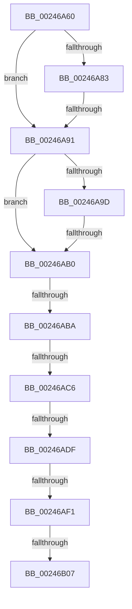

# sub_00246A60

- RVA: `0x00246A60`–`0x00246B1B` (길이 `187` bytes)
- VA: `0x0000000140246A60`
- 실행 섹션: `.text`
- PDB 이름 있음: `아니요`; PDB Function 태그: `아니요`
- unwind 정보 RVA: `0x000621C8`
- 디코드: `42`개 명령, `187/187` bytes 표시
- 미해석 바이트: `0` (있으면 어셈블리에 `.byte`로 보존)

> 이 문서는 커널 이미지의 기계어와 PDB 기호를 분석해 생성했습니다. 4번과 5번은 함수 원형과 자료형을 바이너리 사용 방식에서 추정한 C 해석이며 원본 소스 복구 결과는 아닙니다.

## 1. Dependencies

- 직접 호출 지점: **0**; 고유 호출 대상: **0**
- 직접 호출자로 확인된 함수: **0**
- RIP 상대 이미지 참조: **1**

### Outgoing calls
- 직접 디코드된 call 명령이 없습니다.

### Direct callers
- 이 함수 시작 RVA로 연결되는 직접 call은 확인되지 않았습니다. 간접 호출은 완전히 역산할 수 없습니다.

### Static image references
- `0x00246A6F` → RVA `0x00E38D00` (`.data`; read)

## 2. Other-region calls and transfers

- 다른 실행 섹션으로 향하는 call: **0**
- call이 아닌 외부 분기/꼬리 이동: **8**
  - `0x00246A8B` → [sub_00246B53 + 0xF](Unknown_function_00246B53.md) (`tail-transfer`)
  - `0x00246AAA` → [sub_00246C88 + 0x8](Unknown_function_00246C88.md) (`tail-transfer`)
  - `0x00246AB4` → [sub_00246B53](Unknown_function_00246B53.md) (`tail-transfer`)
  - `0x00246AC0` → [sub_00246B53 + 0xEE](Unknown_function_00246B53.md) (`tail-transfer`)
  - `0x00246AD9` → [sub_00246B53 + 0xEE](Unknown_function_00246B53.md) (`tail-transfer`)
  - `0x00246AEB` → [sub_00246B53 + 0xBB](Unknown_function_00246B53.md) (`tail-transfer`)
  - `0x00246B01` → [sub_00246B53 + 0x11B](Unknown_function_00246B53.md) (`tail-transfer`)
  - `0x00246B16` → [sub_0024697D + 0xBD](Unknown_function_0024697D.md) (`tail-transfer`)

## 3. Assembly (complete function range)

```asm
00246A60  48 89 6C 24 60                  mov qword ptr [rsp + 0x60], rbp
00246A65  48 89 74 24 40                  mov qword ptr [rsp + 0x40], rsi
00246A6A  4C 89 64 24 30                  mov qword ptr [rsp + 0x30], r12
00246A6F  4C 8D 25 8A 22 BF 00            lea r12, [rip + 0xbf228a]
00246A76  48 8B 34 C2                     mov rsi, qword ptr [rdx + rax*8]
00246A7A  48 8B 41 28                     mov rax, qword ptr [rcx + 0x28]
00246A7E  48 85 C0                        test rax, rax
00246A81  79 0E                           jns 0x140246a91
00246A83  8B 41 10                        mov eax, dword ptr [rcx + 0x10]
00246A86  48 0F BA E0 0A                  bt rax, 0xa
00246A8B  0F 82 D1 00 00 00               jb 0x140246b62
00246A91  48 8B 41 08                     mov rax, qword ptr [rcx + 8]
00246A95  49 0B C2                        or rax, r10
00246A98  49 3B C1                        cmp rax, r9
00246A9B  77 13                           ja 0x140246ab0
00246A9D  48 8B 51 08                     mov rdx, qword ptr [rcx + 8]
00246AA1  49 0B D2                        or rdx, r10
00246AA4  49 8B C3                        mov rax, r11
00246AA7  48 3B D0                        cmp rdx, rax
00246AAA  0F 83 E0 01 00 00               jae 0x140246c90
00246AB0  66 45 85 C0                     test r8w, r8w
00246AB4  0F 84 99 00 00 00               je 0x140246b53
00246ABA  4C 8B CF                        mov r9, rdi
00246ABD  49 3B F4                        cmp rsi, r12
00246AC0  0F 85 7B 01 00 00               jne 0x140246c41
00246AC6  65 4C 8B 04 25 20 00 00 00      mov r8, qword ptr gs:[0x20]
00246ACF  41 8B 90 9C 8B 00 00            mov edx, dword ptr [r8 + 0x8b9c]
00246AD6  83 FA FF                        cmp edx, -1
00246AD9  0F 84 62 01 00 00               je 0x140246c41
00246ADF  48 63 C2                        movsxd rax, edx
00246AE2  48 FF C0                        inc rax
00246AE5  48 3D 00 01 00 00               cmp rax, 0x100
00246AEB  0F 87 1D 01 00 00               ja 0x140246c0e
00246AF1  8D 4A 01                        lea ecx, [rdx + 1]
00246AF4  8B C2                           mov eax, edx
00246AF6  F0 41 0F B1 88 9C 8B 00 00      lock cmpxchg dword ptr [r8 + 0x8b9c], ecx
00246AFF  8B D0                           mov edx, eax
00246B01  0F 85 67 01 00 00               jne 0x140246c6e
00246B07  48 8B 6C 24 60                  mov rbp, qword ptr [rsp + 0x60]
00246B0C  48 8B 74 24 40                  mov rsi, qword ptr [rsp + 0x40]
00246B11  4C 8B 64 24 30                  mov r12, qword ptr [rsp + 0x30]
00246B16  E9 1F FF FF FF                  jmp 0x140246a3a
```

## 4. C-style interpretation (structured pseudocode)

```c
__int64 __fastcall sub_00246A60(__int64 a1, __int64 a2, unsigned __int16 a3, __int64 a4, __int64 a5, __int64 a6, __int64 a7, __int64 a8, __int64 a9, __int64 a10, __int64 a11, __int64 a12)
{
    __int64 result;
    unsigned __int64 v_stack_p30;
    unsigned __int64 v_stack_p40;
    unsigned __int64 v_stack_p60;

    v_stack_p60 = v_rbp;
    v_stack_p40 = v_rsi;
    v_stack_p30 = v_r12;
    if (!sign_flag) goto loc_00246A91;
loc_00246A91:
    result = (*(unsigned __int64 *)(a1 + 8)) | (v_r10);
    if (result > a4) goto loc_00246AB0;
    a2 = (*(unsigned __int64 *)(a1 + 8)) | (v_r10);
loc_00246AB0:
    result = ((int)((unsigned int)((unsigned int)(*(unsigned int *)(*(unsigned __int64 *)(gs_base + (0 + 32)) + 35740))))) + 1;
}
```

## 5. (Beta) C Style

```c
int64_t sub_00246A60(void *Arg1, void *Arg2, uint16_t Arg3, int64_t Arg4, uint64_t Arg5, int64_t Arg6, uint64_t Arg7, int64_t Arg8, uint64_t Arg9, uint64_t Arg10, uint64_t Arg11, int64_t Arg12)
{
    uint8_t *arg1 = (uint8_t *)Arg1;
    uint8_t *arg2 = (uint8_t *)Arg2;

    int64_t result;
    uint64_t v_stack_p30;
    uint64_t v_stack_p40;
    uint64_t v_stack_p60;

    v_stack_p60 = local_rbp;
    v_stack_p40 = local_rsi;
    v_stack_p30 = local_r12;
    if (!sign_flag) goto loc_00246A91;
loc_00246A91:
    result = (*(uint64_t *)(arg1 + 0x8)) | (local_r10);
    if (result > Arg4) goto loc_00246AB0;
    Arg2 = (*(uint64_t *)(arg1 + 0x8)) | (local_r10);
loc_00246AB0:
    result = ((int32_t)((uint32_t)((uint32_t)(*(uint32_t *)(*(uint64_t *)(gs_base + (0 + 0x20)) + 0x8B9C))))) + 1;
}
```

### 관측된 메모리 오프셋

구조체 형식이 확인되지 않은 접근은 인자 기준의 오프셋으로만 기록했습니다.

| 기준 인자 | 오프셋 표현 | 폭 (bit) | 접근 |
|---|---:|---:|---|
| `Arg1` | `+ 0x8` | `64` | `R` |
| `Arg1` | `+ 0x10` | `32` | `R` |
| `Arg1` | `+ 0x28` | `64` | `R` |
| `Arg2` | `+ 0x0 + rax*8` | `64` | `R` |

## 6. Execution-region graph

[열기: 2D/3D 그래프와 함수 탐색 컨트롤 패널](../../../control-panel.html?section=text&rva=0x00246A60&view=graph)

- 2D 그래프는 위에서 아래로 흐르고, 3D 그래프는 빈 공간을 드래그해 회전합니다. Shift+드래그는 이동, 휠은 확대·축소, 함수 노드 선택은 대상 보고서 이동입니다.

### Static fallback


