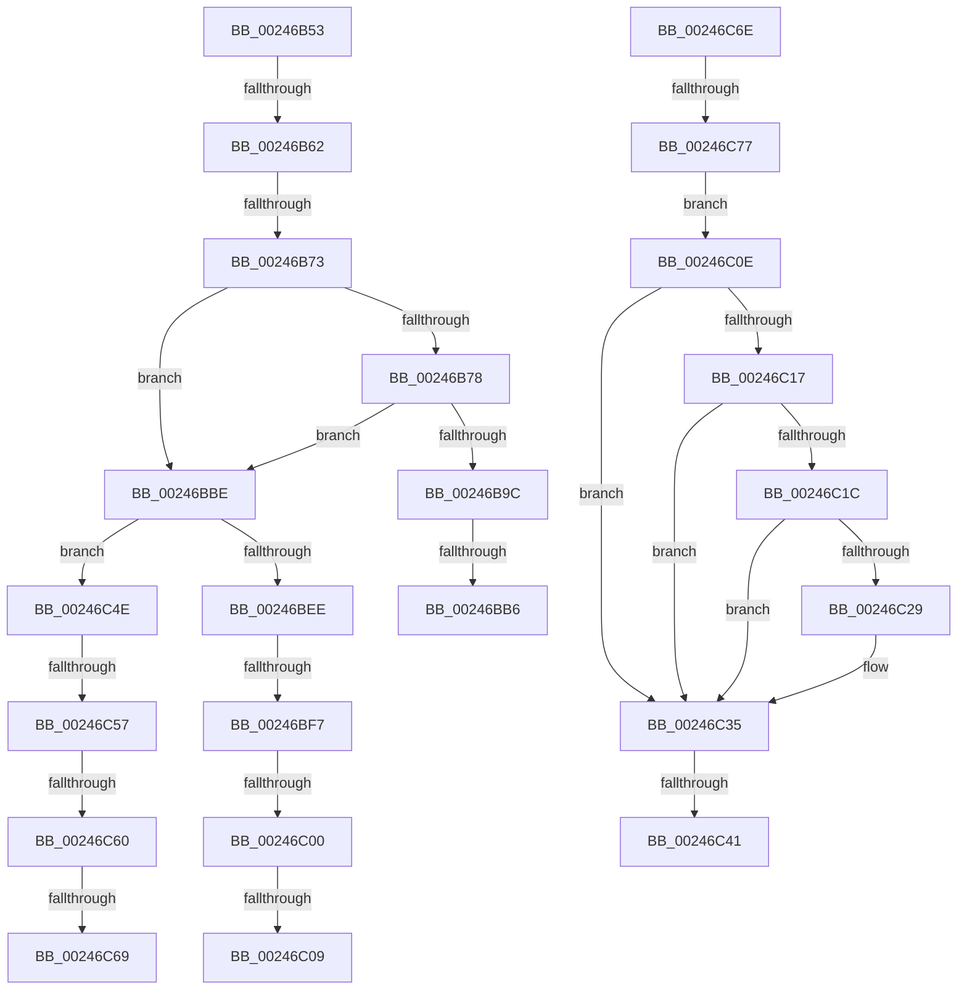

# sub_00246B53

- RVA: `0x00246B53`–`0x00246C79` (길이 `294` bytes)
- VA: `0x0000000140246B53`
- 실행 섹션: `.text`
- PDB 이름 있음: `아니요`; PDB Function 태그: `아니요`
- unwind 정보 RVA: `0x0006221C`
- 디코드: `65`개 명령, `294/294` bytes 표시
- 미해석 바이트: `0` (있으면 어셈블리에 `.byte`로 보존)

> 이 문서는 커널 이미지의 기계어와 PDB 기호를 분석해 생성했습니다. 4번과 5번은 함수 원형과 자료형을 바이너리 사용 방식에서 추정한 C 해석이며 원본 소스 복구 결과는 아닙니다.

## 1. Dependencies

- 직접 호출 지점: **0**; 고유 호출 대상: **0**
- 직접 호출자로 확인된 함수: **0**
- RIP 상대 이미지 참조: **0**

### Outgoing calls
- 직접 디코드된 call 명령이 없습니다.

### Direct callers
- 이 함수 시작 RVA로 연결되는 직접 call은 확인되지 않았습니다. 간접 호출은 완전히 역산할 수 없습니다.

### Static image references
- 디코드된 RIP-relative 메모리 참조가 없습니다.

## 2. Other-region calls and transfers

- 다른 실행 섹션으로 향하는 call: **0**
- call이 아닌 외부 분기/꼬리 이동: **15**
  - `0x00246B5C` → [sub_00246A60 + 0x5A](Unknown_function_00246A60.md) (`tail-transfer`)
  - `0x00246B6D` → [sub_00246C9F](Unknown_function_00246C9F.md) (`tail-transfer`)
  - `0x00246BB0` → [sub_00246C88](Unknown_function_00246C88.md) (`tail-transfer`)
  - `0x00246BB9` → [sub_00246A60 + 0x66](Unknown_function_00246A60.md) (`tail-transfer`)
  - `0x00246BF1` → [sub_00246D01 + 0xA2](Unknown_function_00246D01.md) (`tail-transfer`)
  - `0x00246BFA` → [sub_00246A60 + 0x5A](Unknown_function_00246A60.md) (`tail-transfer`)
  - `0x00246C03` → [sub_00246A60 + 0x5A](Unknown_function_00246A60.md) (`tail-transfer`)
  - `0x00246C09` → [sub_00246D01 + 0xAB](Unknown_function_00246D01.md) (`tail-transfer`)
  - `0x00246C3B` → [sub_00246A60 + 0xA7](Unknown_function_00246A60.md) (`tail-transfer`)
  - `0x00246C49` → [sub_00246A60 + 0xA7](Unknown_function_00246A60.md) (`tail-transfer`)
  - `0x00246C51` → [sub_00246D01](Unknown_function_00246D01.md) (`tail-transfer`)
  - `0x00246C5A` → [sub_00246A60 + 0x5A](Unknown_function_00246A60.md) (`tail-transfer`)
  - `0x00246C63` → [sub_00246A60 + 0x5A](Unknown_function_00246A60.md) (`tail-transfer`)
  - `0x00246C69` → [sub_00246D01 + 0xAB](Unknown_function_00246D01.md) (`tail-transfer`)
  - `0x00246C71` → [sub_00246A60 + 0x7F](Unknown_function_00246A60.md) (`tail-transfer`)

## 3. Assembly (complete function range)

```asm
00246B53  48 8B 41 18                     mov rax, qword ptr [rcx + 0x18]
00246B57  48 0F BA E0 3E                  bt rax, 0x3e
00246B5C  0F 83 58 FF FF FF               jae 0x140246aba
00246B62  48 83 BE 08 42 00 00 00         cmp qword ptr [rsi + 0x4208], 0
00246B6A  48 8B EF                        mov rbp, rdi
00246B6D  0F 85 2C 01 00 00               jne 0x140246c9f
00246B73  49 3B F4                        cmp rsi, r12
00246B76  75 46                           jne 0x140246bbe
00246B78  65 4C 8B 04 25 20 00 00 00      mov r8, qword ptr gs:[0x20]
00246B81  41 0F 0D 88 98 8B 00 00         prefetchw byte ptr [r8 + 0x8b98]
00246B89  41 8B 90 98 8B 00 00            mov edx, dword ptr [r8 + 0x8b98]
00246B90  48 8D 04 2A                     lea rax, [rdx + rbp]
00246B94  48 3D 00 01 00 00               cmp rax, 0x100
00246B9A  77 22                           ja 0x140246bbe
00246B9C  8D 0C 2A                        lea ecx, [rdx + rbp]
00246B9F  8B C2                           mov eax, edx
00246BA1  F0 41 0F B1 88 98 8B 00 00      lock cmpxchg dword ptr [r8 + 0x8b98], ecx
00246BAA  48 63 C8                        movsxd rcx, eax
00246BAD  48 3B CA                        cmp rcx, rdx
00246BB0  0F 85 D2 00 00 00               jne 0x140246c88
00246BB6  4C 8B CF                        mov r9, rdi
00246BB9  E9 08 FF FF FF                  jmp 0x140246ac6
00246BBE  48 8B C5                        mov rax, rbp
00246BC1  48 F7 D8                        neg rax
00246BC4  F0 48 01 86 80 4B 00 00         lock add qword ptr [rsi + 0x4b80], rax
00246BCC  F0 48 0F C1 86 40 4B 00 00      lock xadd qword ptr [rsi + 0x4b40], rax
00246BD5  4C 8B 86 E0 41 00 00            mov r8, qword ptr [rsi + 0x41e0]
00246BDC  48 8B D0                        mov rdx, rax
00246BDF  48 8B 8E D8 41 00 00            mov rcx, qword ptr [rsi + 0x41d8]
00246BE6  48 2B D5                        sub rdx, rbp
00246BE9  48 3B D0                        cmp rdx, rax
00246BEC  77 60                           ja 0x140246c4e
00246BEE  49 3B C0                        cmp rax, r8
00246BF1  0F 83 AC 01 00 00               jae 0x140246da3
00246BF7  48 3B C1                        cmp rax, rcx
00246BFA  0F 82 BA FE FF FF               jb 0x140246aba
00246C00  48 3B D1                        cmp rdx, rcx
00246C03  0F 83 B1 FE FF FF               jae 0x140246aba
00246C09  E9 9E 01 00 00                  jmp 0x140246dac
00246C0E  B9 C0 00 00 00                  mov ecx, 0xc0
00246C13  3B D1                           cmp edx, ecx
00246C15  7E 1E                           jle 0x140246c35
00246C17  83 FA FF                        cmp edx, -1
00246C1A  74 19                           je 0x140246c35
00246C1C  8B C2                           mov eax, edx
00246C1E  F0 41 0F B1 88 9C 8B 00 00      lock cmpxchg dword ptr [r8 + 0x8b9c], ecx
00246C27  75 0C                           jne 0x140246c35
00246C29  8D 82 40 FF FF FF               lea eax, [rdx - 0xc0]
00246C2F  4C 63 C8                        movsxd r9, eax
00246C32  49 FF C1                        inc r9
00246C35  49 8B F9                        mov rdi, r9
00246C38  4D 85 C9                        test r9, r9
00246C3B  0F 84 C6 FE FF FF               je 0x140246b07
00246C41  F0 48 01 BE 40 49 00 00         lock add qword ptr [rsi + 0x4940], rdi
00246C49  E9 B9 FE FF FF                  jmp 0x140246b07
00246C4E  49 3B D0                        cmp rdx, r8
00246C51  0F 83 AA 00 00 00               jae 0x140246d01
00246C57  48 3B D1                        cmp rdx, rcx
00246C5A  0F 82 5A FE FF FF               jb 0x140246aba
00246C60  48 3B C1                        cmp rax, rcx
00246C63  0F 83 51 FE FF FF               jae 0x140246aba
00246C69  E9 3E 01 00 00                  jmp 0x140246dac
00246C6E  83 F8 FF                        cmp eax, -1
00246C71  0F 85 68 FE FF FF               jne 0x140246adf
00246C77  EB 95                           jmp 0x140246c0e
```

## 4. C-style interpretation (structured pseudocode)

```c
__int64 __fastcall sub_00246B53(__int64 a1)
{
    __int64 result;

    if (v_rsi != v_r12) goto loc_00246BBE;
    if (((unsigned int)(*(unsigned int *)(*(unsigned __int64 *)(gs_base + (0 + 32)) + 35736)) + v_rdi * 1) > 256) goto loc_00246BBE;
loc_00246BBE:
    result = -(v_rdi);
    a2 = (result) - (v_rdi);
    if (a2 > result) goto loc_00246C4E;
loc_00246C4E:
}
```

## 5. (Beta) C Style

```c
int64_t sub_00246B53(void *Arg1)
{
    uint8_t *arg1 = (uint8_t *)Arg1;

    int64_t result;

    if (local_rsi != local_r12) goto loc_00246BBE;
    if (((uint32_t)(*(uint32_t *)(*(uint64_t *)(gs_base + (0 + 0x20)) + 0x8B98)) + local_rdi * 1) > 256) goto loc_00246BBE;
loc_00246BBE:
    result = -(local_rdi);
    a2 = (result) - (local_rdi);
    if (a2 > result) goto loc_00246C4E;
loc_00246C4E:
}
```

### 관측된 메모리 오프셋

구조체 형식이 확인되지 않은 접근은 인자 기준의 오프셋으로만 기록했습니다.

| 기준 인자 | 오프셋 표현 | 폭 (bit) | 접근 |
|---|---:|---:|---|
| `Arg1` | `+ 0x18` | `64` | `R` |

## 6. Execution-region graph

[열기: 2D/3D 그래프와 함수 탐색 컨트롤 패널](../../../control-panel.html?section=text&rva=0x00246B53&view=graph)

- 2D 그래프는 위에서 아래로 흐르고, 3D 그래프는 빈 공간을 드래그해 회전합니다. Shift+드래그는 이동, 휠은 확대·축소, 함수 노드 선택은 대상 보고서 이동입니다.

### Static fallback


