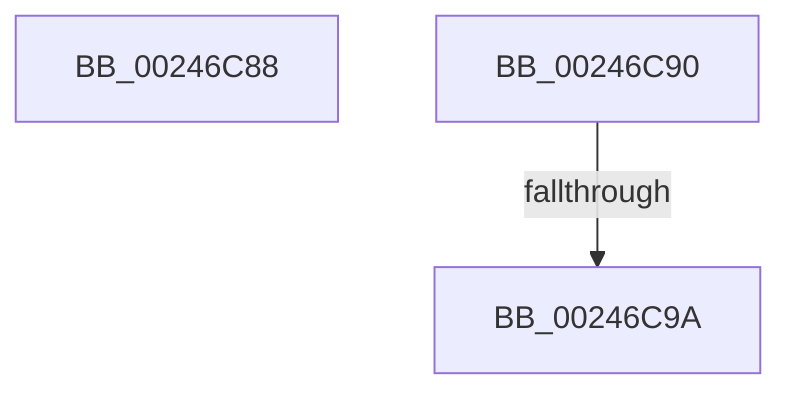

# sub_00246C88

- RVA: `0x00246C88`–`0x00246C9F` (길이 `23` bytes)
- VA: `0x0000000140246C88`
- 실행 섹션: `.text`
- PDB 이름 있음: `아니요`; PDB Function 태그: `아니요`
- unwind 정보 RVA: `0x00062258`
- 디코드: `5`개 명령, `23/23` bytes 표시
- 미해석 바이트: `0` (있으면 어셈블리에 `.byte`로 보존)

> 이 문서는 커널 이미지의 기계어와 PDB 기호를 분석해 생성했습니다. 4번과 5번은 함수 원형과 자료형을 바이너리 사용 방식에서 추정한 C 해석이며 원본 소스 복구 결과는 아닙니다.

## 1. Dependencies

- 직접 호출 지점: **0**; 고유 호출 대상: **0**
- 직접 호출자로 확인된 함수: **0**
- RIP 상대 이미지 참조: **0**

### Outgoing calls
- 직접 디코드된 call 명령이 없습니다.

### Direct callers
- 이 함수 시작 RVA로 연결되는 직접 call은 확인되지 않았습니다. 간접 호출은 완전히 역산할 수 없습니다.

### Static image references
- 디코드된 RIP-relative 메모리 참조가 없습니다.

## 2. Other-region calls and transfers

- 다른 실행 섹션으로 향하는 call: **0**
- call이 아닌 외부 분기/꼬리 이동: **3**
  - `0x00246C8B` → [sub_00246B53 + 0x3D](Unknown_function_00246B53.md) (`tail-transfer`)
  - `0x00246C94` → [sub_00246A60 + 0x50](Unknown_function_00246A60.md) (`tail-transfer`)
  - `0x00246C9A` → [sub_00246B53 + 0xF](Unknown_function_00246B53.md) (`tail-transfer`)

## 3. Assembly (complete function range)

```asm
00246C88  48 8B D1                        mov rdx, rcx
00246C8B  E9 00 FF FF FF                  jmp 0x140246b90
00246C90  F6 41 23 20                     test byte ptr [rcx + 0x23], 0x20
00246C94  0F 84 16 FE FF FF               je 0x140246ab0
00246C9A  E9 C3 FE FF FF                  jmp 0x140246b62
```

## 4. C-style interpretation (structured pseudocode)

```c
void __fastcall sub_00246C88(__int64 a1)
{
}
```

## 5. (Beta) C Style

```c
void sub_00246C88(int64_t Arg1)
{
}
```

## 6. Execution-region graph

[열기: 2D/3D 그래프와 함수 탐색 컨트롤 패널](../../../control-panel.html?section=text&rva=0x00246C88&view=graph)

- 2D 그래프는 위에서 아래로 흐르고, 3D 그래프는 빈 공간을 드래그해 회전합니다. Shift+드래그는 이동, 휠은 확대·축소, 함수 노드 선택은 대상 보고서 이동입니다.

### Static fallback


