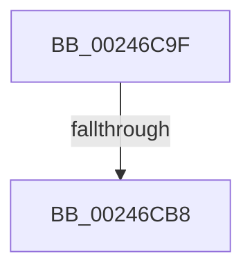

# sub_00246C9F

- RVA: `0x00246C9F`–`0x00246CF2` (길이 `83` bytes)
- VA: `0x0000000140246C9F`
- 실행 섹션: `.text`
- PDB 이름 있음: `아니요`; PDB Function 태그: `아니요`
- unwind 정보 RVA: `0x0006227C`
- 디코드: `19`개 명령, `83/83` bytes 표시
- 미해석 바이트: `0` (있으면 어셈블리에 `.byte`로 보존)

> 이 문서는 커널 이미지의 기계어와 PDB 기호를 분석해 생성했습니다. 4번과 5번은 함수 원형과 자료형을 바이너리 사용 방식에서 추정한 C 해석이며 원본 소스 복구 결과는 아닙니다.

## 1. Dependencies

- 직접 호출 지점: **3**; 고유 호출 대상: **3**
- 직접 호출자로 확인된 함수: **0**
- RIP 상대 이미지 참조: **0**

### Outgoing calls
- `0x00246CB8` → [ExAcquireSpinLockExclusive](ExAcquireSpinLockExclusive_function_00248690.md) (function, `0x00248690`)
- `0x00246CC7` → [MiRestockOverCommit](../40/MiRestockOverCommit_function_00407D94.md) (function, `0x00407D94`)
- `0x00246CDA` → [MiReleaseSpinLockExclusive](MiReleaseSpinLockExclusive_function_002482C0.md) (function, `0x002482C0`)

### Direct callers
- 이 함수 시작 RVA로 연결되는 직접 call은 확인되지 않았습니다. 간접 호출은 완전히 역산할 수 없습니다.

### Static image references
- 디코드된 RIP-relative 메모리 참조가 없습니다.

## 2. Other-region calls and transfers

- 다른 실행 섹션으로 향하는 call: **0**
- call이 아닌 외부 분기/꼬리 이동: **2**
  - `0x00246CB6` → [sub_00246CF7](Unknown_function_00246CF7.md) (`tail-transfer`)
  - `0x00246CEC` → [sub_00246A60 + 0x5A](Unknown_function_00246A60.md) (`tail-transfer`)

## 3. Assembly (complete function range)

```asm
00246C9F  4C 89 74 24 28                  mov qword ptr [rsp + 0x28], r14
00246CA4  4C 89 7C 24 20                  mov qword ptr [rsp + 0x20], r15
00246CA9  44 0F 20 C0                     mov rax, cr8
00246CAD  48 8D 8E F8 41 00 00            lea rcx, [rsi + 0x41f8]
00246CB4  3C 02                           cmp al, 2
00246CB6  74 3F                           je 0x140246cf7
00246CB8  E8 D3 19 00 00                  call 0x140248690
00246CBD  44 0F B6 F8                     movzx r15d, al
00246CC1  48 8B D7                        mov rdx, rdi
00246CC4  48 8B CE                        mov rcx, rsi
00246CC7  E8 C8 10 1C 00                  call 0x140407d94
00246CCC  41 0F B6 D7                     movzx edx, r15b
00246CD0  48 8D 8E F8 41 00 00            lea rcx, [rsi + 0x41f8]
00246CD7  48 8B E8                        mov rbp, rax
00246CDA  E8 E1 15 00 00                  call 0x1402482c0
00246CDF  4C 8B 7C 24 20                  mov r15, qword ptr [rsp + 0x20]
00246CE4  4C 8B 74 24 28                  mov r14, qword ptr [rsp + 0x28]
00246CE9  48 85 ED                        test rbp, rbp
00246CEC  0F 84 C8 FD FF FF               je 0x140246aba
```

## 4. C-style interpretation (structured pseudocode)

```c
__int64 __fastcall sub_00246C9F(__int64 a1, __int64 a2, __int64 a3, __int64 a4, __int64 a5)
{
    __int64 result;
    unsigned __int64 v_stack_p20;
    unsigned __int64 v_stack_p28;

    v_stack_p28 = v_r14;
    v_stack_p20 = v_r15;
    result = ExAcquireSpinLockExclusive(v_rsi + 16888, a2, a3, a4);
    result = MiRestockOverCommit(v_rsi, v_rdi, a3, a4);
    result = MiReleaseSpinLockExclusive(v_rsi + 16888, (unsigned __int8)((unsigned __int8)(result)), a3, a4);
}
```

## 5. (Beta) C Style

```c
int64_t sub_00246C9F(int64_t Arg1, int64_t Arg2, int64_t Arg3, int64_t Arg4, int64_t Arg5)
{
    int64_t result;
    uint64_t v_stack_p20;
    uint64_t v_stack_p28;

    v_stack_p28 = local_r14;
    v_stack_p20 = local_r15;
    result = ExAcquireSpinLockExclusive(local_rsi + 16888, Arg2, Arg3, Arg4);
    result = MiRestockOverCommit(local_rsi, local_rdi, Arg3, Arg4);
    result = MiReleaseSpinLockExclusive(local_rsi + 16888, (uint8_t)((uint8_t)(result)), Arg3, Arg4);
}
```

## 6. Execution-region graph

[열기: 2D/3D 그래프와 함수 탐색 컨트롤 패널](../../../control-panel.html?section=text&rva=0x00246C9F&view=graph)

- 2D 그래프는 위에서 아래로 흐르고, 3D 그래프는 빈 공간을 드래그해 회전합니다. Shift+드래그는 이동, 휠은 확대·축소, 함수 노드 선택은 대상 보고서 이동입니다.

### Static fallback


