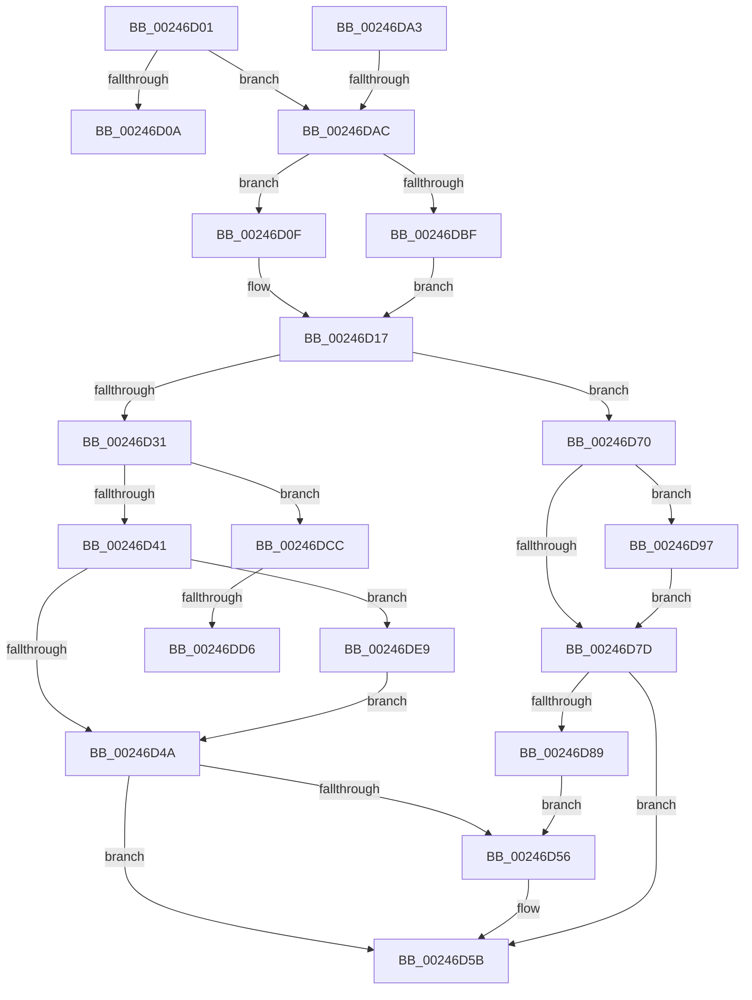

# sub_00246D01

- RVA: `0x00246D01`–`0x00246E02` (길이 `257` bytes)
- VA: `0x0000000140246D01`
- 실행 섹션: `.text`
- PDB 이름 있음: `아니요`; PDB Function 태그: `아니요`
- unwind 정보 RVA: `0x000622BC`
- 디코드: `58`개 명령, `257/257` bytes 표시
- 미해석 바이트: `0` (있으면 어셈블리에 `.byte`로 보존)

> 이 문서는 커널 이미지의 기계어와 PDB 기호를 분석해 생성했습니다. 4번과 5번은 함수 원형과 자료형을 바이너리 사용 방식에서 추정한 C 해석이며 원본 소스 복구 결과는 아닙니다.

## 1. Dependencies

- 직접 호출 지점: **9**; 고유 호출 대상: **5**
- 직접 호출자로 확인된 함수: **0**
- RIP 상대 이미지 참조: **0**

### Outgoing calls
- `0x00246D12` → [ExAcquireSpinLockExclusiveAtDpcLevel](ExAcquireSpinLockExclusiveAtDpcLevel_function_00248E80.md) (function, `0x00248E80`)
- `0x00246D56` → [KeResetEvent](KeResetEvent_function_00248350.md) (function, `0x00248350`)
- `0x00246D66` → [MiReleaseSpinLockExclusive](MiReleaseSpinLockExclusive_function_002482C0.md) (function, `0x002482C0`)
- `0x00246D89` → [KeResetEvent](KeResetEvent_function_00248350.md) (function, `0x00248350`)
- `0x00246D9C` → [KeSetEvent](../33/KeSetEvent_function_0033F310.md) (function, `0x0033F310`)
- `0x00246DBF` → [ExAcquireSpinLockExclusive](ExAcquireSpinLockExclusive_function_00248690.md) (function, `0x00248690`)
- `0x00246DDE` → [KeSetEvent](../33/KeSetEvent_function_0033F310.md) (function, `0x0033F310`)
- `0x00246DEC` → [KeResetEvent](KeResetEvent_function_00248350.md) (function, `0x00248350`)
- `0x00246DF8` → [KeResetEvent](KeResetEvent_function_00248350.md) (function, `0x00248350`)

### Direct callers
- 이 함수 시작 RVA로 연결되는 직접 call은 확인되지 않았습니다. 간접 호출은 완전히 역산할 수 없습니다.

### Static image references
- 디코드된 RIP-relative 메모리 참조가 없습니다.

## 2. Other-region calls and transfers

- 다른 실행 섹션으로 향하는 call: **0**
- call이 아닌 외부 분기/꼬리 이동: **5**
  - `0x00246D0A` → [sub_00246B53 + 0x104](Unknown_function_00246B53.md) (`tail-transfer`)
  - `0x00246D6B` → [sub_00246A60 + 0x5A](Unknown_function_00246A60.md) (`tail-transfer`)
  - `0x00246DA6` → [sub_00246B53 + 0xA4](Unknown_function_00246B53.md) (`tail-transfer`)
  - `0x00246DD0` → [sub_006D7FCA](../6D/Unknown_function_006D7FCA.md) (`tail-transfer`)
  - `0x00246DE4` → [sub_006D7FCA](../6D/Unknown_function_006D7FCA.md) (`tail-transfer`)

## 3. Assembly (complete function range)

```asm
00246D01  49 3B C0                        cmp rax, r8
00246D04  0F 82 A2 00 00 00               jb 0x140246dac
00246D0A  E9 48 FF FF FF                  jmp 0x140246c57
00246D0F  40 B5 11                        mov bpl, 0x11
00246D12  E8 69 21 00 00                  call 0x140248e80
00246D17  48 8B 8E 40 4B 00 00            mov rcx, qword ptr [rsi + 0x4b40]
00246D1E  48 8B 86 D8 41 00 00            mov rax, qword ptr [rsi + 0x41d8]
00246D25  48 8B 96 E0 41 00 00            mov rdx, qword ptr [rsi + 0x41e0]
00246D2C  48 3B C8                        cmp rcx, rax
00246D2F  72 3F                           jb 0x140246d70
00246D31  48 8B 86 30 01 00 00            mov rax, qword ptr [rsi + 0x130]
00246D38  48 3B CA                        cmp rcx, rdx
00246D3B  0F 83 8B 00 00 00               jae 0x140246dcc
00246D41  39 78 04                        cmp dword ptr [rax + 4], edi
00246D44  0F 84 9F 00 00 00               je 0x140246de9
00246D4A  48 8B 8E 28 01 00 00            mov rcx, qword ptr [rsi + 0x128]
00246D51  39 79 04                        cmp dword ptr [rcx + 4], edi
00246D54  75 05                           jne 0x140246d5b
00246D56  E8 F5 15 00 00                  call 0x140248350
00246D5B  48 8D 8E F8 41 00 00            lea rcx, [rsi + 0x41f8]
00246D62  40 0F B6 D5                     movzx edx, bpl
00246D66  E8 55 15 00 00                  call 0x1402482c0
00246D6B  E9 4A FD FF FF                  jmp 0x140246aba
00246D70  48 8B 8E 28 01 00 00            mov rcx, qword ptr [rsi + 0x128]
00246D77  83 79 04 00                     cmp dword ptr [rcx + 4], 0
00246D7B  74 1A                           je 0x140246d97
00246D7D  48 8B 8E 30 01 00 00            mov rcx, qword ptr [rsi + 0x130]
00246D84  39 79 04                        cmp dword ptr [rcx + 4], edi
00246D87  75 D2                           jne 0x140246d5b
00246D89  E8 C2 15 00 00                  call 0x140248350
00246D8E  48 8B 8E 38 01 00 00            mov rcx, qword ptr [rsi + 0x138]
00246D95  EB BF                           jmp 0x140246d56
00246D97  45 33 C0                        xor r8d, r8d
00246D9A  33 D2                           xor edx, edx
00246D9C  E8 6F 85 0F 00                  call 0x14033f310
00246DA1  EB DA                           jmp 0x140246d7d
00246DA3  49 3B D0                        cmp rdx, r8
00246DA6  0F 83 4B FE FF FF               jae 0x140246bf7
00246DAC  44 0F 20 C0                     mov rax, cr8
00246DB0  48 8D 8E F8 41 00 00            lea rcx, [rsi + 0x41f8]
00246DB7  3C 02                           cmp al, 2
00246DB9  0F 84 50 FF FF FF               je 0x140246d0f
00246DBF  E8 CC 18 00 00                  call 0x140248690
00246DC4  0F B6 E8                        movzx ebp, al
00246DC7  E9 4B FF FF FF                  jmp 0x140246d17
00246DCC  83 78 04 00                     cmp dword ptr [rax + 4], 0
00246DD0  0F 85 F4 11 49 00               jne 0x1406d7fca
00246DD6  45 33 C0                        xor r8d, r8d
00246DD9  33 D2                           xor edx, edx
00246DDB  48 8B C8                        mov rcx, rax
00246DDE  E8 2D 85 0F 00                  call 0x14033f310
00246DE3  90                              nop
00246DE4  E9 E1 11 49 00                  jmp 0x1406d7fca
00246DE9  48 8B C8                        mov rcx, rax
00246DEC  E8 5F 15 00 00                  call 0x140248350
00246DF1  48 8B 8E 38 01 00 00            mov rcx, qword ptr [rsi + 0x138]
00246DF8  E8 53 15 00 00                  call 0x140248350
00246DFD  E9 48 FF FF FF                  jmp 0x140246d4a
```

## 4. C-style interpretation (structured pseudocode)

```c
__int64 __fastcall sub_00246D01(__int64 a1, __int64 a2, __int64 a3)
{
    __int64 result;

    if (result < a3) goto loc_00246DAC;
loc_00246D0F:
    result = ExAcquireSpinLockExclusiveAtDpcLevel(a1, a2, a3, a4);
loc_00246D17:
    if ((*(unsigned __int64 *)(v_rsi + 19264)) < (*(unsigned __int64 *)(v_rsi + 16856))) goto loc_00246D70;
    if ((*(unsigned __int64 *)(v_rsi + 19264)) >= (*(unsigned __int64 *)(v_rsi + 16864))) goto loc_00246DCC;
    if ((*(unsigned int *)(*(unsigned __int64 *)(v_rsi + 304) + 4)) == ((unsigned int)(v_rdi))) goto loc_00246DE9;
loc_00246D4A:
    result = *(unsigned __int64 *)(v_rsi + 304);
    if ((*(unsigned int *)(*(unsigned __int64 *)(v_rsi + 296) + 4)) == ((unsigned int)(v_rdi))) {
        result = KeResetEvent(*(unsigned __int64 *)(v_rsi + 296), *(unsigned __int64 *)(v_rsi + 16864), a3, a4);
    }
    result = MiReleaseSpinLockExclusive(v_rsi + 16888, 17, a3, a4);
loc_00246D70:
    if ((*(unsigned int *)(*(unsigned __int64 *)(v_rsi + 296) + 4)) == 0) goto loc_00246D97;
loc_00246D7D:
    if ((*(unsigned int *)(*(unsigned __int64 *)(v_rsi + 304) + 4)) != ((unsigned int)(v_rdi))) goto loc_00246D5B;
    result = KeResetEvent(*(unsigned __int64 *)(v_rsi + 304), 17, a3, a4);
    goto loc_00246D56;
loc_00246D97:
    a3 = 0;
    a2 = 0;
    result = KeSetEvent(*(unsigned __int64 *)(v_rsi + 312), a2, a3, a4);
    goto loc_00246D7D;
loc_00246DAC:
    if (((unsigned __int8)(v_cr8)) == 2) goto loc_00246D0F;
    result = ExAcquireSpinLockExclusive(v_rsi + 16888, a2, a3, a4);
    goto loc_00246D17;
loc_00246DCC:
    a3 = 0;
    a2 = 0;
    result = KeSetEvent(result, a2, a3, a4);
loc_00246DE9:
    result = KeResetEvent(result, a2, a3, a4);
    result = KeResetEvent(*(unsigned __int64 *)(v_rsi + 312), a2, a3, a4);
    goto loc_00246D4A;
}
```

## 5. (Beta) C Style

```c
int64_t sub_00246D01(int64_t Arg1, int64_t Arg2, int64_t Arg3)
{
    int64_t result;

    if (result < Arg3) goto loc_00246DAC;
loc_00246D0F:
    result = ExAcquireSpinLockExclusiveAtDpcLevel(Arg1, Arg2, Arg3, a4);
loc_00246D17:
    if ((*(uint64_t *)(local_rsi + 0x4B40)) < (*(uint64_t *)(local_rsi + 0x41D8))) goto loc_00246D70;
    if ((*(uint64_t *)(local_rsi + 0x4B40)) >= (*(uint64_t *)(local_rsi + 0x41E0))) goto loc_00246DCC;
    if ((*(uint32_t *)(*(uint64_t *)(local_rsi + 0x130) + 0x4)) == ((uint32_t)(local_rdi))) goto loc_00246DE9;
loc_00246D4A:
    result = *(uint64_t *)(local_rsi + 0x130);
    if ((*(uint32_t *)(*(uint64_t *)(local_rsi + 0x128) + 0x4)) == ((uint32_t)(local_rdi))) {
        result = KeResetEvent(*(uint64_t *)(local_rsi + 0x128), *(uint64_t *)(local_rsi + 0x41E0), Arg3, a4);
    }
    result = MiReleaseSpinLockExclusive(local_rsi + 16888, 17, Arg3, a4);
loc_00246D70:
    if ((*(uint32_t *)(*(uint64_t *)(local_rsi + 0x128) + 0x4)) == 0) goto loc_00246D97;
loc_00246D7D:
    if ((*(uint32_t *)(*(uint64_t *)(local_rsi + 0x130) + 0x4)) != ((uint32_t)(local_rdi))) goto loc_00246D5B;
    result = KeResetEvent(*(uint64_t *)(local_rsi + 0x130), 17, Arg3, a4);
    goto loc_00246D56;
loc_00246D97:
    Arg3 = 0;
    Arg2 = 0;
    result = KeSetEvent(*(uint64_t *)(local_rsi + 0x138), Arg2, Arg3, a4);
    goto loc_00246D7D;
loc_00246DAC:
    if (((uint8_t)(v_cr8)) == 2) goto loc_00246D0F;
    result = ExAcquireSpinLockExclusive(local_rsi + 16888, Arg2, Arg3, a4);
    goto loc_00246D17;
loc_00246DCC:
    Arg3 = 0;
    Arg2 = 0;
    result = KeSetEvent(result, Arg2, Arg3, a4);
loc_00246DE9:
    result = KeResetEvent(result, Arg2, Arg3, a4);
    result = KeResetEvent(*(uint64_t *)(local_rsi + 0x138), Arg2, Arg3, a4);
    goto loc_00246D4A;
}
```

## 6. Execution-region graph

[열기: 2D/3D 그래프와 함수 탐색 컨트롤 패널](../../../control-panel.html?section=text&rva=0x00246D01&view=graph)

- 2D 그래프는 위에서 아래로 흐르고, 3D 그래프는 빈 공간을 드래그해 회전합니다. Shift+드래그는 이동, 휠은 확대·축소, 함수 노드 선택은 대상 보고서 이동입니다.

### Static fallback


