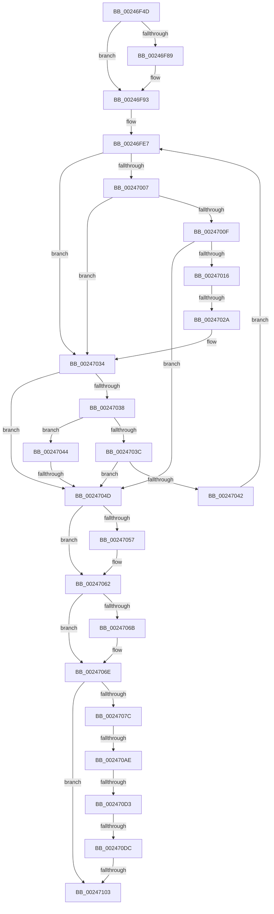

# sub_00246F4D

- RVA: `0x00246F4D`–`0x0024711D` (길이 `464` bytes)
- VA: `0x0000000140246F4D`
- 실행 섹션: `.text`
- PDB 이름 있음: `아니요`; PDB Function 태그: `아니요`
- unwind 정보 RVA: `0x00062310`
- 디코드: `112`개 명령, `464/464` bytes 표시
- 미해석 바이트: `0` (있으면 어셈블리에 `.byte`로 보존)

> 이 문서는 커널 이미지의 기계어와 PDB 기호를 분석해 생성했습니다. 4번과 5번은 함수 원형과 자료형을 바이너리 사용 방식에서 추정한 C 해석이며 원본 소스 복구 결과는 아닙니다.

## 1. Dependencies

- 직접 호출 지점: **4**; 고유 호출 대상: **4**
- 직접 호출자로 확인된 함수: **0**
- RIP 상대 이미지 참조: **7**

### Outgoing calls
- `0x0024705D` → [MiClearMappingAndDereferenceIoSpace](MiClearMappingAndDereferenceIoSpace_function_00247DF0.md) (function, `0x00247DF0`)
- `0x002470B1` → [ExAcquireSpinLockExclusiveAtDpcLevel](ExAcquireSpinLockExclusiveAtDpcLevel_function_00248E80.md) (function, `0x00248E80`)
- `0x002470F5` → [MiReleaseSpinLockExclusive](MiReleaseSpinLockExclusive_function_002482C0.md) (function, `0x002482C0`)
- `0x00247110` → [MiReleasePtes](MiReleasePtes_function_00247240.md) (function, `0x00247240`)

### Direct callers
- 이 함수 시작 RVA로 연결되는 직접 call은 확인되지 않았습니다. 간접 호출은 완전히 역산할 수 없습니다.

### Static image references
- `0x00247062` → RVA `0x00FC6C14` (`ALMOSTRO`; read)
- `0x0024706E` → RVA `0x00FC51FC` (`ALMOSTRO`; read)
- `0x0024709F` → RVA `0x00E35E10` (`.data`; read)
- `0x002470B9` → RVA `0x00E388F0` (`.data`; read)
- `0x002470DC` → RVA `0x00E389F0` (`.data`; read/write)
- `0x002470EA` → RVA `0x00E389F8` (`.data`; read/write)
- `0x00247106` → RVA `0x00E37668` (`.data`; read)

## 2. Other-region calls and transfers

- 다른 실행 섹션으로 향하는 call: **0**
- call이 아닌 외부 분기/꼬리 이동: **6**
  - `0x00247024` → [sub_00247137 + 0xE](Unknown_function_00247137.md) (`tail-transfer`)
  - `0x00247047` → [sub_002471C0](Unknown_function_002471C0.md) (`tail-transfer`)
  - `0x002470A8` → [sub_00247137](Unknown_function_00247137.md) (`tail-transfer`)
  - `0x002470CD` → [sub_006D8004](../6D/Unknown_function_006D8004.md) (`tail-transfer`)
  - `0x002470D6` → [sub_002471FA](Unknown_function_002471FA.md) (`tail-transfer`)
  - `0x002470FD` → [sub_002471FA + 0x28](Unknown_function_002471FA.md) (`tail-transfer`)

## 3. Assembly (complete function range)

```asm
00246F4D  4C 89 AC 24 80 00 00 00         mov qword ptr [rsp + 0x80], r13
00246F55  4C 8B E5                        mov r12, rbp
00246F58  49 BF 00 00 00 00 80 F6 FF FF   movabs r15, 0xfffff68000000000
00246F62  49 C1 EC 09                     shr r12, 9
00246F66  49 BD F8 FF FF FF 7F 00 00 00   movabs r13, 0x7ffffffff8
00246F70  4D 23 E5                        and r12, r13
00246F73  49 8B C7                        mov rax, r15
00246F76  66 41 83 E0 DE                  and r8w, 0xffde
00246F7B  4C 03 E0                        add r12, rax
00246F7E  66 44 89 46 0A                  mov word ptr [rsi + 0xa], r8w
00246F83  41 F6 C0 04                     test r8b, 4
00246F87  74 0A                           je 0x140246f93
00246F89  8B C2                           mov eax, edx
00246F8B  48 03 46 20                     add rax, qword ptr [rsi + 0x20]
00246F8F  48 89 46 18                     mov qword ptr [rsi + 0x18], rax
00246F93  49 8B CC                        mov rcx, r12
00246F96  4C 89 64 24 30                  mov qword ptr [rsp + 0x30], r12
00246F9B  48 C1 E9 09                     shr rcx, 9
00246F9F  49 8B DC                        mov rbx, r12
00246FA2  49 23 CD                        and rcx, r13
00246FA5  41 BA 04 00 00 00               mov r10d, 4
00246FAB  49 8B C7                        mov rax, r15
00246FAE  48 03 C8                        add rcx, rax
00246FB1  48 89 4C 24 38                  mov qword ptr [rsp + 0x38], rcx
00246FB6  48 C1 E9 09                     shr rcx, 9
00246FBA  49 23 CD                        and rcx, r13
00246FBD  49 8B C7                        mov rax, r15
00246FC0  48 03 C8                        add rcx, rax
00246FC3  48 89 4C 24 40                  mov qword ptr [rsp + 0x40], rcx
00246FC8  48 C1 E9 09                     shr rcx, 9
00246FCC  49 23 CD                        and rcx, r13
00246FCF  49 8B C7                        mov rax, r15
00246FD2  48 03 C8                        add rcx, rax
00246FD5  48 BA F8 D7 BE 7D FB F6 FF FF   movabs rdx, 0xfffff6fb7dbed7f8
00246FDF  48 89 4C 24 48                  mov qword ptr [rsp + 0x48], rcx
00246FE4  45 8B DA                        mov r11d, r10d
00246FE7  4E 8B 4C DC 28                  mov r9, qword ptr [rsp + r11*8 + 0x28]
00246FEC  49 FF CB                        dec r11
00246FEF  48 B9 00 D0 BE 7D FB F6 FF FF   movabs rcx, 0xfffff6fb7dbed000
00246FF9  41 FF CA                        dec r10d
00246FFC  49 8B 01                        mov rax, qword ptr [r9]
00246FFF  48 8B C9                        mov rcx, rcx
00247002  4C 3B C9                        cmp r9, rcx
00247005  72 2D                           jb 0x140247034
00247007  48 8B CA                        mov rcx, rdx
0024700A  4C 3B C9                        cmp r9, rcx
0024700D  77 25                           ja 0x140247034
0024700F  48 8B C8                        mov rcx, rax
00247012  A8 01                           test al, 1
00247014  74 37                           je 0x14024704d
00247016  A8 42                           test al, 0x42
00247018  41 0F 95 C0                     setne r8b
0024701C  A8 20                           test al, 0x20
0024701E  0F 95 C2                        setne dl
00247021  44 84 C2                        test dl, r8b
00247024  0F 84 1B 01 00 00               je 0x140247145
0024702A  48 BA F8 D7 BE 7D FB F6 FF FF   movabs rdx, 0xfffff6fb7dbed7f8
00247034  A8 01                           test al, 1
00247036  74 15                           je 0x14024704d
00247038  84 C0                           test al, al
0024703A  78 08                           js 0x140247044
0024703C  49 83 FB 01                     cmp r11, 1
00247040  74 0B                           je 0x14024704d
00247042  EB A3                           jmp 0x140246fe7
00247044  45 85 D2                        test r10d, r10d
00247047  0F 85 73 01 00 00               jne 0x1402471c0
0024704D  48 8B 03                        mov rax, qword ptr [rbx]
00247050  48 0F BA E0 09                  bt rax, 9
00247055  73 0B                           jae 0x140247062
00247057  48 8B D7                        mov rdx, rdi
0024705A  48 8B CD                        mov rcx, rbp
0024705D  E8 8E 0D 00 00                  call 0x140247df0
00247062  44 39 35 AB FB D7 00            cmp dword ptr [rip + 0xd7fbab], r14d
00247069  74 03                           je 0x14024706e
0024706B  48 FF C7                        inc rdi
0024706E  8B 05 88 E1 D7 00               mov eax, dword ptr [rip + 0xd7e188]
00247074  A8 01                           test al, 1
00247076  0F 84 87 00 00 00               je 0x140247103
0024707C  48 8B C5                        mov rax, rbp
0024707F  48 C1 E8 0C                     shr rax, 0xc
00247083  48 69 C8 5F 9E 00 00            imul rcx, rax, 0x9e5f
0024708A  48 8B D9                        mov rbx, rcx
0024708D  48 C1 EB 20                     shr rbx, 0x20
00247091  48 33 D9                        xor rbx, rcx
00247094  48 81 E5 00 F0 FF FF            and rbp, 0xfffffffffffff000
0024709B  44 0F 20 C0                     mov rax, cr8
0024709F  48 8D 0D 6A ED BE 00            lea rcx, [rip + 0xbeed6a]
002470A6  3C 02                           cmp al, 2
002470A8  0F 85 89 00 00 00               jne 0x140247137
002470AE  41 B7 11                        mov r15b, 0x11
002470B1  E8 CA 1D 00 00                  call 0x140248e80
002470B6  83 E3 0F                        and ebx, 0xf
002470B9  48 8D 0D 30 18 BF 00            lea rcx, [rip + 0xbf1830]
002470C0  48 C1 E3 04                     shl rbx, 4
002470C4  48 03 CB                        add rcx, rbx
002470C7  4C 8B 01                        mov r8, qword ptr [rcx]
002470CA  4C 3B C1                        cmp r8, rcx
002470CD  0F 85 31 0F 49 00               jne 0x1406d8004
002470D3  4D 85 F6                        test r14, r14
002470D6  0F 84 1E 01 00 00               je 0x1402471fa
002470DC  48 29 3D 0D 19 BF 00            sub qword ptr [rip + 0xbf190d], rdi
002470E3  48 8D 0D 26 ED BE 00            lea rcx, [rip + 0xbeed26]
002470EA  48 FF 0D 07 19 BF 00            dec qword ptr [rip + 0xbf1907]
002470F1  41 0F B6 D7                     movzx edx, r15b
002470F5  E8 C6 11 00 00                  call 0x1402482c0
002470FA  4D 85 F6                        test r14, r14
002470FD  0F 85 1F 01 00 00               jne 0x140247222
00247103  44 8B C7                        mov r8d, edi
00247106  48 8D 0D 5B 05 BF 00            lea rcx, [rip + 0xbf055b]
0024710D  49 8B D4                        mov rdx, r12
00247110  E8 2B 01 00 00                  call 0x140247240
00247115  4C 8B AC 24 80 00 00 00         mov r13, qword ptr [rsp + 0x80]
```

## 4. C-style interpretation (structured pseudocode)

```c
__int64 __fastcall sub_00246F4D(__int64 a1, int a2, unsigned __int16 a3, __int64 a4, __int64 a5, __int64 a6, __int64 a7, __int64 a8, __int64 a9, __int64 a10, __int64 a11, __int64 a12, __int64 a13, __int64 a14, __int64 a15, __int64 a16)
{
    __int64 result;
    __int64 v_r10;
    __int64 v_r11;
    __int64 v_r12;
    __int64 v_rbp;
    __int64 v_rbx;
    __int64 v_rdi;
    unsigned __int64 v_stack_p30;
    unsigned __int64 v_stack_p38;
    unsigned __int64 v_stack_p40;
    unsigned __int64 v_stack_p48;
    unsigned __int64 v_stack_p80;

    v_stack_p80 = v_r13;
    v_r12 = (v_rbp) >> (9);
    v_r12 = (v_r12) & (v_r13);
    a3 = (unsigned __int16)((a3) & (0xFFDEULL));
    v_r12 = (v_r12) + (v_r15);
    *(unsigned __int16 *)(v_rsi + 10) = a3;
    result = v_r15;
    if ((((unsigned __int8)(a3)) & (4)) != 0) {
        result = a2;
        result = (result) + (*(unsigned __int64 *)(v_rsi + 32));
        *(unsigned __int64 *)(v_rsi + 24) = result;
    }
    v_stack_p30 = v_r12;
    a1 = (v_r12) >> (9);
    a1 = (a1) & (v_r13);
    a1 = (a1) + (v_r15);
    v_stack_p38 = a1;
    a1 = (a1) >> (9);
    a1 = (a1) & (v_r13);
    a1 = (a1) + (v_r15);
    v_stack_p40 = a1;
    a1 = (a1) >> (9);
    a1 = (a1) & (v_r13);
    a1 = (a1) + (v_r15);
    v_stack_p48 = a1;
loc_00246FE7:
    v_r11 = (4) - 1;
    v_r10 = (unsigned int)((4) - 1);
    if ((*(unsigned __int64 *)(v_rsp + 4 * 8 + 40)) < a1) goto loc_00247034;
    if ((*(unsigned __int64 *)(v_rsp + 4 * 8 + 40)) > a2) goto loc_00247034;
    if ((((unsigned __int8)(*(unsigned __int64 *)(*(unsigned __int64 *)(v_rsp + 4 * 8 + 40)))) & (1)) == 0) goto loc_0024704D;
    a3 = ((((unsigned __int8)(*(unsigned __int64 *)(*(unsigned __int64 *)(v_rsp + 4 * 8 + 40)))) & (66)) != 0) ? 1 : 0;
    a2 = ((((unsigned __int8)(*(unsigned __int64 *)(*(unsigned __int64 *)(v_rsp + 4 * 8 + 40)))) & (32)) != 0) ? 1 : 0;
loc_00247034:
    if ((((unsigned __int8)(*(unsigned __int64 *)(*(unsigned __int64 *)(v_rsp + 4 * 8 + 40)))) & (1)) == 0) goto loc_0024704D;
    if (sign_flag) goto loc_00247044;
    if (v_r11 == 1) goto loc_0024704D;
    goto loc_00246FE7;
loc_00247044:
loc_0024704D:
    result = *(unsigned __int64 *)(v_r12);
    if (!(condition_is_above_or_equal)) {
        a2 = v_rdi;
        a1 = v_rbp;
        result = MiClearMappingAndDereferenceIoSpace(a1, a2, a3, *(unsigned __int64 *)(v_rsp + 4 * 8 + 40));
    }
    if ((*(unsigned int *)(v_rip + 14154667)) != ((unsigned int)(v_r14))) {
        v_rdi = (v_rdi) + 1;
    }
    if ((((unsigned __int8)((unsigned int)(*(unsigned int *)(v_rip + 14147976)))) & (1)) == 0) goto loc_00247103;
    result = (v_rbp) >> (12);
    a1 = (a1) * (result);
    v_rbx = (a1) >> (32);
    v_rbx = (v_rbx) ^ (a1);
    v_rbp = (v_rbp) & (0xFFFFFFFFFFFFF000ULL);
    result = ExAcquireSpinLockExclusiveAtDpcLevel(v_rip + 12512618, a2, a3, *(unsigned __int64 *)(v_rsp + 4 * 8 + 40));
    v_rbx = (unsigned int)((v_rbx) & (15));
    v_rbx = (v_rbx) << (4);
    a1 = (v_rip + 12523568) + (v_rbx);
    result = MiReleaseSpinLockExclusive(v_rip + 12512550, 17, *(unsigned __int64 *)(a1), *(unsigned __int64 *)(v_rsp + 4 * 8 + 40));
loc_00247103:
    result = MiReleasePtes(v_rip + 12518747, v_r12, (unsigned int)((unsigned int)(v_rdi)), *(unsigned __int64 *)(v_rsp + 4 * 8 + 40));
    return result;
}
```

## 5. (Beta) C Style

```c
int64_t sub_00246F4D(int64_t Arg1, int32_t Arg2, uint16_t Arg3, int64_t Arg4, void *Arg5, uint64_t Arg6, uint64_t Arg7, uint64_t Arg8, uint64_t Arg9, uint64_t Arg10, uint64_t Arg11, uint64_t Arg12, uint64_t Arg13, uint64_t Arg14, uint64_t Arg15, int64_t Arg16)
{
    uint8_t *arg5 = (uint8_t *)Arg5;

    int64_t result;
    int64_t local_r10;
    int64_t local_r11;
    int64_t local_r12;
    int64_t local_rbp;
    int64_t local_rbx;
    int64_t local_rdi;
    uint64_t v_stack_p30;
    uint64_t v_stack_p38;
    uint64_t v_stack_p40;
    uint64_t v_stack_p48;
    uint64_t v_stack_p80;

    v_stack_p80 = local_r13;
    local_r12 = (local_rbp) >> (9);
    local_r12 = (local_r12) & (local_r13);
    Arg3 = (uint16_t)((Arg3) & (0xFFDEULL));
    local_r12 = (local_r12) + (local_r15);
    *(uint16_t *)(local_rsi + 0xA) = Arg3;
    result = local_r15;
    if ((((uint8_t)(Arg3)) & (4)) != 0) {
        result = Arg2;
        result = (result) + (*(uint64_t *)(local_rsi + 0x20));
        *(uint64_t *)(local_rsi + 0x18) = result;
    }
    v_stack_p30 = local_r12;
    Arg1 = (local_r12) >> (9);
    Arg1 = (Arg1) & (local_r13);
    Arg1 = (Arg1) + (local_r15);
    v_stack_p38 = Arg1;
    Arg1 = (Arg1) >> (9);
    Arg1 = (Arg1) & (local_r13);
    Arg1 = (Arg1) + (local_r15);
    v_stack_p40 = Arg1;
    Arg1 = (Arg1) >> (9);
    Arg1 = (Arg1) & (local_r13);
    Arg1 = (Arg1) + (local_r15);
    v_stack_p48 = Arg1;
loc_00246FE7:
    local_r11 = (4) - 1;
    local_r10 = (uint32_t)((4) - 1);
    if ((*(uint64_t *)(local_rsp + 0x4 * 8 + 0x28)) < Arg1) goto loc_00247034;
    if ((*(uint64_t *)(local_rsp + 0x4 * 8 + 0x28)) > Arg2) goto loc_00247034;
    if ((((uint8_t)(*(uint64_t *)(*(uint64_t *)(local_rsp + 0x4 * 8 + 0x28)))) & (1)) == 0) goto loc_0024704D;
    Arg3 = ((((uint8_t)(*(uint64_t *)(*(uint64_t *)(local_rsp + 0x4 * 8 + 0x28)))) & (66)) != 0) ? 1 : 0;
    Arg2 = ((((uint8_t)(*(uint64_t *)(*(uint64_t *)(local_rsp + 0x4 * 8 + 0x28)))) & (32)) != 0) ? 1 : 0;
loc_00247034:
    if ((((uint8_t)(*(uint64_t *)(*(uint64_t *)(local_rsp + 0x4 * 8 + 0x28)))) & (1)) == 0) goto loc_0024704D;
    if (sign_flag) goto loc_00247044;
    if (local_r11 == 1) goto loc_0024704D;
    goto loc_00246FE7;
loc_00247044:
loc_0024704D:
    result = *(uint64_t *)(local_r12);
    if (!(condition_is_above_or_equal)) {
        Arg2 = local_rdi;
        Arg1 = local_rbp;
        result = MiClearMappingAndDereferenceIoSpace(Arg1, Arg2, Arg3, *(uint64_t *)(local_rsp + 0x4 * 8 + 0x28));
    }
    if ((*(uint32_t *)(v_rip + 0xD7FBAB)) != ((uint32_t)(local_r14))) {
        local_rdi = (local_rdi) + 1;
    }
    if ((((uint8_t)((uint32_t)(*(uint32_t *)(v_rip + 0xD7E188)))) & (1)) == 0) goto loc_00247103;
    result = (local_rbp) >> (12);
    Arg1 = (Arg1) * (result);
    local_rbx = (Arg1) >> (32);
    local_rbx = (local_rbx) ^ (Arg1);
    local_rbp = (local_rbp) & (0xFFFFFFFFFFFFF000ULL);
    result = ExAcquireSpinLockExclusiveAtDpcLevel(v_rip + 12512618, Arg2, Arg3, *(uint64_t *)(local_rsp + 0x4 * 8 + 0x28));
    local_rbx = (uint32_t)((local_rbx) & (15));
    local_rbx = (local_rbx) << (4);
    Arg1 = (v_rip + 12523568) + (local_rbx);
    result = MiReleaseSpinLockExclusive(v_rip + 12512550, 17, *(uint64_t *)(Arg1), *(uint64_t *)(local_rsp + 0x4 * 8 + 0x28));
loc_00247103:
    result = MiReleasePtes(v_rip + 12518747, local_r12, (uint32_t)((uint32_t)(local_rdi)), *(uint64_t *)(local_rsp + 0x4 * 8 + 0x28));
    return result;
}
```

### 관측된 메모리 오프셋

구조체 형식이 확인되지 않은 접근은 인자 기준의 오프셋으로만 기록했습니다.

| 기준 인자 | 오프셋 표현 | 폭 (bit) | 접근 |
|---|---:|---:|---|
| `Arg5` | `+ 0x0` | `64` | `R` |

## 6. Execution-region graph

[열기: 2D/3D 그래프와 함수 탐색 컨트롤 패널](../../../control-panel.html?section=text&rva=0x00246F4D&view=graph)

- 2D 그래프는 위에서 아래로 흐르고, 3D 그래프는 빈 공간을 드래그해 회전합니다. Shift+드래그는 이동, 휠은 확대·축소, 함수 노드 선택은 대상 보고서 이동입니다.

### Static fallback


