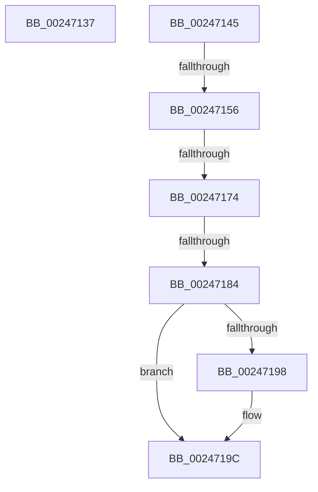

# sub_00247137

- RVA: `0x00247137`–`0x002471AF` (길이 `120` bytes)
- VA: `0x0000000140247137`
- 실행 섹션: `.text`
- PDB 이름 있음: `아니요`; PDB Function 태그: `아니요`
- unwind 정보 RVA: `0x00062338`
- 디코드: `23`개 명령, `120/120` bytes 표시
- 미해석 바이트: `0` (있으면 어셈블리에 `.byte`로 보존)

> 이 문서는 커널 이미지의 기계어와 PDB 기호를 분석해 생성했습니다. 4번과 5번은 함수 원형과 자료형을 바이너리 사용 방식에서 추정한 C 해석이며 원본 소스 복구 결과는 아닙니다.

## 1. Dependencies

- 직접 호출 지점: **1**; 고유 호출 대상: **1**
- 직접 호출자로 확인된 함수: **0**
- RIP 상대 이미지 참조: **1**

### Outgoing calls
- `0x00247137` → [ExAcquireSpinLockExclusive](ExAcquireSpinLockExclusive_function_00248690.md) (function, `0x00248690`)

### Direct callers
- 이 함수 시작 RVA로 연결되는 직접 call은 확인되지 않았습니다. 간접 호출은 완전히 역산할 수 없습니다.

### Static image references
- `0x00247145` → RVA `0x00FC6A88` (`ALMOSTRO`; read)

## 2. Other-region calls and transfers

- 다른 실행 섹션으로 향하는 call: **0**
- call이 아닌 외부 분기/꼬리 이동: **5**
  - `0x00247140` → [sub_00246F4D + 0x169](Unknown_function_00246F4D.md) (`tail-transfer`)
  - `0x00247150` → [sub_00246F4D + 0xDD](Unknown_function_00246F4D.md) (`tail-transfer`)
  - `0x0024716E` → [sub_00246F4D + 0xDD](Unknown_function_00246F4D.md) (`tail-transfer`)
  - `0x0024717E` → [sub_00246F4D + 0xDD](Unknown_function_00246F4D.md) (`tail-transfer`)
  - `0x002471AA` → [sub_00246F4D + 0xDD](Unknown_function_00246F4D.md) (`tail-transfer`)

## 3. Assembly (complete function range)

```asm
00247137  E8 54 15 00 00                  call 0x140248690
0024713C  44 0F B6 F8                     movzx r15d, al
00247140  E9 71 FF FF FF                  jmp 0x1402470b6
00247145  48 F7 05 38 F9 D7 00 00 00 60 00  test qword ptr [rip + 0xd7f938], 0x600000
00247150  0F 84 D4 FE FF FF               je 0x14024702a
00247156  65 48 8B 14 25 88 01 00 00      mov rdx, qword ptr gs:[0x188]
0024715F  4C 8B 82 B8 00 00 00            mov r8, qword ptr [rdx + 0xb8]
00247166  41 80 B8 60 01 00 00 01         cmp byte ptr [r8 + 0x160], 1
0024716E  0F 84 B6 FE FF FF               je 0x14024702a
00247174  49 8B 90 08 05 00 00            mov rdx, qword ptr [r8 + 0x508]
0024717B  48 85 D2                        test rdx, rdx
0024717E  0F 84 A6 FE FF FF               je 0x14024702a
00247184  49 C1 E9 03                     shr r9, 3
00247188  41 81 E1 FF 01 00 00            and r9d, 0x1ff
0024718F  4A 8B 14 CA                     mov rdx, qword ptr [rdx + r9*8]
00247193  F6 C2 20                        test dl, 0x20
00247196  74 04                           je 0x14024719c
00247198  48 83 C9 20                     or rcx, 0x20
0024719C  48 8B C1                        mov rax, rcx
0024719F  48 83 C8 42                     or rax, 0x42
002471A3  F6 C2 42                        test dl, 0x42
002471A6  48 0F 44 C1                     cmove rax, rcx
002471AA  E9 7B FE FF FF                  jmp 0x14024702a
```

## 4. C-style interpretation (structured pseudocode)

```c
__int64 __fastcall sub_00247137(__int64 a1, __int64 a2, __int64 a3, __int64 a4)
{
    __int64 result;

    result = ExAcquireSpinLockExclusive(a1, a2, a3, a4);
}
```

## 5. (Beta) C Style

```c
int64_t sub_00247137(int64_t Arg1, int64_t Arg2, int64_t Arg3, int64_t Arg4)
{
    int64_t result;

    result = ExAcquireSpinLockExclusive(Arg1, Arg2, Arg3, Arg4);
}
```

## 6. Execution-region graph

[열기: 2D/3D 그래프와 함수 탐색 컨트롤 패널](../../../control-panel.html?section=text&rva=0x00247137&view=graph)

- 2D 그래프는 위에서 아래로 흐르고, 3D 그래프는 빈 공간을 드래그해 회전합니다. Shift+드래그는 이동, 휠은 확대·축소, 함수 노드 선택은 대상 보고서 이동입니다.

### Static fallback


