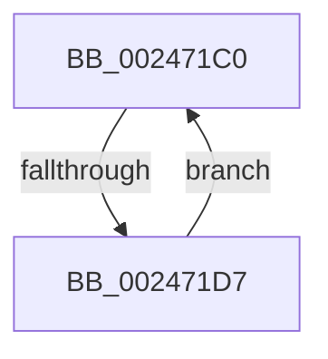

# sub_002471C0

- RVA: `0x002471C0`–`0x002471D9` (길이 `25` bytes)
- VA: `0x00000001402471C0`
- 실행 섹션: `.text`
- PDB 이름 있음: `아니요`; PDB Function 태그: `아니요`
- unwind 정보 RVA: `0x0006235C`
- 디코드: `7`개 명령, `25/25` bytes 표시
- 미해석 바이트: `0` (있으면 어셈블리에 `.byte`로 보존)

> 이 문서는 커널 이미지의 기계어와 PDB 기호를 분석해 생성했습니다. 4번과 5번은 함수 원형과 자료형을 바이너리 사용 방식에서 추정한 C 해석이며 원본 소스 복구 결과는 아닙니다.

## 1. Dependencies

- 직접 호출 지점: **0**; 고유 호출 대상: **0**
- 직접 호출자로 확인된 함수: **0**
- RIP 상대 이미지 참조: **0**

### Outgoing calls
- 직접 디코드된 call 명령이 없습니다.

### Direct callers
- 이 함수 시작 RVA로 연결되는 직접 call은 확인되지 않았습니다. 간접 호출은 완전히 역산할 수 없습니다.

### Static image references
- 디코드된 RIP-relative 메모리 참조가 없습니다.

## 2. Other-region calls and transfers

- 다른 실행 섹션으로 향하는 call: **0**
- call이 아닌 외부 분기/꼬리 이동: **1**
  - `0x002471D1` → [sub_00246F4D + 0x100](Unknown_function_00246F4D.md) (`tail-transfer`)

## 3. Assembly (complete function range)

```asm
002471C0  48 C1 EB 09                     shr rbx, 9
002471C4  49 23 DD                        and rbx, r13
002471C7  49 8B C7                        mov rax, r15
002471CA  48 03 D8                        add rbx, rax
002471CD  41 83 C2 FF                     add r10d, -1
002471D1  0F 84 76 FE FF FF               je 0x14024704d
002471D7  EB E7                           jmp 0x1402471c0
```

## 4. C-style interpretation (structured pseudocode)

```c
__int64 __fastcall sub_002471C0(void)
{
    __int64 v_r10;
    __int64 v_rbx;

    v_rbx = (v_rbx) >> (9);
    v_rbx = (v_rbx) & (v_r13);
    v_rbx = (v_rbx) + (v_r15);
    v_r10 = (unsigned int)((v_r10) + (-1));
    goto loc_002471C0;
}
```

## 5. (Beta) C Style

```c
void sub_002471C0(void)
{
    int64_t local_r10;
    int64_t local_rbx;

    local_rbx = (local_rbx) >> (9);
    local_rbx = (local_rbx) & (local_r13);
    local_rbx = (local_rbx) + (local_r15);
    local_r10 = (uint32_t)((local_r10) + (-1));
    goto loc_002471C0;
}
```

## 6. Execution-region graph

[열기: 2D/3D 그래프와 함수 탐색 컨트롤 패널](../../../control-panel.html?section=text&rva=0x002471C0&view=graph)

- 2D 그래프는 위에서 아래로 흐르고, 3D 그래프는 빈 공간을 드래그해 회전합니다. Shift+드래그는 이동, 휠은 확대·축소, 함수 노드 선택은 대상 보고서 이동입니다.

### Static fallback


