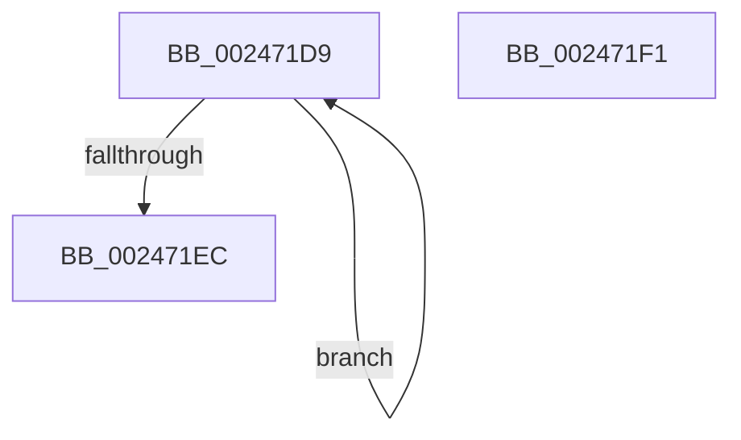

# sub_002471D9

- RVA: `0x002471D9`–`0x002471FA` (길이 `33` bytes)
- VA: `0x00000001402471D9`
- 실행 섹션: `.text`
- PDB 이름 있음: `아니요`; PDB Function 태그: `아니요`
- unwind 정보 RVA: `0x00062370`
- 디코드: `9`개 명령, `33/33` bytes 표시
- 미해석 바이트: `0` (있으면 어셈블리에 `.byte`로 보존)

> 이 문서는 커널 이미지의 기계어와 PDB 기호를 분석해 생성했습니다. 4번과 5번은 함수 원형과 자료형을 바이너리 사용 방식에서 추정한 C 해석이며 원본 소스 복구 결과는 아닙니다.

## 1. Dependencies

- 직접 호출 지점: **0**; 고유 호출 대상: **0**
- 직접 호출자로 확인된 함수: **0**
- RIP 상대 이미지 참조: **0**

### Outgoing calls
- 직접 디코드된 call 명령이 없습니다.

### Direct callers
- 이 함수 시작 RVA로 연결되는 직접 call은 확인되지 않았습니다. 간접 호출은 완전히 역산할 수 없습니다.

### Static image references
- 디코드된 RIP-relative 메모리 참조가 없습니다.

## 2. Other-region calls and transfers

- 다른 실행 섹션으로 향하는 call: **0**
- call이 아닌 외부 분기/꼬리 이동: **2**
  - `0x002471EC` → [MmUnmapLockedPages + 0x71](MmUnmapLockedPages_function_00246E60.md) (`tail-transfer`)
  - `0x002471F5` → [MmUnmapLockedPages + 0xA7](MmUnmapLockedPages_function_00246E60.md) (`tail-transfer`)

## 3. Assembly (complete function range)

```asm
002471D9  48 8B 42 F8                     mov rax, qword ptr [rdx - 8]
002471DD  48 8D 4A F8                     lea rcx, [rdx - 8]
002471E1  48 89 02                        mov qword ptr [rdx], rax
002471E4  48 8B D1                        mov rdx, rcx
002471E7  49 3B C8                        cmp rcx, r8
002471EA  75 ED                           jne 0x1402471d9
002471EC  E9 E0 FC FF FF                  jmp 0x140246ed1
002471F1  48 29 4E 18                     sub qword ptr [rsi + 0x18], rcx
002471F5  E9 0D FD FF FF                  jmp 0x140246f07
```

## 4. C-style interpretation (structured pseudocode)

```c
__int64 __fastcall sub_002471D9(__int64 a1, __int64 a2, __int64 a3)
{
    *(unsigned __int64 *)(a2) = *(unsigned __int64 *)(a2 - 8);
    if ((a2 - 8) != a3) goto loc_002471D9;
}
```

## 5. (Beta) C Style

```c
int64_t sub_002471D9(int64_t Arg1, void *Arg2, int64_t Arg3)
{
    uint8_t *arg2 = (uint8_t *)Arg2;

    *(uint64_t *)(arg2) = *(uint64_t *)(arg2 - 0x8);
    if ((Arg2 - 8) != Arg3) goto loc_002471D9;
}
```

### 관측된 메모리 오프셋

구조체 형식이 확인되지 않은 접근은 인자 기준의 오프셋으로만 기록했습니다.

| 기준 인자 | 오프셋 표현 | 폭 (bit) | 접근 |
|---|---:|---:|---|
| `Arg2` | `- 0x8` | `64` | `R` |
| `Arg2` | `+ 0x0` | `64` | `W` |

## 6. Execution-region graph

[열기: 2D/3D 그래프와 함수 탐색 컨트롤 패널](../../../control-panel.html?section=text&rva=0x002471D9&view=graph)

- 2D 그래프는 위에서 아래로 흐르고, 3D 그래프는 빈 공간을 드래그해 회전합니다. Shift+드래그는 이동, 휠은 확대·축소, 함수 노드 선택은 대상 보고서 이동입니다.

### Static fallback


