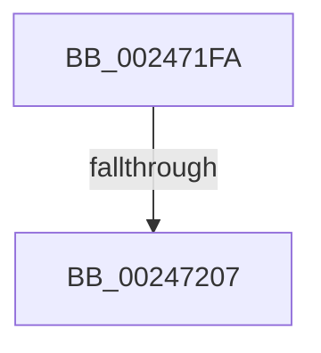

# sub_002471FA

- RVA: `0x002471FA`–`0x00247236` (길이 `60` bytes)
- VA: `0x00000001402471FA`
- 실행 섹션: `.text`
- PDB 이름 있음: `아니요`; PDB Function 태그: `아니요`
- unwind 정보 RVA: `0x00062380`
- 디코드: `13`개 명령, `60/60` bytes 표시
- 미해석 바이트: `0` (있으면 어셈블리에 `.byte`로 보존)

> 이 문서는 커널 이미지의 기계어와 PDB 기호를 분석해 생성했습니다. 4번과 5번은 함수 원형과 자료형을 바이너리 사용 방식에서 추정한 C 해석이며 원본 소스 복구 결과는 아닙니다.

## 1. Dependencies

- 직접 호출 지점: **2**; 고유 호출 대상: **2**
- 직접 호출자로 확인된 함수: **0**
- RIP 상대 이미지 참조: **2**

### Outgoing calls
- `0x0024721C` → [KeBugCheckEx](../4F/KeBugCheckEx_function_004FD660.md) (function, `0x004FD660`)
- `0x0024722C` → [ExpInterlockedPushEntrySList](../6B/ExpInterlockedPushEntrySList_function_006BA5B0.md) (function, `0x006BA5B0`)

### Direct callers
- 이 함수 시작 RVA로 연결되는 직접 call은 확인되지 않았습니다. 간접 호출은 완전히 역산할 수 없습니다.

### Static image references
- `0x002471FA` → RVA `0x00E35FA5` (`.data`; read)
- `0x00247225` → RVA `0x00E35E00` (`.data`; read)

## 2. Other-region calls and transfers

- 다른 실행 섹션으로 향하는 call: **0**
- call이 아닌 외부 분기/꼬리 이동: **2**
  - `0x00247201` → [sub_00246F4D + 0x18F](Unknown_function_00246F4D.md) (`tail-transfer`)
  - `0x00247231` → [sub_00246F4D + 0x1B6](Unknown_function_00246F4D.md) (`tail-transfer`)

## 3. Assembly (complete function range)

```asm
002471FA  80 3D A4 ED BE 00 00            cmp byte ptr [rip + 0xbeeda4], 0
00247201  0F 85 D5 FE FF FF               jne 0x1402470dc
00247207  4C 8B CD                        mov r9, rbp
0024720A  48 89 7C 24 20                  mov qword ptr [rsp + 0x20], rdi
0024720F  4C 8B C6                        mov r8, rsi
00247212  BA 06 00 00 00                  mov edx, 6
00247217  B9 DA 00 00 00                  mov ecx, 0xda
0024721C  E8 3F 64 2B 00                  call 0x1404fd660
00247221  CC                              int3
00247222  49 8B D6                        mov rdx, r14
00247225  48 8D 0D D4 EB BE 00            lea rcx, [rip + 0xbeebd4]
0024722C  E8 7F 33 47 00                  call 0x1406ba5b0
00247231  E9 CD FE FF FF                  jmp 0x140247103
```

## 4. C-style interpretation (structured pseudocode)

```c
__int64 __fastcall sub_002471FA(void)
{
    __int64 result;
    unsigned __int64 v_stack_p20;

    v_stack_p20 = v_rdi;
    result = KeBugCheckEx(218, 6, v_rsi, v_rbp);
    result = ExpInterlockedPushEntrySList(v_rip + 12512212, v_r14, v_rsi, v_rbp);
}
```

## 5. (Beta) C Style

```c
void sub_002471FA(void)
{
    int64_t result;
    uint64_t v_stack_p20;

    v_stack_p20 = local_rdi;
    result = KeBugCheckEx(218, 6, local_rsi, local_rbp);
    result = ExpInterlockedPushEntrySList(v_rip + 12512212, local_r14, local_rsi, local_rbp);
}
```

## 6. Execution-region graph

[열기: 2D/3D 그래프와 함수 탐색 컨트롤 패널](../../../control-panel.html?section=text&rva=0x002471FA&view=graph)

- 2D 그래프는 위에서 아래로 흐르고, 3D 그래프는 빈 공간을 드래그해 회전합니다. Shift+드래그는 이동, 휠은 확대·축소, 함수 노드 선택은 대상 보고서 이동입니다.

### Static fallback


