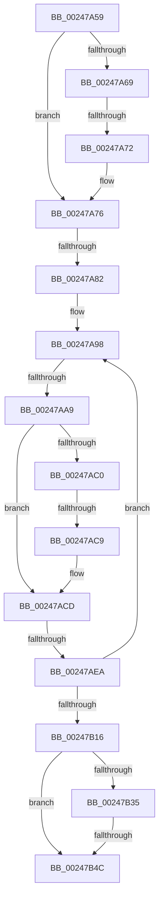

# sub_00247A59

- RVA: `0x00247A59`–`0x00247B59` (길이 `256` bytes)
- VA: `0x0000000140247A59`
- 실행 섹션: `.text`
- PDB 이름 있음: `아니요`; PDB Function 태그: `아니요`
- unwind 정보 RVA: `0x000623E4`
- 디코드: `59`개 명령, `256/256` bytes 표시
- 미해석 바이트: `0` (있으면 어셈블리에 `.byte`로 보존)

> 이 문서는 커널 이미지의 기계어와 PDB 기호를 분석해 생성했습니다. 4번과 5번은 함수 원형과 자료형을 바이너리 사용 방식에서 추정한 C 해석이며 원본 소스 복구 결과는 아닙니다.

## 1. Dependencies

- 직접 호출 지점: **0**; 고유 호출 대상: **0**
- 직접 호출자로 확인된 함수: **0**
- RIP 상대 이미지 참조: **1**

### Outgoing calls
- 직접 디코드된 call 명령이 없습니다.

### Direct callers
- 이 함수 시작 RVA로 연결되는 직접 call은 확인되지 않았습니다. 간접 호출은 완전히 역산할 수 없습니다.

### Static image references
- `0x00247AA9` → RVA `0x00E2DC80` (`.data`; read)

## 2. Other-region calls and transfers

- 다른 실행 섹션으로 향하는 call: **0**
- call이 아닌 외부 분기/꼬리 이동: **6**
  - `0x00247A6C` → [sub_00247BBB](Unknown_function_00247BBB.md) (`tail-transfer`)
  - `0x00247A7C` → [sub_00247C30 + 0x13A](Unknown_function_00247C30.md) (`tail-transfer`)
  - `0x00247AA3` → [sub_00247C30](Unknown_function_00247C30.md) (`tail-transfer`)
  - `0x00247AC3` → [sub_00247B69](Unknown_function_00247B69.md) (`tail-transfer`)
  - `0x00247AE4` → [sub_00247C30 + 0x14A](Unknown_function_00247C30.md) (`tail-transfer`)
  - `0x00247B46` → [sub_00247C30 + 0x91](Unknown_function_00247C30.md) (`tail-transfer`)

## 3. Assembly (complete function range)

```asm
00247A59  4C 89 BC 24 98 00 00 00         mov qword ptr [rsp + 0x98], r15
00247A61  44 8B FF                        mov r15d, edi
00247A64  48 85 D2                        test rdx, rdx
00247A67  74 0D                           je 0x140247a76
00247A69  48 85 D0                        test rax, rdx
00247A6C  0F 84 49 01 00 00               je 0x140247bbb
00247A72  48 83 C8 10                     or rax, 0x10
00247A76  48 8B 3E                        mov rdi, qword ptr [rsi]
00247A79  83 FD 02                        cmp ebp, 2
00247A7C  0F 84 E8 02 00 00               je 0x140247d6a
00247A82  4C 8B 84 24 A8 00 00 00         mov r8, qword ptr [rsp + 0xa8]
00247A8A  48 83 E0 FD                     and rax, 0xfffffffffffffffd
00247A8E  49 0B C0                        or rax, r8
00247A91  48 89 06                        mov qword ptr [rsi], rax
00247A94  49 8B 1C 24                     mov rbx, qword ptr [r12]
00247A98  0F B7 C3                        movzx eax, bx
00247A9B  48 89 5C 24 28                  mov qword ptr [rsp + 0x28], rbx
00247AA0  49 3B C7                        cmp rax, r15
00247AA3  0F 85 87 01 00 00               jne 0x140247c30
00247AA9  48 8B 15 D0 61 BE 00            mov rdx, qword ptr [rip + 0xbe61d0]
00247AB0  48 8B C3                        mov rax, rbx
00247AB3  48 C1 E8 10                     shr rax, 0x10
00247AB7  48 C1 E0 19                     shl rax, 0x19
00247ABB  48 85 D2                        test rdx, rdx
00247ABE  74 0D                           je 0x140247acd
00247AC0  48 85 D0                        test rax, rdx
00247AC3  0F 84 A0 00 00 00               je 0x140247b69
00247AC9  48 83 C8 10                     or rax, 0x10
00247ACD  48 83 E0 FD                     and rax, 0xfffffffffffffffd
00247AD1  48 8B CF                        mov rcx, rdi
00247AD4  49 0B C0                        or rax, r8
00247AD7  81 E1 E0 03 00 00               and ecx, 0x3e0
00247ADD  48 81 F9 00 02 00 00            cmp rcx, 0x200
00247AE4  0F 84 90 02 00 00               je 0x140247d7a
00247AEA  48 8B CE                        mov rcx, rsi
00247AED  48 89 06                        mov qword ptr [rsi], rax
00247AF0  49 2B CD                        sub rcx, r13
00247AF3  48 8B C3                        mov rax, rbx
00247AF6  48 C1 F9 03                     sar rcx, 3
00247AFA  48 C1 E1 10                     shl rcx, 0x10
00247AFE  49 0B CF                        or rcx, r15
00247B01  48 89 4C 24 20                  mov qword ptr [rsp + 0x20], rcx
00247B06  F0 49 0F B1 0C 24               lock cmpxchg qword ptr [r12], rcx
00247B0C  48 8B D8                        mov rbx, rax
00247B0F  48 3B 44 24 28                  cmp rax, qword ptr [rsp + 0x28]
00247B14  75 82                           jne 0x140247a98
00247B16  48 8B 44 24 38                  mov rax, qword ptr [rsp + 0x38]
00247B1B  F0 49 01 46 40                  lock add qword ptr [r14 + 0x40], rax
00247B20  65 48 8B 04 25 20 00 00 00      mov rax, qword ptr gs:[0x20]
00247B29  48 8B 90 38 88 00 00            mov rdx, qword ptr [rax + 0x8838]
00247B30  48 85 D2                        test rdx, rdx
00247B33  74 17                           je 0x140247b4c
00247B35  B9 01 00 00 00                  mov ecx, 1
00247B3A  F0 0F C1 8A 58 01 00 00         lock xadd dword ptr [rdx + 0x158], ecx
00247B42  FF C1                           inc ecx
00247B44  84 C9                           test cl, cl
00247B46  0F 84 75 01 00 00               je 0x140247cc1
00247B4C  4C 8B BC 24 98 00 00 00         mov r15, qword ptr [rsp + 0x98]
00247B54  B8 01 00 00 00                  mov eax, 1
```

## 4. C-style interpretation (structured pseudocode)

```c
__int64 __fastcall sub_00247A59(__int64 a1, __int64 a2, __int64 a3, __int64 a4, __int64 a5, __int64 a6, __int64 a7, __int64 a8, __int64 a9, __int64 a10, __int64 a11, __int64 a12, __int64 a13, __int64 a14, __int64 a15, __int64 a16, __int64 a17, __int64 a18, __int64 a19, __int64 a20, __int64 a21)
{
    __int64 result;
    unsigned __int64 v_stack_p20;
    unsigned __int64 v_stack_p28;
    unsigned __int64 v_stack_p98;

    v_stack_p98 = v_r15;
    if (a2 == 0) goto loc_00247A76;
    result = (result) | (16);
loc_00247A76:
    result = (result) & (-3);
    result = (result) | (a21);
    *(unsigned __int64 *)(v_rsi) = result;
loc_00247A98:
    v_stack_p28 = *(unsigned __int64 *)(v_r12);
    result = (*(unsigned __int64 *)(v_r12)) >> (16);
    result = (result) << (25);
    if (*(unsigned __int64 *)(v_rip + 12476880) == 0) goto loc_00247ACD;
    result = (result) | (16);
loc_00247ACD:
    result = (result) & (-3);
    result = (result) | (a21);
    a1 = (unsigned int)((*(unsigned __int64 *)(v_rsi)) & (992));
    *(unsigned __int64 *)(v_rsi) = result;
    a1 = (v_rsi) - (v_r13);
    a1 = (a1) >> (3);
    a1 = (a1) << (16);
    a1 = (a1) | ((unsigned int)((unsigned int)(v_rdi)));
    v_stack_p20 = a1;
    if ((*(unsigned __int64 *)(v_r12)) != a5) goto loc_00247A98;
    if (*(unsigned __int64 *)(*(unsigned __int64 *)(gs_base + (0 + 32)) + 34872) == 0) goto loc_00247B4C;
    a1 = (unsigned int)((1) + 1);
loc_00247B4C:
    return 1;
}
```

## 5. (Beta) C Style

```c
int64_t sub_00247A59(int64_t Arg1, int64_t Arg2, int64_t Arg3, int64_t Arg4, int64_t Arg5, uint64_t Arg6, int64_t Arg7, uint64_t Arg8, uint64_t Arg9, uint64_t Arg10, uint64_t Arg11, uint64_t Arg12, uint64_t Arg13, uint64_t Arg14, uint64_t Arg15, uint64_t Arg16, uint64_t Arg17, uint64_t Arg18, int64_t Arg19, uint64_t Arg20, int64_t Arg21)
{
    int64_t result;
    uint64_t v_stack_p20;
    uint64_t v_stack_p28;
    uint64_t v_stack_p98;

    v_stack_p98 = local_r15;
    if (Arg2 == 0) goto loc_00247A76;
    result = (result) | (16);
loc_00247A76:
    result = (result) & (-3);
    result = (result) | (Arg21);
    *(uint64_t *)(local_rsi) = result;
loc_00247A98:
    v_stack_p28 = *(uint64_t *)(local_r12);
    result = (*(uint64_t *)(local_r12)) >> (16);
    result = (result) << (25);
    if (*(uint64_t *)(v_rip + 0xBE61D0) == 0) goto loc_00247ACD;
    result = (result) | (16);
loc_00247ACD:
    result = (result) & (-3);
    result = (result) | (Arg21);
    Arg1 = (uint32_t)((*(uint64_t *)(local_rsi)) & (992));
    *(uint64_t *)(local_rsi) = result;
    Arg1 = (local_rsi) - (local_r13);
    Arg1 = (Arg1) >> (3);
    Arg1 = (Arg1) << (16);
    Arg1 = (Arg1) | ((uint32_t)((uint32_t)(local_rdi)));
    v_stack_p20 = Arg1;
    if ((*(uint64_t *)(local_r12)) != Arg5) goto loc_00247A98;
    if (*(uint64_t *)(*(uint64_t *)(gs_base + (0 + 0x20)) + 0x8838) == 0) goto loc_00247B4C;
    Arg1 = (uint32_t)((1) + 1);
loc_00247B4C:
    return 1;
}
```

## 6. Execution-region graph

[열기: 2D/3D 그래프와 함수 탐색 컨트롤 패널](../../../control-panel.html?section=text&rva=0x00247A59&view=graph)

- 2D 그래프는 위에서 아래로 흐르고, 3D 그래프는 빈 공간을 드래그해 회전합니다. Shift+드래그는 이동, 휠은 확대·축소, 함수 노드 선택은 대상 보고서 이동입니다.

### Static fallback


