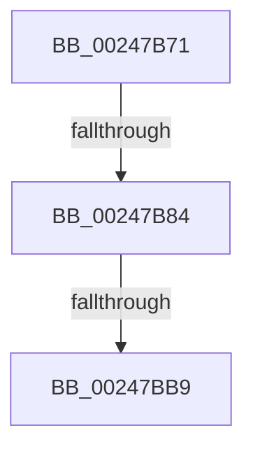

# sub_00247B71

- RVA: `0x00247B71`–`0x00247BBB` (길이 `74` bytes)
- VA: `0x0000000140247B71`
- 실행 섹션: `.text`
- PDB 이름 있음: `아니요`; PDB Function 태그: `아니요`
- unwind 정보 RVA: `0x00062420`
- 디코드: `17`개 명령, `74/74` bytes 표시
- 미해석 바이트: `0` (있으면 어셈블리에 `.byte`로 보존)

> 이 문서는 커널 이미지의 기계어와 PDB 기호를 분석해 생성했습니다. 4번과 5번은 함수 원형과 자료형을 바이너리 사용 방식에서 추정한 C 해석이며 원본 소스 복구 결과는 아닙니다.

## 1. Dependencies

- 직접 호출 지점: **0**; 고유 호출 대상: **0**
- 직접 호출자로 확인된 함수: **0**
- RIP 상대 이미지 참조: **0**

### Outgoing calls
- 직접 디코드된 call 명령이 없습니다.

### Direct callers
- 이 함수 시작 RVA로 연결되는 직접 call은 확인되지 않았습니다. 간접 호출은 완전히 역산할 수 없습니다.

### Static image references
- 디코드된 RIP-relative 메모리 참조가 없습니다.

## 2. Other-region calls and transfers

- 다른 실행 섹션으로 향하는 call: **0**
- call이 아닌 외부 분기/꼬리 이동: **3**
  - `0x00247B7E` → [MiInsertCachedPte + 0x66](MiInsertCachedPte_function_00247970.md) (`tail-transfer`)
  - `0x00247BB3` → [MiInsertCachedPte + 0x66](MiInsertCachedPte_function_00247970.md) (`tail-transfer`)
  - `0x00247BB9` → [sub_00247BC3 + 0x61](Unknown_function_00247BC3.md) (`tail-transfer`)

## 3. Assembly (complete function range)

```asm
00247B71  48 B9 FF FF FF FF FF F6 FF FF   movabs rcx, 0xfffff6ffffffffff
00247B7B  48 3B C1                        cmp rax, rcx
00247B7E  0F 87 52 FE FF FF               ja 0x1402479d6
00247B84  49 C1 ED 09                     shr r13, 9
00247B88  48 B8 F8 FF FF FF 7F 00 00 00   movabs rax, 0x7ffffffff8
00247B92  4C 23 E8                        and r13, rax
00247B95  BD 02 00 00 00                  mov ebp, 2
00247B9A  49 8B C1                        mov rax, r9
00247B9D  4C 03 E8                        add r13, rax
00247BA0  B9 00 10 00 00                  mov ecx, 0x1000
00247BA5  8B C6                           mov eax, esi
00247BA7  25 FF 0F 00 00                  and eax, 0xfff
00247BAC  2B C8                           sub ecx, eax
00247BAE  C1 E9 03                        shr ecx, 3
00247BB1  3B D9                           cmp ebx, ecx
00247BB3  0F 86 1D FE FF FF               jbe 0x1402479d6
00247BB9  EB 69                           jmp 0x140247c24
```

## 4. C-style interpretation (structured pseudocode)

```c
__int64 __fastcall sub_00247B71(__int64 a1, __int64 a2, __int64 a3, __int64 a4)
{
    __int64 result;
    __int64 v_r13;

    v_r13 = (v_r13) >> (9);
    v_r13 = (v_r13) & (result);
    v_r13 = (v_r13) + (a4);
    result = (unsigned int)(((unsigned int)((unsigned int)(v_rsi))) & (0xFFFULL));
    a1 = (unsigned int)(((unsigned int)(0x1000ULL)) - ((unsigned int)(result)));
    a1 = (unsigned int)((a1) >> (3));
}
```

## 5. (Beta) C Style

```c
int64_t sub_00247B71(int64_t Arg1, int64_t Arg2, int64_t Arg3, int64_t Arg4)
{
    int64_t result;
    int64_t local_r13;

    local_r13 = (local_r13) >> (9);
    local_r13 = (local_r13) & (result);
    local_r13 = (local_r13) + (Arg4);
    result = (uint32_t)(((uint32_t)((uint32_t)(local_rsi))) & (0xFFFULL));
    Arg1 = (uint32_t)(((uint32_t)(0x1000ULL)) - ((uint32_t)(result)));
    Arg1 = (uint32_t)((Arg1) >> (3));
}
```

## 6. Execution-region graph

[열기: 2D/3D 그래프와 함수 탐색 컨트롤 패널](../../../control-panel.html?section=text&rva=0x00247B71&view=graph)

- 2D 그래프는 위에서 아래로 흐르고, 3D 그래프는 빈 공간을 드래그해 회전합니다. Shift+드래그는 이동, 휠은 확대·축소, 함수 노드 선택은 대상 보고서 이동입니다.

### Static fallback


