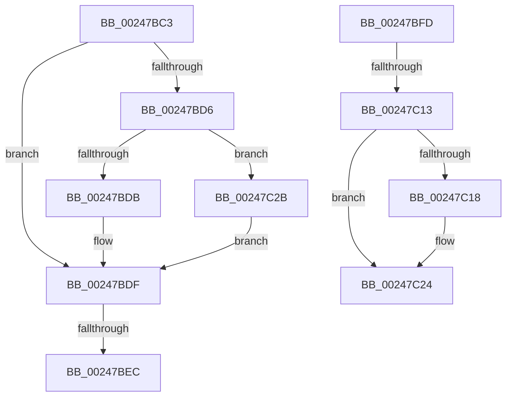

# sub_00247BC3

- RVA: `0x00247BC3`–`0x00247C30` (길이 `109` bytes)
- VA: `0x0000000140247BC3`
- 실행 섹션: `.text`
- PDB 이름 있음: `아니요`; PDB Function 태그: `아니요`
- unwind 정보 RVA: `0x00062444`
- 디코드: `29`개 명령, `109/109` bytes 표시
- 미해석 바이트: `0` (있으면 어셈블리에 `.byte`로 보존)

> 이 문서는 커널 이미지의 기계어와 PDB 기호를 분석해 생성했습니다. 4번과 5번은 함수 원형과 자료형을 바이너리 사용 방식에서 추정한 C 해석이며 원본 소스 복구 결과는 아닙니다.

## 1. Dependencies

- 직접 호출 지점: **2**; 고유 호출 대상: **2**
- 직접 호출자로 확인된 함수: **0**
- RIP 상대 이미지 참조: **1**

### Outgoing calls
- `0x00247C06` → [MiOkToBinMoreLargePtes](../4A/MiOkToBinMoreLargePtes_function_004A3B5C.md) (function, `0x004A3B5C`)
- `0x00247C1B` → [MiMakeDemandZeroPte](../33/MiMakeDemandZeroPte_function_00337A00.md) (function, `0x00337A00`)

### Direct callers
- 이 함수 시작 RVA로 연결되는 직접 call은 확인되지 않았습니다. 간접 호출은 완전히 역산할 수 없습니다.

### Static image references
- `0x00247BC3` → RVA `0x00E2DC80` (`.data`; read)

## 2. Other-region calls and transfers

- 다른 실행 섹션으로 향하는 call: **0**
- call이 아닌 외부 분기/꼬리 이동: **4**
  - `0x00247BE6` → [sub_00247D90 + 0x2E](Unknown_function_00247D90.md) (`tail-transfer`)
  - `0x00247BF8` → [MiInsertCachedPte + 0x84](MiInsertCachedPte_function_00247970.md) (`tail-transfer`)
  - `0x00247C0D` → [sub_00247D90 + 0x3E](Unknown_function_00247D90.md) (`tail-transfer`)
  - `0x00247C26` → [sub_00247B59](Unknown_function_00247B59.md) (`tail-transfer`)

## 3. Assembly (complete function range)

```asm
00247BC3  48 8B 15 B6 60 BE 00            mov rdx, qword ptr [rip + 0xbe60b6]
00247BCA  48 8B C3                        mov rax, rbx
00247BCD  48 C1 E0 20                     shl rax, 0x20
00247BD1  48 85 D2                        test rdx, rdx
00247BD4  74 09                           je 0x140247bdf
00247BD6  48 85 D0                        test rax, rdx
00247BD9  74 50                           je 0x140247c2b
00247BDB  48 83 C8 10                     or rax, 0x10
00247BDF  48 8B 4E 08                     mov rcx, qword ptr [rsi + 8]
00247BE3  83 FD 02                        cmp ebp, 2
00247BE6  0F 84 D2 01 00 00               je 0x140247dbe
00247BEC  48 89 46 08                     mov qword ptr [rsi + 8], rax
00247BF0  4C 89 9C 24 A8 00 00 00         mov qword ptr [rsp + 0xa8], r11
00247BF8  E9 F7 FD FF FF                  jmp 0x1402479f4
00247BFD  44 8B C3                        mov r8d, ebx
00247C00  49 8B D6                        mov rdx, r14
00247C03  49 8B CA                        mov rcx, r10
00247C06  E8 51 BF 25 00                  call 0x1404a3b5c
00247C0B  85 C0                           test eax, eax
00247C0D  0F 85 BB 01 00 00               jne 0x140247dce
00247C13  83 FB 01                        cmp ebx, 1
00247C16  74 0C                           je 0x140247c24
00247C18  8D 48 10                        lea ecx, [rax + 0x10]
00247C1B  E8 E0 FD 0E 00                  call 0x140337a00
00247C20  48 89 46 08                     mov qword ptr [rsi + 8], rax
00247C24  33 C0                           xor eax, eax
00247C26  E9 2E FF FF FF                  jmp 0x140247b59
00247C2B  48 0B C2                        or rax, rdx
00247C2E  EB AF                           jmp 0x140247bdf
```

## 4. C-style interpretation (structured pseudocode)

```c
__int64 __fastcall sub_00247BC3(void)
{
    __int64 result;
    unsigned __int64 v_stack_pA8;

    result = (v_rbx) << (32);
    if (*(unsigned __int64 *)(v_rip + 12476598) == 0) goto loc_00247BDF;
    if (((result) & (*(unsigned __int64 *)(v_rip + 12476598))) == 0) goto loc_00247C2B;
    result = (result) | (16);
loc_00247BDF:
    *(unsigned __int64 *)(v_rsi + 8) = result;
    v_stack_pA8 = v_r11;
loc_00247C2B:
    result = (result) | (*(unsigned __int64 *)(v_rip + 12476598));
    goto loc_00247BDF;
}
```

## 5. (Beta) C Style

```c
void sub_00247BC3(void)
{
    int64_t result;
    uint64_t v_stack_pA8;

    result = (local_rbx) << (32);
    if (*(uint64_t *)(v_rip + 0xBE60B6) == 0) goto loc_00247BDF;
    if (((result) & (*(uint64_t *)(v_rip + 0xBE60B6))) == 0) goto loc_00247C2B;
    result = (result) | (16);
loc_00247BDF:
    *(uint64_t *)(local_rsi + 0x8) = result;
    v_stack_pA8 = local_r11;
loc_00247C2B:
    result = (result) | (*(uint64_t *)(v_rip + 0xBE60B6));
    goto loc_00247BDF;
}
```

## 6. Execution-region graph

[열기: 2D/3D 그래프와 함수 탐색 컨트롤 패널](../../../control-panel.html?section=text&rva=0x00247BC3&view=graph)

- 2D 그래프는 위에서 아래로 흐르고, 3D 그래프는 빈 공간을 드래그해 회전합니다. Shift+드래그는 이동, 휠은 확대·축소, 함수 노드 선택은 대상 보고서 이동입니다.

### Static fallback


