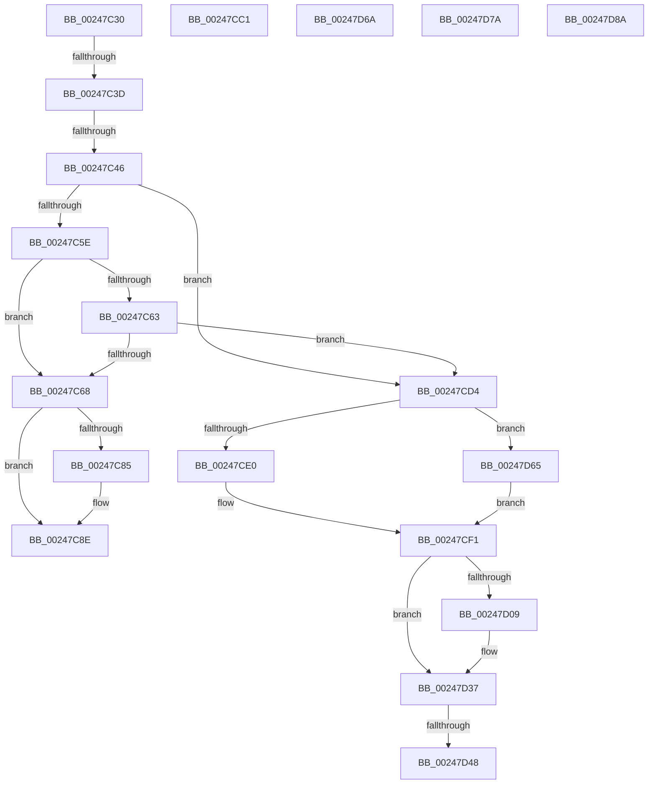

# sub_00247C30

- RVA: `0x00247C30`–`0x00247D90` (길이 `352` bytes)
- VA: `0x0000000140247C30`
- 실행 섹션: `.text`
- PDB 이름 있음: `아니요`; PDB Function 태그: `아니요`
- unwind 정보 RVA: `0x00062454`
- 디코드: `82`개 명령, `352/352` bytes 표시
- 미해석 바이트: `0` (있으면 어셈블리에 `.byte`로 보존)

> 이 문서는 커널 이미지의 기계어와 PDB 기호를 분석해 생성했습니다. 4번과 5번은 함수 원형과 자료형을 바이너리 사용 방식에서 추정한 C 해석이며 원본 소스 복구 결과는 아닙니다.

## 1. Dependencies

- 직접 호출 지점: **5**; 고유 호출 대상: **4**
- 직접 호출자로 확인된 함수: **0**
- RIP 상대 이미지 참조: **1**

### Outgoing calls
- `0x00247C6A` → [MiMakeLinkedListPte](../2C/MiMakeLinkedListPte_function_002C98C0.md) (function, `0x002C98C0`)
- `0x00247CB7` → [MiReleasePteMappings](../23/MiReleasePteMappings_function_00237CE0.md) (function, `0x00237CE0`)
- `0x00247CCA` → [MiEmptyPteBins](../31/MiEmptyPteBins_function_0031AAE4.md) (function, `0x0031AAE4`)
- `0x00247D17` → [MiReleasePteMappings](../23/MiReleasePteMappings_function_00237CE0.md) (function, `0x00237CE0`)
- `0x00247D48` → [KeLeaveCriticalRegionThread](../25/KeLeaveCriticalRegionThread_function_0025EFF0.md) (function, `0x0025EFF0`)

### Direct callers
- 이 함수 시작 RVA로 연결되는 직접 call은 확인되지 않았습니다. 간접 호출은 완전히 역산할 수 없습니다.

### Static image references
- `0x00247C4B` → RVA `0x00FCF080` (`CACHEALI`; read)

## 2. Other-region calls and transfers

- 다른 실행 섹션으로 향하는 call: **0**
- call이 아닌 외부 분기/꼬리 이동: **8**
  - `0x00247C37` → [sub_00247A59 + 0x50](Unknown_function_00247A59.md) (`tail-transfer`)
  - `0x00247C40` → [sub_00247A59 + 0x3B](Unknown_function_00247A59.md) (`tail-transfer`)
  - `0x00247CBC` → [sub_00247A59 + 0xF3](Unknown_function_00247A59.md) (`tail-transfer`)
  - `0x00247CCF` → [sub_00247A59 + 0xF3](Unknown_function_00247A59.md) (`tail-transfer`)
  - `0x00247D42` → [sub_00247A59 + 0x3F](Unknown_function_00247A59.md) (`tail-transfer`)
  - `0x00247D60` → [sub_00247A59 + 0x3F](Unknown_function_00247A59.md) (`tail-transfer`)
  - `0x00247D75` → [sub_00247A59 + 0x29](Unknown_function_00247A59.md) (`tail-transfer`)
  - `0x00247D85` → [sub_00247A59 + 0x91](Unknown_function_00247A59.md) (`tail-transfer`)

## 3. Assembly (complete function range)

```asm
00247C30  48 81 FB 00 00 01 00            cmp rbx, 0x10000
00247C37  0F 82 6C FE FF FF               jb 0x140247aa9
00247C3D  48 85 C0                        test rax, rax
00247C40  0F 84 4E FE FF FF               je 0x140247a94
00247C46  F0 83 0C 24 00                  lock or dword ptr [rsp], 0
00247C4B  8B 05 2F 74 D8 00               mov eax, dword ptr [rip + 0xd8742f]
00247C51  0F B7 CB                        movzx ecx, bx
00247C54  2B C1                           sub eax, ecx
00247C56  0F B7 D0                        movzx edx, ax
00247C59  83 FA 02                        cmp edx, 2
00247C5C  77 76                           ja 0x140247cd4
00247C5E  F6 C1 01                        test cl, 1
00247C61  75 05                           jne 0x140247c68
00247C63  83 FA 02                        cmp edx, 2
00247C66  73 6C                           jae 0x140247cd4
00247C68  33 C9                           xor ecx, ecx
00247C6A  E8 51 1C 08 00                  call 0x1402c98c0
00247C6F  48 83 E0 FD                     and rax, 0xfffffffffffffffd
00247C73  81 E7 E0 03 00 00               and edi, 0x3e0
00247C79  49 0B C0                        or rax, r8
00247C7C  48 81 FF 00 02 00 00            cmp rdi, 0x200
00247C83  75 09                           jne 0x140247c8e
00247C85  48 25 1F FE FF FF               and rax, 0xfffffffffffffe1f
00247C8B  48 0B C7                        or rax, rdi
00247C8E  48 89 06                        mov qword ptr [rsi], rax
00247C91  48 8D 54 24 20                  lea rdx, [rsp + 0x20]
00247C96  0F B7 44 24 20                  movzx eax, word ptr [rsp + 0x20]
00247C9B  49 2B F5                        sub rsi, r13
00247C9E  48 C1 FE 03                     sar rsi, 3
00247CA2  44 8B CD                        mov r9d, ebp
00247CA5  48 C1 E6 10                     shl rsi, 0x10
00247CA9  45 33 C0                        xor r8d, r8d
00247CAC  48 0B F0                        or rsi, rax
00247CAF  49 8B CA                        mov rcx, r10
00247CB2  48 89 74 24 20                  mov qword ptr [rsp + 0x20], rsi
00247CB7  E8 24 00 FF FF                  call 0x140237ce0
00247CBC  E9 8B FE FF FF                  jmp 0x140247b4c
00247CC1  33 D2                           xor edx, edx
00247CC3  49 8B CA                        mov rcx, r10
00247CC6  44 8D 42 02                     lea r8d, [rdx + 2]
00247CCA  E8 15 2E 0D 00                  call 0x14031aae4
00247CCF  E9 78 FE FF FF                  jmp 0x140247b4c
00247CD4  44 0F 20 C0                     mov rax, cr8
00247CD8  84 C0                           test al, al
00247CDA  0F 85 85 00 00 00               jne 0x140247d65
00247CE0  65 48 8B 0C 25 88 01 00 00      mov rcx, qword ptr gs:[0x188]
00247CE9  66 FF 89 E4 01 00 00            dec word ptr [rcx + 0x1e4]
00247CF0  90                              nop
00247CF1  48 89 4C 24 30                  mov qword ptr [rsp + 0x30], rcx
00247CF6  48 8B C3                        mov rax, rbx
00247CF9  F0 4D 0F B1 1C 24               lock cmpxchg qword ptr [r12], r11
00247CFF  48 8B D8                        mov rbx, rax
00247D02  48 3B 44 24 28                  cmp rax, qword ptr [rsp + 0x28]
00247D07  75 2E                           jne 0x140247d37
00247D09  44 8B CD                        mov r9d, ebp
00247D0C  48 8D 54 24 28                  lea rdx, [rsp + 0x28]
00247D11  45 33 C0                        xor r8d, r8d
00247D14  49 8B CA                        mov rcx, r10
00247D17  E8 C4 FF FE FF                  call 0x140237ce0
00247D1C  48 F7 D8                        neg rax
00247D1F  F0 49 01 46 40                  lock add qword ptr [r14 + 0x40], rax
00247D24  48 8B 4C 24 30                  mov rcx, qword ptr [rsp + 0x30]
00247D29  45 33 DB                        xor r11d, r11d
00247D2C  4C 8B 84 24 A8 00 00 00         mov r8, qword ptr [rsp + 0xa8]
00247D34  41 8B DB                        mov ebx, r11d
00247D37  4C 8B 94 24 90 00 00 00         mov r10, qword ptr [rsp + 0x90]
00247D3F  48 85 C9                        test rcx, rcx
00247D42  0F 84 50 FD FF FF               je 0x140247a98
00247D48  E8 A3 72 01 00                  call 0x14025eff0
00247D4D  4C 8B 84 24 A8 00 00 00         mov r8, qword ptr [rsp + 0xa8]
00247D55  45 33 DB                        xor r11d, r11d
00247D58  4C 8B 94 24 90 00 00 00         mov r10, qword ptr [rsp + 0x90]
00247D60  E9 33 FD FF FF                  jmp 0x140247a98
00247D65  49 8B CB                        mov rcx, r11
00247D68  EB 87                           jmp 0x140247cf1
00247D6A  48 25 1F FE FF FF               and rax, 0xfffffffffffffe1f
00247D70  48 0F BA E8 09                  bts rax, 9
00247D75  E9 08 FD FF FF                  jmp 0x140247a82
00247D7A  48 25 1F FE FF FF               and rax, 0xfffffffffffffe1f
00247D80  48 0F BA E8 09                  bts rax, 9
00247D85  E9 60 FD FF FF                  jmp 0x140247aea
00247D8A  66 0F 1F 44 00 00               nop word ptr [rax + rax]
```

## 4. C-style interpretation (structured pseudocode)

```c
__int64 __fastcall sub_00247C30(__int64 a1, __int64 a2, __int64 a3, __int64 a4, __int64 a5, __int64 a6, __int64 a7, __int64 a8, __int64 a9, __int64 a10, __int64 a11, __int64 a12, __int64 a13, __int64 a14, __int64 a15, __int64 a16, __int64 a17, __int64 a18, __int64 a19, __int64 a20, __int64 a21)
{
    __int64 result;
    __int64 v_r11;
    __int64 v_rbx;
    __int64 v_rdi;
    __int64 v_rsi;
    unsigned int v_stack_p0;
    unsigned __int64 v_stack_p20;
    unsigned __int64 v_stack_p30;

    result = (unsigned int)(((unsigned int)(*(unsigned int *)(v_rip + 14185519))) - ((unsigned int)((unsigned __int16)(v_rbx))));
    if (((unsigned int)((unsigned __int16)(result))) > 2) goto loc_00247CD4;
    if ((((unsigned __int8)((unsigned __int16)(v_rbx))) & (1)) != 0) goto loc_00247C68;
    if (((unsigned int)((unsigned __int16)(result))) >= 2) goto loc_00247CD4;
loc_00247C68:
    a1 = 0;
    result = MiMakeLinkedListPte(a1, (unsigned __int16)(result), a3, a4);
    result = (result) & (-3);
    v_rdi = (unsigned int)((v_rdi) & (992));
    result = (result) | (a3);
    if (v_rdi == 512) {
        result = (result) & (-481);
        result = (result) | (v_rdi);
    }
    *(unsigned __int64 *)(v_rsi) = result;
    v_rsi = (v_rsi) - (v_r13);
    v_rsi = (v_rsi) >> (3);
    v_rsi = (v_rsi) << (16);
    a3 = 0;
    v_rsi = (v_rsi) | (v_stack_p20);
    v_stack_p20 = v_rsi;
    result = MiReleasePteMappings(v_r10, v_stack_p20, a3, (unsigned int)((unsigned int)(v_rbp)));
loc_00247CD4:
    if ((unsigned __int8)(v_cr8) != 0) goto loc_00247D65;
loc_00247CF1:
    v_stack_p30 = *(unsigned __int64 *)(gs_base + (0 + 392));
    result = v_rbx;
    if (v_rbx == a5) {
        a4 = (unsigned int)(v_rbp);
        a2 = a5;
        a3 = 0;
        a1 = v_r10;
        result = MiReleasePteMappings(a1, a2, a3, a4);
        result = -(result);
        a1 = a6;
        v_r11 = 0;
        a3 = a21;
        v_rbx = 0;
    }
    result = KeLeaveCriticalRegionThread(a1, a2, a3, a4);
    v_r11 = 0;
loc_00247D65:
    goto loc_00247CF1;
}
```

## 5. (Beta) C Style

```c
int64_t sub_00247C30(int64_t Arg1, int64_t Arg2, int64_t Arg3, int64_t Arg4, int64_t Arg5, int64_t Arg6, uint64_t Arg7, uint64_t Arg8, uint64_t Arg9, uint64_t Arg10, uint64_t Arg11, uint64_t Arg12, uint64_t Arg13, uint64_t Arg14, uint64_t Arg15, uint64_t Arg16, uint64_t Arg17, int64_t Arg18, uint64_t Arg19, uint64_t Arg20, int64_t Arg21)
{
    int64_t result;
    int64_t local_r11;
    int64_t local_rbx;
    int64_t local_rdi;
    int64_t local_rsi;
    uint32_t v_stack_p0;
    uint64_t v_stack_p20;
    uint64_t v_stack_p30;

    result = (uint32_t)(((uint32_t)(*(uint32_t *)(v_rip + 0xD8742F))) - ((uint32_t)((uint16_t)(local_rbx))));
    if (((uint32_t)((uint16_t)(result))) > 2) goto loc_00247CD4;
    if ((((uint8_t)((uint16_t)(local_rbx))) & (1)) != 0) goto loc_00247C68;
    if (((uint32_t)((uint16_t)(result))) >= 2) goto loc_00247CD4;
loc_00247C68:
    Arg1 = 0;
    result = MiMakeLinkedListPte(Arg1, (uint16_t)(result), Arg3, Arg4);
    result = (result) & (-3);
    local_rdi = (uint32_t)((local_rdi) & (992));
    result = (result) | (Arg3);
    if (local_rdi == 512) {
        result = (result) & (-481);
        result = (result) | (local_rdi);
    }
    *(uint64_t *)(local_rsi) = result;
    local_rsi = (local_rsi) - (local_r13);
    local_rsi = (local_rsi) >> (3);
    local_rsi = (local_rsi) << (16);
    Arg3 = 0;
    local_rsi = (local_rsi) | (v_stack_p20);
    v_stack_p20 = local_rsi;
    result = MiReleasePteMappings(local_r10, v_stack_p20, Arg3, (uint32_t)((uint32_t)(local_rbp)));
loc_00247CD4:
    if ((uint8_t)(v_cr8) != 0) goto loc_00247D65;
loc_00247CF1:
    v_stack_p30 = *(uint64_t *)(gs_base + (0 + 0x188));
    result = local_rbx;
    if (local_rbx == Arg5) {
        Arg4 = (uint32_t)(local_rbp);
        Arg2 = Arg5;
        Arg3 = 0;
        Arg1 = local_r10;
        result = MiReleasePteMappings(Arg1, Arg2, Arg3, Arg4);
        result = -(result);
        Arg1 = Arg6;
        local_r11 = 0;
        Arg3 = Arg21;
        local_rbx = 0;
    }
    result = KeLeaveCriticalRegionThread(Arg1, Arg2, Arg3, Arg4);
    local_r11 = 0;
loc_00247D65:
    goto loc_00247CF1;
}
```

## 6. Execution-region graph

[열기: 2D/3D 그래프와 함수 탐색 컨트롤 패널](../../../control-panel.html?section=text&rva=0x00247C30&view=graph)

- 2D 그래프는 위에서 아래로 흐르고, 3D 그래프는 빈 공간을 드래그해 회전합니다. Shift+드래그는 이동, 휠은 확대·축소, 함수 노드 선택은 대상 보고서 이동입니다.

### Static fallback


