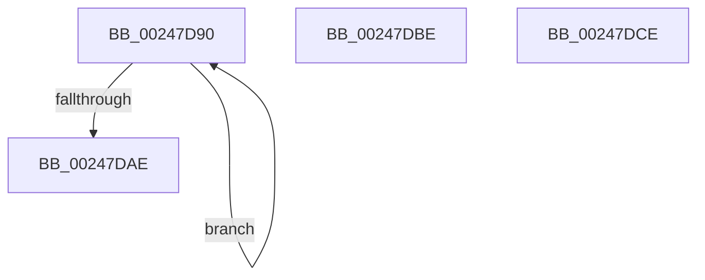

# sub_00247D90

- RVA: `0x00247D90`–`0x00247DDE` (길이 `78` bytes)
- VA: `0x0000000140247D90`
- 실행 섹션: `.text`
- PDB 이름 있음: `아니요`; PDB Function 태그: `아니요`
- unwind 정보 RVA: `0x00062468`
- 디코드: `17`개 명령, `78/78` bytes 표시
- 미해석 바이트: `0` (있으면 어셈블리에 `.byte`로 보존)

> 이 문서는 커널 이미지의 기계어와 PDB 기호를 분석해 생성했습니다. 4번과 5번은 함수 원형과 자료형을 바이너리 사용 방식에서 추정한 C 해석이며 원본 소스 복구 결과는 아닙니다.

## 1. Dependencies

- 직접 호출 지점: **1**; 고유 호출 대상: **1**
- 직접 호출자로 확인된 함수: **0**
- RIP 상대 이미지 참조: **1**

### Outgoing calls
- `0x00247D97` → [MI_FLUSH_ENTIRE_TB](../31/MI_FLUSH_ENTIRE_TB_function_00314110.md) (function, `0x00314110`)

### Direct callers
- 이 함수 시작 RVA로 연결되는 직접 call은 확인되지 않았습니다. 간접 호출은 완전히 역산할 수 없습니다.

### Static image references
- `0x00247DA1` → RVA `0x00FCF080` (`CACHEALI`; read)

## 2. Other-region calls and transfers

- 다른 실행 섹션으로 향하는 call: **0**
- call이 아닌 외부 분기/꼬리 이동: **3**
  - `0x00247DB9` → [MiInsertCachedPte + 0xCA](MiInsertCachedPte_function_00247970.md) (`tail-transfer`)
  - `0x00247DC9` → [sub_00247BC3 + 0x29](Unknown_function_00247BC3.md) (`tail-transfer`)
  - `0x00247DD9` → [MiInsertCachedPte + 0xDC](MiInsertCachedPte_function_00247970.md) (`tail-transfer`)

## 3. Assembly (complete function range)

```asm
00247D90  BA 01 00 00 00                  mov edx, 1
00247D95  33 C9                           xor ecx, ecx
00247D97  E8 74 C3 0C 00                  call 0x140314110
00247D9C  F0 83 0C 24 00                  lock or dword ptr [rsp], 0
00247DA1  8B 05 D9 72 D8 00               mov eax, dword ptr [rip + 0xd872d9]
00247DA7  0F B7 F8                        movzx edi, ax
00247DAA  85 FF                           test edi, edi
00247DAC  74 E2                           je 0x140247d90
00247DAE  4C 8B 94 24 90 00 00 00         mov r10, qword ptr [rsp + 0x90]
00247DB6  45 33 DB                        xor r11d, r11d
00247DB9  E9 7C FC FF FF                  jmp 0x140247a3a
00247DBE  48 25 1F FE FF FF               and rax, 0xfffffffffffffe1f
00247DC4  48 0F BA E8 09                  bts rax, 9
00247DC9  E9 1E FE FF FF                  jmp 0x140247bec
00247DCE  4C 8B 94 24 90 00 00 00         mov r10, qword ptr [rsp + 0x90]
00247DD6  45 33 DB                        xor r11d, r11d
00247DD9  E9 6E FC FF FF                  jmp 0x140247a4c
```

## 4. C-style interpretation (structured pseudocode)

```c
__int64 __fastcall sub_00247D90(int a1, __int64 a2, __int64 a3, __int64 a4, __int64 a5, __int64 a6, __int64 a7, __int64 a8, __int64 a9, __int64 a10, __int64 a11, __int64 a12, __int64 a13, __int64 a14, __int64 a15, __int64 a16, __int64 a17, __int64 a18)
{
    __int64 result;
    __int64 v_r11;
    unsigned int v_stack_p0;
    unsigned __int64 v_stack_p90;

    a1 = 0;
    result = MI_FLUSH_ENTIRE_TB(a1, 1, a3, a4);
    if ((unsigned int)((unsigned __int16)((unsigned int)(*(unsigned int *)(v_rip + 14185177)))) == 0) goto loc_00247D90;
    v_r11 = 0;
}
```

## 5. (Beta) C Style

```c
int64_t sub_00247D90(int32_t Arg1, int64_t Arg2, int64_t Arg3, int64_t Arg4, uint64_t Arg5, uint64_t Arg6, uint64_t Arg7, uint64_t Arg8, uint64_t Arg9, uint64_t Arg10, uint64_t Arg11, uint64_t Arg12, uint64_t Arg13, uint64_t Arg14, uint64_t Arg15, uint64_t Arg16, uint64_t Arg17, int64_t Arg18)
{
    int64_t result;
    int64_t local_r11;
    uint32_t v_stack_p0;
    uint64_t v_stack_p90;

    Arg1 = 0;
    result = MI_FLUSH_ENTIRE_TB(Arg1, 1, Arg3, Arg4);
    if ((uint32_t)((uint16_t)((uint32_t)(*(uint32_t *)(v_rip + 0xD872D9)))) == 0) goto loc_00247D90;
    local_r11 = 0;
}
```

## 6. Execution-region graph

[열기: 2D/3D 그래프와 함수 탐색 컨트롤 패널](../../../control-panel.html?section=text&rva=0x00247D90&view=graph)

- 2D 그래프는 위에서 아래로 흐르고, 3D 그래프는 빈 공간을 드래그해 회전합니다. Shift+드래그는 이동, 휠은 확대·축소, 함수 노드 선택은 대상 보고서 이동입니다.

### Static fallback


