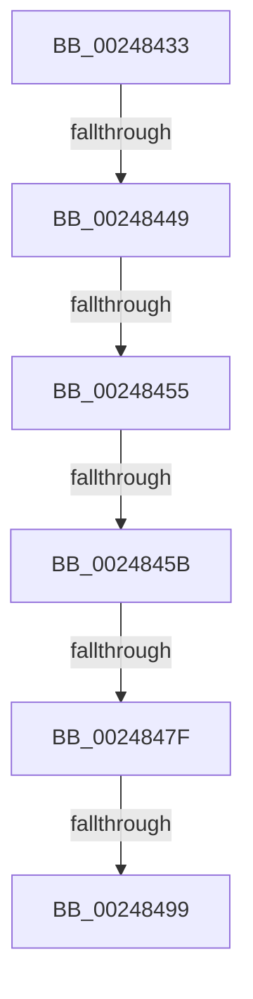

# sub_00248433

- RVA: `0x00248433`–`0x002484B3` (길이 `128` bytes)
- VA: `0x0000000140248433`
- 실행 섹션: `.text`
- PDB 이름 있음: `아니요`; PDB Function 태그: `아니요`
- unwind 정보 RVA: `0x000624D8`
- 디코드: `29`개 명령, `128/128` bytes 표시
- 미해석 바이트: `0` (있으면 어셈블리에 `.byte`로 보존)

> 이 문서는 커널 이미지의 기계어와 PDB 기호를 분석해 생성했습니다. 4번과 5번은 함수 원형과 자료형을 바이너리 사용 방식에서 추정한 C 해석이며 원본 소스 복구 결과는 아닙니다.

## 1. Dependencies

- 직접 호출 지점: **0**; 고유 호출 대상: **0**
- 직접 호출자로 확인된 함수: **0**
- RIP 상대 이미지 참조: **1**

### Outgoing calls
- 직접 디코드된 call 명령이 없습니다.

### Direct callers
- 이 함수 시작 RVA로 연결되는 직접 call은 확인되지 않았습니다. 간접 호출은 완전히 역산할 수 없습니다.

### Static image references
- `0x00248449` → RVA `0x00E38D00` (`.data`; read)

## 2. Other-region calls and transfers

- 다른 실행 섹션으로 향하는 call: **0**
- call이 아닌 외부 분기/꼬리 이동: **5**
  - `0x00248443` → [sub_002484B4 + 0x130](Unknown_function_002484B4.md) (`tail-transfer`)
  - `0x00248453` → [sub_002484B4](Unknown_function_002484B4.md) (`tail-transfer`)
  - `0x00248459` → [sub_002484B4 + 0x14](Unknown_function_002484B4.md) (`tail-transfer`)
  - `0x0024847D` → [sub_002484B4 + 0x6](Unknown_function_002484B4.md) (`tail-transfer`)
  - `0x00248493` → [sub_002484B4 + 0x88](Unknown_function_002484B4.md) (`tail-transfer`)

## 3. Assembly (complete function range)

```asm
00248433  48 89 6C 24 30                  mov qword ptr [rsp + 0x30], rbp
00248438  48 8B FA                        mov rdi, rdx
0024843B  4C 89 74 24 38                  mov qword ptr [rsp + 0x38], r14
00248440  48 8B D9                        mov rbx, rcx
00248443  0F 85 9B 01 00 00               jne 0x1402485e4
00248449  48 8D 05 B0 08 BF 00            lea rax, [rip + 0xbf08b0]
00248450  48 3B D8                        cmp rbx, rax
00248453  75 5F                           jne 0x1402484b4
00248455  40 F6 C6 10                     test sil, 0x10
00248459  75 6D                           jne 0x1402484c8
0024845B  65 4C 8B 04 25 20 00 00 00      mov r8, qword ptr gs:[0x20]
00248464  41 0F 0D 88 98 8B 00 00         prefetchw byte ptr [r8 + 0x8b98]
0024846C  41 8B 90 98 8B 00 00            mov edx, dword ptr [r8 + 0x8b98]
00248473  48 8D 04 3A                     lea rax, [rdx + rdi]
00248477  48 3D 00 01 00 00               cmp rax, 0x100
0024847D  77 3B                           ja 0x1402484ba
0024847F  8D 0C 3A                        lea ecx, [rdx + rdi]
00248482  8B C2                           mov eax, edx
00248484  F0 41 0F B1 88 98 8B 00 00      lock cmpxchg dword ptr [r8 + 0x8b98], ecx
0024848D  48 63 C8                        movsxd rcx, eax
00248490  48 3B CA                        cmp rcx, rdx
00248493  0F 85 A3 00 00 00               jne 0x14024853c
00248499  48 8B 6C 24 30                  mov rbp, qword ptr [rsp + 0x30]
0024849E  4C 8B 74 24 38                  mov r14, qword ptr [rsp + 0x38]
002484A3  48 8B 5C 24 40                  mov rbx, qword ptr [rsp + 0x40]
002484A8  48 8B 74 24 48                  mov rsi, qword ptr [rsp + 0x48]
002484AD  48 83 C4 20                     add rsp, 0x20
002484B1  5F                              pop rdi
002484B2  C3                              ret
```

## 4. C-style interpretation (structured pseudocode)

```c
__int64 __fastcall sub_00248433(__int64 a1, __int64 a2, __int64 a3, __int64 a4, __int64 a5, __int64 a6, __int64 a7, __int64 a8, __int64 a9)
{
    __int64 v_rsp;
    unsigned __int64 v_stack_p30;
    unsigned __int64 v_stack_p38;

    v_stack_p30 = v_rbp;
    v_stack_p38 = v_r14;
    v_rsp = (v_rsp) + (32);
    return (unsigned int)((unsigned int)((unsigned int)(*(unsigned int *)(*(unsigned __int64 *)(gs_base + (0 + 32)) + 35736))));
}
```

## 5. (Beta) C Style

```c
int64_t sub_00248433(int64_t Arg1, int64_t Arg2, int64_t Arg3, int64_t Arg4, uint64_t Arg5, int64_t Arg6, int64_t Arg7, int64_t Arg8, int64_t Arg9)
{
    int64_t local_rsp;
    uint64_t v_stack_p30;
    uint64_t v_stack_p38;

    v_stack_p30 = local_rbp;
    v_stack_p38 = local_r14;
    local_rsp = (local_rsp) + (32);
    return (uint32_t)((uint32_t)((uint32_t)(*(uint32_t *)(*(uint64_t *)(gs_base + (0 + 0x20)) + 0x8B98))));
}
```

## 6. Execution-region graph

[열기: 2D/3D 그래프와 함수 탐색 컨트롤 패널](../../../control-panel.html?section=text&rva=0x00248433&view=graph)

- 2D 그래프는 위에서 아래로 흐르고, 3D 그래프는 빈 공간을 드래그해 회전합니다. Shift+드래그는 이동, 휠은 확대·축소, 함수 노드 선택은 대상 보고서 이동입니다.

### Static fallback


