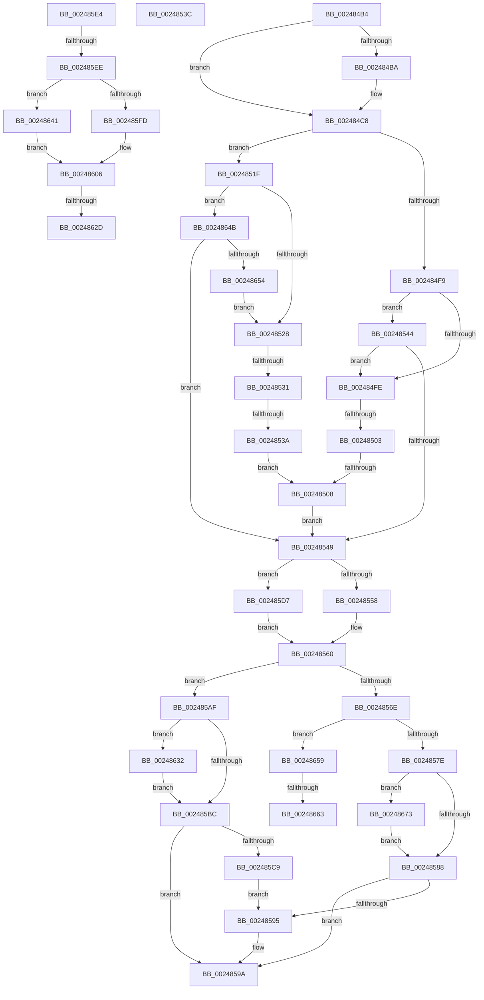

# sub_002484B4

- RVA: `0x002484B4`–`0x00248689` (길이 `469` bytes)
- VA: `0x00000001402484B4`
- 실행 섹션: `.text`
- PDB 이름 있음: `아니요`; PDB Function 태그: `아니요`
- unwind 정보 RVA: `0x00062504`
- 디코드: `113`개 명령, `469/469` bytes 표시
- 미해석 바이트: `0` (있으면 어셈블리에 `.byte`로 보존)

> 이 문서는 커널 이미지의 기계어와 PDB 기호를 분석해 생성했습니다. 4번과 5번은 함수 원형과 자료형을 바이너리 사용 방식에서 추정한 C 해석이며 원본 소스 복구 결과는 아닙니다.

## 1. Dependencies

- 직접 호출 지점: **13**; 고유 호출 대상: **6**
- 직접 호출자로 확인된 함수: **0**
- RIP 상대 이미지 참조: **0**

### Outgoing calls
- `0x0024855B` → [ExAcquireSpinLockExclusiveAtDpcLevel](ExAcquireSpinLockExclusiveAtDpcLevel_function_00248E80.md) (function, `0x00248E80`)
- `0x00248595` → [KeResetEvent](KeResetEvent_function_00248350.md) (function, `0x00248350`)
- `0x002485A5` → [MiReleaseSpinLockExclusive](MiReleaseSpinLockExclusive_function_002482C0.md) (function, `0x002482C0`)
- `0x002485C9` → [KeResetEvent](KeResetEvent_function_00248350.md) (function, `0x00248350`)
- `0x002485D7` → [ExAcquireSpinLockExclusive](ExAcquireSpinLockExclusive_function_00248690.md) (function, `0x00248690`)
- `0x002485FD` → [ExAcquireSpinLockExclusive](ExAcquireSpinLockExclusive_function_00248690.md) (function, `0x00248690`)
- `0x0024860C` → [MiRestockOverCommit](../40/MiRestockOverCommit_function_00407D94.md) (function, `0x00407D94`)
- `0x0024861F` → [MiReleaseSpinLockExclusive](MiReleaseSpinLockExclusive_function_002482C0.md) (function, `0x002482C0`)
- `0x00248637` → [KeSetEvent](../33/KeSetEvent_function_0033F310.md) (function, `0x0033F310`)
- `0x00248644` → [ExAcquireSpinLockExclusiveAtDpcLevel](ExAcquireSpinLockExclusiveAtDpcLevel_function_00248E80.md) (function, `0x00248E80`)
- `0x00248668` → [KeSetEvent](../33/KeSetEvent_function_0033F310.md) (function, `0x0033F310`)
- `0x00248673` → [KeResetEvent](KeResetEvent_function_00248350.md) (function, `0x00248350`)
- `0x0024867F` → [KeResetEvent](KeResetEvent_function_00248350.md) (function, `0x00248350`)

### Direct callers
- 이 함수 시작 RVA로 연결되는 직접 call은 확인되지 않았습니다. 간접 호출은 완전히 역산할 수 없습니다.

### Static image references
- 디코드된 RIP-relative 메모리 참조가 없습니다.

## 2. Other-region calls and transfers

- 다른 실행 섹션으로 향하는 call: **0**
- call이 아닌 외부 분기/꼬리 이동: **11**
  - `0x00248501` → [sub_00248433 + 0x66](Unknown_function_00248433.md) (`tail-transfer`)
  - `0x00248506` → [sub_00248433 + 0x66](Unknown_function_00248433.md) (`tail-transfer`)
  - `0x0024852B` → [sub_00248433 + 0x66](Unknown_function_00248433.md) (`tail-transfer`)
  - `0x00248534` → [sub_00248433 + 0x66](Unknown_function_00248433.md) (`tail-transfer`)
  - `0x0024853F` → [sub_00248433 + 0x40](Unknown_function_00248433.md) (`tail-transfer`)
  - `0x002485AA` → [sub_00248433 + 0x66](Unknown_function_00248433.md) (`tail-transfer`)
  - `0x002485E8` → [sub_00248433 + 0x16](Unknown_function_00248433.md) (`tail-transfer`)
  - `0x00248627` → [sub_00248433 + 0x66](Unknown_function_00248433.md) (`tail-transfer`)
  - `0x0024862D` → [sub_00248433 + 0x16](Unknown_function_00248433.md) (`tail-transfer`)
  - `0x0024865D` → [sub_006D80FC](../6D/Unknown_function_006D80FC.md) (`tail-transfer`)
  - `0x0024866E` → [sub_006D80FC](../6D/Unknown_function_006D80FC.md) (`tail-transfer`)

## 3. Assembly (complete function range)

```asm
002484B4  40 F6 C6 10                     test sil, 0x10
002484B8  75 0E                           jne 0x1402484c8
002484BA  48 8B C7                        mov rax, rdi
002484BD  48 F7 D8                        neg rax
002484C0  F0 48 01 83 80 4B 00 00         lock add qword ptr [rbx + 0x4b80], rax
002484C8  48 8B C7                        mov rax, rdi
002484CB  48 8D B3 40 4B 00 00            lea rsi, [rbx + 0x4b40]
002484D2  48 F7 D8                        neg rax
002484D5  F0 48 0F C1 06                  lock xadd qword ptr [rsi], rax
002484DA  48 8B D0                        mov rdx, rax
002484DD  4C 8D B3 E0 41 00 00            lea r14, [rbx + 0x41e0]
002484E4  4D 8B 06                        mov r8, qword ptr [r14]
002484E7  48 2B D7                        sub rdx, rdi
002484EA  48 8D BB D8 41 00 00            lea rdi, [rbx + 0x41d8]
002484F1  48 8B 0F                        mov rcx, qword ptr [rdi]
002484F4  48 3B D0                        cmp rdx, rax
002484F7  77 26                           ja 0x14024851f
002484F9  49 3B C0                        cmp rax, r8
002484FC  73 46                           jae 0x140248544
002484FE  48 3B C1                        cmp rax, rcx
00248501  72 96                           jb 0x140248499
00248503  48 3B D1                        cmp rdx, rcx
00248506  73 91                           jae 0x140248499
00248508  4C 8D B3 E0 41 00 00            lea r14, [rbx + 0x41e0]
0024850F  48 8D BB D8 41 00 00            lea rdi, [rbx + 0x41d8]
00248516  48 8D B3 40 4B 00 00            lea rsi, [rbx + 0x4b40]
0024851D  EB 2A                           jmp 0x140248549
0024851F  49 3B D0                        cmp rdx, r8
00248522  0F 83 23 01 00 00               jae 0x14024864b
00248528  48 3B D1                        cmp rdx, rcx
0024852B  0F 82 68 FF FF FF               jb 0x140248499
00248531  48 3B C1                        cmp rax, rcx
00248534  0F 83 5F FF FF FF               jae 0x140248499
0024853A  EB CC                           jmp 0x140248508
0024853C  48 8B D1                        mov rdx, rcx
0024853F  E9 2F FF FF FF                  jmp 0x140248473
00248544  49 3B D0                        cmp rdx, r8
00248547  73 B5                           jae 0x1402484fe
00248549  44 0F 20 C0                     mov rax, cr8
0024854D  48 8D 8B F8 41 00 00            lea rcx, [rbx + 0x41f8]
00248554  3C 02                           cmp al, 2
00248556  75 7F                           jne 0x1402485d7
00248558  40 B5 11                        mov bpl, 0x11
0024855B  E8 20 09 00 00                  call 0x140248e80
00248560  48 8B 16                        mov rdx, qword ptr [rsi]
00248563  48 8B 0F                        mov rcx, qword ptr [rdi]
00248566  4D 8B 06                        mov r8, qword ptr [r14]
00248569  48 3B D1                        cmp rdx, rcx
0024856C  72 41                           jb 0x1402485af
0024856E  48 8B 8B 30 01 00 00            mov rcx, qword ptr [rbx + 0x130]
00248575  49 3B D0                        cmp rdx, r8
00248578  0F 83 DB 00 00 00               jae 0x140248659
0024857E  83 79 04 01                     cmp dword ptr [rcx + 4], 1
00248582  0F 84 EB 00 00 00               je 0x140248673
00248588  48 8B 8B 28 01 00 00            mov rcx, qword ptr [rbx + 0x128]
0024858F  83 79 04 01                     cmp dword ptr [rcx + 4], 1
00248593  75 05                           jne 0x14024859a
00248595  E8 B6 FD FF FF                  call 0x140248350
0024859A  48 8D 8B F8 41 00 00            lea rcx, [rbx + 0x41f8]
002485A1  40 0F B6 D5                     movzx edx, bpl
002485A5  E8 16 FD FF FF                  call 0x1402482c0
002485AA  E9 EA FE FF FF                  jmp 0x140248499
002485AF  48 8B 8B 28 01 00 00            mov rcx, qword ptr [rbx + 0x128]
002485B6  83 79 04 00                     cmp dword ptr [rcx + 4], 0
002485BA  74 76                           je 0x140248632
002485BC  48 8B 8B 30 01 00 00            mov rcx, qword ptr [rbx + 0x130]
002485C3  83 79 04 01                     cmp dword ptr [rcx + 4], 1
002485C7  75 D1                           jne 0x14024859a
002485C9  E8 82 FD FF FF                  call 0x140248350
002485CE  48 8B 8B 38 01 00 00            mov rcx, qword ptr [rbx + 0x138]
002485D5  EB BE                           jmp 0x140248595
002485D7  E8 B4 00 00 00                  call 0x140248690
002485DC  0F B6 E8                        movzx ebp, al
002485DF  E9 7C FF FF FF                  jmp 0x140248560
002485E4  40 F6 C6 10                     test sil, 0x10
002485E8  0F 85 5B FE FF FF               jne 0x140248449
002485EE  44 0F 20 C0                     mov rax, cr8
002485F2  48 81 C1 F8 41 00 00            add rcx, 0x41f8
002485F9  3C 02                           cmp al, 2
002485FB  74 44                           je 0x140248641
002485FD  E8 8E 00 00 00                  call 0x140248690
00248602  44 0F B6 F0                     movzx r14d, al
00248606  48 8B D7                        mov rdx, rdi
00248609  48 8B CB                        mov rcx, rbx
0024860C  E8 83 F7 1B 00                  call 0x140407d94
00248611  41 0F B6 D6                     movzx edx, r14b
00248615  48 8D 8B F8 41 00 00            lea rcx, [rbx + 0x41f8]
0024861C  48 8B F8                        mov rdi, rax
0024861F  E8 9C FC FF FF                  call 0x1402482c0
00248624  48 85 FF                        test rdi, rdi
00248627  0F 84 6C FE FF FF               je 0x140248499
0024862D  E9 17 FE FF FF                  jmp 0x140248449
00248632  45 33 C0                        xor r8d, r8d
00248635  33 D2                           xor edx, edx
00248637  E8 D4 6C 0F 00                  call 0x14033f310
0024863C  E9 7B FF FF FF                  jmp 0x1402485bc
00248641  41 B6 11                        mov r14b, 0x11
00248644  E8 37 08 00 00                  call 0x140248e80
00248649  EB BB                           jmp 0x140248606
0024864B  49 3B C0                        cmp rax, r8
0024864E  0F 82 F5 FE FF FF               jb 0x140248549
00248654  E9 CF FE FF FF                  jmp 0x140248528
00248659  83 79 04 00                     cmp dword ptr [rcx + 4], 0
0024865D  0F 85 99 FA 48 00               jne 0x1406d80fc
00248663  45 33 C0                        xor r8d, r8d
00248666  33 D2                           xor edx, edx
00248668  E8 A3 6C 0F 00                  call 0x14033f310
0024866D  90                              nop
0024866E  E9 89 FA 48 00                  jmp 0x1406d80fc
00248673  E8 D8 FC FF FF                  call 0x140248350
00248678  48 8B 8B 38 01 00 00            mov rcx, qword ptr [rbx + 0x138]
0024867F  E8 CC FC FF FF                  call 0x140248350
00248684  E9 FF FE FF FF                  jmp 0x140248588
```

## 4. C-style interpretation (structured pseudocode)

```c
__int64 __fastcall sub_002484B4(void)
{
    __int64 result;

    if ((((unsigned __int8)(v_rsi)) & (16)) == 0) {
        result = v_rdi;
        result = -(result);
    }
    result = -(v_rdi);
    a2 = (result) - (v_rdi);
    if (a2 > result) goto loc_0024851F;
    if (result >= (*(unsigned __int64 *)(v_rbx + 16864))) goto loc_00248544;
loc_002484FE:
loc_00248508:
    goto loc_00248549;
loc_0024851F:
    if (a2 >= (*(unsigned __int64 *)(v_rbx + 16864))) goto loc_0024864B;
loc_00248528:
    goto loc_00248508;
loc_00248544:
    if (a2 >= (*(unsigned __int64 *)(v_rbx + 16864))) goto loc_002484FE;
loc_00248549:
    if (((unsigned __int8)(v_cr8)) != 2) goto loc_002485D7;
    result = ExAcquireSpinLockExclusiveAtDpcLevel(v_rbx + 16888, a2, *(unsigned __int64 *)(v_rbx + 16864), a4);
loc_00248560:
    if ((*(unsigned __int64 *)(v_rbx + 19264)) < (*(unsigned __int64 *)(v_rbx + 16856))) goto loc_002485AF;
    if ((*(unsigned __int64 *)(v_rbx + 19264)) >= (*(unsigned __int64 *)(v_rbx + 16864))) goto loc_00248659;
    if ((*(unsigned int *)(*(unsigned __int64 *)(v_rbx + 304) + 4)) == 1) goto loc_00248673;
loc_00248588:
    if ((*(unsigned int *)(*(unsigned __int64 *)(v_rbx + 296) + 4)) == 1) {
        result = KeResetEvent(*(unsigned __int64 *)(v_rbx + 296), *(unsigned __int64 *)(v_rbx + 19264), *(unsigned __int64 *)(v_rbx + 16864), a4);
    }
    result = MiReleaseSpinLockExclusive(v_rbx + 16888, 17, *(unsigned __int64 *)(v_rbx + 16864), a4);
loc_002485AF:
    if ((*(unsigned int *)(*(unsigned __int64 *)(v_rbx + 296) + 4)) == 0) goto loc_00248632;
loc_002485BC:
    if ((*(unsigned int *)(*(unsigned __int64 *)(v_rbx + 304) + 4)) != 1) goto loc_0024859A;
    result = KeResetEvent(*(unsigned __int64 *)(v_rbx + 304), 17, *(unsigned __int64 *)(v_rbx + 16864), a4);
    goto loc_00248595;
loc_002485D7:
    result = ExAcquireSpinLockExclusive(*(unsigned __int64 *)(v_rbx + 312), 17, *(unsigned __int64 *)(v_rbx + 16864), a4);
    goto loc_00248560;
loc_00248632:
    a3 = 0;
    a2 = 0;
    result = KeSetEvent(*(unsigned __int64 *)(v_rbx + 312), a2, a3, a4);
    goto loc_002485BC;
loc_0024864B:
    if (result < 0) goto loc_00248549;
    goto loc_00248528;
loc_00248659:
    a3 = 0;
    a2 = 0;
    result = KeSetEvent(*(unsigned __int64 *)(v_rbx + 312), a2, a3, a4);
loc_00248673:
    result = KeResetEvent(*(unsigned __int64 *)(v_rbx + 312), a2, a3, a4);
    result = KeResetEvent(*(unsigned __int64 *)(v_rbx + 312), a2, a3, a4);
    goto loc_00248588;
}
```

## 5. (Beta) C Style

```c
void sub_002484B4(void)
{
    int64_t result;

    if ((((uint8_t)(local_rsi)) & (16)) == 0) {
        result = local_rdi;
        result = -(result);
    }
    result = -(local_rdi);
    a2 = (result) - (local_rdi);
    if (a2 > result) goto loc_0024851F;
    if (result >= (*(uint64_t *)(local_rbx + 0x41E0))) goto loc_00248544;
loc_002484FE:
loc_00248508:
    goto loc_00248549;
loc_0024851F:
    if (a2 >= (*(uint64_t *)(local_rbx + 0x41E0))) goto loc_0024864B;
loc_00248528:
    goto loc_00248508;
loc_00248544:
    if (a2 >= (*(uint64_t *)(local_rbx + 0x41E0))) goto loc_002484FE;
loc_00248549:
    if (((uint8_t)(v_cr8)) != 2) goto loc_002485D7;
    result = ExAcquireSpinLockExclusiveAtDpcLevel(local_rbx + 16888, a2, *(uint64_t *)(local_rbx + 0x41E0), a4);
loc_00248560:
    if ((*(uint64_t *)(local_rbx + 0x4B40)) < (*(uint64_t *)(local_rbx + 0x41D8))) goto loc_002485AF;
    if ((*(uint64_t *)(local_rbx + 0x4B40)) >= (*(uint64_t *)(local_rbx + 0x41E0))) goto loc_00248659;
    if ((*(uint32_t *)(*(uint64_t *)(local_rbx + 0x130) + 0x4)) == 1) goto loc_00248673;
loc_00248588:
    if ((*(uint32_t *)(*(uint64_t *)(local_rbx + 0x128) + 0x4)) == 1) {
        result = KeResetEvent(*(uint64_t *)(local_rbx + 0x128), *(uint64_t *)(local_rbx + 0x4B40), *(uint64_t *)(local_rbx + 0x41E0), a4);
    }
    result = MiReleaseSpinLockExclusive(local_rbx + 16888, 17, *(uint64_t *)(local_rbx + 0x41E0), a4);
loc_002485AF:
    if ((*(uint32_t *)(*(uint64_t *)(local_rbx + 0x128) + 0x4)) == 0) goto loc_00248632;
loc_002485BC:
    if ((*(uint32_t *)(*(uint64_t *)(local_rbx + 0x130) + 0x4)) != 1) goto loc_0024859A;
    result = KeResetEvent(*(uint64_t *)(local_rbx + 0x130), 17, *(uint64_t *)(local_rbx + 0x41E0), a4);
    goto loc_00248595;
loc_002485D7:
    result = ExAcquireSpinLockExclusive(*(uint64_t *)(local_rbx + 0x138), 17, *(uint64_t *)(local_rbx + 0x41E0), a4);
    goto loc_00248560;
loc_00248632:
    a3 = 0;
    a2 = 0;
    result = KeSetEvent(*(uint64_t *)(local_rbx + 0x138), a2, a3, a4);
    goto loc_002485BC;
loc_0024864B:
    if (result < 0) goto loc_00248549;
    goto loc_00248528;
loc_00248659:
    a3 = 0;
    a2 = 0;
    result = KeSetEvent(*(uint64_t *)(local_rbx + 0x138), a2, a3, a4);
loc_00248673:
    result = KeResetEvent(*(uint64_t *)(local_rbx + 0x138), a2, a3, a4);
    result = KeResetEvent(*(uint64_t *)(local_rbx + 0x138), a2, a3, a4);
    goto loc_00248588;
}
```

## 6. Execution-region graph

[열기: 2D/3D 그래프와 함수 탐색 컨트롤 패널](../../../control-panel.html?section=text&rva=0x002484B4&view=graph)

- 2D 그래프는 위에서 아래로 흐르고, 3D 그래프는 빈 공간을 드래그해 회전합니다. Shift+드래그는 이동, 휠은 확대·축소, 함수 노드 선택은 대상 보고서 이동입니다.

### Static fallback


