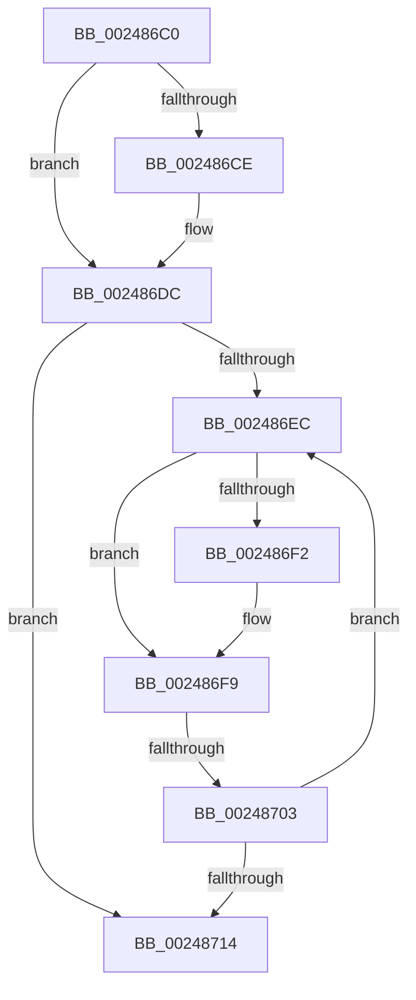

# sub_002486C0

- RVA: `0x002486C0`–`0x00248728` (길이 `104` bytes)
- VA: `0x00000001402486C0`
- 실행 섹션: `.text`
- PDB 이름 있음: `아니요`; PDB Function 태그: `아니요`
- unwind 정보 RVA: `0x00062540`
- 디코드: `31`개 명령, `104/104` bytes 표시
- 미해석 바이트: `0` (있으면 어셈블리에 `.byte`로 보존)

> 이 문서는 커널 이미지의 기계어와 PDB 기호를 분석해 생성했습니다. 4번과 5번은 함수 원형과 자료형을 바이너리 사용 방식에서 추정한 C 해석이며 원본 소스 복구 결과는 아닙니다.

## 1. Dependencies

- 직접 호출 지점: **1**; 고유 호출 대상: **1**
- 직접 호출자로 확인된 함수: **0**
- RIP 상대 이미지 참조: **1**

### Outgoing calls
- `0x002486D5` → [ExpWaitForSpinLockExclusiveAndAcquire](../32/ExpWaitForSpinLockExclusiveAndAcquire_function_003239A0.md) (function, `0x003239A0`)

### Direct callers
- 이 함수 시작 RVA로 연결되는 직접 call은 확인되지 않았습니다. 간접 호출은 완전히 역산할 수 없습니다.

### Static image references
- `0x002486FB` → RVA `0x00FC52AC` (`ALMOSTRO`; reference)

## 2. Other-region calls and transfers

- 다른 실행 섹션으로 향하는 call: **0**
- call이 아닌 외부 분기/꼬리 이동: **1**
  - `0x00248701` → [sub_00248760](Unknown_function_00248760.md) (`tail-transfer`)

## 3. Assembly (complete function range)

```asm
002486C0  48 89 74 24 30                  mov qword ptr [rsp + 0x30], rsi
002486C5  33 F6                           xor esi, esi
002486C7  F0 0F BA 2B 1F                  lock bts dword ptr [rbx], 0x1f
002486CC  73 0E                           jae 0x1402486dc
002486CE  40 0F B6 D7                     movzx edx, dil
002486D2  48 8B CB                        mov rcx, rbx
002486D5  E8 C6 B2 0D 00                  call 0x1403239a0
002486DA  8B F0                           mov esi, eax
002486DC  8B 13                           mov edx, dword ptr [rbx]
002486DE  8B CA                           mov ecx, edx
002486E0  0F BA F1 1E                     btr ecx, 0x1e
002486E4  81 F9 00 00 00 80               cmp ecx, 0x80000000
002486EA  74 28                           je 0x140248714
002486EC  0F BA E2 1E                     bt edx, 0x1e
002486F0  72 07                           jb 0x1402486f9
002486F2  F0 81 0B 00 00 00 40            lock or dword ptr [rbx], 0x40000000
002486F9  FF C6                           inc esi
002486FB  85 35 AB CB D7 00               test dword ptr [rip + 0xd7cbab], esi
00248701  74 5D                           je 0x140248760
00248703  F3 90                           pause
00248705  8B 13                           mov edx, dword ptr [rbx]
00248707  8B C2                           mov eax, edx
00248709  0F BA F0 1E                     btr eax, 0x1e
0024870D  3D 00 00 00 80                  cmp eax, 0x80000000
00248712  75 D8                           jne 0x1402486ec
00248714  48 8B 74 24 30                  mov rsi, qword ptr [rsp + 0x30]
00248719  40 0F B6 C7                     movzx eax, dil
0024871D  48 8B 5C 24 40                  mov rbx, qword ptr [rsp + 0x40]
00248722  48 83 C4 20                     add rsp, 0x20
00248726  5F                              pop rdi
00248727  C3                              ret
```

## 4. C-style interpretation (structured pseudocode)

```c
__int64 __fastcall sub_002486C0(__int64 a1, __int64 a2, __int64 a3, __int64 a4, __int64 a5, __int64 a6, __int64 a7, __int64 a8)
{
    __int64 result;
    __int64 v_rsi;
    __int64 v_rsp;
    unsigned __int64 v_stack_p30;

    v_stack_p30 = v_rsi;
    v_rsi = 0;
    if (!(condition_is_above_or_equal)) {
        a2 = (unsigned __int8)(v_rdi);
        a1 = v_rbx;
        result = ExpWaitForSpinLockExclusiveAndAcquire(a1, a2, a3, a4);
        v_rsi = (unsigned int)(result);
    }
    if (((unsigned int)((unsigned int)((unsigned int)((unsigned int)(*(unsigned int *)(v_rbx)))))) == 0x80000000ULL) goto loc_00248714;
loc_002486EC:
    if (((unsigned int)((unsigned int)((unsigned int)((unsigned int)(*(unsigned int *)(v_rbx)))))) >= 0x80000000ULL) {
    }
    v_rsi = (unsigned int)((v_rsi) + 1);
    if (((unsigned int)((unsigned int)((unsigned int)((unsigned int)(*(unsigned int *)(v_rbx)))))) != 0x80000000ULL) goto loc_002486EC;
loc_00248714:
    v_rsp = (v_rsp) + (32);
    return (unsigned __int8)(v_rdi);
}
```

## 5. (Beta) C Style

```c
int64_t sub_002486C0(int64_t Arg1, int64_t Arg2, int64_t Arg3, int64_t Arg4, uint64_t Arg5, int64_t Arg6, uint64_t Arg7, int64_t Arg8)
{
    int64_t result;
    int64_t local_rsi;
    int64_t local_rsp;
    uint64_t v_stack_p30;

    v_stack_p30 = local_rsi;
    local_rsi = 0;
    if (!(condition_is_above_or_equal)) {
        Arg2 = (uint8_t)(local_rdi);
        Arg1 = local_rbx;
        result = ExpWaitForSpinLockExclusiveAndAcquire(Arg1, Arg2, Arg3, Arg4);
        local_rsi = (uint32_t)(result);
    }
    if (((uint32_t)((uint32_t)((uint32_t)((uint32_t)(*(uint32_t *)(local_rbx)))))) == 0x80000000ULL) goto loc_00248714;
loc_002486EC:
    if (((uint32_t)((uint32_t)((uint32_t)((uint32_t)(*(uint32_t *)(local_rbx)))))) >= 0x80000000ULL) {
    }
    local_rsi = (uint32_t)((local_rsi) + 1);
    if (((uint32_t)((uint32_t)((uint32_t)((uint32_t)(*(uint32_t *)(local_rbx)))))) != 0x80000000ULL) goto loc_002486EC;
loc_00248714:
    local_rsp = (local_rsp) + (32);
    return (uint8_t)(local_rdi);
}
```

## 6. Execution-region graph

[열기: 2D/3D 그래프와 함수 탐색 컨트롤 패널](../../../control-panel.html?section=text&rva=0x002486C0&view=graph)

- 2D 그래프는 위에서 아래로 흐르고, 3D 그래프는 빈 공간을 드래그해 회전합니다. Shift+드래그는 이동, 휠은 확대·축소, 함수 노드 선택은 대상 보고서 이동입니다.

### Static fallback


