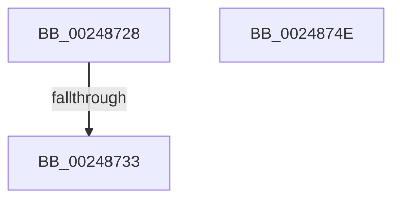

# sub_00248728

- RVA: `0x00248728`–`0x00248760` (길이 `56` bytes)
- VA: `0x0000000140248728`
- 실행 섹션: `.text`
- PDB 이름 있음: `아니요`; PDB Function 태그: `아니요`
- unwind 정보 RVA: `0x00062558`
- 디코드: `17`개 명령, `56/56` bytes 표시
- 미해석 바이트: `0` (있으면 어셈블리에 `.byte`로 보존)

> 이 문서는 커널 이미지의 기계어와 PDB 기호를 분석해 생성했습니다. 4번과 5번은 함수 원형과 자료형을 바이너리 사용 방식에서 추정한 C 해석이며 원본 소스 복구 결과는 아닙니다.

## 1. Dependencies

- 직접 호출 지점: **2**; 고유 호출 대상: **2**
- 직접 호출자로 확인된 함수: **0**
- RIP 상대 이미지 참조: **1**

### Outgoing calls
- `0x0024873A` → [ExpAcquireSpinLockExclusiveAtDpcLevelInstrumented](../32/ExpAcquireSpinLockExclusiveAtDpcLevelInstrumented_function_00323A70.md) (function, `0x00323A70`)
- `0x00248756` → [KiRaiseIrqlProcessIrqlFlags](../4F/KiRaiseIrqlProcessIrqlFlags_function_004F56FC.md) (function, `0x004F56FC`)

### Direct callers
- 이 함수 시작 RVA로 연결되는 직접 call은 확인되지 않았습니다. 간접 호출은 완전히 역산할 수 없습니다.

### Static image references
- `0x00248729` → RVA `0x00F0DE58` (`.data`; read)

## 2. Other-region calls and transfers

- 다른 실행 섹션으로 향하는 call: **0**
- call이 아닌 외부 분기/꼬리 이동: **2**
  - `0x00248731` → [sub_002486C0](Unknown_function_002486C0.md) (`tail-transfer`)
  - `0x0024875B` → [ExAcquireSpinLockExclusive + 0x27](ExAcquireSpinLockExclusive_function_00248690.md) (`tail-transfer`)

## 3. Assembly (complete function range)

```asm
00248728  CC                              int3
00248729  8B 0D 29 57 CC 00               mov ecx, dword ptr [rip + 0xcc5729]
0024872F  85 C9                           test ecx, ecx
00248731  75 8D                           jne 0x1402486c0
00248733  40 0F B6 D7                     movzx edx, dil
00248737  48 8B CB                        mov rcx, rbx
0024873A  E8 31 B3 0D 00                  call 0x140323a70
0024873F  48 8B 5C 24 40                  mov rbx, qword ptr [rsp + 0x40]
00248744  40 0F B6 C7                     movzx eax, dil
00248748  48 83 C4 20                     add rsp, 0x20
0024874C  5F                              pop rdi
0024874D  C3                              ret
0024874E  CC                              int3
0024874F  0F B6 D0                        movzx edx, al
00248752  40 0F B6 CF                     movzx ecx, dil
00248756  E8 A1 CF 2A 00                  call 0x1404f56fc
0024875B  E9 57 FF FF FF                  jmp 0x1402486b7
```

## 4. C-style interpretation (structured pseudocode)

```c
__int64 __fastcall sub_00248728(__int64 a1, __int64 a2, __int64 a3, __int64 a4, __int64 a5, __int64 a6, __int64 a7, __int64 a8)
{
    __int64 result;
    __int64 v_rsp;

    result = ExpAcquireSpinLockExclusiveAtDpcLevelInstrumented(v_rbx, (unsigned __int8)(v_rdi), a3, a4);
    v_rsp = (v_rsp) + (32);
    return (unsigned __int8)(v_rdi);
}
```

## 5. (Beta) C Style

```c
int64_t sub_00248728(int64_t Arg1, int64_t Arg2, int64_t Arg3, int64_t Arg4, uint64_t Arg5, uint64_t Arg6, uint64_t Arg7, int64_t Arg8)
{
    int64_t result;
    int64_t local_rsp;

    result = ExpAcquireSpinLockExclusiveAtDpcLevelInstrumented(local_rbx, (uint8_t)(local_rdi), Arg3, Arg4);
    local_rsp = (local_rsp) + (32);
    return (uint8_t)(local_rdi);
}
```

## 6. Execution-region graph

[열기: 2D/3D 그래프와 함수 탐색 컨트롤 패널](../../../control-panel.html?section=text&rva=0x00248728&view=graph)

- 2D 그래프는 위에서 아래로 흐르고, 3D 그래프는 빈 공간을 드래그해 회전합니다. Shift+드래그는 이동, 휠은 확대·축소, 함수 노드 선택은 대상 보고서 이동입니다.

### Static fallback


