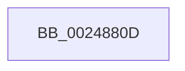

# sub_0024880D

- RVA: `0x0024880D`–`0x00248832` (길이 `37` bytes)
- VA: `0x000000014024880D`
- 실행 섹션: `.text`
- PDB 이름 있음: `아니요`; PDB Function 태그: `아니요`
- unwind 정보 RVA: `0x00062590`
- 디코드: `10`개 명령, `37/37` bytes 표시
- 미해석 바이트: `0` (있으면 어셈블리에 `.byte`로 보존)

> 이 문서는 커널 이미지의 기계어와 PDB 기호를 분석해 생성했습니다. 4번과 5번은 함수 원형과 자료형을 바이너리 사용 방식에서 추정한 C 해석이며 원본 소스 복구 결과는 아닙니다.

## 1. Dependencies

- 직접 호출 지점: **0**; 고유 호출 대상: **0**
- 직접 호출자로 확인된 함수: **0**
- RIP 상대 이미지 참조: **0**

### Outgoing calls
- 직접 디코드된 call 명령이 없습니다.

### Direct callers
- 이 함수 시작 RVA로 연결되는 직접 call은 확인되지 않았습니다. 간접 호출은 완전히 역산할 수 없습니다.

### Static image references
- 디코드된 RIP-relative 메모리 참조가 없습니다.

## 2. Other-region calls and transfers

- 다른 실행 섹션으로 향하는 call: **0**
- call이 아닌 외부 분기/꼬리 이동: **1**
  - `0x0024882C` → [sub_00248AFE](Unknown_function_00248AFE.md) (`tail-transfer`)

## 3. Assembly (complete function range)

```asm
0024880D  4D 89 7B C8                     mov qword ptr [r11 - 0x38], r15
00248811  44 0F B7 7F 0A                  movzx r15d, word ptr [rdi + 0xa]
00248816  44 0B F9                        or r15d, ecx
00248819  0F B6 4F 0C                     movzx ecx, byte ptr [rdi + 0xc]
0024881D  48 D3 E0                        shl rax, cl
00248820  FF C8                           dec eax
00248822  44 33 F8                        xor r15d, eax
00248825  41 0F BC CF                     bsf ecx, r15d
00248829  89 4D 67                        mov dword ptr [rbp + 0x67], ecx
0024882C  0F 84 CC 02 00 00               je 0x140248afe
```

## 4. C-style interpretation (structured pseudocode)

```c
__int64 __fastcall sub_0024880D(int a1)
{
    __int64 result;
    __int64 v_r15;

    *(unsigned __int64 *)(v_r11 - 56) = v_r15;
    v_r15 = (unsigned int)((*(unsigned __int16 *)(v_rdi + 10)) | (a1));
    result = (result) << ((unsigned __int8)(*(unsigned __int8 *)(v_rdi + 12)));
    result = (unsigned int)((result) - 1);
    v_r15 = (unsigned int)((v_r15) ^ ((unsigned int)(result)));
    *(unsigned int *)(v_rbp + 103) = (unsigned int)(*(unsigned __int8 *)(v_rdi + 12));
}
```

## 5. (Beta) C Style

```c
int64_t sub_0024880D(int32_t Arg1)
{
    int64_t result;
    int64_t local_r15;

    *(uint64_t *)(local_r11 - 0x38) = local_r15;
    local_r15 = (uint32_t)((*(uint16_t *)(local_rdi + 0xA)) | (Arg1));
    result = (result) << ((uint8_t)(*(uint8_t *)(local_rdi + 0xC)));
    result = (uint32_t)((result) - 1);
    local_r15 = (uint32_t)((local_r15) ^ ((uint32_t)(result)));
    *(uint32_t *)(local_rbp + 0x67) = (uint32_t)(*(uint8_t *)(local_rdi + 0xC));
}
```

## 6. Execution-region graph

[열기: 2D/3D 그래프와 함수 탐색 컨트롤 패널](../../../control-panel.html?section=text&rva=0x0024880D&view=graph)

- 2D 그래프는 위에서 아래로 흐르고, 3D 그래프는 빈 공간을 드래그해 회전합니다. Shift+드래그는 이동, 휠은 확대·축소, 함수 노드 선택은 대상 보고서 이동입니다.

### Static fallback


