# sub_00248832

- RVA: `0x00248832`–`0x00248AFE` (길이 `716` bytes)
- VA: `0x0000000140248832`
- 실행 섹션: `.text`
- PDB 이름 있음: `아니요`; PDB Function 태그: `아니요`
- unwind 정보 RVA: `0x000625A4`
- 디코드: `180`개 명령, `716/716` bytes 표시
- 미해석 바이트: `0` (있으면 어셈블리에 `.byte`로 보존)

> 이 문서는 커널 이미지의 기계어와 PDB 기호를 분석해 생성했습니다. 4번과 5번은 함수 원형과 자료형을 바이너리 사용 방식에서 추정한 C 해석이며 원본 소스 복구 결과는 아닙니다.

## 1. Dependencies

- 직접 호출 지점: **4**; 고유 호출 대상: **4**
- 직접 호출자로 확인된 함수: **0**
- RIP 상대 이미지 참조: **2**

### Outgoing calls
- `0x002488D9` → [ExAcquireSpinLockSharedAtDpcLevel](ExAcquireSpinLockSharedAtDpcLevel_function_00248E30.md) (function, `0x00248E30`)
- `0x002489AE` → [RtlRbRemoveNode](../2E/RtlRbRemoveNode_function_002E4C10.md) (function, `0x002E4C10`)
- `0x002489CC` → [ExReleaseSpinLockSharedFromDpcLevel](ExReleaseSpinLockSharedFromDpcLevel_function_0024A590.md) (function, `0x0024A590`)
- `0x00248A36` → [KeReleaseInStackQueuedSpinLockFromDpcLevel](../21/KeReleaseInStackQueuedSpinLockFromDpcLevel_function_002171B0.md) (function, `0x002171B0`)

### Direct callers
- 이 함수 시작 RVA로 연결되는 직접 call은 확인되지 않았습니다. 간접 호출은 완전히 역산할 수 없습니다.

### Static image references
- `0x00248836` → RVA `0x00E17100` (`.data`; read)
- `0x00248919` → RVA `0x00FC6B06` (`ALMOSTRO`; read)

## 2. Other-region calls and transfers

- 다른 실행 섹션으로 향하는 call: **0**
- call이 아닌 외부 분기/꼬리 이동: **14**
  - `0x00248896` → [sub_00248B10 + 0xA](Unknown_function_00248B10.md) (`tail-transfer`)
  - `0x002488D3` → [sub_00248B10](Unknown_function_00248B10.md) (`tail-transfer`)
  - `0x002488ED` → [sub_00248B10 + 0x14A](Unknown_function_00248B10.md) (`tail-transfer`)
  - `0x002488F9` → [sub_00248B10 + 0x2C0](Unknown_function_00248B10.md) (`tail-transfer`)
  - `0x00248902` → [sub_00248B10 + 0x212](Unknown_function_00248B10.md) (`tail-transfer`)
  - `0x00248920` → [sub_00248B10 + 0x4F](Unknown_function_00248B10.md) (`tail-transfer`)
  - `0x00248930` → [sub_00248B10 + 0x1FA](Unknown_function_00248B10.md) (`tail-transfer`)
  - `0x00248945` → [sub_00248B10 + 0x1DF](Unknown_function_00248B10.md) (`tail-transfer`)
  - `0x00248954` → [sub_00248B10 + 0x1CA](Unknown_function_00248B10.md) (`tail-transfer`)
  - `0x00248964` → [sub_00248B10 + 0x1CA](Unknown_function_00248B10.md) (`tail-transfer`)
  - `0x0024897A` → [sub_00248B10 + 0x78](Unknown_function_00248B10.md) (`tail-transfer`)
  - `0x002489A1` → [sub_00248B10 + 0xA3](Unknown_function_00248B10.md) (`tail-transfer`)
  - `0x002489C6` → [sub_00248B10 + 0x6E](Unknown_function_00248B10.md) (`tail-transfer`)
  - `0x00248A41` → [sub_00248B10 + 0x23B](Unknown_function_00248B10.md) (`tail-transfer`)

## 3. Assembly (complete function range)

```asm
00248832  49 89 5B 18                     mov qword ptr [r11 + 0x18], rbx
00248836  4C 8D 05 C3 E8 BC 00            lea r8, [rip + 0xbce8c3]
0024883D  49 89 73 E0                     mov qword ptr [r11 - 0x20], rsi
00248841  48 BA FC FF FF FF FF FF FF 7F   movabs rdx, 0x7ffffffffffffffc
0024884B  4D 89 63 D8                     mov qword ptr [r11 - 0x28], r12
0024884F  4D 89 73 D0                     mov qword ptr [r11 - 0x30], r14
00248853  41 8D 47 FF                     lea eax, [r15 - 1]
00248857  44 23 F8                        and r15d, eax
0024885A  8B C1                           mov eax, ecx
0024885C  48 6B C8 58                     imul rcx, rax, 0x58
00248860  80 7C 39 19 00                  cmp byte ptr [rcx + rdi + 0x19], 0
00248865  4C 8D 34 39                     lea r14, [rcx + rdi]
00248869  4D 8D 66 10                     lea r12, [r14 + 0x10]
0024886D  0F 85 61 02 00 00               jne 0x140248ad4
00248873  41 83 7E 60 00                  cmp dword ptr [r14 + 0x60], 0
00248878  0F 85 56 02 00 00               jne 0x140248ad4
0024887E  49 8B 34 24                     mov rsi, qword ptr [r12]
00248882  41 0F B6 4E 18                  movzx ecx, byte ptr [r14 + 0x18]
00248887  48 23 F2                        and rsi, rdx
0024888A  48 8B C6                        mov rax, rsi
0024888D  48 C1 E8 04                     shr rax, 4
00248891  44 8B C8                        mov r9d, eax
00248894  84 C9                           test cl, cl
00248896  0F 88 7E 02 00 00               js 0x140248b1a
0024889C  41 81 E1 FF 03 00 00            and r9d, 0x3ff
002488A3  49 C1 E1 06                     shl r9, 6
002488A7  4B 8D 04 01                     lea rax, [r9 + r8]
002488AB  49 8D 49 10                     lea rcx, [r9 + 0x10]
002488AF  48 89 45 EF                     mov qword ptr [rbp - 0x11], rax
002488B3  49 03 C8                        add rcx, r8
002488B6  0F B6 45 1F                     movzx eax, byte ptr [rbp + 0x1f]
002488BA  48 89 4D F7                     mov qword ptr [rbp - 9], rcx
002488BE  24 FD                           and al, 0xfd
002488C0  41 0F B6 56 1B                  movzx edx, byte ptr [r14 + 0x1b]
002488C5  80 E2 01                        and dl, 1
002488C8  02 D2                           add dl, dl
002488CA  0A D0                           or dl, al
002488CC  88 55 1F                        mov byte ptr [rbp + 0x1f], dl
002488CF  90                              nop
002488D0  F6 C2 02                        test dl, 2
002488D3  0F 85 37 02 00 00               jne 0x140248b10
002488D9  E8 52 05 00 00                  call 0x140248e30
002488DE  0F B6 4D 1F                     movzx ecx, byte ptr [rbp + 0x1f]
002488E2  80 C9 01                        or cl, 1
002488E5  88 4D 1F                        mov byte ptr [rbp + 0x1f], cl
002488E8  41 F6 46 1B 01                  test byte ptr [r14 + 0x1b], 1
002488ED  0F 84 67 03 00 00               je 0x140248c5a
002488F3  49 8B DC                        mov rbx, r12
002488F6  F6 C1 02                        test cl, 2
002488F9  0F 84 D1 04 00 00               je 0x140248dd0
002488FF  48 85 DB                        test rbx, rbx
00248902  0F 84 1A 04 00 00               je 0x140248d22
00248908  48 8D 4B 48                     lea rcx, [rbx + 0x48]
0024890C  48 C7 45 FF 00 00 00 00         mov qword ptr [rbp - 1], 0
00248914  48 89 4D 07                     mov qword ptr [rbp + 7], rcx
00248918  90                              nop
00248919  F6 05 E6 E1 D7 00 21            test byte ptr [rip + 0xd7e1e6], 0x21
00248920  0F 85 39 02 00 00               jne 0x140248b5f
00248926  48 8D 55 FF                     lea rdx, [rbp - 1]
0024892A  48 87 11                        xchg qword ptr [rcx], rdx
0024892D  48 85 D2                        test rdx, rdx
00248930  0F 85 D4 03 00 00               jne 0x140248d0a
00248936  0F B6 4D 1F                     movzx ecx, byte ptr [rbp + 0x1f]
0024893A  80 C9 04                        or cl, 4
0024893D  88 4D 1F                        mov byte ptr [rbp + 0x1f], cl
00248940  41 F6 46 1B 01                  test byte ptr [r14 + 0x1b], 1
00248945  0F 84 A4 03 00 00               je 0x140248cef
0024894B  48 89 5D 17                     mov qword ptr [rbp + 0x17], rbx
0024894F  41 83 7E 60 00                  cmp dword ptr [r14 + 0x60], 0
00248954  0F 85 80 03 00 00               jne 0x140248cda
0024895A  49 8B 04 24                     mov rax, qword ptr [r12]
0024895E  48 C1 E8 3F                     shr rax, 0x3f
00248962  84 C0                           test al, al
00248964  0F 84 70 03 00 00               je 0x140248cda
0024896A  33 C0                           xor eax, eax
0024896C  0F 57 C0                        xorps xmm0, xmm0
0024896F  48 89 45 E7                     mov qword ptr [rbp - 0x19], rax
00248973  0F 11 45 D7                     movups xmmword ptr [rbp - 0x29], xmm0
00248977  49 3B DC                        cmp rbx, r12
0024897A  0F 85 08 02 00 00               jne 0x140248b88
00248980  48 39 43 38                     cmp qword ptr [rbx + 0x38], rax
00248984  48 8D 4B 38                     lea rcx, [rbx + 0x38]
00248988  75 10                           jne 0x14024899a
0024898A  48 39 43 28                     cmp qword ptr [rbx + 0x28], rax
0024898E  48 8D 4B 28                     lea rcx, [rbx + 0x28]
00248992  75 06                           jne 0x14024899a
00248994  49 8D 76 20                     lea rsi, [r14 + 0x20]
00248998  EB 0D                           jmp 0x1402489a7
0024899A  49 8D 76 20                     lea rsi, [r14 + 0x20]
0024899E  48 85 C9                        test rcx, rcx
002489A1  0F 85 0C 02 00 00               jne 0x140248bb3
002489A7  48 8B 4D EF                     mov rcx, qword ptr [rbp - 0x11]
002489AB  48 8B D6                        mov rdx, rsi
002489AE  E8 5D C2 09 00                  call 0x1402e4c10
002489B3  0F B6 45 1F                     movzx eax, byte ptr [rbp + 0x1f]
002489B7  A8 01                           test al, 1
002489B9  74 1A                           je 0x1402489d5
002489BB  48 8B 4D F7                     mov rcx, qword ptr [rbp - 9]
002489BF  24 FE                           and al, 0xfe
002489C1  88 45 1F                        mov byte ptr [rbp + 0x1f], al
002489C4  A8 02                           test al, 2
002489C6  0F 85 B2 01 00 00               jne 0x140248b7e
002489CC  E8 BF 1B 00 00                  call 0x14024a590
002489D1  80 65 1F FD                     and byte ptr [rbp + 0x1f], 0xfd
002489D5  F6 43 0B 02                     test byte ptr [rbx + 0xb], 2
002489D9  74 0C                           je 0x1402489e7
002489DB  FE 4B 54                        dec byte ptr [rbx + 0x54]
002489DE  0F B6 43 0B                     movzx eax, byte ptr [rbx + 0xb]
002489E2  24 FD                           and al, 0xfd
002489E4  88 43 0B                        mov byte ptr [rbx + 0xb], al
002489E7  F6 43 0B 04                     test byte ptr [rbx + 0xb], 4
002489EB  74 22                           je 0x140248a0f
002489ED  8B 4B 54                        mov ecx, dword ptr [rbx + 0x54]
002489F0  8B C1                           mov eax, ecx
002489F2  C1 E8 08                        shr eax, 8
002489F5  FF C8                           dec eax
002489F7  C1 E0 08                        shl eax, 8
002489FA  33 C1                           xor eax, ecx
002489FC  25 00 7F 00 00                  and eax, 0x7f00
00248A01  33 C1                           xor eax, ecx
00248A03  89 43 54                        mov dword ptr [rbx + 0x54], eax
00248A06  0F B6 43 0B                     movzx eax, byte ptr [rbx + 0xb]
00248A0A  24 FB                           and al, 0xfb
00248A0C  88 43 0B                        mov byte ptr [rbx + 0xb], al
00248A0F  41 0F B6 46 17                  movzx eax, byte ptr [r14 + 0x17]
00248A14  24 7F                           and al, 0x7f
00248A16  41 88 46 17                     mov byte ptr [r14 + 0x17], al
00248A1A  41 0F B6 46 1B                  movzx eax, byte ptr [r14 + 0x1b]
00248A1F  24 FE                           and al, 0xfe
00248A21  41 88 46 1B                     mov byte ptr [r14 + 0x1b], al
00248A25  0F B6 45 1F                     movzx eax, byte ptr [rbp + 0x1f]
00248A29  A8 04                           test al, 4
00248A2B  74 12                           je 0x140248a3f
00248A2D  24 FB                           and al, 0xfb
00248A2F  48 8D 4D FF                     lea rcx, [rbp - 1]
00248A33  88 45 1F                        mov byte ptr [rbp + 0x1f], al
00248A36  E8 75 E7 FC FF                  call 0x1402171b0
00248A3B  0F B6 45 1F                     movzx eax, byte ptr [rbp + 0x1f]
00248A3F  A8 01                           test al, 1
00248A41  0F 85 04 03 00 00               jne 0x140248d4b
00248A47  48 C7 45 17 00 00 00 00         mov qword ptr [rbp + 0x17], 0
00248A4F  4C 8D 05 AA E6 BC 00            lea r8, [rip + 0xbce6aa]
00248A56  41 0F B6 46 18                  movzx eax, byte ptr [r14 + 0x18]
00248A5B  49 8B D4                        mov rdx, r12
00248A5E  83 E0 3F                        and eax, 0x3f
00248A61  48 6B C8 58                     imul rcx, rax, 0x58
00248A65  41 0F B6 46 19                  movzx eax, byte ptr [r14 + 0x19]
00248A6A  48 2B D1                        sub rdx, rcx
00248A6D  F6 D8                           neg al
00248A6F  B8 01 00 00 00                  mov eax, 1
00248A74  48 1B C9                        sbb rcx, rcx
00248A77  48 81 C1 19 03 00 00            add rcx, 0x319
00248A7E  48 03 4A F0                     add rcx, qword ptr [rdx - 0x10]
00248A82  F0 FE 09                        lock dec byte ptr [rcx]
00248A85  49 C7 04 24 00 00 00 00         mov qword ptr [r12], 0
00248A8D  41 0F B6 4E 18                  movzx ecx, byte ptr [r14 + 0x18]
00248A92  83 E1 3F                        and ecx, 0x3f
00248A95  D2 E0                           shl al, cl
00248A97  0F B6 C0                        movzx eax, al
00248A9A  66 09 47 08                     or word ptr [rdi + 8], ax
00248A9E  49 8B 95 20 03 00 00            mov rdx, qword ptr [r13 + 0x320]
00248AA5  48 85 D2                        test rdx, rdx
00248AA8  74 20                           je 0x140248aca
00248AAA  8B 45 67                        mov eax, dword ptr [rbp + 0x67]
00248AAD  48 8B 0C C2                     mov rcx, qword ptr [rdx + rax*8]
00248AB1  48 89 4D 6F                     mov qword ptr [rbp + 0x6f], rcx
00248AB5  48 C1 E9 38                     shr rcx, 0x38
00248AB9  80 E1 7F                        and cl, 0x7f
00248ABC  88 4D 76                        mov byte ptr [rbp + 0x76], cl
00248ABF  8B 4D 67                        mov ecx, dword ptr [rbp + 0x67]
00248AC2  48 8B 45 6F                     mov rax, qword ptr [rbp + 0x6f]
00248AC6  48 89 04 CA                     mov qword ptr [rdx + rcx*8], rax
00248ACA  48 BA FC FF FF FF FF FF FF 7F   movabs rdx, 0x7ffffffffffffffc
00248AD4  41 0F BC CF                     bsf ecx, r15d
00248AD8  89 4D 67                        mov dword ptr [rbp + 0x67], ecx
00248ADB  0F 85 72 FD FF FF               jne 0x140248853
00248AE1  4C 8B 74 24 78                  mov r14, qword ptr [rsp + 0x78]
00248AE6  4C 8B A4 24 80 00 00 00         mov r12, qword ptr [rsp + 0x80]
00248AEE  48 8B B4 24 88 00 00 00         mov rsi, qword ptr [rsp + 0x88]
00248AF6  48 8B 9C 24 C0 00 00 00         mov rbx, qword ptr [rsp + 0xc0]
```

## 4. C-style interpretation (structured pseudocode)

```c
__int64 __fastcall sub_00248832(int a1, __int64 a2, __int64 a3, __int64 a4, __int64 a5, __int64 a6, __int64 a7, __int64 a8, __int64 a9, __int64 a10, __int64 a11, __int64 a12, __int64 a13, __int64 a14, __int64 a15, __int64 a16, __int64 a17, __int64 a18, __int64 a19, __int64 a20, __int64 a21, __int64 a22, __int64 a23, __int64 a24)
{
    __int64 result;
    __int64 v_r15;
    __int64 v_rsi;

    *(unsigned __int64 *)(v_r11 + 24) = v_rbx;
    *(unsigned __int64 *)(v_r11 - 32) = v_rsi;
    *(unsigned __int64 *)(v_r11 - 40) = v_r12;
    *(unsigned __int64 *)(v_r11 - 48) = v_r14;
loc_00248853:
    v_r15 = (unsigned int)((v_r15) & ((unsigned int)(v_r15 - 1)));
    a1 = (a1) * ((unsigned int)(a1));
    if ((*(unsigned __int8 *)(a1 + v_rdi * 1 + 25)) != 0) goto loc_00248AD4;
    if ((*(unsigned int *)(a1 + v_rdi * 1 + 96)) != 0) goto loc_00248AD4;
    v_rsi = (*(unsigned __int64 *)(a1 + v_rdi * 1 + 16)) & (a2);
    result = (v_rsi) >> (4);
    a4 = (unsigned int)(((unsigned int)((unsigned int)(result))) & (0x3FFULL));
    a4 = (a4) << (6);
    *(unsigned __int64 *)(v_rbp - 17) = a4 + v_rip + 12380355 * 1;
    a1 = (a4 + 16) + (v_rip + 12380355);
    *(unsigned __int64 *)(v_rbp - 9) = a1;
    result = (unsigned __int8)((*(unsigned __int8 *)(v_rbp + 31)) & (253));
    a2 = (unsigned __int8)((*(unsigned __int8 *)(a1 + v_rdi * 1 + 27)) & (1));
    a2 = (unsigned __int8)((a2) + ((unsigned __int8)(a2)));
    a2 = (unsigned __int8)((a2) | ((unsigned __int8)(result)));
    *(unsigned __int8 *)(v_rbp + 31) = (unsigned __int8)(a2);
    result = ExAcquireSpinLockSharedAtDpcLevel(a1, a2, v_rip + 12380355, a4);
    a1 = (unsigned __int8)((*(unsigned __int8 *)(v_rbp + 31)) | (1));
    *(unsigned __int8 *)(v_rbp + 31) = (unsigned __int8)(a1);
    *(unsigned __int64 *)(v_rbp - 1) = 0;
    *(unsigned __int64 *)(v_rbp + 7) = a1 + v_rdi * 1 + 16 + 72;
    a1 = (unsigned __int8)((*(unsigned __int8 *)(v_rbp + 31)) | (4));
    *(unsigned __int8 *)(v_rbp + 31) = (unsigned __int8)(a1);
    *(unsigned __int64 *)(v_rbp + 23) = a1 + v_rdi * 1 + 16;
    result = (*(unsigned __int64 *)(a1 + v_rdi * 1 + 16)) >> (63);
    result = 0;
    *(unsigned __int64 *)(v_rbp - 25) = 0;
    *(unsigned __int64 *)(v_rbp - 41) = v_xmm0;
    if ((*(unsigned __int64 *)(a1 + v_rdi * 1 + 16 + 56)) != 0) goto loc_0024899A;
    if ((*(unsigned __int64 *)(a1 + v_rdi * 1 + 16 + 40)) != 0) goto loc_0024899A;
    goto loc_002489A7;
loc_0024899A:
loc_002489A7:
    result = RtlRbRemoveNode(*(unsigned __int64 *)(v_rbp - 17), a1 + v_rdi * 1 + 32, v_rip + 12380355, a4);
    if ((((unsigned __int8)(*(unsigned __int8 *)(v_rbp + 31))) & (1)) == 0) goto loc_002489D5;
    result = (unsigned __int8)((*(unsigned __int8 *)(v_rbp + 31)) & (254));
    *(unsigned __int8 *)(v_rbp + 31) = (unsigned __int8)(result);
    result = ExReleaseSpinLockSharedFromDpcLevel(*(unsigned __int64 *)(v_rbp - 9), a1 + v_rdi * 1 + 32, v_rip + 12380355, a4);
loc_002489D5:
    if (((*(unsigned __int8 *)(a1 + v_rdi * 1 + 16 + 11)) & (2)) != 0) {
        result = *(unsigned __int8 *)(a1 + v_rdi * 1 + 16 + 11);
        result = (unsigned __int8)((result) & (253));
        *(unsigned __int8 *)(a1 + v_rdi * 1 + 16 + 11) = (unsigned __int8)(result);
    }
    if (((*(unsigned __int8 *)(a1 + v_rdi * 1 + 16 + 11)) & (4)) != 0) {
        a1 = *(unsigned int *)(a1 + v_rdi * 1 + 16 + 84);
        result = a1;
        result = (unsigned int)((result) >> (8));
        result = (unsigned int)((result) - 1);
        result = (unsigned int)((result) << (8));
        result = (unsigned int)((result) ^ (a1));
        result = (unsigned int)((result) & (0x7F00ULL));
        result = (unsigned int)((result) ^ (a1));
        *(unsigned int *)(a1 + v_rdi * 1 + 16 + 84) = (unsigned int)(result);
        result = *(unsigned __int8 *)(a1 + v_rdi * 1 + 16 + 11);
        result = (unsigned __int8)((result) & (251));
        *(unsigned __int8 *)(a1 + v_rdi * 1 + 16 + 11) = (unsigned __int8)(result);
    }
    result = (unsigned __int8)((*(unsigned __int8 *)(a1 + v_rdi * 1 + 23)) & (127));
    *(unsigned __int8 *)(a1 + v_rdi * 1 + 23) = (unsigned __int8)(result);
    result = (unsigned __int8)((*(unsigned __int8 *)(a1 + v_rdi * 1 + 27)) & (254));
    *(unsigned __int8 *)(a1 + v_rdi * 1 + 27) = (unsigned __int8)(result);
    result = *(unsigned __int8 *)(v_rbp + 31);
    if ((((unsigned __int8)(*(unsigned __int8 *)(v_rbp + 31))) & (4)) != 0) {
        result = (unsigned __int8)((*(unsigned __int8 *)(v_rbp + 31)) & (251));
        a1 = v_rbp - 1;
        *(unsigned __int8 *)(v_rbp + 31) = (unsigned __int8)(result);
        result = KeReleaseInStackQueuedSpinLockFromDpcLevel(a1, a1 + v_rdi * 1 + 32, v_rip + 12380355, a4);
        result = *(unsigned __int8 *)(v_rbp + 31);
    }
    *(unsigned __int64 *)(v_rbp + 23) = 0;
    result = (unsigned int)((*(unsigned __int8 *)(a1 + v_rdi * 1 + 24)) & (63));
    a1 = (a1) * (result);
    a2 = (a1 + v_rdi * 1 + 16) - (a1);
    result = (unsigned __int8)(-(*(unsigned __int8 *)(a1 + v_rdi * 1 + 25)));
    a1 = (a1) + (793);
    a1 = (a1) + (*(unsigned __int64 *)(a2 - 16));
    *(unsigned __int64 *)(a1 + v_rdi * 1 + 16) = 0;
    a1 = (unsigned int)((*(unsigned __int8 *)(a1 + v_rdi * 1 + 24)) & (63));
    result = (unsigned __int8)((1) << ((unsigned __int8)(a1)));
    result = (unsigned __int8)(result);
    if (*(unsigned __int64 *)(v_r13 + 800) != 0) {
        result = *(unsigned int *)(v_rbp + 103);
        a1 = *(unsigned __int64 *)(*(unsigned __int64 *)(v_r13 + 800) + result * 8);
        *(unsigned __int64 *)(v_rbp + 111) = a1;
        a1 = (a1) >> (56);
        a1 = (unsigned __int8)((a1) & (127));
        *(unsigned __int8 *)(v_rbp + 118) = (unsigned __int8)(a1);
        a1 = *(unsigned int *)(v_rbp + 103);
        result = *(unsigned __int64 *)(v_rbp + 111);
        *(unsigned __int64 *)(*(unsigned __int64 *)(v_r13 + 800) + a1 * 8) = result;
    }
loc_00248AD4:
    *(unsigned int *)(v_rbp + 103) = a1;
    if (condition_is_not_equal) goto loc_00248853;
    return result;
}
```

## 5. (Beta) C Style

```c
int64_t sub_00248832(int32_t Arg1, int64_t Arg2, int64_t Arg3, int64_t Arg4, uint64_t Arg5, uint64_t Arg6, uint64_t Arg7, uint64_t Arg8, uint64_t Arg9, uint64_t Arg10, uint64_t Arg11, uint64_t Arg12, uint64_t Arg13, uint64_t Arg14, int64_t Arg15, int64_t Arg16, int64_t Arg17, uint64_t Arg18, uint64_t Arg19, uint64_t Arg20, uint64_t Arg21, uint64_t Arg22, uint64_t Arg23, int64_t Arg24)
{
    int64_t result;
    int64_t local_r15;
    int64_t local_rsi;

    *(uint64_t *)(local_r11 + 0x18) = local_rbx;
    *(uint64_t *)(local_r11 - 0x20) = local_rsi;
    *(uint64_t *)(local_r11 - 0x28) = local_r12;
    *(uint64_t *)(local_r11 - 0x30) = local_r14;
loc_00248853:
    local_r15 = (uint32_t)((local_r15) & ((uint32_t)(local_r15 - 1)));
    Arg1 = (Arg1) * ((uint32_t)(Arg1));
    if ((*(uint8_t *)(Arg1 + local_rdi * 1 + 0x19)) != 0) goto loc_00248AD4;
    if ((*(uint32_t *)(Arg1 + local_rdi * 1 + 0x60)) != 0) goto loc_00248AD4;
    local_rsi = (*(uint64_t *)(Arg1 + local_rdi * 1 + 0x10)) & (Arg2);
    result = (local_rsi) >> (4);
    Arg4 = (uint32_t)(((uint32_t)((uint32_t)(result))) & (0x3FFULL));
    Arg4 = (Arg4) << (6);
    *(uint64_t *)(local_rbp - 0x11) = Arg4 + v_rip + 12380355 * 1;
    Arg1 = (Arg4 + 16) + (v_rip + 12380355);
    *(uint64_t *)(local_rbp - 0x9) = Arg1;
    result = (uint8_t)((*(uint8_t *)(local_rbp + 0x1F)) & (253));
    Arg2 = (uint8_t)((*(uint8_t *)(Arg1 + local_rdi * 1 + 0x1B)) & (1));
    Arg2 = (uint8_t)((Arg2) + ((uint8_t)(Arg2)));
    Arg2 = (uint8_t)((Arg2) | ((uint8_t)(result)));
    *(uint8_t *)(local_rbp + 0x1F) = (uint8_t)(Arg2);
    result = ExAcquireSpinLockSharedAtDpcLevel(Arg1, Arg2, v_rip + 12380355, Arg4);
    Arg1 = (uint8_t)((*(uint8_t *)(local_rbp + 0x1F)) | (1));
    *(uint8_t *)(local_rbp + 0x1F) = (uint8_t)(Arg1);
    *(uint64_t *)(local_rbp - 0x1) = 0;
    *(uint64_t *)(local_rbp + 0x7) = Arg1 + local_rdi * 1 + 16 + 72;
    Arg1 = (uint8_t)((*(uint8_t *)(local_rbp + 0x1F)) | (4));
    *(uint8_t *)(local_rbp + 0x1F) = (uint8_t)(Arg1);
    *(uint64_t *)(local_rbp + 0x17) = Arg1 + local_rdi * 1 + 16;
    result = (*(uint64_t *)(Arg1 + local_rdi * 1 + 0x10)) >> (63);
    result = 0;
    *(uint64_t *)(local_rbp - 0x19) = 0;
    *(uint64_t *)(local_rbp - 0x29) = v_xmm0;
    if ((*(uint64_t *)(Arg1 + local_rdi * 1 + 0x10 + 0x38)) != 0) goto loc_0024899A;
    if ((*(uint64_t *)(Arg1 + local_rdi * 1 + 0x10 + 0x28)) != 0) goto loc_0024899A;
    goto loc_002489A7;
loc_0024899A:
loc_002489A7:
    result = RtlRbRemoveNode(*(uint64_t *)(local_rbp - 0x11), Arg1 + local_rdi * 1 + 32, v_rip + 12380355, Arg4);
    if ((((uint8_t)(*(uint8_t *)(local_rbp + 0x1F))) & (1)) == 0) goto loc_002489D5;
    result = (uint8_t)((*(uint8_t *)(local_rbp + 0x1F)) & (254));
    *(uint8_t *)(local_rbp + 0x1F) = (uint8_t)(result);
    result = ExReleaseSpinLockSharedFromDpcLevel(*(uint64_t *)(local_rbp - 0x9), Arg1 + local_rdi * 1 + 32, v_rip + 12380355, Arg4);
loc_002489D5:
    if (((*(uint8_t *)(Arg1 + local_rdi * 1 + 0x10 + 0xB)) & (2)) != 0) {
        result = *(uint8_t *)(Arg1 + local_rdi * 1 + 0x10 + 0xB);
        result = (uint8_t)((result) & (253));
        *(uint8_t *)(Arg1 + local_rdi * 1 + 0x10 + 0xB) = (uint8_t)(result);
    }
    if (((*(uint8_t *)(Arg1 + local_rdi * 1 + 0x10 + 0xB)) & (4)) != 0) {
        Arg1 = *(uint32_t *)(Arg1 + local_rdi * 1 + 0x10 + 0x54);
        result = Arg1;
        result = (uint32_t)((result) >> (8));
        result = (uint32_t)((result) - 1);
        result = (uint32_t)((result) << (8));
        result = (uint32_t)((result) ^ (Arg1));
        result = (uint32_t)((result) & (0x7F00ULL));
        result = (uint32_t)((result) ^ (Arg1));
        *(uint32_t *)(Arg1 + local_rdi * 1 + 0x10 + 0x54) = (uint32_t)(result);
        result = *(uint8_t *)(Arg1 + local_rdi * 1 + 0x10 + 0xB);
        result = (uint8_t)((result) & (251));
        *(uint8_t *)(Arg1 + local_rdi * 1 + 0x10 + 0xB) = (uint8_t)(result);
    }
    result = (uint8_t)((*(uint8_t *)(Arg1 + local_rdi * 1 + 0x17)) & (127));
    *(uint8_t *)(Arg1 + local_rdi * 1 + 0x17) = (uint8_t)(result);
    result = (uint8_t)((*(uint8_t *)(Arg1 + local_rdi * 1 + 0x1B)) & (254));
    *(uint8_t *)(Arg1 + local_rdi * 1 + 0x1B) = (uint8_t)(result);
    result = *(uint8_t *)(local_rbp + 0x1F);
    if ((((uint8_t)(*(uint8_t *)(local_rbp + 0x1F))) & (4)) != 0) {
        result = (uint8_t)((*(uint8_t *)(local_rbp + 0x1F)) & (251));
        Arg1 = local_rbp - 1;
        *(uint8_t *)(local_rbp + 0x1F) = (uint8_t)(result);
        result = KeReleaseInStackQueuedSpinLockFromDpcLevel(Arg1, Arg1 + local_rdi * 1 + 32, v_rip + 12380355, Arg4);
        result = *(uint8_t *)(local_rbp + 0x1F);
    }
    *(uint64_t *)(local_rbp + 0x17) = 0;
    result = (uint32_t)((*(uint8_t *)(Arg1 + local_rdi * 1 + 0x18)) & (63));
    Arg1 = (Arg1) * (result);
    Arg2 = (Arg1 + local_rdi * 1 + 16) - (Arg1);
    result = (uint8_t)(-(*(uint8_t *)(Arg1 + local_rdi * 1 + 0x19)));
    Arg1 = (Arg1) + (793);
    Arg1 = (Arg1) + (*(uint64_t *)(Arg2 - 0x10));
    *(uint64_t *)(Arg1 + local_rdi * 1 + 0x10) = 0;
    Arg1 = (uint32_t)((*(uint8_t *)(Arg1 + local_rdi * 1 + 0x18)) & (63));
    result = (uint8_t)((1) << ((uint8_t)(Arg1)));
    result = (uint8_t)(result);
    if (*(uint64_t *)(local_r13 + 0x320) != 0) {
        result = *(uint32_t *)(local_rbp + 0x67);
        Arg1 = *(uint64_t *)(*(uint64_t *)(local_r13 + 0x320) + result * 8);
        *(uint64_t *)(local_rbp + 0x6F) = Arg1;
        Arg1 = (Arg1) >> (56);
        Arg1 = (uint8_t)((Arg1) & (127));
        *(uint8_t *)(local_rbp + 0x76) = (uint8_t)(Arg1);
        Arg1 = *(uint32_t *)(local_rbp + 0x67);
        result = *(uint64_t *)(local_rbp + 0x6F);
        *(uint64_t *)(*(uint64_t *)(local_r13 + 0x320) + Arg1 * 8) = result;
    }
loc_00248AD4:
    *(uint32_t *)(local_rbp + 0x67) = Arg1;
    if (condition_is_not_equal) goto loc_00248853;
    return result;
}
```

## 6. Execution-region graph

[열기: 2D/3D 그래프와 함수 탐색 컨트롤 패널](../../../control-panel.html?section=text&rva=0x00248832&view=graph)

- 2D 그래프는 위에서 아래로 흐르고, 3D 그래프는 빈 공간을 드래그해 회전합니다. Shift+드래그는 이동, 휠은 확대·축소, 함수 노드 선택은 대상 보고서 이동입니다.

### Static fallback

```mermaid
flowchart TD
  bb_00248832[BB_00248832]
  bb_00248853[BB_00248853]
  bb_00248873[BB_00248873]
  bb_0024887E[BB_0024887E]
  bb_0024889C[BB_0024889C]
  bb_002488D9[BB_002488D9]
  bb_002488F3[BB_002488F3]
  bb_002488FF[BB_002488FF]
  bb_00248908[BB_00248908]
  bb_00248926[BB_00248926]
  bb_00248936[BB_00248936]
  bb_0024894B[BB_0024894B]
  bb_0024895A[BB_0024895A]
  bb_0024896A[BB_0024896A]
  bb_00248980[BB_00248980]
  bb_0024898A[BB_0024898A]
  bb_00248994[BB_00248994]
  bb_0024899A[BB_0024899A]
  bb_002489A7[BB_002489A7]
  bb_002489BB[BB_002489BB]
  bb_002489CC[BB_002489CC]
  bb_002489D5[BB_002489D5]
  bb_002489DB[BB_002489DB]
  bb_002489E7[BB_002489E7]
  bb_002489ED[BB_002489ED]
  bb_00248A0F[BB_00248A0F]
  bb_00248A2D[BB_00248A2D]
  bb_00248A3F[BB_00248A3F]
  bb_00248A47[BB_00248A47]
  bb_00248AAA[BB_00248AAA]
  bb_00248ACA[BB_00248ACA]
  bb_00248AD4[BB_00248AD4]
  bb_00248AE1[BB_00248AE1]
  bb_00248832 -->|flow| bb_00248853
  bb_00248853 -->|branch| bb_00248AD4
  bb_00248853 -->|fallthrough| bb_00248873
  bb_00248873 -->|branch| bb_00248AD4
  bb_00248873 -->|fallthrough| bb_0024887E
  bb_0024887E -->|fallthrough| bb_0024889C
  bb_0024889C -->|fallthrough| bb_002488D9
  bb_002488D9 -->|fallthrough| bb_002488F3
  bb_002488F3 -->|fallthrough| bb_002488FF
  bb_002488FF -->|fallthrough| bb_00248908
  bb_00248908 -->|fallthrough| bb_00248926
  bb_00248926 -->|fallthrough| bb_00248936
  bb_00248936 -->|fallthrough| bb_0024894B
  bb_0024894B -->|fallthrough| bb_0024895A
  bb_0024895A -->|fallthrough| bb_0024896A
  bb_0024896A -->|fallthrough| bb_00248980
  bb_00248980 -->|branch| bb_0024899A
  bb_00248980 -->|fallthrough| bb_0024898A
  bb_0024898A -->|branch| bb_0024899A
  bb_0024898A -->|fallthrough| bb_00248994
  bb_00248994 -->|branch| bb_002489A7
  bb_0024899A -->|fallthrough| bb_002489A7
  bb_002489A7 -->|branch| bb_002489D5
  bb_002489A7 -->|fallthrough| bb_002489BB
  bb_002489BB -->|fallthrough| bb_002489CC
  bb_002489CC -->|flow| bb_002489D5
  bb_002489D5 -->|branch| bb_002489E7
  bb_002489D5 -->|fallthrough| bb_002489DB
  bb_002489DB -->|flow| bb_002489E7
  bb_002489E7 -->|branch| bb_00248A0F
  bb_002489E7 -->|fallthrough| bb_002489ED
  bb_002489ED -->|flow| bb_00248A0F
  bb_00248A0F -->|branch| bb_00248A3F
  bb_00248A0F -->|fallthrough| bb_00248A2D
  bb_00248A2D -->|flow| bb_00248A3F
  bb_00248A3F -->|fallthrough| bb_00248A47
  bb_00248A47 -->|branch| bb_00248ACA
  bb_00248A47 -->|fallthrough| bb_00248AAA
  bb_00248AAA -->|flow| bb_00248ACA
  bb_00248ACA -->|flow| bb_00248AD4
  bb_00248AD4 -->|branch| bb_00248853
  bb_00248AD4 -->|fallthrough| bb_00248AE1
```


