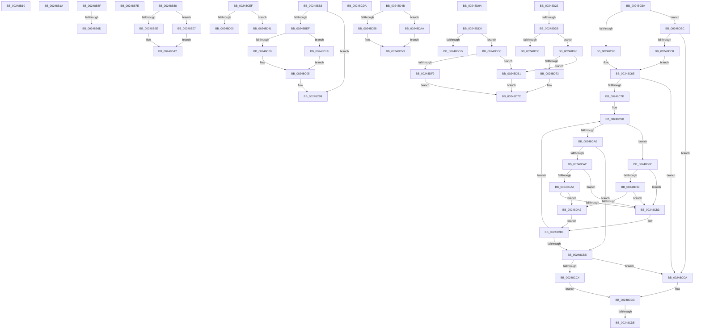

# sub_00248B10

- RVA: `0x00248B10`–`0x00248E1B` (길이 `779` bytes)
- VA: `0x0000000140248B10`
- 실행 섹션: `.text`
- PDB 이름 있음: `아니요`; PDB Function 태그: `아니요`
- unwind 정보 RVA: `0x000625E8`
- 디코드: `199`개 명령, `779/779` bytes 표시
- 미해석 바이트: `0` (있으면 어셈블리에 `.byte`로 보존)

> 이 문서는 커널 이미지의 기계어와 PDB 기호를 분석해 생성했습니다. 4번과 5번은 함수 원형과 자료형을 바이너리 사용 방식에서 추정한 C 해석이며 원본 소스 복구 결과는 아닙니다.

## 1. Dependencies

- 직접 호출 지점: **23**; 고유 호출 대상: **12**
- 직접 호출자로 확인된 함수: **0**
- RIP 상대 이미지 참조: **2**

### Outgoing calls
- `0x00248B10` → [ExAcquireSpinLockExclusiveAtDpcLevel](ExAcquireSpinLockExclusiveAtDpcLevel_function_00248E80.md) (function, `0x00248E80`)
- `0x00248B74` → [KiAcquireQueuedSpinLockInstrumented](../27/KiAcquireQueuedSpinLockInstrumented_function_00275850.md) (function, `0x00275850`)
- `0x00248B7E` → [ExReleaseSpinLockExclusiveFromDpcLevel](ExReleaseSpinLockExclusiveFromDpcLevel_function_002497E0.md) (function, `0x002497E0`)
- `0x00248BA9` → [RtlRbRemoveNode](../2E/RtlRbRemoveNode_function_002E4C10.md) (function, `0x002E4C10`)
- `0x00248BB9` → [RtlRbRemoveNode](../2E/RtlRbRemoveNode_function_002E4C10.md) (function, `0x002E4C10`)
- `0x00248BC8` → [RtlRbReplaceNode](../27/RtlRbReplaceNode_function_00272250.md) (function, `0x00272250`)
- `0x00248BE2` → [KxAcquireQueuedSpinLock](../27/KxAcquireQueuedSpinLock_function_00273E20.md) (function, `0x00273E20`)
- `0x00248C00` → [ExReleaseSpinLockSharedFromDpcLevel](ExReleaseSpinLockSharedFromDpcLevel_function_0024A590.md) (function, `0x0024A590`)
- `0x00248C3E` → [KiAbTryDecrementIoWaiterCounts](../27/KiAbTryDecrementIoWaiterCounts_function_00272330.md) (function, `0x00272330`)
- `0x00248C50` → [KeReleaseInStackQueuedSpinLockFromDpcLevel](../21/KeReleaseInStackQueuedSpinLockFromDpcLevel_function_002171B0.md) (function, `0x002171B0`)
- `0x00248CDE` → [KiAbReleaseLocksForEntry](../27/KiAbReleaseLocksForEntry_function_002721F8.md) (function, `0x002721F8`)
- `0x00248D00` → [ExReleaseSpinLockSharedFromDpcLevel](ExReleaseSpinLockSharedFromDpcLevel_function_0024A590.md) (function, `0x0024A590`)
- `0x00248D0E` → [KxWaitForLockOwnerShip](../25/KxWaitForLockOwnerShip_function_00257EB0.md) (function, `0x00257EB0`)
- `0x00248D18` → [ExReleaseSpinLockExclusiveFromDpcLevel](ExReleaseSpinLockExclusiveFromDpcLevel_function_002497E0.md) (function, `0x002497E0`)
- `0x00248D2F` → [ExTryConvertSharedSpinLockExclusive](../2E/ExTryConvertSharedSpinLockExclusive_function_002EF4C0.md) (function, `0x002EF4C0`)
- `0x00248D41` → [ExReleaseSpinLockExclusiveFromDpcLevel](ExReleaseSpinLockExclusiveFromDpcLevel_function_002497E0.md) (function, `0x002497E0`)
- `0x00248D58` → [ExReleaseSpinLockSharedFromDpcLevel](ExReleaseSpinLockSharedFromDpcLevel_function_0024A590.md) (function, `0x0024A590`)
- `0x00248D77` → [ExReleaseSpinLockSharedFromDpcLevel](ExReleaseSpinLockSharedFromDpcLevel_function_0024A590.md) (function, `0x0024A590`)
- `0x00248DAA` → [ExReleaseSpinLockExclusiveFromDpcLevel](ExReleaseSpinLockExclusiveFromDpcLevel_function_002497E0.md) (function, `0x002497E0`)
- `0x00248DB5` → [ExReleaseSpinLockExclusiveFromDpcLevel](ExReleaseSpinLockExclusiveFromDpcLevel_function_002497E0.md) (function, `0x002497E0`)
- `0x00248DD4` → [ExTryConvertSharedSpinLockExclusive](../2E/ExTryConvertSharedSpinLockExclusive_function_002EF4C0.md) (function, `0x002EF4C0`)
- `0x00248DFD` → [ExReleaseSpinLockSharedFromDpcLevel](ExReleaseSpinLockSharedFromDpcLevel_function_0024A590.md) (function, `0x0024A590`)
- `0x00248E11` → [KiAbTryDecrementIoWaiterCounts](../27/KiAbTryDecrementIoWaiterCounts_function_00272330.md) (function, `0x00272330`)

### Direct callers
- 이 함수 시작 RVA로 연결되는 직접 call은 확인되지 않았습니다. 간접 호출은 완전히 역산할 수 없습니다.

### Static image references
- `0x00248B5F` → RVA `0x00F0DE58` (`.data`; read)
- `0x00248CE3` → RVA `0x00E17100` (`.data`; read)

## 2. Other-region calls and transfers

- 다른 실행 섹션으로 향하는 call: **0**
- call이 아닌 외부 분기/꼬리 이동: **18**
  - `0x00248B15` → [sub_00248832 + 0xAC](Unknown_function_00248832.md) (`tail-transfer`)
  - `0x00248B5A` → [sub_00248832 + 0x84](Unknown_function_00248832.md) (`tail-transfer`)
  - `0x00248B67` → [sub_00248832 + 0xF4](Unknown_function_00248832.md) (`tail-transfer`)
  - `0x00248B79` → [sub_00248832 + 0x104](Unknown_function_00248832.md) (`tail-transfer`)
  - `0x00248B83` → [sub_00248832 + 0x19F](Unknown_function_00248832.md) (`tail-transfer`)
  - `0x00248BAE` → [sub_00248832 + 0x1F3](Unknown_function_00248832.md) (`tail-transfer`)
  - `0x00248C55` → [sub_00248832 + 0x1DD](Unknown_function_00248832.md) (`tail-transfer`)
  - `0x00248CCF` → [sub_00248832 + 0xC4](Unknown_function_00248832.md) (`tail-transfer`)
  - `0x00248CD5` → [sub_00248832 + 0xCD](Unknown_function_00248832.md) (`tail-transfer`)
  - `0x00248CEA` → [sub_00248832 + 0x298](Unknown_function_00248832.md) (`tail-transfer`)
  - `0x00248D05` → [sub_00248832 + 0x119](Unknown_function_00248832.md) (`tail-transfer`)
  - `0x00248D13` → [sub_00248832 + 0x104](Unknown_function_00248832.md) (`tail-transfer`)
  - `0x00248D25` → [sub_00248832 + 0x119](Unknown_function_00248832.md) (`tail-transfer`)
  - `0x00248D3C` → [sub_00248832 + 0x119](Unknown_function_00248832.md) (`tail-transfer`)
  - `0x00248D46` → [sub_00248832 + 0x119](Unknown_function_00248832.md) (`tail-transfer`)
  - `0x00248D61` → [sub_00248832 + 0x215](Unknown_function_00248832.md) (`tail-transfer`)
  - `0x00248D87` → [sub_00248832 + 0x9A](Unknown_function_00248832.md) (`tail-transfer`)
  - `0x00248DE7` → [sub_00248832 + 0xCD](Unknown_function_00248832.md) (`tail-transfer`)

## 3. Assembly (complete function range)

```asm
00248B10  E8 6B 03 00 00                  call 0x140248e80
00248B15  E9 C4 FD FF FF                  jmp 0x1402488de
00248B1A  83 E1 3F                        and ecx, 0x3f
00248B1D  49 8B D4                        mov rdx, r12
00248B20  48 6B C9 58                     imul rcx, rcx, 0x58
00248B24  48 2B D1                        sub rdx, rcx
00248B27  48 8B 4A F0                     mov rcx, qword ptr [rdx - 0x10]
00248B2B  33 D2                           xor edx, edx
00248B2D  4C 8B 81 20 02 00 00            mov r8, qword ptr [rcx + 0x220]
00248B34  41 F7 70 60                     div dword ptr [r8 + 0x60]
00248B38  49 8B 48 58                     mov rcx, qword ptr [r8 + 0x58]
00248B3C  48 8D 04 52                     lea rax, [rdx + rdx*2]
00248B40  48 8D 14 C5 00 00 00 00         lea rdx, [rax*8]
00248B48  48 03 CA                        add rcx, rdx
00248B4B  48 89 4D EF                     mov qword ptr [rbp - 0x11], rcx
00248B4F  49 8B 48 58                     mov rcx, qword ptr [r8 + 0x58]
00248B53  48 83 C1 10                     add rcx, 0x10
00248B57  48 03 CA                        add rcx, rdx
00248B5A  E9 57 FD FF FF                  jmp 0x1402488b6
00248B5F  8B 05 F3 52 CC 00               mov eax, dword ptr [rip + 0xcc52f3]
00248B65  85 C0                           test eax, eax
00248B67  0F 85 B9 FD FF FF               jne 0x140248926
00248B6D  48 8B D1                        mov rdx, rcx
00248B70  48 8D 4D FF                     lea rcx, [rbp - 1]
00248B74  E8 D7 CC 02 00                  call 0x140275850
00248B79  E9 B8 FD FF FF                  jmp 0x140248936
00248B7E  E8 5D 0C 00 00                  call 0x1402497e0
00248B83  E9 49 FE FF FF                  jmp 0x1402489d1
00248B88  41 0F B6 46 17                  movzx eax, byte ptr [r14 + 0x17]
00248B8D  24 7F                           and al, 0x7f
00248B8F  41 88 46 17                     mov byte ptr [r14 + 0x17], al
00248B93  41 80 7E 19 00                  cmp byte ptr [r14 + 0x19], 0
00248B98  0F 85 69 02 00 00               jne 0x140248e07
00248B9E  4C 8D 4B 28                     lea r9, [rbx + 0x28]
00248BA2  49 8D 56 20                     lea rdx, [r14 + 0x20]
00248BA6  49 8B C9                        mov rcx, r9
00248BA9  E8 62 C0 09 00                  call 0x1402e4c10
00248BAE  E9 72 FE FF FF                  jmp 0x140248a25
00248BB3  48 8B 19                        mov rbx, qword ptr [rcx]
00248BB6  48 8B D3                        mov rdx, rbx
00248BB9  E8 52 C0 09 00                  call 0x1402e4c10
00248BBE  48 8B 4D EF                     mov rcx, qword ptr [rbp - 0x11]
00248BC2  4C 8B C3                        mov r8, rbx
00248BC5  48 8B D6                        mov rdx, rsi
00248BC8  E8 83 96 02 00                  call 0x140272250
00248BCD  48 8D 53 38                     lea rdx, [rbx + 0x38]
00248BD1  48 C7 45 D7 00 00 00 00         mov qword ptr [rbp - 0x29], 0
00248BD9  48 89 55 DF                     mov qword ptr [rbp - 0x21], rdx
00248BDD  48 8D 4D D7                     lea rcx, [rbp - 0x29]
00248BE1  90                              nop
00248BE2  E8 39 B2 02 00                  call 0x140273e20
00248BE7  0F B6 45 1F                     movzx eax, byte ptr [rbp + 0x1f]
00248BEB  A8 01                           test al, 1
00248BED  74 1A                           je 0x140248c09
00248BEF  48 8B 4D F7                     mov rcx, qword ptr [rbp - 9]
00248BF3  24 FE                           and al, 0xfe
00248BF5  88 45 1F                        mov byte ptr [rbp + 0x1f], al
00248BF8  A8 02                           test al, 2
00248BFA  0F 85 18 01 00 00               jne 0x140248d18
00248C00  E8 8B 19 00 00                  call 0x14024a590
00248C05  80 65 1F FD                     and byte ptr [rbp + 0x1f], 0xfd
00248C09  41 0F 10 46 38                  movups xmm0, xmmword ptr [r14 + 0x38]
00248C0E  48 8D 53 F0                     lea rdx, [rbx - 0x10]
00248C12  0F 11 43 18                     movups xmmword ptr [rbx + 0x18], xmm0
00248C16  41 0F 10 46 48                  movups xmm0, xmmword ptr [r14 + 0x48]
00248C1B  0F 11 43 28                     movups xmmword ptr [rbx + 0x28], xmm0
00248C1F  41 0F B6 46 64                  movzx eax, byte ptr [r14 + 0x64]
00248C24  88 43 44                        mov byte ptr [rbx + 0x44], al
00248C27  8B 43 44                        mov eax, dword ptr [rbx + 0x44]
00248C2A  8B C8                           mov ecx, eax
00248C2C  41 33 4E 64                     xor ecx, dword ptr [r14 + 0x64]
00248C30  81 E1 00 7F 00 00               and ecx, 0x7f00
00248C36  33 C8                           xor ecx, eax
00248C38  89 4B 44                        mov dword ptr [rbx + 0x44], ecx
00248C3B  49 8B CC                        mov rcx, r12
00248C3E  E8 ED 96 02 00                  call 0x140272330
00248C43  0F B6 43 FB                     movzx eax, byte ptr [rbx - 5]
00248C47  48 8D 4D D7                     lea rcx, [rbp - 0x29]
00248C4B  0C 01                           or al, 1
00248C4D  88 43 FB                        mov byte ptr [rbx - 5], al
00248C50  E8 5B E5 FC FF                  call 0x1402171b0
00248C55  E9 B5 FD FF FF                  jmp 0x140248a0f
00248C5A  48 8B 45 EF                     mov rax, qword ptr [rbp - 0x11]
00248C5E  48 8B 50 08                     mov rdx, qword ptr [rax + 8]
00248C62  F6 C2 01                        test dl, 1
00248C65  0F 85 51 01 00 00               jne 0x140248dbc
00248C6B  48 8B 18                        mov rbx, qword ptr [rax]
00248C6E  44 0F B6 C2                     movzx r8d, dl
00248C72  41 83 E0 01                     and r8d, 1
00248C76  48 85 DB                        test rbx, rbx
00248C79  74 4F                           je 0x140248cca
00248C7B  48 B9 FC FF FF FF FF FF FF 7F   movabs rcx, 0x7ffffffffffffffc
00248C85  66 66 66 0F 1F 84 00 00 00 00 00  nop word ptr [rax + rax]
00248C90  48 8B 43 F0                     mov rax, qword ptr [rbx - 0x10]
00248C94  48 23 C1                        and rax, rcx
00248C97  48 3B C6                        cmp rax, rsi
00248C9A  0F 82 EC 00 00 00               jb 0x140248d8c
00248CA0  76 19                           jbe 0x140248cbb
00248CA2  48 8B 03                        mov rax, qword ptr [rbx]
00248CA5  45 85 C0                        test r8d, r8d
00248CA8  74 09                           je 0x140248cb3
00248CAA  48 85 C0                        test rax, rax
00248CAD  0F 85 EF 00 00 00               jne 0x140248da2
00248CB3  48 8B D8                        mov rbx, rax
00248CB6  48 85 DB                        test rbx, rbx
00248CB9  75 D5                           jne 0x140248c90
00248CBB  0F B6 4D 1F                     movzx ecx, byte ptr [rbp + 0x1f]
00248CBF  48 85 DB                        test rbx, rbx
00248CC2  74 06                           je 0x140248cca
00248CC4  48 83 C3 F0                     add rbx, -0x10
00248CC8  EB 02                           jmp 0x140248ccc
00248CCA  33 DB                           xor ebx, ebx
00248CCC  49 3B DC                        cmp rbx, r12
00248CCF  0F 84 21 FC FF FF               je 0x1402488f6
00248CD5  E9 25 FC FF FF                  jmp 0x1402488ff
00248CDA  48 8D 4D EF                     lea rcx, [rbp - 0x11]
00248CDE  E8 15 95 02 00                  call 0x1402721f8
00248CE3  4C 8D 05 16 E4 BC 00            lea r8, [rip + 0xbce416]
00248CEA  E9 DB FD FF FF                  jmp 0x140248aca
00248CEF  0F B6 C1                        movzx eax, cl
00248CF2  24 FE                           and al, 0xfe
00248CF4  F6 C1 02                        test cl, 2
00248CF7  88 45 1F                        mov byte ptr [rbp + 0x1f], al
00248CFA  48 8B 4D F7                     mov rcx, qword ptr [rbp - 9]
00248CFE  75 41                           jne 0x140248d41
00248D00  E8 8B 18 00 00                  call 0x14024a590
00248D05  E9 41 FC FF FF                  jmp 0x14024894b
00248D0A  48 8D 4D FF                     lea rcx, [rbp - 1]
00248D0E  E8 9D F1 00 00                  call 0x140257eb0
00248D13  E9 1E FC FF FF                  jmp 0x140248936
00248D18  E8 C3 0A 00 00                  call 0x1402497e0
00248D1D  E9 E3 FE FF FF                  jmp 0x140248c05
00248D22  F6 C1 02                        test cl, 2
00248D25  0F 85 20 FC FF FF               jne 0x14024894b
00248D2B  48 8B 4D F7                     mov rcx, qword ptr [rbp - 9]
00248D2F  E8 8C 67 0A 00                  call 0x1402ef4c0
00248D34  85 C0                           test eax, eax
00248D36  74 2E                           je 0x140248d66
00248D38  80 4D 1F 02                     or byte ptr [rbp + 0x1f], 2
00248D3C  E9 0A FC FF FF                  jmp 0x14024894b
00248D41  E8 9A 0A 00 00                  call 0x1402497e0
00248D46  E9 00 FC FF FF                  jmp 0x14024894b
00248D4B  48 8B 4D F7                     mov rcx, qword ptr [rbp - 9]
00248D4F  24 FE                           and al, 0xfe
00248D51  88 45 1F                        mov byte ptr [rbp + 0x1f], al
00248D54  A8 02                           test al, 2
00248D56  75 52                           jne 0x140248daa
00248D58  E8 33 18 00 00                  call 0x14024a590
00248D5D  80 65 1F FD                     and byte ptr [rbp + 0x1f], 0xfd
00248D61  E9 E1 FC FF FF                  jmp 0x140248a47
00248D66  0F B6 45 1F                     movzx eax, byte ptr [rbp + 0x1f]
00248D6A  24 FE                           and al, 0xfe
00248D6C  88 45 1F                        mov byte ptr [rbp + 0x1f], al
00248D6F  A8 02                           test al, 2
00248D71  75 3E                           jne 0x140248db1
00248D73  48 8B 4D F7                     mov rcx, qword ptr [rbp - 9]
00248D77  E8 14 18 00 00                  call 0x14024a590
00248D7C  0F B6 55 1F                     movzx edx, byte ptr [rbp + 0x1f]
00248D80  48 8B 4D F7                     mov rcx, qword ptr [rbp - 9]
00248D84  80 CA 02                        or dl, 2
00248D87  E9 40 FB FF FF                  jmp 0x1402488cc
00248D8C  48 8B 43 08                     mov rax, qword ptr [rbx + 8]
00248D90  45 85 C0                        test r8d, r8d
00248D93  0F 84 1A FF FF FF               je 0x140248cb3
00248D99  48 85 C0                        test rax, rax
00248D9C  0F 84 11 FF FF FF               je 0x140248cb3
00248DA2  48 33 D8                        xor rbx, rax
00248DA5  E9 0C FF FF FF                  jmp 0x140248cb6
00248DAA  E8 31 0A 00 00                  call 0x1402497e0
00248DAF  EB AC                           jmp 0x140248d5d
00248DB1  48 8B 4D F7                     mov rcx, qword ptr [rbp - 9]
00248DB5  E8 26 0A 00 00                  call 0x1402497e0
00248DBA  EB C0                           jmp 0x140248d7c
00248DBC  48 8B 18                        mov rbx, qword ptr [rax]
00248DBF  48 85 DB                        test rbx, rbx
00248DC2  0F 84 02 FF FF FF               je 0x140248cca
00248DC8  48 33 D8                        xor rbx, rax
00248DCB  E9 9E FE FF FF                  jmp 0x140248c6e
00248DD0  48 8B 4D F7                     mov rcx, qword ptr [rbp - 9]
00248DD4  E8 E7 66 0A 00                  call 0x1402ef4c0
00248DD9  85 C0                           test eax, eax
00248DDB  74 0F                           je 0x140248dec
00248DDD  0F B6 4D 1F                     movzx ecx, byte ptr [rbp + 0x1f]
00248DE1  80 C9 02                        or cl, 2
00248DE4  88 4D 1F                        mov byte ptr [rbp + 0x1f], cl
00248DE7  E9 13 FB FF FF                  jmp 0x1402488ff
00248DEC  0F B6 45 1F                     movzx eax, byte ptr [rbp + 0x1f]
00248DF0  24 FE                           and al, 0xfe
00248DF2  88 45 1F                        mov byte ptr [rbp + 0x1f], al
00248DF5  A8 02                           test al, 2
00248DF7  75 B8                           jne 0x140248db1
00248DF9  48 8B 4D F7                     mov rcx, qword ptr [rbp - 9]
00248DFD  E8 8E 17 00 00                  call 0x14024a590
00248E02  E9 75 FF FF FF                  jmp 0x140248d7c
00248E07  48 8B D3                        mov rdx, rbx
00248E0A  4C 8D 4B 38                     lea r9, [rbx + 0x38]
00248E0E  49 8B CC                        mov rcx, r12
00248E11  E8 1A 95 02 00                  call 0x140272330
00248E16  E9 87 FD FF FF                  jmp 0x140248ba2
```

## 4. C-style interpretation (structured pseudocode)

```c
__int64 __fastcall sub_00248B10(int a1)
{
    __int64 result;

    result = ExAcquireSpinLockExclusiveAtDpcLevel(a1, a2, a3, a4);
}
```

## 5. (Beta) C Style

```c
int64_t sub_00248B10(int32_t Arg1)
{
    int64_t result;

    result = ExAcquireSpinLockExclusiveAtDpcLevel(Arg1, a2, a3, a4);
}
```

## 6. Execution-region graph

[열기: 2D/3D 그래프와 함수 탐색 컨트롤 패널](../../../control-panel.html?section=text&rva=0x00248B10&view=graph)

- 2D 그래프는 위에서 아래로 흐르고, 3D 그래프는 빈 공간을 드래그해 회전합니다. Shift+드래그는 이동, 휠은 확대·축소, 함수 노드 선택은 대상 보고서 이동입니다.

### Static fallback


