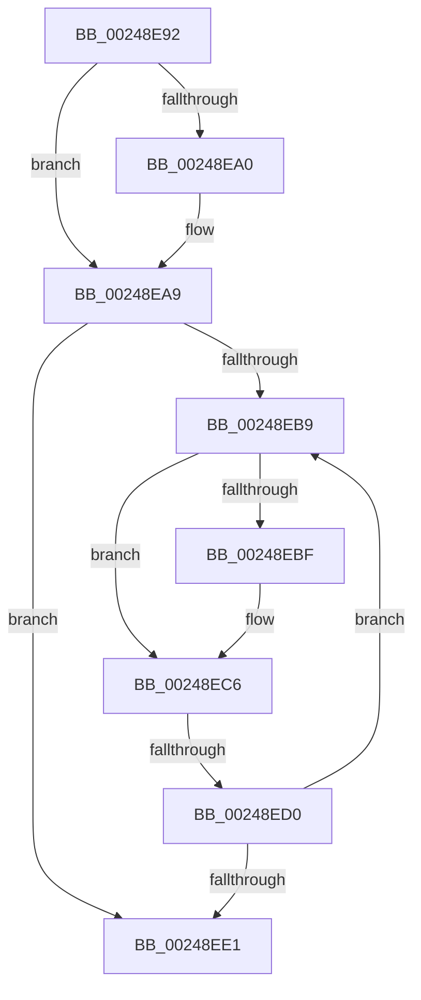

# sub_00248E92

- RVA: `0x00248E92`–`0x00248EEC` (길이 `90` bytes)
- VA: `0x0000000140248E92`
- 실행 섹션: `.text`
- PDB 이름 있음: `아니요`; PDB Function 태그: `아니요`
- unwind 정보 RVA: `0x00062624`
- 디코드: `28`개 명령, `90/90` bytes 표시
- 미해석 바이트: `0` (있으면 어셈블리에 `.byte`로 보존)

> 이 문서는 커널 이미지의 기계어와 PDB 기호를 분석해 생성했습니다. 4번과 5번은 함수 원형과 자료형을 바이너리 사용 방식에서 추정한 C 해석이며 원본 소스 복구 결과는 아닙니다.

## 1. Dependencies

- 직접 호출 지점: **1**; 고유 호출 대상: **1**
- 직접 호출자로 확인된 함수: **0**
- RIP 상대 이미지 참조: **1**

### Outgoing calls
- `0x00248EA2` → [ExpWaitForSpinLockExclusiveAndAcquire](../32/ExpWaitForSpinLockExclusiveAndAcquire_function_003239A0.md) (function, `0x003239A0`)

### Direct callers
- 이 함수 시작 RVA로 연결되는 직접 call은 확인되지 않았습니다. 간접 호출은 완전히 역산할 수 없습니다.

### Static image references
- `0x00248EC8` → RVA `0x00FC52AC` (`ALMOSTRO`; reference)

## 2. Other-region calls and transfers

- 다른 실행 섹션으로 향하는 call: **0**
- call이 아닌 외부 분기/꼬리 이동: **1**
  - `0x00248ECE` → [sub_00248F05](Unknown_function_00248F05.md) (`tail-transfer`)

## 3. Assembly (complete function range)

```asm
00248E92  48 89 7C 24 30                  mov qword ptr [rsp + 0x30], rdi
00248E97  33 FF                           xor edi, edi
00248E99  F0 0F BA 29 1F                  lock bts dword ptr [rcx], 0x1f
00248E9E  73 09                           jae 0x140248ea9
00248EA0  B2 FF                           mov dl, 0xff
00248EA2  E8 F9 AA 0D 00                  call 0x1403239a0
00248EA7  8B F8                           mov edi, eax
00248EA9  8B 13                           mov edx, dword ptr [rbx]
00248EAB  8B CA                           mov ecx, edx
00248EAD  0F BA F1 1E                     btr ecx, 0x1e
00248EB1  81 F9 00 00 00 80               cmp ecx, 0x80000000
00248EB7  74 28                           je 0x140248ee1
00248EB9  0F BA E2 1E                     bt edx, 0x1e
00248EBD  72 07                           jb 0x140248ec6
00248EBF  F0 81 0B 00 00 00 40            lock or dword ptr [rbx], 0x40000000
00248EC6  FF C7                           inc edi
00248EC8  85 3D DE C3 D7 00               test dword ptr [rip + 0xd7c3de], edi
00248ECE  74 35                           je 0x140248f05
00248ED0  F3 90                           pause
00248ED2  8B 13                           mov edx, dword ptr [rbx]
00248ED4  8B C2                           mov eax, edx
00248ED6  0F BA F0 1E                     btr eax, 0x1e
00248EDA  3D 00 00 00 80                  cmp eax, 0x80000000
00248EDF  75 D8                           jne 0x140248eb9
00248EE1  48 8B 7C 24 30                  mov rdi, qword ptr [rsp + 0x30]
00248EE6  48 83 C4 20                     add rsp, 0x20
00248EEA  5B                              pop rbx
00248EEB  C3                              ret
```

## 4. C-style interpretation (structured pseudocode)

```c
__int64 __fastcall sub_00248E92(__int64 a1, __int64 a2, __int64 a3, __int64 a4, __int64 a5, __int64 a6)
{
    __int64 result;
    __int64 v_rdi;
    __int64 v_rsp;
    unsigned __int64 v_stack_p30;

    v_stack_p30 = v_rdi;
    v_rdi = 0;
    if (!(condition_is_above_or_equal)) {
        a2 = 255;
        result = ExpWaitForSpinLockExclusiveAndAcquire(a1, a2, a3, a4);
        v_rdi = (unsigned int)(result);
    }
    if (((unsigned int)((unsigned int)((unsigned int)((unsigned int)(*(unsigned int *)(v_rbx)))))) == 0x80000000ULL) goto loc_00248EE1;
loc_00248EB9:
    if (((unsigned int)((unsigned int)((unsigned int)((unsigned int)(*(unsigned int *)(v_rbx)))))) >= 0x80000000ULL) {
    }
    v_rdi = (unsigned int)((v_rdi) + 1);
    if (((unsigned int)((unsigned int)((unsigned int)((unsigned int)(*(unsigned int *)(v_rbx)))))) != 0x80000000ULL) goto loc_00248EB9;
loc_00248EE1:
    v_rsp = (v_rsp) + (32);
    return (unsigned int)((unsigned int)((unsigned int)(*(unsigned int *)(v_rbx))));
}
```

## 5. (Beta) C Style

```c
int64_t sub_00248E92(void *Arg1, int64_t Arg2, int64_t Arg3, int64_t Arg4, uint64_t Arg5, int64_t Arg6)
{
    uint8_t *arg1 = (uint8_t *)Arg1;

    int64_t result;
    int64_t local_rdi;
    int64_t local_rsp;
    uint64_t v_stack_p30;

    v_stack_p30 = local_rdi;
    local_rdi = 0;
    if (!(condition_is_above_or_equal)) {
        Arg2 = 255;
        result = ExpWaitForSpinLockExclusiveAndAcquire(Arg1, Arg2, Arg3, Arg4);
        local_rdi = (uint32_t)(result);
    }
    if (((uint32_t)((uint32_t)((uint32_t)((uint32_t)(*(uint32_t *)(local_rbx)))))) == 0x80000000ULL) goto loc_00248EE1;
loc_00248EB9:
    if (((uint32_t)((uint32_t)((uint32_t)((uint32_t)(*(uint32_t *)(local_rbx)))))) >= 0x80000000ULL) {
    }
    local_rdi = (uint32_t)((local_rdi) + 1);
    if (((uint32_t)((uint32_t)((uint32_t)((uint32_t)(*(uint32_t *)(local_rbx)))))) != 0x80000000ULL) goto loc_00248EB9;
loc_00248EE1:
    local_rsp = (local_rsp) + (32);
    return (uint32_t)((uint32_t)((uint32_t)(*(uint32_t *)(local_rbx))));
}
```

### 관측된 메모리 오프셋

구조체 형식이 확인되지 않은 접근은 인자 기준의 오프셋으로만 기록했습니다.

| 기준 인자 | 오프셋 표현 | 폭 (bit) | 접근 |
|---|---:|---:|---|
| `Arg1` | `+ 0x0` | `32` | `R/W` |

## 6. Execution-region graph

[열기: 2D/3D 그래프와 함수 탐색 컨트롤 패널](../../../control-panel.html?section=text&rva=0x00248E92&view=graph)

- 2D 그래프는 위에서 아래로 흐르고, 3D 그래프는 빈 공간을 드래그해 회전합니다. Shift+드래그는 이동, 휠은 확대·축소, 함수 노드 선택은 대상 보고서 이동입니다.

### Static fallback


