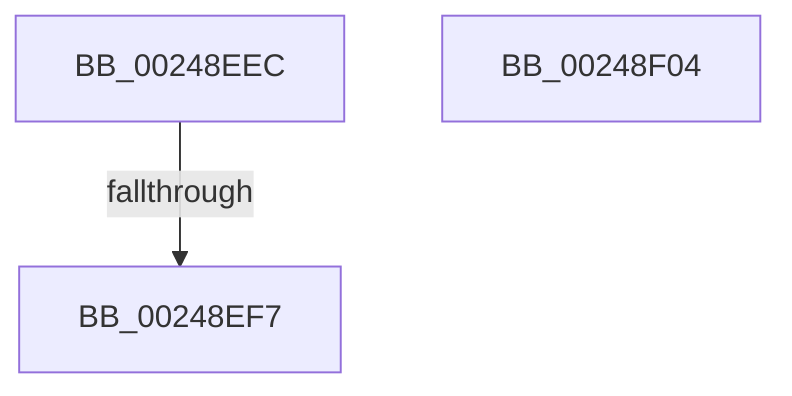

# sub_00248EEC

- RVA: `0x00248EEC`–`0x00248F05` (길이 `25` bytes)
- VA: `0x0000000140248EEC`
- 실행 섹션: `.text`
- PDB 이름 있음: `아니요`; PDB Function 태그: `아니요`
- unwind 정보 RVA: `0x0006263C`
- 디코드: `10`개 명령, `25/25` bytes 표시
- 미해석 바이트: `0` (있으면 어셈블리에 `.byte`로 보존)

> 이 문서는 커널 이미지의 기계어와 PDB 기호를 분석해 생성했습니다. 4번과 5번은 함수 원형과 자료형을 바이너리 사용 방식에서 추정한 C 해석이며 원본 소스 복구 결과는 아닙니다.

## 1. Dependencies

- 직접 호출 지점: **1**; 고유 호출 대상: **1**
- 직접 호출자로 확인된 함수: **0**
- RIP 상대 이미지 참조: **1**

### Outgoing calls
- `0x00248EF9` → [ExpAcquireSpinLockExclusiveAtDpcLevelInstrumented](../32/ExpAcquireSpinLockExclusiveAtDpcLevelInstrumented_function_00323A70.md) (function, `0x00323A70`)

### Direct callers
- 이 함수 시작 RVA로 연결되는 직접 call은 확인되지 않았습니다. 간접 호출은 완전히 역산할 수 없습니다.

### Static image references
- `0x00248EED` → RVA `0x00F0DE58` (`.data`; read)

## 2. Other-region calls and transfers

- 다른 실행 섹션으로 향하는 call: **0**
- call이 아닌 외부 분기/꼬리 이동: **1**
  - `0x00248EF5` → [sub_00248E92](Unknown_function_00248E92.md) (`tail-transfer`)

## 3. Assembly (complete function range)

```asm
00248EEC  CC                              int3
00248EED  8B 05 65 4F CC 00               mov eax, dword ptr [rip + 0xcc4f65]
00248EF3  85 C0                           test eax, eax
00248EF5  75 9B                           jne 0x140248e92
00248EF7  B2 FF                           mov dl, 0xff
00248EF9  E8 72 AB 0D 00                  call 0x140323a70
00248EFE  48 83 C4 20                     add rsp, 0x20
00248F02  5B                              pop rbx
00248F03  C3                              ret
00248F04  CC                              int3
```

## 4. C-style interpretation (structured pseudocode)

```c
__int64 __fastcall sub_00248EEC(void)
{
    __int64 result;
    __int64 v_rsp;

    result = ExpAcquireSpinLockExclusiveAtDpcLevelInstrumented(a1, 255, a3, a4);
    v_rsp = (v_rsp) + (32);
    return result;
}
```

## 5. (Beta) C Style

```c
void sub_00248EEC(void)
{
    int64_t result;
    int64_t local_rsp;

    result = ExpAcquireSpinLockExclusiveAtDpcLevelInstrumented(a1, 255, a3, a4);
    local_rsp = (local_rsp) + (32);
    return result;
}
```

## 6. Execution-region graph

[열기: 2D/3D 그래프와 함수 탐색 컨트롤 패널](../../../control-panel.html?section=text&rva=0x00248EEC&view=graph)

- 2D 그래프는 위에서 아래로 흐르고, 3D 그래프는 빈 공간을 드래그해 회전합니다. Shift+드래그는 이동, 휠은 확대·축소, 함수 노드 선택은 대상 보고서 이동입니다.

### Static fallback


