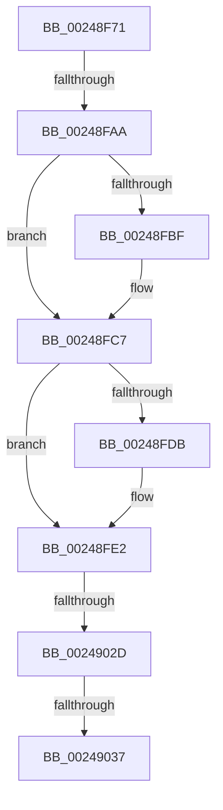

# sub_00248F71

- RVA: `0x00248F71`–`0x0024904B` (길이 `218` bytes)
- VA: `0x0000000140248F71`
- 실행 섹션: `.text`
- PDB 이름 있음: `아니요`; PDB Function 태그: `아니요`
- unwind 정보 RVA: `0x00062670`
- 디코드: `47`개 명령, `218/218` bytes 표시
- 미해석 바이트: `0` (있으면 어셈블리에 `.byte`로 보존)

> 이 문서는 커널 이미지의 기계어와 PDB 기호를 분석해 생성했습니다. 4번과 5번은 함수 원형과 자료형을 바이너리 사용 방식에서 추정한 C 해석이며 원본 소스 복구 결과는 아닙니다.

## 1. Dependencies

- 직접 호출 지점: **5**; 고유 호출 대상: **5**
- 직접 호출자로 확인된 함수: **0**
- RIP 상대 이미지 참조: **0**

### Outgoing calls
- `0x00248F8A` → [MiClearFilePointer](../46/MiClearFilePointer_function_00463044.md) (function, `0x00463044`)
- `0x00248FB1` → [ExAcquireSpinLockExclusiveAtDpcLevel](ExAcquireSpinLockExclusiveAtDpcLevel_function_00248E80.md) (function, `0x00248E80`)
- `0x00248FC2` → [MiUnlinkUnusedControlArea](../4E/MiUnlinkUnusedControlArea_function_004ED9F8.md) (function, `0x004ED9F8`)
- `0x00248FFE` → [ExReleaseSpinLockExclusiveFromDpcLevel](ExReleaseSpinLockExclusiveFromDpcLevel_function_002497E0.md) (function, `0x002497E0`)
- `0x0024900F` → [KeSetEvent](../33/KeSetEvent_function_0033F310.md) (function, `0x0033F310`)

### Direct callers
- 이 함수 시작 RVA로 연결되는 직접 call은 확인되지 않았습니다. 간접 호출은 완전히 역산할 수 없습니다.

### Static image references
- 디코드된 RIP-relative 메모리 참조가 없습니다.

## 2. Other-region calls and transfers

- 다른 실행 섹션으로 향하는 call: **0**
- call이 아닌 외부 분기/꼬리 이동: **4**
  - `0x00248FA4` → [sub_0024904B + 0x1D](Unknown_function_0024904B.md) (`tail-transfer`)
  - `0x0024902B` → [sub_0024904B + 0x29](Unknown_function_0024904B.md) (`tail-transfer`)
  - `0x00249035` → [sub_0024904B](Unknown_function_0024904B.md) (`tail-transfer`)
  - `0x00249046` → [MiCheckForControlAreaDeletion + 0x10](MiCheckForControlAreaDeletion_function_00248F30.md) (`tail-transfer`)

## 3. Assembly (complete function range)

```asm
00248F71  48 89 6C 24 30                  mov qword ptr [rsp + 0x30], rbp
00248F76  48 89 74 24 38                  mov qword ptr [rsp + 0x38], rsi
00248F7B  48 89 7C 24 40                  mov qword ptr [rsp + 0x40], rdi
00248F80  48 8B 3C C8                     mov rdi, qword ptr [rax + rcx*8]
00248F84  48 8B CB                        mov rcx, rbx
00248F87  89 53 38                        mov dword ptr [rbx + 0x38], edx
00248F8A  E8 B5 A0 21 00                  call 0x140463044
00248F8F  B8 01 00 00 00                  mov eax, 1
00248F94  F0 48 0F C1 87 C8 06 00 00      lock xadd qword ptr [rdi + 0x6c8], rax
00248F9D  48 FF C0                        inc rax
00248FA0  48 83 F8 01                     cmp rax, 1
00248FA4  0F 8E BE 00 00 00               jle 0x140249068
00248FAA  48 8D 8F C0 06 00 00            lea rcx, [rdi + 0x6c0]
00248FB1  E8 CA FE FF FF                  call 0x140248e80
00248FB6  F7 43 38 00 00 00 10            test dword ptr [rbx + 0x38], 0x10000000
00248FBD  74 08                           je 0x140248fc7
00248FBF  48 8B CB                        mov rcx, rbx
00248FC2  E8 31 4A 2A 00                  call 0x1404ed9f8
00248FC7  48 8D 87 88 07 00 00            lea rax, [rdi + 0x788]
00248FCE  48 8B 48 08                     mov rcx, qword ptr [rax + 8]
00248FD2  48 8D 53 08                     lea rdx, [rbx + 8]
00248FD6  48 39 01                        cmp qword ptr [rcx], rax
00248FD9  74 07                           je 0x140248fe2
00248FDB  B9 03 00 00 00                  mov ecx, 3
00248FE0  CD 29                           int 0x29
00248FE2  48 89 4A 08                     mov qword ptr [rdx + 8], rcx
00248FE6  48 89 02                        mov qword ptr [rdx], rax
00248FE9  48 89 11                        mov qword ptr [rcx], rdx
00248FEC  48 8D 8F C0 06 00 00            lea rcx, [rdi + 0x6c0]
00248FF3  48 89 50 08                     mov qword ptr [rax + 8], rdx
00248FF7  81 4B 38 00 00 00 10            or dword ptr [rbx + 0x38], 0x10000000
00248FFE  E8 DD 07 00 00                  call 0x1402497e0
00249003  45 33 C0                        xor r8d, r8d
00249006  48 8D 8F 70 07 00 00            lea rcx, [rdi + 0x770]
0024900D  33 D2                           xor edx, edx
0024900F  E8 FC 62 0F 00                  call 0x14033f310
00249014  48 C7 C0 FF FF FF FF            mov rax, 0xffffffffffffffff
0024901B  F0 48 0F C1 87 C8 06 00 00      lock xadd qword ptr [rdi + 0x6c8], rax
00249024  48 FF C8                        dec rax
00249027  48 83 F8 FF                     cmp rax, -1
0024902B  7E 47                           jle 0x140249074
0024902D  48 83 BF C8 06 00 00 00         cmp qword ptr [rdi + 0x6c8], 0
00249035  74 14                           je 0x14024904b
00249037  48 8B 74 24 38                  mov rsi, qword ptr [rsp + 0x38]
0024903C  48 8B 6C 24 30                  mov rbp, qword ptr [rsp + 0x30]
00249041  48 8B 7C 24 40                  mov rdi, qword ptr [rsp + 0x40]
00249046  E9 F5 FE FF FF                  jmp 0x140248f40
```

## 4. C-style interpretation (structured pseudocode)

```c
__int64 __fastcall sub_00248F71(__int64 a1, int a2, int a3, __int64 a4, __int64 a5, __int64 a6, __int64 a7, __int64 a8)
{
    __int64 result;
    unsigned __int64 v_stack_p30;
    unsigned __int64 v_stack_p38;
    unsigned __int64 v_stack_p40;

    v_stack_p30 = v_rbp;
    v_stack_p38 = v_rsi;
    v_stack_p40 = v_rdi;
    *(unsigned int *)(v_rbx + 56) = a2;
    result = MiClearFilePointer(v_rbx, a2, a3, a4);
    result = (1) + 1;
    result = ExAcquireSpinLockExclusiveAtDpcLevel(*(unsigned __int64 *)(result + a1 * 8) + 1728, a2, a3, a4);
    if (((*(unsigned int *)(v_rbx + 56)) & (0x10000000ULL)) != 0) {
        a1 = v_rbx;
        result = MiUnlinkUnusedControlArea(a1, a2, a3, a4);
    }
    if ((*(unsigned __int64 *)(*(unsigned __int64 *)(*(unsigned __int64 *)(result + a1 * 8) + 1928 + 8))) != (*(unsigned __int64 *)(result + a1 * 8) + 1928)) {
        a1 = 3;
    }
    *(unsigned __int64 *)(v_rbx + 8 + 8) = a1;
    *(unsigned __int64 *)(v_rbx + 8) = *(unsigned __int64 *)(result + a1 * 8) + 1928;
    *(unsigned __int64 *)(a1) = v_rbx + 8;
    *(unsigned __int64 *)(*(unsigned __int64 *)(result + a1 * 8) + 1928 + 8) = v_rbx + 8;
    result = ExReleaseSpinLockExclusiveFromDpcLevel(*(unsigned __int64 *)(result + a1 * 8) + 1728, v_rbx + 8, a3, a4);
    a3 = 0;
    a2 = 0;
    result = KeSetEvent(*(unsigned __int64 *)(result + a1 * 8) + 1904, a2, a3, a4);
    result = (-1) - 1;
}
```

## 5. (Beta) C Style

```c
int64_t sub_00248F71(int64_t Arg1, int32_t Arg2, int32_t Arg3, int64_t Arg4, uint64_t Arg5, int64_t Arg6, int64_t Arg7, int64_t Arg8)
{
    int64_t result;
    uint64_t v_stack_p30;
    uint64_t v_stack_p38;
    uint64_t v_stack_p40;

    v_stack_p30 = local_rbp;
    v_stack_p38 = local_rsi;
    v_stack_p40 = local_rdi;
    *(uint32_t *)(local_rbx + 0x38) = Arg2;
    result = MiClearFilePointer(local_rbx, Arg2, Arg3, Arg4);
    result = (1) + 1;
    result = ExAcquireSpinLockExclusiveAtDpcLevel(*(uint64_t *)(result + Arg1 * 8) + 1728, Arg2, Arg3, Arg4);
    if (((*(uint32_t *)(local_rbx + 0x38)) & (0x10000000ULL)) != 0) {
        Arg1 = local_rbx;
        result = MiUnlinkUnusedControlArea(Arg1, Arg2, Arg3, Arg4);
    }
    if ((*(uint64_t *)(*(uint64_t *)(*(uint64_t *)(result + Arg1 * 8) + 0x788 + 0x8))) != (*(uint64_t *)(result + Arg1 * 8) + 1928)) {
        Arg1 = 3;
    }
    *(uint64_t *)(local_rbx + 0x8 + 0x8) = Arg1;
    *(uint64_t *)(local_rbx + 0x8) = *(uint64_t *)(result + Arg1 * 8) + 1928;
    *(uint64_t *)(Arg1) = local_rbx + 8;
    *(uint64_t *)(*(uint64_t *)(result + Arg1 * 8) + 0x788 + 0x8) = local_rbx + 8;
    result = ExReleaseSpinLockExclusiveFromDpcLevel(*(uint64_t *)(result + Arg1 * 8) + 1728, local_rbx + 8, Arg3, Arg4);
    Arg3 = 0;
    Arg2 = 0;
    result = KeSetEvent(*(uint64_t *)(result + Arg1 * 8) + 1904, Arg2, Arg3, Arg4);
    result = (-1) - 1;
}
```

## 6. Execution-region graph

[열기: 2D/3D 그래프와 함수 탐색 컨트롤 패널](../../../control-panel.html?section=text&rva=0x00248F71&view=graph)

- 2D 그래프는 위에서 아래로 흐르고, 3D 그래프는 빈 공간을 드래그해 회전합니다. Shift+드래그는 이동, 휠은 확대·축소, 함수 노드 선택은 대상 보고서 이동입니다.

### Static fallback


