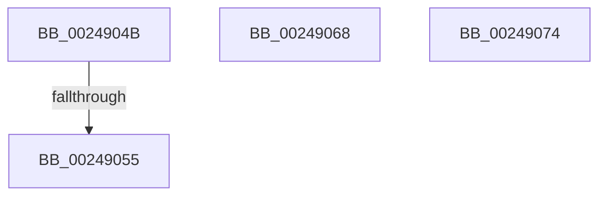

# sub_0024904B

- RVA: `0x0024904B`–`0x0024907D` (길이 `50` bytes)
- VA: `0x000000014024904B`
- 실행 섹션: `.text`
- PDB 이름 있음: `아니요`; PDB Function 태그: `아니요`
- unwind 정보 RVA: `0x0006268C`
- 디코드: `13`개 명령, `50/50` bytes 표시
- 미해석 바이트: `0` (있으면 어셈블리에 `.byte`로 보존)

> 이 문서는 커널 이미지의 기계어와 PDB 기호를 분석해 생성했습니다. 4번과 5번은 함수 원형과 자료형을 바이너리 사용 방식에서 추정한 C 해석이며 원본 소스 복구 결과는 아닙니다.

## 1. Dependencies

- 직접 호출 지점: **1**; 고유 호출 대상: **1**
- 직접 호출자로 확인된 함수: **0**
- RIP 상대 이미지 참조: **0**

### Outgoing calls
- `0x00249061` → [KeSetEvent](../33/KeSetEvent_function_0033F310.md) (function, `0x0033F310`)

### Direct callers
- 이 함수 시작 RVA로 연결되는 직접 call은 확인되지 않았습니다. 간접 호출은 완전히 역산할 수 없습니다.

### Static image references
- 디코드된 RIP-relative 메모리 참조가 없습니다.

## 2. Other-region calls and transfers

- 다른 실행 섹션으로 향하는 call: **0**
- call이 아닌 외부 분기/꼬리 이동: **4**
  - `0x00249053` → [sub_00248F71 + 0xC6](Unknown_function_00248F71.md) (`tail-transfer`)
  - `0x00249066` → [sub_00248F71 + 0xC6](Unknown_function_00248F71.md) (`tail-transfer`)
  - `0x0024906F` → [sub_00248F71 + 0x39](Unknown_function_00248F71.md) (`tail-transfer`)
  - `0x0024907B` → [sub_00248F71 + 0xBC](Unknown_function_00248F71.md) (`tail-transfer`)

## 3. Assembly (complete function range)

```asm
0024904B  48 83 BF D0 06 00 00 00         cmp qword ptr [rdi + 0x6d0], 0
00249053  75 E2                           jne 0x140249037
00249055  48 8B 8F E0 0A 00 00            mov rcx, qword ptr [rdi + 0xae0]
0024905C  45 33 C0                        xor r8d, r8d
0024905F  33 D2                           xor edx, edx
00249061  E8 AA 62 0F 00                  call 0x14033f310
00249066  EB CF                           jmp 0x140249037
00249068  B9 0E 00 00 00                  mov ecx, 0xe
0024906D  CD 29                           int 0x29
0024906F  E9 36 FF FF FF                  jmp 0x140248faa
00249074  B9 0E 00 00 00                  mov ecx, 0xe
00249079  CD 29                           int 0x29
0024907B  EB B0                           jmp 0x14024902d
```

## 4. C-style interpretation (structured pseudocode)

```c
__int64 __fastcall sub_0024904B(__int64 a1, int a2, int a3)
{
    __int64 result;

    a3 = 0;
    a2 = 0;
    result = KeSetEvent(*(unsigned __int64 *)(v_rdi + 2784), a2, a3, a4);
}
```

## 5. (Beta) C Style

```c
int64_t sub_0024904B(int64_t Arg1, int32_t Arg2, int32_t Arg3)
{
    int64_t result;

    Arg3 = 0;
    Arg2 = 0;
    result = KeSetEvent(*(uint64_t *)(local_rdi + 0xAE0), Arg2, Arg3, a4);
}
```

## 6. Execution-region graph

[열기: 2D/3D 그래프와 함수 탐색 컨트롤 패널](../../../control-panel.html?section=text&rva=0x0024904B&view=graph)

- 2D 그래프는 위에서 아래로 흐르고, 3D 그래프는 빈 공간을 드래그해 회전합니다. Shift+드래그는 이동, 휠은 확대·축소, 함수 노드 선택은 대상 보고서 이동입니다.

### Static fallback


