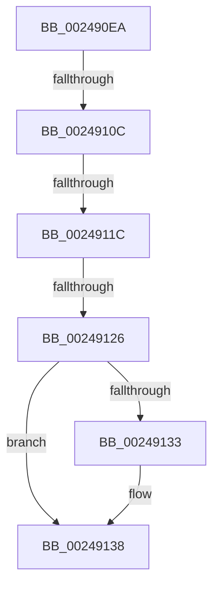

# sub_002490EA

- RVA: `0x002490EA`–`0x00249157` (길이 `109` bytes)
- VA: `0x00000001402490EA`
- 실행 섹션: `.text`
- PDB 이름 있음: `아니요`; PDB Function 태그: `아니요`
- unwind 정보 RVA: `0x000626B4`
- 디코드: `22`개 명령, `109/109` bytes 표시
- 미해석 바이트: `0` (있으면 어셈블리에 `.byte`로 보존)

> 이 문서는 커널 이미지의 기계어와 PDB 기호를 분석해 생성했습니다. 4번과 5번은 함수 원형과 자료형을 바이너리 사용 방식에서 추정한 C 해석이며 원본 소스 복구 결과는 아닙니다.

## 1. Dependencies

- 직접 호출 지점: **3**; 고유 호출 대상: **3**
- 직접 호출자로 확인된 함수: **0**
- RIP 상대 이미지 참조: **0**

### Outgoing calls
- `0x002490ED` → [ExAcquireSpinLockExclusiveAtDpcLevel](ExAcquireSpinLockExclusiveAtDpcLevel_function_00248E80.md) (function, `0x00248E80`)
- `0x00249133` → [KeResetEvent](KeResetEvent_function_00248350.md) (function, `0x00248350`)
- `0x00249143` → [MiReleaseSpinLockExclusive](MiReleaseSpinLockExclusive_function_002482C0.md) (function, `0x002482C0`)

### Direct callers
- 이 함수 시작 RVA로 연결되는 직접 call은 확인되지 않았습니다. 간접 호출은 완전히 역산할 수 없습니다.

### Static image references
- 디코드된 RIP-relative 메모리 참조가 없습니다.

## 2. Other-region calls and transfers

- 다른 실행 섹션으로 향하는 call: **0**
- call이 아닌 외부 분기/꼬리 이동: **4**
  - `0x0024910A` → [sub_00249157](Unknown_function_00249157.md) (`tail-transfer`)
  - `0x00249116` → [sub_0024918B + 0x33](Unknown_function_0024918B.md) (`tail-transfer`)
  - `0x00249120` → [sub_0024918B + 0x4D](Unknown_function_0024918B.md) (`tail-transfer`)
  - `0x00249152` → [MiSignalCommitSignals + 0x2A](MiSignalCommitSignals_function_00249090.md) (`tail-transfer`)

## 3. Assembly (complete function range)

```asm
002490EA  40 B6 11                        mov sil, 0x11
002490ED  E8 8E FD FF FF                  call 0x140248e80
002490F2  48 8B 93 40 4B 00 00            mov rdx, qword ptr [rbx + 0x4b40]
002490F9  48 8B 8B D8 41 00 00            mov rcx, qword ptr [rbx + 0x41d8]
00249100  4C 8B 83 E0 41 00 00            mov r8, qword ptr [rbx + 0x41e0]
00249107  48 3B D1                        cmp rdx, rcx
0024910A  72 4B                           jb 0x140249157
0024910C  48 8B 8B 30 01 00 00            mov rcx, qword ptr [rbx + 0x130]
00249113  49 3B D0                        cmp rdx, r8
00249116  0F 83 A2 00 00 00               jae 0x1402491be
0024911C  83 79 04 01                     cmp dword ptr [rcx + 4], 1
00249120  0F 84 B2 00 00 00               je 0x1402491d8
00249126  48 8B 8B 28 01 00 00            mov rcx, qword ptr [rbx + 0x128]
0024912D  83 79 04 01                     cmp dword ptr [rcx + 4], 1
00249131  75 05                           jne 0x140249138
00249133  E8 18 F2 FF FF                  call 0x140248350
00249138  40 0F B6 D6                     movzx edx, sil
0024913C  48 8D 8B F8 41 00 00            lea rcx, [rbx + 0x41f8]
00249143  E8 78 F1 FF FF                  call 0x1402482c0
00249148  48 8B 7C 24 38                  mov rdi, qword ptr [rsp + 0x38]
0024914D  48 8B 74 24 30                  mov rsi, qword ptr [rsp + 0x30]
00249152  E9 63 FF FF FF                  jmp 0x1402490ba
```

## 4. C-style interpretation (structured pseudocode)

```c
__int64 __fastcall sub_002490EA(__int64 a1, __int64 a2, __int64 a3, __int64 a4, __int64 a5, __int64 a6, __int64 a7)
{
    __int64 result;

    result = ExAcquireSpinLockExclusiveAtDpcLevel(a1, a2, a3, a4);
    if ((*(unsigned int *)(*(unsigned __int64 *)(v_rbx + 296) + 4)) == 1) {
        result = KeResetEvent(*(unsigned __int64 *)(v_rbx + 296), *(unsigned __int64 *)(v_rbx + 19264), *(unsigned __int64 *)(v_rbx + 16864), a4);
    }
    result = MiReleaseSpinLockExclusive(v_rbx + 16888, 17, *(unsigned __int64 *)(v_rbx + 16864), a4);
}
```

## 5. (Beta) C Style

```c
int64_t sub_002490EA(int64_t Arg1, int64_t Arg2, int64_t Arg3, int64_t Arg4, uint64_t Arg5, int64_t Arg6, int64_t Arg7)
{
    int64_t result;

    result = ExAcquireSpinLockExclusiveAtDpcLevel(Arg1, Arg2, Arg3, Arg4);
    if ((*(uint32_t *)(*(uint64_t *)(local_rbx + 0x128) + 0x4)) == 1) {
        result = KeResetEvent(*(uint64_t *)(local_rbx + 0x128), *(uint64_t *)(local_rbx + 0x4B40), *(uint64_t *)(local_rbx + 0x41E0), Arg4);
    }
    result = MiReleaseSpinLockExclusive(local_rbx + 16888, 17, *(uint64_t *)(local_rbx + 0x41E0), Arg4);
}
```

## 6. Execution-region graph

[열기: 2D/3D 그래프와 함수 탐색 컨트롤 패널](../../../control-panel.html?section=text&rva=0x002490EA&view=graph)

- 2D 그래프는 위에서 아래로 흐르고, 3D 그래프는 빈 공간을 드래그해 회전합니다. Shift+드래그는 이동, 휠은 확대·축소, 함수 노드 선택은 대상 보고서 이동입니다.

### Static fallback


