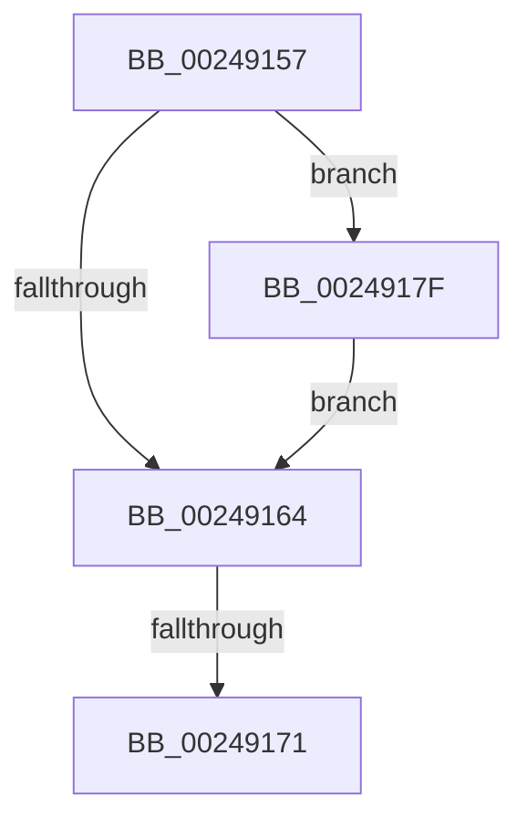

# sub_00249157

- RVA: `0x00249157`–`0x0024918B` (길이 `52` bytes)
- VA: `0x0000000140249157`
- 실행 섹션: `.text`
- PDB 이름 있음: `아니요`; PDB Function 태그: `아니요`
- unwind 정보 RVA: `0x000626CC`
- 디코드: `13`개 명령, `52/52` bytes 표시
- 미해석 바이트: `0` (있으면 어셈블리에 `.byte`로 보존)

> 이 문서는 커널 이미지의 기계어와 PDB 기호를 분석해 생성했습니다. 4번과 5번은 함수 원형과 자료형을 바이너리 사용 방식에서 추정한 C 해석이며 원본 소스 복구 결과는 아닙니다.

## 1. Dependencies

- 직접 호출 지점: **2**; 고유 호출 대상: **2**
- 직접 호출자로 확인된 함수: **0**
- RIP 상대 이미지 참조: **0**

### Outgoing calls
- `0x00249171` → [KeResetEvent](KeResetEvent_function_00248350.md) (function, `0x00248350`)
- `0x00249184` → [KeSetEvent](../33/KeSetEvent_function_0033F310.md) (function, `0x0033F310`)

### Direct callers
- 이 함수 시작 RVA로 연결되는 직접 call은 확인되지 않았습니다. 간접 호출은 완전히 역산할 수 없습니다.

### Static image references
- 디코드된 RIP-relative 메모리 참조가 없습니다.

## 2. Other-region calls and transfers

- 다른 실행 섹션으로 향하는 call: **0**
- call이 아닌 외부 분기/꼬리 이동: **2**
  - `0x0024916F` → [sub_002490EA + 0x4E](Unknown_function_002490EA.md) (`tail-transfer`)
  - `0x0024917D` → [sub_002490EA + 0x49](Unknown_function_002490EA.md) (`tail-transfer`)

## 3. Assembly (complete function range)

```asm
00249157  48 8B 8B 28 01 00 00            mov rcx, qword ptr [rbx + 0x128]
0024915E  83 79 04 00                     cmp dword ptr [rcx + 4], 0
00249162  74 1B                           je 0x14024917f
00249164  48 8B 8B 30 01 00 00            mov rcx, qword ptr [rbx + 0x130]
0024916B  83 79 04 01                     cmp dword ptr [rcx + 4], 1
0024916F  75 C7                           jne 0x140249138
00249171  E8 DA F1 FF FF                  call 0x140248350
00249176  48 8B 8B 38 01 00 00            mov rcx, qword ptr [rbx + 0x138]
0024917D  EB B4                           jmp 0x140249133
0024917F  45 33 C0                        xor r8d, r8d
00249182  33 D2                           xor edx, edx
00249184  E8 87 61 0F 00                  call 0x14033f310
00249189  EB D9                           jmp 0x140249164
```

## 4. C-style interpretation (structured pseudocode)

```c
__int64 __fastcall sub_00249157(__int64 a1, int a2, int a3)
{
    __int64 result;

    if ((*(unsigned int *)(*(unsigned __int64 *)(v_rbx + 296) + 4)) == 0) goto loc_0024917F;
loc_00249164:
    result = KeResetEvent(*(unsigned __int64 *)(v_rbx + 304), a2, a3, a4);
loc_0024917F:
    a3 = 0;
    a2 = 0;
    result = KeSetEvent(*(unsigned __int64 *)(v_rbx + 312), a2, a3, a4);
    goto loc_00249164;
}
```

## 5. (Beta) C Style

```c
int64_t sub_00249157(int64_t Arg1, int32_t Arg2, int32_t Arg3)
{
    int64_t result;

    if ((*(uint32_t *)(*(uint64_t *)(local_rbx + 0x128) + 0x4)) == 0) goto loc_0024917F;
loc_00249164:
    result = KeResetEvent(*(uint64_t *)(local_rbx + 0x130), Arg2, Arg3, a4);
loc_0024917F:
    Arg3 = 0;
    Arg2 = 0;
    result = KeSetEvent(*(uint64_t *)(local_rbx + 0x138), Arg2, Arg3, a4);
    goto loc_00249164;
}
```

## 6. Execution-region graph

[열기: 2D/3D 그래프와 함수 탐색 컨트롤 패널](../../../control-panel.html?section=text&rva=0x00249157&view=graph)

- 2D 그래프는 위에서 아래로 흐르고, 3D 그래프는 빈 공간을 드래그해 회전합니다. Shift+드래그는 이동, 휠은 확대·축소, 함수 노드 선택은 대상 보고서 이동입니다.

### Static fallback


