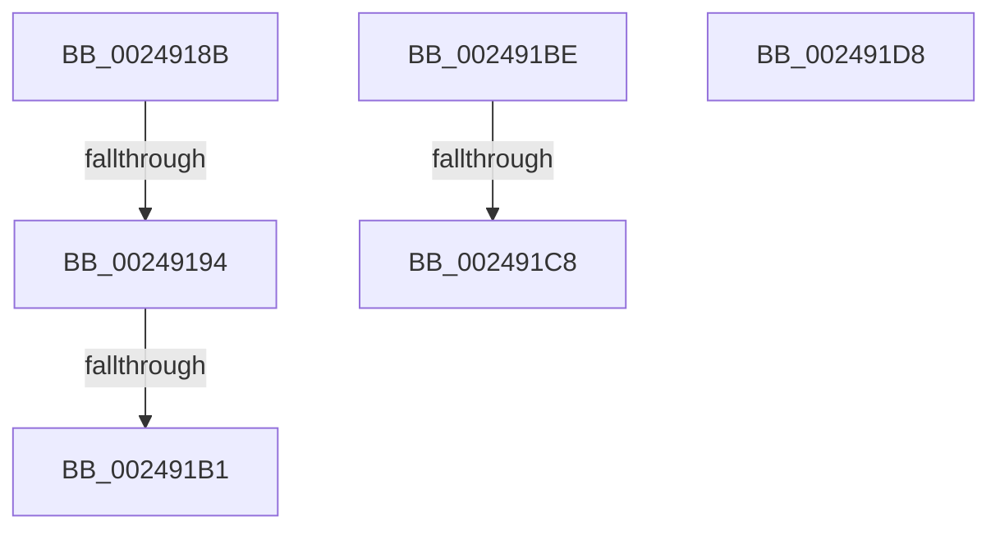

# sub_0024918B

- RVA: `0x0024918B`–`0x002491EE` (길이 `99` bytes)
- VA: `0x000000014024918B`
- 실행 섹션: `.text`
- PDB 이름 있음: `아니요`; PDB Function 태그: `아니요`
- unwind 정보 RVA: `0x000626E4`
- 디코드: `22`개 명령, `99/99` bytes 표시
- 미해석 바이트: `0` (있으면 어셈블리에 `.byte`로 보존)

> 이 문서는 커널 이미지의 기계어와 PDB 기호를 분석해 생성했습니다. 4번과 5번은 함수 원형과 자료형을 바이너리 사용 방식에서 추정한 C 해석이며 원본 소스 복구 결과는 아닙니다.

## 1. Dependencies

- 직접 호출 지점: **4**; 고유 호출 대상: **3**
- 직접 호출자로 확인된 함수: **0**
- RIP 상대 이미지 참조: **0**

### Outgoing calls
- `0x002491B1` → [ExAcquireSpinLockExclusive](ExAcquireSpinLockExclusive_function_00248690.md) (function, `0x00248690`)
- `0x002491CD` → [KeSetEvent](../33/KeSetEvent_function_0033F310.md) (function, `0x0033F310`)
- `0x002491D8` → [KeResetEvent](KeResetEvent_function_00248350.md) (function, `0x00248350`)
- `0x002491E4` → [KeResetEvent](KeResetEvent_function_00248350.md) (function, `0x00248350`)

### Direct callers
- 이 함수 시작 RVA로 연결되는 직접 call은 확인되지 않았습니다. 간접 호출은 완전히 역산할 수 없습니다.

### Static image references
- 디코드된 RIP-relative 메모리 참조가 없습니다.

## 2. Other-region calls and transfers

- 다른 실행 섹션으로 향하는 call: **0**
- call이 아닌 외부 분기/꼬리 이동: **6**
  - `0x0024918E` → [MiSignalCommitSignals + 0x25](MiSignalCommitSignals_function_00249090.md) (`tail-transfer`)
  - `0x002491AB` → [sub_002490EA](Unknown_function_002490EA.md) (`tail-transfer`)
  - `0x002491B9` → [sub_002490EA + 0x8](Unknown_function_002490EA.md) (`tail-transfer`)
  - `0x002491C2` → [sub_006D8136](../6D/Unknown_function_006D8136.md) (`tail-transfer`)
  - `0x002491D3` → [sub_006D8136](../6D/Unknown_function_006D8136.md) (`tail-transfer`)
  - `0x002491E9` → [sub_002490EA + 0x3C](Unknown_function_002490EA.md) (`tail-transfer`)

## 3. Assembly (complete function range)

```asm
0024918B  48 3B D1                        cmp rdx, rcx
0024918E  0F 83 21 FF FF FF               jae 0x1402490b5
00249194  48 89 74 24 30                  mov qword ptr [rsp + 0x30], rsi
00249199  48 89 7C 24 38                  mov qword ptr [rsp + 0x38], rdi
0024919E  44 0F 20 C0                     mov rax, cr8
002491A2  48 8D 8B F8 41 00 00            lea rcx, [rbx + 0x41f8]
002491A9  3C 02                           cmp al, 2
002491AB  0F 84 39 FF FF FF               je 0x1402490ea
002491B1  E8 DA F4 FF FF                  call 0x140248690
002491B6  0F B6 F0                        movzx esi, al
002491B9  E9 34 FF FF FF                  jmp 0x1402490f2
002491BE  83 79 04 00                     cmp dword ptr [rcx + 4], 0
002491C2  0F 85 6E EF 48 00               jne 0x1406d8136
002491C8  45 33 C0                        xor r8d, r8d
002491CB  33 D2                           xor edx, edx
002491CD  E8 3E 61 0F 00                  call 0x14033f310
002491D2  90                              nop
002491D3  E9 5E EF 48 00                  jmp 0x1406d8136
002491D8  E8 73 F1 FF FF                  call 0x140248350
002491DD  48 8B 8B 38 01 00 00            mov rcx, qword ptr [rbx + 0x138]
002491E4  E8 67 F1 FF FF                  call 0x140248350
002491E9  E9 38 FF FF FF                  jmp 0x140249126
```

## 4. C-style interpretation (structured pseudocode)

```c
__int64 __fastcall sub_0024918B(__int64 a1, __int64 a2, int a3)
{
    __int64 result;
    unsigned __int64 v_stack_p30;
    unsigned __int64 v_stack_p38;

    v_stack_p30 = v_rsi;
    v_stack_p38 = v_rdi;
    result = ExAcquireSpinLockExclusive(v_rbx + 16888, a2, a3, a4);
}
```

## 5. (Beta) C Style

```c
int64_t sub_0024918B(int64_t Arg1, int64_t Arg2, int32_t Arg3)
{
    int64_t result;
    uint64_t v_stack_p30;
    uint64_t v_stack_p38;

    v_stack_p30 = local_rsi;
    v_stack_p38 = local_rdi;
    result = ExAcquireSpinLockExclusive(local_rbx + 16888, Arg2, Arg3, a4);
}
```

## 6. Execution-region graph

[열기: 2D/3D 그래프와 함수 탐색 컨트롤 패널](../../../control-panel.html?section=text&rva=0x0024918B&view=graph)

- 2D 그래프는 위에서 아래로 흐르고, 3D 그래프는 빈 공간을 드래그해 회전합니다. Shift+드래그는 이동, 휠은 확대·축소, 함수 노드 선택은 대상 보고서 이동입니다.

### Static fallback


