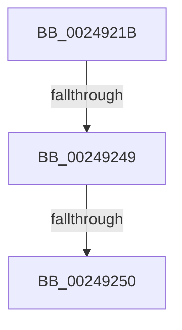

# sub_0024921B

- RVA: `0x0024921B`–`0x00249256` (길이 `59` bytes)
- VA: `0x000000014024921B`
- 실행 섹션: `.text`
- PDB 이름 있음: `아니요`; PDB Function 태그: `아니요`
- unwind 정보 RVA: `0x00062720`
- 디코드: `15`개 명령, `59/59` bytes 표시
- 미해석 바이트: `0` (있으면 어셈블리에 `.byte`로 보존)

> 이 문서는 커널 이미지의 기계어와 PDB 기호를 분석해 생성했습니다. 4번과 5번은 함수 원형과 자료형을 바이너리 사용 방식에서 추정한 C 해석이며 원본 소스 복구 결과는 아닙니다.

## 1. Dependencies

- 직접 호출 지점: **0**; 고유 호출 대상: **0**
- 직접 호출자로 확인된 함수: **0**
- RIP 상대 이미지 참조: **0**

### Outgoing calls
- 직접 디코드된 call 명령이 없습니다.

### Direct callers
- 이 함수 시작 RVA로 연결되는 직접 call은 확인되지 않았습니다. 간접 호출은 완전히 역산할 수 없습니다.

### Static image references
- 디코드된 RIP-relative 메모리 참조가 없습니다.

## 2. Other-region calls and transfers

- 다른 실행 섹션으로 향하는 call: **0**
- call이 아닌 외부 분기/꼬리 이동: **3**
  - `0x00249243` → [sub_002492F6](Unknown_function_002492F6.md) (`tail-transfer`)
  - `0x0024924E` → [sub_002492B4 + 0x1A](Unknown_function_002492B4.md) (`tail-transfer`)
  - `0x00249254` → [sub_002492B4 + 0x1A](Unknown_function_002492B4.md) (`tail-transfer`)

## 3. Assembly (complete function range)

```asm
0024921B  4C 89 64 24 70                  mov qword ptr [rsp + 0x70], r12
00249220  4C 8B E1                        mov r12, rcx
00249223  4C 89 6C 24 40                  mov qword ptr [rsp + 0x40], r13
00249228  45 33 ED                        xor r13d, r13d
0024922B  4C 89 74 24 38                  mov qword ptr [rsp + 0x38], r14
00249230  41 BE 02 00 00 00               mov r14d, 2
00249236  4C 89 7C 24 30                  mov qword ptr [rsp + 0x30], r15
0024923B  4C 8B 7D 40                     mov r15, qword ptr [rbp + 0x40]
0024923F  41 F6 C0 08                     test r8b, 8
00249243  0F 85 AD 00 00 00               jne 0x1402492f6
00249249  8B 45 38                        mov eax, dword ptr [rbp + 0x38]
0024924C  A8 20                           test al, 0x20
0024924E  75 7E                           jne 0x1402492ce
00249250  4C 39 6D 40                     cmp qword ptr [rbp + 0x40], r13
00249254  74 78                           je 0x1402492ce
```

## 4. C-style interpretation (structured pseudocode)

```c
__int64 __fastcall sub_0024921B(__int64 a1, __int64 a2, unsigned __int8 a3)
{
    __int64 v_r13;
    unsigned __int64 v_stack_p30;
    unsigned __int64 v_stack_p38;
    unsigned __int64 v_stack_p40;
    unsigned __int64 v_stack_p70;

    v_stack_p70 = v_r12;
    v_stack_p40 = v_r13;
    v_r13 = 0;
    v_stack_p38 = v_r14;
    v_stack_p30 = v_r15;
}
```

## 5. (Beta) C Style

```c
int64_t sub_0024921B(int64_t Arg1, int64_t Arg2, uint8_t Arg3)
{
    int64_t local_r13;
    uint64_t v_stack_p30;
    uint64_t v_stack_p38;
    uint64_t v_stack_p40;
    uint64_t v_stack_p70;

    v_stack_p70 = local_r12;
    v_stack_p40 = local_r13;
    local_r13 = 0;
    v_stack_p38 = local_r14;
    v_stack_p30 = local_r15;
}
```

## 6. Execution-region graph

[열기: 2D/3D 그래프와 함수 탐색 컨트롤 패널](../../../control-panel.html?section=text&rva=0x0024921B&view=graph)

- 2D 그래프는 위에서 아래로 흐르고, 3D 그래프는 빈 공간을 드래그해 회전합니다. Shift+드래그는 이동, 휠은 확대·축소, 함수 노드 선택은 대상 보고서 이동입니다.

### Static fallback


