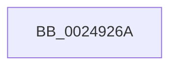

# sub_0024926A

- RVA: `0x0024926A`–`0x002492A9` (길이 `63` bytes)
- VA: `0x000000014024926A`
- 실행 섹션: `.text`
- PDB 이름 있음: `아니요`; PDB Function 태그: `아니요`
- unwind 정보 RVA: `0x00062754`
- 디코드: `12`개 명령, `63/63` bytes 표시
- 미해석 바이트: `0` (있으면 어셈블리에 `.byte`로 보존)

> 이 문서는 커널 이미지의 기계어와 PDB 기호를 분석해 생성했습니다. 4번과 5번은 함수 원형과 자료형을 바이너리 사용 방식에서 추정한 C 해석이며 원본 소스 복구 결과는 아닙니다.

## 1. Dependencies

- 직접 호출 지점: **3**; 고유 호출 대상: **3**
- 직접 호출자로 확인된 함수: **0**
- RIP 상대 이미지 참조: **1**

### Outgoing calls
- `0x0024928B` → [ExAcquireSpinLockExclusiveAtDpcLevel](ExAcquireSpinLockExclusiveAtDpcLevel_function_00248E80.md) (function, `0x00248E80`)
- `0x00249293` → [MiUnlinkUnusedSubsection](MiUnlinkUnusedSubsection_function_002496F4.md) (function, `0x002496F4`)
- `0x0024929F` → [ExReleaseSpinLockExclusiveFromDpcLevel](ExReleaseSpinLockExclusiveFromDpcLevel_function_002497E0.md) (function, `0x002497E0`)

### Direct callers
- 이 함수 시작 RVA로 연결되는 직접 call은 확인되지 않았습니다. 간접 호출은 완전히 역산할 수 없습니다.

### Static image references
- `0x00249273` → RVA `0x00E30088` (`.data`; read)

## 2. Other-region calls and transfers

- 다른 실행 섹션으로 향하는 call: **0**
- 별도 외부 분기/꼬리 이동을 확인하지 못했습니다.

## 3. Assembly (complete function range)

```asm
0024926A  48 89 74 24 68                  mov qword ptr [rsp + 0x68], rsi
0024926F  0F B7 48 3C                     movzx ecx, word ptr [rax + 0x3c]
00249273  48 8B 05 0E 6E BE 00            mov rax, qword ptr [rip + 0xbe6e0e]
0024927A  81 E1 FF 03 00 00               and ecx, 0x3ff
00249280  48 8B 34 C8                     mov rsi, qword ptr [rax + rcx*8]
00249284  48 8D 8E C0 06 00 00            lea rcx, [rsi + 0x6c0]
0024928B  E8 F0 FB FF FF                  call 0x140248e80
00249290  49 8B CC                        mov rcx, r12
00249293  E8 5C 04 00 00                  call 0x1402496f4
00249298  48 8D 8E C0 06 00 00            lea rcx, [rsi + 0x6c0]
0024929F  E8 3C 05 00 00                  call 0x1402497e0
002492A4  48 8B 74 24 68                  mov rsi, qword ptr [rsp + 0x68]
```

## 4. C-style interpretation (structured pseudocode)

```c
__int64 __fastcall sub_0024926A(__int64 a1, __int64 a2, __int64 a3, __int64 a4, __int64 a5, __int64 a6, __int64 a7, __int64 a8, __int64 a9, __int64 a10, __int64 a11, __int64 a12, __int64 a13)
{
    __int64 result;
    unsigned __int64 v_stack_p68;

    v_stack_p68 = v_rsi;
    a1 = (unsigned int)((*(unsigned __int16 *)(result + 60)) & (0x3FFULL));
    result = ExAcquireSpinLockExclusiveAtDpcLevel(*(unsigned __int64 *)(*(unsigned __int64 *)(v_rip + 12480014) + a1 * 8) + 1728, a2, a3, a4);
    result = MiUnlinkUnusedSubsection(v_r12, a2, a3, a4);
    result = ExReleaseSpinLockExclusiveFromDpcLevel(*(unsigned __int64 *)(*(unsigned __int64 *)(v_rip + 12480014) + a1 * 8) + 1728, a2, a3, a4);
    return result;
}
```

## 5. (Beta) C Style

```c
int64_t sub_0024926A(int64_t Arg1, int64_t Arg2, int64_t Arg3, int64_t Arg4, uint64_t Arg5, uint64_t Arg6, uint64_t Arg7, uint64_t Arg8, uint64_t Arg9, uint64_t Arg10, uint64_t Arg11, uint64_t Arg12, int64_t Arg13)
{
    int64_t result;
    uint64_t v_stack_p68;

    v_stack_p68 = local_rsi;
    Arg1 = (uint32_t)((*(uint16_t *)(result + 0x3C)) & (0x3FFULL));
    result = ExAcquireSpinLockExclusiveAtDpcLevel(*(uint64_t *)(*(uint64_t *)(v_rip + 0xBE6E0E) + Arg1 * 8) + 1728, Arg2, Arg3, Arg4);
    result = MiUnlinkUnusedSubsection(local_r12, Arg2, Arg3, Arg4);
    result = ExReleaseSpinLockExclusiveFromDpcLevel(*(uint64_t *)(*(uint64_t *)(v_rip + 0xBE6E0E) + Arg1 * 8) + 1728, Arg2, Arg3, Arg4);
    return result;
}
```

## 6. Execution-region graph

[열기: 2D/3D 그래프와 함수 탐색 컨트롤 패널](../../../control-panel.html?section=text&rva=0x0024926A&view=graph)

- 2D 그래프는 위에서 아래로 흐르고, 3D 그래프는 빈 공간을 드래그해 회전합니다. Shift+드래그는 이동, 휠은 확대·축소, 함수 노드 선택은 대상 보고서 이동입니다.

### Static fallback


