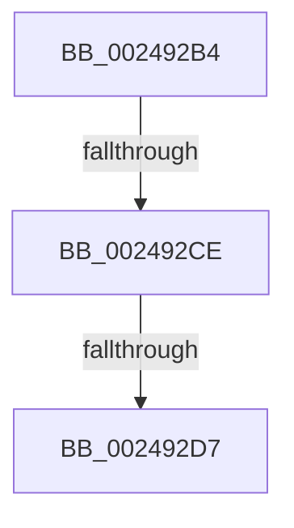

# sub_002492B4

- RVA: `0x002492B4`–`0x002492F5` (길이 `65` bytes)
- VA: `0x00000001402492B4`
- 실행 섹션: `.text`
- PDB 이름 있음: `아니요`; PDB Function 태그: `아니요`
- unwind 정보 RVA: `0x00062778`
- 디코드: `15`개 명령, `65/65` bytes 표시
- 미해석 바이트: `0` (있으면 어셈블리에 `.byte`로 보존)

> 이 문서는 커널 이미지의 기계어와 PDB 기호를 분석해 생성했습니다. 4번과 5번은 함수 원형과 자료형을 바이너리 사용 방식에서 추정한 C 해석이며 원본 소스 복구 결과는 아닙니다.

## 1. Dependencies

- 직접 호출 지점: **0**; 고유 호출 대상: **0**
- 직접 호출자로 확인된 함수: **0**
- RIP 상대 이미지 참조: **0**

### Outgoing calls
- 직접 디코드된 call 명령이 없습니다.

### Direct callers
- 이 함수 시작 RVA로 연결되는 직접 call은 확인되지 않았습니다. 간접 호출은 완전히 역산할 수 없습니다.

### Static image references
- 디코드된 RIP-relative 메모리 참조가 없습니다.

## 2. Other-region calls and transfers

- 다른 실행 섹션으로 향하는 call: **0**
- call이 아닌 외부 분기/꼬리 이동: **2**
  - `0x002492C8` → [sub_002493E4](Unknown_function_002493E4.md) (`tail-transfer`)
  - `0x002492D1` → [sub_002492F6 + 0xBE](Unknown_function_002492F6.md) (`tail-transfer`)

## 3. Assembly (complete function range)

```asm
002492B4  49 FF 44 24 50                  inc qword ptr [r12 + 0x50]
002492B9  48 B9 FF FF FF FF FF FF FF 7F   movabs rcx, 0x7fffffffffffffff
002492C3  49 85 4C 24 50                  test qword ptr [r12 + 0x50], rcx
002492C8  0F 84 16 01 00 00               je 0x1402493e4
002492CE  4D 85 FF                        test r15, r15
002492D1  0F 85 DD 00 00 00               jne 0x1402493b4
002492D7  41 8B C6                        mov eax, r14d
002492DA  4C 8B 74 24 38                  mov r14, qword ptr [rsp + 0x38]
002492DF  4C 8B 6C 24 40                  mov r13, qword ptr [rsp + 0x40]
002492E4  4C 8B 64 24 70                  mov r12, qword ptr [rsp + 0x70]
002492E9  4C 8B 7C 24 30                  mov r15, qword ptr [rsp + 0x30]
002492EE  48 83 C4 48                     add rsp, 0x48
002492F2  5F                              pop rdi
002492F3  5D                              pop rbp
002492F4  C3                              ret
```

## 4. C-style interpretation (structured pseudocode)

```c
__int64 __fastcall sub_002492B4(__int64 a1, __int64 a2, __int64 a3, __int64 a4, __int64 a5, __int64 a6, __int64 a7, __int64 a8, __int64 a9, __int64 a10, __int64 a11, __int64 a12, __int64 a13, __int64 a14)
{
    __int64 v_rsp;

    v_rsp = (v_rsp) + (72);
    return (unsigned int)((unsigned int)(v_r14));
}
```

## 5. (Beta) C Style

```c
int64_t sub_002492B4(int64_t Arg1, int64_t Arg2, int64_t Arg3, int64_t Arg4, uint64_t Arg5, int64_t Arg6, int64_t Arg7, int64_t Arg8, uint64_t Arg9, uint64_t Arg10, uint64_t Arg11, uint64_t Arg12, uint64_t Arg13, int64_t Arg14)
{
    int64_t local_rsp;

    local_rsp = (local_rsp) + (72);
    return (uint32_t)((uint32_t)(local_r14));
}
```

## 6. Execution-region graph

[열기: 2D/3D 그래프와 함수 탐색 컨트롤 패널](../../../control-panel.html?section=text&rva=0x002492B4&view=graph)

- 2D 그래프는 위에서 아래로 흐르고, 3D 그래프는 빈 공간을 드래그해 회전합니다. Shift+드래그는 이동, 휠은 확대·축소, 함수 노드 선택은 대상 보고서 이동입니다.

### Static fallback


