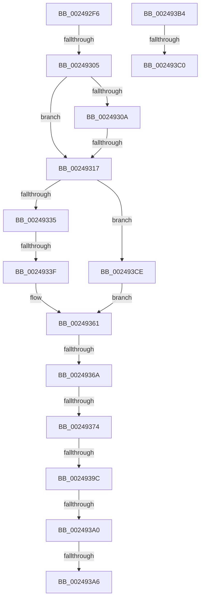

# sub_002492F6

- RVA: `0x002492F6`–`0x002493D7` (길이 `225` bytes)
- VA: `0x00000001402492F6`
- 실행 섹션: `.text`
- PDB 이름 있음: `아니요`; PDB Function 태그: `아니요`
- unwind 정보 RVA: `0x0006279C`
- 디코드: `49`개 명령, `225/225` bytes 표시
- 미해석 바이트: `0` (있으면 어셈블리에 `.byte`로 보존)

> 이 문서는 커널 이미지의 기계어와 PDB 기호를 분석해 생성했습니다. 4번과 5번은 함수 원형과 자료형을 바이너리 사용 방식에서 추정한 C 해석이며 원본 소스 복구 결과는 아닙니다.

## 1. Dependencies

- 직접 호출 지점: **2**; 고유 호출 대상: **1**
- 직접 호출자로 확인된 함수: **0**
- RIP 상대 이미지 참조: **2**

### Outgoing calls
- `0x00249377` → [MiGetSubsectionHoldingCrossPartitionReferences](../45/MiGetSubsectionHoldingCrossPartitionReferences_function_004589E4.md) (function, `0x004589E4`)
- `0x00249382` → [MiGetSubsectionHoldingCrossPartitionReferences](../45/MiGetSubsectionHoldingCrossPartitionReferences_function_004589E4.md) (function, `0x004589E4`)

### Direct callers
- 이 함수 시작 RVA로 연결되는 직접 call은 확인되지 않았습니다. 간접 호출은 완전히 역산할 수 없습니다.

### Static image references
- `0x0024931B` → RVA `0x00E30088` (`.data`; read)
- `0x002493CE` → RVA `0x00E38D00` (`.data`; read)

## 2. Other-region calls and transfers

- 다른 실행 섹션으로 향하는 call: **0**
- call이 아닌 외부 분기/꼬리 이동: **11**
  - `0x002492FF` → [sub_0024921B + 0x2E](Unknown_function_0024921B.md) (`tail-transfer`)
  - `0x00249311` → [sub_0024921B + 0x2E](Unknown_function_0024921B.md) (`tail-transfer`)
  - `0x00249339` → [sub_002493E4 + 0x1A](Unknown_function_002493E4.md) (`tail-transfer`)
  - `0x00249364` → [sub_0024921B + 0x2E](Unknown_function_0024921B.md) (`tail-transfer`)
  - `0x0024936E` → [sub_002493E4 + 0x22](Unknown_function_002493E4.md) (`tail-transfer`)
  - `0x00249396` → [sub_0024921B + 0x2E](Unknown_function_0024921B.md) (`tail-transfer`)
  - `0x0024939E` → [sub_002493E4 + 0x3B](Unknown_function_002493E4.md) (`tail-transfer`)
  - `0x002493A4` → [sub_002493E4 + 0x35](Unknown_function_002493E4.md) (`tail-transfer`)
  - `0x002493AF` → [sub_002492B4 + 0x26](Unknown_function_002492B4.md) (`tail-transfer`)
  - `0x002493BA` → [sub_002492B4 + 0x23](Unknown_function_002492B4.md) (`tail-transfer`)
  - `0x002493C9` → [sub_002492B4 + 0x23](Unknown_function_002492B4.md) (`tail-transfer`)

## 3. Assembly (complete function range)

```asm
002492F6  44 0F B6 55 3E                  movzx r10d, byte ptr [rbp + 0x3e]
002492FB  41 F6 C2 0C                     test r10b, 0xc
002492FF  0F 85 44 FF FF FF               jne 0x140249249
00249305  4D 85 FF                        test r15, r15
00249308  75 0D                           jne 0x140249317
0024930A  F7 45 5C 00 00 01 00            test dword ptr [rbp + 0x5c], 0x10000
00249311  0F 85 32 FF FF FF               jne 0x140249249
00249317  0F B7 4D 3C                     movzx ecx, word ptr [rbp + 0x3c]
0024931B  48 8B 05 66 6D BE 00            mov rax, qword ptr [rip + 0xbe6d66]
00249322  81 E1 FF 03 00 00               and ecx, 0x3ff
00249328  4C 8B 0C C8                     mov r9, qword ptr [rax + rcx*8]
0024932C  45 84 C0                        test r8b, r8b
0024932F  0F 88 99 00 00 00               js 0x1402493ce
00249335  41 F6 C0 10                     test r8b, 0x10
00249339  0F 85 BF 00 00 00               jne 0x1402493fe
0024933F  65 48 8B 04 25 88 01 00 00      mov rax, qword ptr gs:[0x188]
00249348  48 8B 88 B8 00 00 00            mov rcx, qword ptr [rax + 0xb8]
0024934F  48 8B 05 32 6D BE 00            mov rax, qword ptr [rip + 0xbe6d32]
00249356  0F B7 91 AE 04 00 00            movzx edx, word ptr [rcx + 0x4ae]
0024935D  48 8B 04 D0                     mov rax, qword ptr [rax + rdx*8]
00249361  49 3B C1                        cmp rax, r9
00249364  0F 84 DF FE FF FF               je 0x140249249
0024936A  41 F6 C2 01                     test r10b, 1
0024936E  0F 85 92 00 00 00               jne 0x140249406
00249374  48 8B CF                        mov rcx, rdi
00249377  E8 68 F6 20 00                  call 0x1404589e4
0024937C  48 8B C8                        mov rcx, rax
0024937F  4C 8B E0                        mov r12, rax
00249382  E8 5D F6 20 00                  call 0x1404589e4
00249387  8B 50 30                        mov edx, dword ptr [rax + 0x30]
0024938A  81 E2 FF FF FF 3F               and edx, 0x3fffffff
00249390  81 FA FF FF FF 3F               cmp edx, 0x3fffffff
00249396  0F 84 AD FE FF FF               je 0x140249249
0024939C  85 D2                           test edx, edx
0024939E  75 7F                           jne 0x14024941f
002493A0  41 F6 C0 20                     test r8b, 0x20
002493A4  75 73                           jne 0x140249419
002493A6  41 BD 01 00 00 00               mov r13d, 1
002493AC  41 8B C5                        mov eax, r13d
002493AF  E9 26 FF FF FF                  jmp 0x1402492da
002493B4  8B 4D 38                        mov ecx, dword ptr [rbp + 0x38]
002493B7  F6 C1 20                        test cl, 0x20
002493BA  0F 85 17 FF FF FF               jne 0x1402492d7
002493C0  8B 4F 20                        mov ecx, dword ptr [rdi + 0x20]
002493C3  83 C9 01                        or ecx, 1
002493C6  89 4F 20                        mov dword ptr [rdi + 0x20], ecx
002493C9  E9 09 FF FF FF                  jmp 0x1402492d7
002493CE  48 8D 05 2B F9 BE 00            lea rax, [rip + 0xbef92b]
002493D5  EB 8A                           jmp 0x140249361
```

## 4. C-style interpretation (structured pseudocode)

```c
__int64 __fastcall sub_002492F6(__int64 a1, __int64 a2, unsigned __int8 a3)
{
    __int64 result;

    if (v_r15 != 0) goto loc_00249317;
loc_00249317:
    a1 = (unsigned int)((*(unsigned __int16 *)(v_rbp + 60)) & (0x3FFULL));
    if (sign_flag) goto loc_002493CE;
loc_00249361:
    result = MiGetSubsectionHoldingCrossPartitionReferences(v_rdi, *(unsigned __int16 *)(*(unsigned __int64 *)(*(unsigned __int64 *)(gs_base + (0 + 392)) + 184) + 1198), a3, *(unsigned __int64 *)(*(unsigned __int64 *)(v_rip + 12479846) + a1 * 8));
    result = MiGetSubsectionHoldingCrossPartitionReferences(result, *(unsigned __int16 *)(*(unsigned __int64 *)(*(unsigned __int64 *)(gs_base + (0 + 392)) + 184) + 1198), a3, *(unsigned __int64 *)(*(unsigned __int64 *)(v_rip + 12479846) + a1 * 8));
    a2 = (unsigned int)(((unsigned int)(*(unsigned int *)(result + 48))) & (0x3FFFFFFFULL));
loc_002493CE:
    goto loc_00249361;
}
```

## 5. (Beta) C Style

```c
int64_t sub_002492F6(int64_t Arg1, int64_t Arg2, uint8_t Arg3)
{
    int64_t result;

    if (local_r15 != 0) goto loc_00249317;
loc_00249317:
    Arg1 = (uint32_t)((*(uint16_t *)(local_rbp + 0x3C)) & (0x3FFULL));
    if (sign_flag) goto loc_002493CE;
loc_00249361:
    result = MiGetSubsectionHoldingCrossPartitionReferences(local_rdi, *(uint16_t *)(*(uint64_t *)(*(uint64_t *)(gs_base + (0 + 0x188)) + 0xB8) + 0x4AE), Arg3, *(uint64_t *)(*(uint64_t *)(v_rip + 0xBE6D66) + Arg1 * 8));
    result = MiGetSubsectionHoldingCrossPartitionReferences(result, *(uint16_t *)(*(uint64_t *)(*(uint64_t *)(gs_base + (0 + 0x188)) + 0xB8) + 0x4AE), Arg3, *(uint64_t *)(*(uint64_t *)(v_rip + 0xBE6D66) + Arg1 * 8));
    Arg2 = (uint32_t)(((uint32_t)(*(uint32_t *)(result + 0x30))) & (0x3FFFFFFFULL));
loc_002493CE:
    goto loc_00249361;
}
```

## 6. Execution-region graph

[열기: 2D/3D 그래프와 함수 탐색 컨트롤 패널](../../../control-panel.html?section=text&rva=0x002492F6&view=graph)

- 2D 그래프는 위에서 아래로 흐르고, 3D 그래프는 빈 공간을 드래그해 회전합니다. Shift+드래그는 이동, 휠은 확대·축소, 함수 노드 선택은 대상 보고서 이동입니다.

### Static fallback


