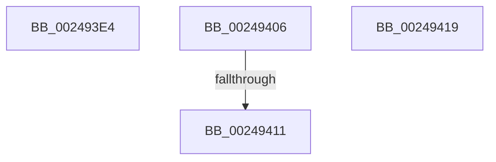

# sub_002493E4

- RVA: `0x002493E4`–`0x0024942E` (길이 `74` bytes)
- VA: `0x00000001402493E4`
- 실행 섹션: `.text`
- PDB 이름 있음: `아니요`; PDB Function 태그: `아니요`
- unwind 정보 RVA: `0x000627D0`
- 디코드: `18`개 명령, `74/74` bytes 표시
- 미해석 바이트: `0` (있으면 어셈블리에 `.byte`로 보존)

> 이 문서는 커널 이미지의 기계어와 PDB 기호를 분석해 생성했습니다. 4번과 5번은 함수 원형과 자료형을 바이너리 사용 방식에서 추정한 C 해석이며 원본 소스 복구 결과는 아닙니다.

## 1. Dependencies

- 직접 호출 지점: **2**; 고유 호출 대상: **2**
- 직접 호출자로 확인된 함수: **0**
- RIP 상대 이미지 참조: **1**

### Outgoing calls
- `0x002493F8` → [KeBugCheckEx](../4F/KeBugCheckEx_function_004FD660.md) (function, `0x004FD660`)
- `0x00249424` → [MiUpdateSubsectionCrossPartitionRefs](../4F/MiUpdateSubsectionCrossPartitionRefs_function_004FB5DC.md) (function, `0x004FB5DC`)

### Direct callers
- 이 함수 시작 RVA로 연결되는 직접 call은 확인되지 않았습니다. 간접 호출은 완전히 역산할 수 없습니다.

### Static image references
- `0x00249411` → RVA `0x00E30090` (`.data`; read/write)

## 2. Other-region calls and transfers

- 다른 실행 섹션으로 향하는 call: **0**
- call이 아닌 외부 분기/꼬리 이동: **4**
  - `0x00249401` → [sub_002492F6 + 0x6B](Unknown_function_002492F6.md) (`tail-transfer`)
  - `0x0024940B` → [sub_002492F6 + 0x7E](Unknown_function_002492F6.md) (`tail-transfer`)
  - `0x00249417` → [sub_002492F6 + 0xB6](Unknown_function_002492F6.md) (`tail-transfer`)
  - `0x00249429` → [sub_0024921B + 0x2E](Unknown_function_0024921B.md) (`tail-transfer`)

## 3. Assembly (complete function range)

```asm
002493E4  45 33 C9                        xor r9d, r9d
002493E7  4C 89 6C 24 20                  mov qword ptr [rsp + 0x20], r13
002493EC  4D 8B C4                        mov r8, r12
002493EF  BA 00 20 04 00                  mov edx, 0x42000
002493F4  41 8D 49 1A                     lea ecx, [r9 + 0x1a]
002493F8  E8 63 42 2B 00                  call 0x1404fd660
002493FD  CC                              int3
002493FE  49 8B C5                        mov rax, r13
00249401  E9 5B FF FF FF                  jmp 0x140249361
00249406  41 0F BA E0 08                  bt r8d, 8
0024940B  0F 82 63 FF FF FF               jb 0x140249374
00249411  FF 05 79 6C BE 00               inc dword ptr [rip + 0xbe6c79]
00249417  EB 93                           jmp 0x1402493ac
00249419  41 BE 03 00 00 00               mov r14d, 3
0024941F  FF C2                           inc edx
00249421  49 8B CC                        mov rcx, r12
00249424  E8 B3 21 2B 00                  call 0x1404fb5dc
00249429  E9 1B FE FF FF                  jmp 0x140249249
```

## 4. C-style interpretation (structured pseudocode)

```c
__int64 __fastcall sub_002493E4(__int64 a1, __int64 a2, __int64 a3, int a4)
{
    __int64 result;
    unsigned __int64 v_stack_p20;

    a4 = 0;
    v_stack_p20 = v_r13;
    result = KeBugCheckEx(a4 + 26, (unsigned int)(0x42000ULL), v_r12, a4);
}
```

## 5. (Beta) C Style

```c
int64_t sub_002493E4(int64_t Arg1, int64_t Arg2, int64_t Arg3, int32_t Arg4)
{
    int64_t result;
    uint64_t v_stack_p20;

    Arg4 = 0;
    v_stack_p20 = local_r13;
    result = KeBugCheckEx(Arg4 + 26, (uint32_t)(0x42000ULL), local_r12, Arg4);
}
```

## 6. Execution-region graph

[열기: 2D/3D 그래프와 함수 탐색 컨트롤 패널](../../../control-panel.html?section=text&rva=0x002493E4&view=graph)

- 2D 그래프는 위에서 아래로 흐르고, 3D 그래프는 빈 공간을 드래그해 회전합니다. Shift+드래그는 이동, 휠은 확대·축소, 함수 노드 선택은 대상 보고서 이동입니다.

### Static fallback


