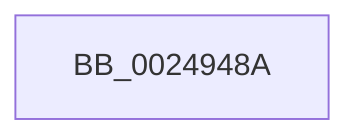

# sub_0024948A

- RVA: `0x0024948A`–`0x002494B8` (길이 `46` bytes)
- VA: `0x000000014024948A`
- 실행 섹션: `.text`
- PDB 이름 있음: `아니요`; PDB Function 태그: `아니요`
- unwind 정보 RVA: `0x00062810`
- 디코드: `8`개 명령, `46/46` bytes 표시
- 미해석 바이트: `0` (있으면 어셈블리에 `.byte`로 보존)

> 이 문서는 커널 이미지의 기계어와 PDB 기호를 분석해 생성했습니다. 4번과 5번은 함수 원형과 자료형을 바이너리 사용 방식에서 추정한 C 해석이며 원본 소스 복구 결과는 아닙니다.

## 1. Dependencies

- 직접 호출 지점: **0**; 고유 호출 대상: **0**
- 직접 호출자로 확인된 함수: **0**
- RIP 상대 이미지 참조: **2**

### Outgoing calls
- 직접 디코드된 call 명령이 없습니다.

### Direct callers
- 이 함수 시작 RVA로 연결되는 직접 call은 확인되지 않았습니다. 간접 호출은 완전히 역산할 수 없습니다.

### Static image references
- `0x00249493` → RVA `0x00E30088` (`.data`; read)
- `0x002494AB` → RVA `0x00FC6B06` (`ALMOSTRO`; read)

## 2. Other-region calls and transfers

- 다른 실행 섹션으로 향하는 call: **0**
- call이 아닌 외부 분기/꼬리 이동: **1**
  - `0x002494B2` → [sub_0024962C](Unknown_function_0024962C.md) (`tail-transfer`)

## 3. Assembly (complete function range)

```asm
0024948A  4C 89 74 24 30                  mov qword ptr [rsp + 0x30], r14
0024948F  0F B7 48 3C                     movzx ecx, word ptr [rax + 0x3c]
00249493  48 8B 05 EE 6B BE 00            mov rax, qword ptr [rip + 0xbe6bee]
0024949A  81 E1 FF 03 00 00               and ecx, 0x3ff
002494A0  4C 8B 34 C8                     mov r14, qword ptr [rax + rcx*8]
002494A4  49 81 C6 C0 06 00 00            add r14, 0x6c0
002494AB  F6 05 54 D6 D7 00 21            test byte ptr [rip + 0xd7d654], 0x21
002494B2  0F 85 74 01 00 00               jne 0x14024962c
```

## 4. C-style interpretation (structured pseudocode)

```c
__int64 __fastcall sub_0024948A(void)
{
    __int64 v_r14;
    unsigned __int64 v_stack_p30;

    v_stack_p30 = v_r14;
    a1 = (unsigned int)((*(unsigned __int16 *)(result + 60)) & (0x3FFULL));
    v_r14 = (*(unsigned __int64 *)(*(unsigned __int64 *)(v_rip + 12479470) + a1 * 8)) + (0x6C0ULL);
}
```

## 5. (Beta) C Style

```c
void sub_0024948A(void)
{
    int64_t local_r14;
    uint64_t v_stack_p30;

    v_stack_p30 = local_r14;
    a1 = (uint32_t)((*(uint16_t *)(result + 0x3C)) & (0x3FFULL));
    local_r14 = (*(uint64_t *)(*(uint64_t *)(v_rip + 0xBE6BEE) + a1 * 8)) + (0x6C0ULL);
}
```

## 6. Execution-region graph

[열기: 2D/3D 그래프와 함수 탐색 컨트롤 패널](../../../control-panel.html?section=text&rva=0x0024948A&view=graph)

- 2D 그래프는 위에서 아래로 흐르고, 3D 그래프는 빈 공간을 드래그해 회전합니다. Shift+드래그는 이동, 휠은 확대·축소, 함수 노드 선택은 대상 보고서 이동입니다.

### Static fallback


