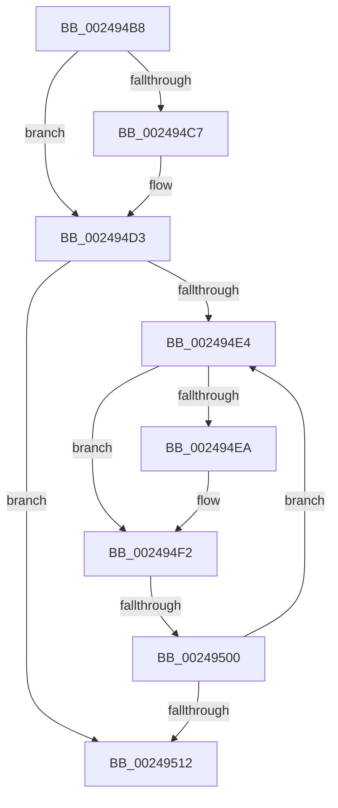

# sub_002494B8

- RVA: `0x002494B8`–`0x00249517` (길이 `95` bytes)
- VA: `0x00000001402494B8`
- 실행 섹션: `.text`
- PDB 이름 있음: `아니요`; PDB Function 태그: `아니요`
- unwind 정보 RVA: `0x00062824`
- 디코드: `26`개 명령, `95/95` bytes 표시
- 미해석 바이트: `0` (있으면 어셈블리에 `.byte`로 보존)

> 이 문서는 커널 이미지의 기계어와 PDB 기호를 분석해 생성했습니다. 4번과 5번은 함수 원형과 자료형을 바이너리 사용 방식에서 추정한 C 해석이며 원본 소스 복구 결과는 아닙니다.

## 1. Dependencies

- 직접 호출 지점: **1**; 고유 호출 대상: **1**
- 직접 호출자로 확인된 함수: **0**
- RIP 상대 이미지 참조: **1**

### Outgoing calls
- `0x002494CC` → [ExpWaitForSpinLockExclusiveAndAcquire](../32/ExpWaitForSpinLockExclusiveAndAcquire_function_003239A0.md) (function, `0x003239A0`)

### Direct callers
- 이 함수 시작 RVA로 연결되는 직접 call은 확인되지 않았습니다. 간접 호출은 완전히 역산할 수 없습니다.

### Static image references
- `0x002494F4` → RVA `0x00FC52AC` (`ALMOSTRO`; reference)

## 2. Other-region calls and transfers

- 다른 실행 섹션으로 향하는 call: **0**
- call이 아닌 외부 분기/꼬리 이동: **1**
  - `0x002494FA` → [sub_00249649](Unknown_function_00249649.md) (`tail-transfer`)

## 3. Assembly (complete function range)

```asm
002494B8  48 89 6C 24 60                  mov qword ptr [rsp + 0x60], rbp
002494BD  33 ED                           xor ebp, ebp
002494BF  F0 41 0F BA 2E 1F               lock bts dword ptr [r14], 0x1f
002494C5  73 0C                           jae 0x1402494d3
002494C7  B2 FF                           mov dl, 0xff
002494C9  49 8B CE                        mov rcx, r14
002494CC  E8 CF A4 0D 00                  call 0x1403239a0
002494D1  8B E8                           mov ebp, eax
002494D3  41 8B 16                        mov edx, dword ptr [r14]
002494D6  8B CA                           mov ecx, edx
002494D8  0F BA F1 1E                     btr ecx, 0x1e
002494DC  81 F9 00 00 00 80               cmp ecx, 0x80000000
002494E2  74 2E                           je 0x140249512
002494E4  0F BA E2 1E                     bt edx, 0x1e
002494E8  72 08                           jb 0x1402494f2
002494EA  F0 41 81 0E 00 00 00 40         lock or dword ptr [r14], 0x40000000
002494F2  FF C5                           inc ebp
002494F4  85 2D B2 BD D7 00               test dword ptr [rip + 0xd7bdb2], ebp
002494FA  0F 84 49 01 00 00               je 0x140249649
00249500  F3 90                           pause
00249502  41 8B 16                        mov edx, dword ptr [r14]
00249505  8B C2                           mov eax, edx
00249507  0F BA F0 1E                     btr eax, 0x1e
0024950B  3D 00 00 00 80                  cmp eax, 0x80000000
00249510  75 D2                           jne 0x1402494e4
00249512  48 8B 6C 24 60                  mov rbp, qword ptr [rsp + 0x60]
```

## 4. C-style interpretation (structured pseudocode)

```c
__int64 __fastcall sub_002494B8(__int64 a1, __int64 a2, __int64 a3, __int64 a4, __int64 a5, __int64 a6, __int64 a7, __int64 a8, __int64 a9, __int64 a10, __int64 a11, __int64 a12)
{
    __int64 result;
    __int64 v_rbp;
    unsigned __int64 v_stack_p60;

    v_stack_p60 = v_rbp;
    v_rbp = 0;
    if (!(condition_is_above_or_equal)) {
        a2 = 255;
        a1 = v_r14;
        result = ExpWaitForSpinLockExclusiveAndAcquire(a1, a2, a3, a4);
        v_rbp = (unsigned int)(result);
    }
    if (((unsigned int)((unsigned int)((unsigned int)((unsigned int)(*(unsigned int *)(v_r14)))))) == 0x80000000ULL) goto loc_00249512;
loc_002494E4:
    if (((unsigned int)((unsigned int)((unsigned int)((unsigned int)(*(unsigned int *)(v_r14)))))) >= 0x80000000ULL) {
    }
    v_rbp = (unsigned int)((v_rbp) + 1);
    if (((unsigned int)((unsigned int)((unsigned int)((unsigned int)(*(unsigned int *)(v_r14)))))) != 0x80000000ULL) goto loc_002494E4;
loc_00249512:
    return (unsigned int)((unsigned int)((unsigned int)(*(unsigned int *)(v_r14))));
}
```

## 5. (Beta) C Style

```c
int64_t sub_002494B8(int64_t Arg1, int64_t Arg2, int64_t Arg3, int64_t Arg4, uint64_t Arg5, uint64_t Arg6, uint64_t Arg7, uint64_t Arg8, uint64_t Arg9, uint64_t Arg10, uint64_t Arg11, int64_t Arg12)
{
    int64_t result;
    int64_t local_rbp;
    uint64_t v_stack_p60;

    v_stack_p60 = local_rbp;
    local_rbp = 0;
    if (!(condition_is_above_or_equal)) {
        Arg2 = 255;
        Arg1 = local_r14;
        result = ExpWaitForSpinLockExclusiveAndAcquire(Arg1, Arg2, Arg3, Arg4);
        local_rbp = (uint32_t)(result);
    }
    if (((uint32_t)((uint32_t)((uint32_t)((uint32_t)(*(uint32_t *)(local_r14)))))) == 0x80000000ULL) goto loc_00249512;
loc_002494E4:
    if (((uint32_t)((uint32_t)((uint32_t)((uint32_t)(*(uint32_t *)(local_r14)))))) >= 0x80000000ULL) {
    }
    local_rbp = (uint32_t)((local_rbp) + 1);
    if (((uint32_t)((uint32_t)((uint32_t)((uint32_t)(*(uint32_t *)(local_r14)))))) != 0x80000000ULL) goto loc_002494E4;
loc_00249512:
    return (uint32_t)((uint32_t)((uint32_t)(*(uint32_t *)(local_r14))));
}
```

## 6. Execution-region graph

[열기: 2D/3D 그래프와 함수 탐색 컨트롤 패널](../../../control-panel.html?section=text&rva=0x002494B8&view=graph)

- 2D 그래프는 위에서 아래로 흐르고, 3D 그래프는 빈 공간을 드래그해 회전합니다. Shift+드래그는 이동, 휠은 확대·축소, 함수 노드 선택은 대상 보고서 이동입니다.

### Static fallback


