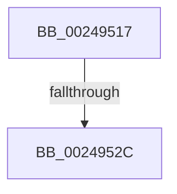

# sub_00249517

- RVA: `0x00249517`–`0x00249538` (길이 `33` bytes)
- VA: `0x0000000140249517`
- 실행 섹션: `.text`
- PDB 이름 있음: `아니요`; PDB Function 태그: `아니요`
- unwind 정보 RVA: `0x00062838`
- 디코드: `6`개 명령, `33/33` bytes 표시
- 미해석 바이트: `0` (있으면 어셈블리에 `.byte`로 보존)

> 이 문서는 커널 이미지의 기계어와 PDB 기호를 분석해 생성했습니다. 4번과 5번은 함수 원형과 자료형을 바이너리 사용 방식에서 추정한 C 해석이며 원본 소스 복구 결과는 아닙니다.

## 1. Dependencies

- 직접 호출 지점: **1**; 고유 호출 대상: **1**
- 직접 호출자로 확인된 함수: **0**
- RIP 상대 이미지 참조: **1**

### Outgoing calls
- `0x0024951A` → [MiUnlinkUnusedSubsection](MiUnlinkUnusedSubsection_function_002496F4.md) (function, `0x002496F4`)

### Direct callers
- 이 함수 시작 RVA로 연결되는 직접 call은 확인되지 않았습니다. 간접 호출은 완전히 역산할 수 없습니다.

### Static image references
- `0x0024951F` → RVA `0x00FC6B06` (`ALMOSTRO`; read)

## 2. Other-region calls and transfers

- 다른 실행 섹션으로 향하는 call: **0**
- call이 아닌 외부 분기/꼬리 이동: **1**
  - `0x00249526` → [sub_0024967C](Unknown_function_0024967C.md) (`tail-transfer`)

## 3. Assembly (complete function range)

```asm
00249517  48 8B CF                        mov rcx, rdi
0024951A  E8 D5 01 00 00                  call 0x1402496f4
0024951F  F6 05 E0 D5 D7 00 01            test byte ptr [rip + 0xd7d5e0], 1
00249526  0F 85 50 01 00 00               jne 0x14024967c
0024952C  41 C7 06 00 00 00 00            mov dword ptr [r14], 0
00249533  4C 8B 74 24 30                  mov r14, qword ptr [rsp + 0x30]
```

## 4. C-style interpretation (structured pseudocode)

```c
__int64 __fastcall sub_00249517(__int64 a1, __int64 a2, __int64 a3, __int64 a4, __int64 a5, __int64 a6)
{
    __int64 result;

    result = MiUnlinkUnusedSubsection(v_rdi, a2, a3, a4);
    *(unsigned int *)(v_r14) = 0;
    return result;
}
```

## 5. (Beta) C Style

```c
int64_t sub_00249517(int64_t Arg1, int64_t Arg2, int64_t Arg3, int64_t Arg4, uint64_t Arg5, int64_t Arg6)
{
    int64_t result;

    result = MiUnlinkUnusedSubsection(local_rdi, Arg2, Arg3, Arg4);
    *(uint32_t *)(local_r14) = 0;
    return result;
}
```

## 6. Execution-region graph

[열기: 2D/3D 그래프와 함수 탐색 컨트롤 패널](../../../control-panel.html?section=text&rva=0x00249517&view=graph)

- 2D 그래프는 위에서 아래로 흐르고, 3D 그래프는 빈 공간을 드래그해 회전합니다. Shift+드래그는 이동, 휠은 확대·축소, 함수 노드 선택은 대상 보고서 이동입니다.

### Static fallback


