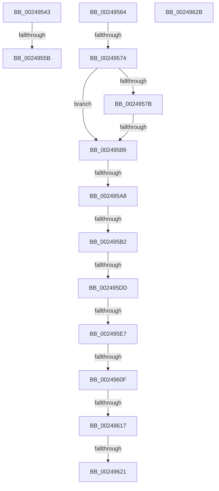

# sub_00249543

- RVA: `0x00249543`–`0x0024962C` (길이 `233` bytes)
- VA: `0x0000000140249543`
- 실행 섹션: `.text`
- PDB 이름 있음: `아니요`; PDB Function 태그: `아니요`
- unwind 정보 RVA: `0x00062858`
- 디코드: `53`개 명령, `233/233` bytes 표시
- 미해석 바이트: `0` (있으면 어셈블리에 `.byte`로 보존)

> 이 문서는 커널 이미지의 기계어와 PDB 기호를 분석해 생성했습니다. 4번과 5번은 함수 원형과 자료형을 바이너리 사용 방식에서 추정한 C 해석이며 원본 소스 복구 결과는 아닙니다.

## 1. Dependencies

- 직접 호출 지점: **2**; 고유 호출 대상: **1**
- 직접 호출자로 확인된 함수: **0**
- RIP 상대 이미지 참조: **1**

### Outgoing calls
- `0x002495EA` → [MiGetSubsectionHoldingCrossPartitionReferences](../45/MiGetSubsectionHoldingCrossPartitionReferences_function_004589E4.md) (function, `0x004589E4`)
- `0x002495F5` → [MiGetSubsectionHoldingCrossPartitionReferences](../45/MiGetSubsectionHoldingCrossPartitionReferences_function_004589E4.md) (function, `0x004589E4`)

### Direct callers
- 이 함수 시작 RVA로 연결되는 직접 call은 확인되지 않았습니다. 간접 호출은 완전히 역산할 수 없습니다.

### Static image references
- `0x0024958E` → RVA `0x00E30088` (`.data`; read)

## 2. Other-region calls and transfers

- 다른 실행 섹션으로 향하는 call: **0**
- call이 아닌 외부 분기/꼬리 이동: **10**
  - `0x00249555` → [sub_0024969C](Unknown_function_0024969C.md) (`tail-transfer`)
  - `0x0024956E` → [MiIncrementSubsectionViewCount + 0x1E](MiIncrementSubsectionViewCount_function_00249440.md) (`tail-transfer`)
  - `0x00249583` → [MiIncrementSubsectionViewCount + 0x1E](MiIncrementSubsectionViewCount_function_00249440.md) (`tail-transfer`)
  - `0x002495A2` → [sub_00249670](Unknown_function_00249670.md) (`tail-transfer`)
  - `0x002495AC` → [sub_0024969C + 0x1E](Unknown_function_0024969C.md) (`tail-transfer`)
  - `0x002495D7` → [MiIncrementSubsectionViewCount + 0x1E](MiIncrementSubsectionViewCount_function_00249440.md) (`tail-transfer`)
  - `0x002495E1` → [sub_0024969C + 0x25](Unknown_function_0024969C.md) (`tail-transfer`)
  - `0x00249609` → [MiIncrementSubsectionViewCount + 0x1E](MiIncrementSubsectionViewCount_function_00249440.md) (`tail-transfer`)
  - `0x00249611` → [sub_0024969C + 0x42](Unknown_function_0024969C.md) (`tail-transfer`)
  - `0x0024961B` → [sub_0024969C + 0x3D](Unknown_function_0024969C.md) (`tail-transfer`)

## 3. Assembly (complete function range)

```asm
00249543  48 FF 47 50                     inc qword ptr [rdi + 0x50]
00249547  48 B9 FF FF FF FF FF FF FF 7F   movabs rcx, 0x7fffffffffffffff
00249551  48 85 4F 50                     test qword ptr [rdi + 0x50], rcx
00249555  0F 84 41 01 00 00               je 0x14024969c
0024955B  8B C6                           mov eax, esi
0024955D  48 83 C4 38                     add rsp, 0x38
00249561  5F                              pop rdi
00249562  5E                              pop rsi
00249563  C3                              ret
00249564  CC                              int3
00249565  45 0F B6 58 3E                  movzx r11d, byte ptr [r8 + 0x3e]
0024956A  41 F6 C3 0C                     test r11b, 0xc
0024956E  0F 85 EA FE FF FF               jne 0x14024945e
00249574  49 83 78 40 00                  cmp qword ptr [r8 + 0x40], 0
00249579  75 0E                           jne 0x140249589
0024957B  41 F7 40 5C 00 00 01 00         test dword ptr [r8 + 0x5c], 0x10000
00249583  0F 85 D5 FE FF FF               jne 0x14024945e
00249589  41 0F B7 48 3C                  movzx ecx, word ptr [r8 + 0x3c]
0024958E  48 8B 05 F3 6A BE 00            mov rax, qword ptr [rip + 0xbe6af3]
00249595  81 E1 FF 03 00 00               and ecx, 0x3ff
0024959B  4C 8B 14 C8                     mov r10, qword ptr [rax + rcx*8]
0024959F  45 84 C9                        test r9b, r9b
002495A2  0F 88 C8 00 00 00               js 0x140249670
002495A8  41 F6 C1 10                     test r9b, 0x10
002495AC  0F 85 08 01 00 00               jne 0x1402496ba
002495B2  65 48 8B 04 25 88 01 00 00      mov rax, qword ptr gs:[0x188]
002495BB  48 8B 88 B8 00 00 00            mov rcx, qword ptr [rax + 0xb8]
002495C2  48 8B 05 BF 6A BE 00            mov rax, qword ptr [rip + 0xbe6abf]
002495C9  0F B7 91 AE 04 00 00            movzx edx, word ptr [rcx + 0x4ae]
002495D0  48 8B 04 D0                     mov rax, qword ptr [rax + rdx*8]
002495D4  49 3B C2                        cmp rax, r10
002495D7  0F 84 81 FE FF FF               je 0x14024945e
002495DD  41 F6 C3 01                     test r11b, 1
002495E1  0F 85 DA 00 00 00               jne 0x1402496c1
002495E7  48 8B CF                        mov rcx, rdi
002495EA  E8 F5 F3 20 00                  call 0x1404589e4
002495EF  48 8B C8                        mov rcx, rax
002495F2  48 8B F8                        mov rdi, rax
002495F5  E8 EA F3 20 00                  call 0x1404589e4
002495FA  8B 50 30                        mov edx, dword ptr [rax + 0x30]
002495FD  81 E2 FF FF FF 3F               and edx, 0x3fffffff
00249603  81 FA FF FF FF 3F               cmp edx, 0x3fffffff
00249609  0F 84 4F FE FF FF               je 0x14024945e
0024960F  85 D2                           test edx, edx
00249611  0F 85 C7 00 00 00               jne 0x1402496de
00249617  41 F6 C1 20                     test r9b, 0x20
0024961B  0F 85 B8 00 00 00               jne 0x1402496d9
00249621  8D 42 01                        lea eax, [rdx + 1]
00249624  48 83 C4 38                     add rsp, 0x38
00249628  5F                              pop rdi
00249629  5E                              pop rsi
0024962A  C3                              ret
0024962B  CC                              int3
```

## 4. C-style interpretation (structured pseudocode)

```c
__int64 __fastcall sub_00249543(__int64 a1, __int64 a2, __int64 a3, unsigned __int8 a4)
{
    __int64 v_rsp;

    v_rsp = (v_rsp) + (56);
    return (unsigned int)((unsigned int)(v_rsi));
}
```

## 5. (Beta) C Style

```c
int64_t sub_00249543(int64_t Arg1, int64_t Arg2, int64_t Arg3, uint8_t Arg4)
{
    int64_t local_rsp;

    local_rsp = (local_rsp) + (56);
    return (uint32_t)((uint32_t)(local_rsi));
}
```

## 6. Execution-region graph

[열기: 2D/3D 그래프와 함수 탐색 컨트롤 패널](../../../control-panel.html?section=text&rva=0x00249543&view=graph)

- 2D 그래프는 위에서 아래로 흐르고, 3D 그래프는 빈 공간을 드래그해 회전합니다. Shift+드래그는 이동, 휠은 확대·축소, 함수 노드 선택은 대상 보고서 이동입니다.

### Static fallback


