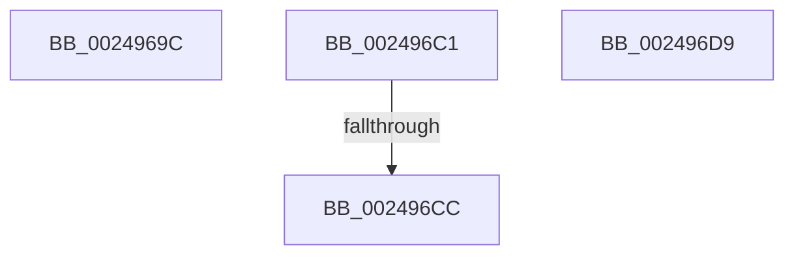

# sub_0024969C

- RVA: `0x0024969C`–`0x002496ED` (길이 `81` bytes)
- VA: `0x000000014024969C`
- 실행 섹션: `.text`
- PDB 이름 있음: `아니요`; PDB Function 태그: `아니요`
- unwind 정보 RVA: `0x000628CC`
- 디코드: `19`개 명령, `81/81` bytes 표시
- 미해석 바이트: `0` (있으면 어셈블리에 `.byte`로 보존)

> 이 문서는 커널 이미지의 기계어와 PDB 기호를 분석해 생성했습니다. 4번과 5번은 함수 원형과 자료형을 바이너리 사용 방식에서 추정한 C 해석이며 원본 소스 복구 결과는 아닙니다.

## 1. Dependencies

- 직접 호출 지점: **2**; 고유 호출 대상: **2**
- 직접 호출자로 확인된 함수: **0**
- RIP 상대 이미지 참조: **1**

### Outgoing calls
- `0x002496B4` → [KeBugCheckEx](../4F/KeBugCheckEx_function_004FD660.md) (function, `0x004FD660`)
- `0x002496E3` → [MiUpdateSubsectionCrossPartitionRefs](../4F/MiUpdateSubsectionCrossPartitionRefs_function_004FB5DC.md) (function, `0x004FB5DC`)

### Direct callers
- 이 함수 시작 RVA로 연결되는 직접 call은 확인되지 않았습니다. 간접 호출은 완전히 역산할 수 없습니다.

### Static image references
- `0x002496CC` → RVA `0x00E30090` (`.data`; read/write)

## 2. Other-region calls and transfers

- 다른 실행 섹션으로 향하는 call: **0**
- call이 아닌 외부 분기/꼬리 이동: **4**
  - `0x002496BC` → [sub_00249543 + 0x91](Unknown_function_00249543.md) (`tail-transfer`)
  - `0x002496C6` → [sub_00249543 + 0xA4](Unknown_function_00249543.md) (`tail-transfer`)
  - `0x002496D4` → [sub_00249543 + 0x1A](Unknown_function_00249543.md) (`tail-transfer`)
  - `0x002496E8` → [MiIncrementSubsectionViewCount + 0x1E](MiIncrementSubsectionViewCount_function_00249440.md) (`tail-transfer`)

## 3. Assembly (complete function range)

```asm
0024969C  45 33 C9                        xor r9d, r9d
0024969F  48 C7 44 24 20 00 00 00 00      mov qword ptr [rsp + 0x20], 0
002496A8  4C 8B C7                        mov r8, rdi
002496AB  BA 00 20 04 00                  mov edx, 0x42000
002496B0  41 8D 49 1A                     lea ecx, [r9 + 0x1a]
002496B4  E8 A7 3F 2B 00                  call 0x1404fd660
002496B9  CC                              int3
002496BA  33 C0                           xor eax, eax
002496BC  E9 13 FF FF FF                  jmp 0x1402495d4
002496C1  41 0F BA E1 08                  bt r9d, 8
002496C6  0F 82 1B FF FF FF               jb 0x1402495e7
002496CC  FF 05 BE 69 BE 00               inc dword ptr [rip + 0xbe69be]
002496D2  33 C0                           xor eax, eax
002496D4  E9 84 FE FF FF                  jmp 0x14024955d
002496D9  BE 03 00 00 00                  mov esi, 3
002496DE  FF C2                           inc edx
002496E0  48 8B CF                        mov rcx, rdi
002496E3  E8 F4 1E 2B 00                  call 0x1404fb5dc
002496E8  E9 71 FD FF FF                  jmp 0x14024945e
```

## 4. C-style interpretation (structured pseudocode)

```c
__int64 __fastcall sub_0024969C(__int64 a1, __int64 a2, __int64 a3, int a4)
{
    __int64 result;
    unsigned __int64 v_stack_p20;

    a4 = 0;
    v_stack_p20 = 0;
    result = KeBugCheckEx(a4 + 26, (unsigned int)(0x42000ULL), v_rdi, a4);
    result = 0;
}
```

## 5. (Beta) C Style

```c
int64_t sub_0024969C(int64_t Arg1, int64_t Arg2, int64_t Arg3, int32_t Arg4)
{
    int64_t result;
    uint64_t v_stack_p20;

    Arg4 = 0;
    v_stack_p20 = 0;
    result = KeBugCheckEx(Arg4 + 26, (uint32_t)(0x42000ULL), local_rdi, Arg4);
    result = 0;
}
```

## 6. Execution-region graph

[열기: 2D/3D 그래프와 함수 탐색 컨트롤 패널](../../../control-panel.html?section=text&rva=0x0024969C&view=graph)

- 2D 그래프는 위에서 아래로 흐르고, 3D 그래프는 빈 공간을 드래그해 회전합니다. Shift+드래그는 이동, 휠은 확대·축소, 함수 노드 선택은 대상 보고서 이동입니다.

### Static fallback


