# sub_00249850

- RVA: `0x00249850`–`0x00249B50` (길이 `768` bytes)
- VA: `0x0000000140249850`
- 실행 섹션: `.text`
- PDB 이름 있음: `아니요`; PDB Function 태그: `아니요`
- unwind 정보 RVA: `0x000628E4`
- 디코드: `188`개 명령, `768/768` bytes 표시
- 미해석 바이트: `0` (있으면 어셈블리에 `.byte`로 보존)

> 이 문서는 커널 이미지의 기계어와 PDB 기호를 분석해 생성했습니다. 4번과 5번은 함수 원형과 자료형을 바이너리 사용 방식에서 추정한 C 해석이며 원본 소스 복구 결과는 아닙니다.

## 1. Dependencies

- 직접 호출 지점: **10**; 고유 호출 대상: **7**
- 직접 호출자로 확인된 함수: **0**
- RIP 상대 이미지 참조: **4**

### Outgoing calls
- `0x00249866` → [ExAcquireSpinLockExclusive](ExAcquireSpinLockExclusive_function_00248690.md) (function, `0x00248690`)
- `0x0024987D` → [MiReleaseSpinLockExclusive](MiReleaseSpinLockExclusive_function_002482C0.md) (function, `0x002482C0`)
- `0x0024988A` → [MiRefPageFileSpaceBitmaps](../40/MiRefPageFileSpaceBitmaps_function_00407DC4.md) (function, `0x00407DC4`)
- `0x002499D2` → [ExpWaitForSpinLockExclusiveAndAcquire](../32/ExpWaitForSpinLockExclusiveAndAcquire_function_003239A0.md) (function, `0x003239A0`)
- `0x00249A72` → [ExReleaseSpinLockExclusiveFromDpcLevel](ExReleaseSpinLockExclusiveFromDpcLevel_function_002497E0.md) (function, `0x002497E0`)
- `0x00249A8E` → [KiLowerIrqlProcessIrqlFlags](../4F/KiLowerIrqlProcessIrqlFlags_function_004F5698.md) (function, `0x004F5698`)
- `0x00249AC3` → [SMKM_STORE_MGR<SM_TRAITS>::SmpPageEvict](SMKM_STORE_MGR_SM_TRAITS_SmpPageEvict_function_0024A5F4.md) (function, `0x0024A5F4`)
- `0x00249AE4` → [SMKM_STORE_MGR<SM_TRAITS>::SmpPageEvict](SMKM_STORE_MGR_SM_TRAITS_SmpPageEvict_function_0024A5F4.md) (function, `0x0024A5F4`)
- `0x00249B12` → [ExAcquireSpinLockExclusive](ExAcquireSpinLockExclusive_function_00248690.md) (function, `0x00248690`)
- `0x00249B26` → [MiReleaseSpinLockExclusive](MiReleaseSpinLockExclusive_function_002482C0.md) (function, `0x002482C0`)

### Direct callers
- 이 함수 시작 RVA로 연결되는 직접 call은 확인되지 않았습니다. 간접 호출은 완전히 역산할 수 없습니다.

### Static image references
- `0x002499A6` → RVA `0x00FC6D20` (`ALMOSTRO`; read)
- `0x002499B3` → RVA `0x00FC6B06` (`ALMOSTRO`; read)
- `0x002499FC` → RVA `0x00FC52AC` (`ALMOSTRO`; reference)
- `0x00249A40` → RVA `0x00000000` (`image boundary/outside`; read)

## 2. Other-region calls and transfers

- 다른 실행 섹션으로 향하는 call: **0**
- call이 아닌 외부 분기/꼬리 이동: **8**
  - `0x0024990B` → [sub_00249B6A + 0x8B](Unknown_function_00249B6A.md) (`tail-transfer`)
  - `0x00249941` → [sub_00249B6A + 0x8B](Unknown_function_00249B6A.md) (`tail-transfer`)
  - `0x00249960` → [sub_00249B6A + 0xBA](Unknown_function_00249B6A.md) (`tail-transfer`)
  - `0x002499AD` → [sub_00249B6A + 0x7B](Unknown_function_00249B6A.md) (`tail-transfer`)
  - `0x002499BA` → [sub_00249B6A + 0x5C](Unknown_function_00249B6A.md) (`tail-transfer`)
  - `0x00249A02` → [sub_00249B6A + 0x93](Unknown_function_00249B6A.md) (`tail-transfer`)
  - `0x00249A3A` → [sub_00249B6A](Unknown_function_00249B6A.md) (`tail-transfer`)
  - `0x00249B4E` → [sub_00249B50 + 0xA](Unknown_function_00249B50.md) (`tail-transfer`)

## 3. Assembly (complete function range)

```asm
00249850  49 89 5B 20                     mov qword ptr [r11 + 0x20], rbx
00249854  49 89 7B E0                     mov qword ptr [r11 - 0x20], rdi
00249858  4D 89 63 D8                     mov qword ptr [r11 - 0x28], r12
0024985C  4C 8D A1 C8 00 00 00            lea r12, [rcx + 0xc8]
00249863  49 8B CC                        mov rcx, r12
00249866  E8 25 EE FF FF                  call 0x140248690
0024986B  41 8B 5D 68                     mov ebx, dword ptr [r13 + 0x68]
0024986F  0F B6 D0                        movzx edx, al
00249872  49 8B CC                        mov rcx, r12
00249875  41 C7 45 68 FF FF FF FF         mov dword ptr [r13 + 0x68], 0xffffffff
0024987D  E8 3E EA FF FF                  call 0x1402482c0
00249882  48 8D 54 24 20                  lea rdx, [rsp + 0x20]
00249887  49 8B CD                        mov rcx, r13
0024988A  E8 35 E5 1B 00                  call 0x140407dc4
0024988F  44 8B 54 24 38                  mov r10d, dword ptr [rsp + 0x38]
00249894  BF 02 00 00 00                  mov edi, 2
00249899  48 89 6C 24 78                  mov qword ptr [rsp + 0x78], rbp
0024989E  48 89 74 24 70                  mov qword ptr [rsp + 0x70], rsi
002498A3  4C 89 74 24 58                  mov qword ptr [rsp + 0x58], r14
002498A8  4C 89 7C 24 50                  mov qword ptr [rsp + 0x50], r15
002498AD  0F 1F 00                        nop dword ptr [rax]
002498B0  C7 84 24 98 00 00 00 00 00 00 00  mov dword ptr [rsp + 0x98], 0
002498BB  44 3B D3                        cmp r10d, ebx
002498BE  0F 86 4B 02 00 00               jbe 0x140249b0f
002498C4  4C 8B 5C 24 40                  mov r11, qword ptr [rsp + 0x40]
002498C9  41 8D 52 FF                     lea edx, [r10 - 1]
002498CD  48 C1 EA 05                     shr rdx, 5
002498D1  45 33 F6                        xor r14d, r14d
002498D4  8B C3                           mov eax, ebx
002498D6  83 E3 1F                        and ebx, 0x1f
002498D9  48 C1 E8 05                     shr rax, 5
002498DD  0F B6 CB                        movzx ecx, bl
002498E0  45 8B 04 83                     mov r8d, dword ptr [r11 + rax*4]
002498E4  49 8D 04 83                     lea rax, [r11 + rax*4]
002498E8  4D 8D 0C 93                     lea r9, [r11 + rdx*4]
002498EC  BA 01 00 00 00                  mov edx, 1
002498F1  D3 E2                           shl edx, cl
002498F3  48 8D 48 04                     lea rcx, [rax + 4]
002498F7  FF CA                           dec edx
002498F9  44 0B C2                        or r8d, edx
002498FC  0F 1F 40 00                     nop dword ptr [rax]
00249900  41 F7 D0                        not r8d
00249903  45 85 C0                        test r8d, r8d
00249906  75 17                           jne 0x14024991f
00249908  49 3B C9                        cmp rcx, r9
0024990B  0F 87 E4 02 00 00               ja 0x140249bf5
00249911  44 8B 40 04                     mov r8d, dword ptr [rax + 4]
00249915  48 83 C0 04                     add rax, 4
00249919  48 83 C1 04                     add rcx, 4
0024991D  EB E1                           jmp 0x140249900
0024991F  41 8B C8                        mov ecx, r8d
00249922  4C 8B F8                        mov r15, rax
00249925  4D 2B FB                        sub r15, r11
00249928  48 0F BC C9                     bsf rcx, rcx
0024992C  49 C1 FF 02                     sar r15, 2
00249930  41 C1 E7 05                     shl r15d, 5
00249934  44 03 F9                        add r15d, ecx
00249937  89 8C 24 98 00 00 00            mov dword ptr [rsp + 0x98], ecx
0024993E  45 3B FA                        cmp r15d, r10d
00249941  0F 87 AE 02 00 00               ja 0x140249bf5
00249947  BA 01 00 00 00                  mov edx, 1
0024994C  D3 E2                           shl edx, cl
0024994E  FF CA                           dec edx
00249950  41 0B D0                        or edx, r8d
00249953  F7 D2                           not edx
00249955  85 D2                           test edx, edx
00249957  75 14                           jne 0x14024996d
00249959  48 8D 48 04                     lea rcx, [rax + 4]
0024995D  49 3B C9                        cmp rcx, r9
00249960  0F 87 BE 02 00 00               ja 0x140249c24
00249966  8B 11                           mov edx, dword ptr [rcx]
00249968  48 8B C1                        mov rax, rcx
0024996B  EB E8                           jmp 0x140249955
0024996D  8B CA                           mov ecx, edx
0024996F  48 0F BC C9                     bsf rcx, rcx
00249973  49 2B C3                        sub rax, r11
00249976  89 8C 24 98 00 00 00            mov dword ptr [rsp + 0x98], ecx
0024997D  4C 8B F0                        mov r14, rax
00249980  49 C1 FE 02                     sar r14, 2
00249984  41 C1 E6 05                     shl r14d, 5
00249988  44 03 F1                        add r14d, ecx
0024998B  45 3B F2                        cmp r14d, r10d
0024998E  45 0F 47 F2                     cmova r14d, r10d
00249992  45 2B F7                        sub r14d, r15d
00249995  45 85 F6                        test r14d, r14d
00249998  0F 84 71 01 00 00               je 0x140249b0f
0024999E  44 0F 20 C6                     mov rsi, cr8
002499A2  44 0F 22 C7                     mov cr8, rdi
002499A6  83 3D 73 D3 D7 00 00            cmp dword ptr [rip + 0xd7d373], 0
002499AD  0F 85 32 02 00 00               jne 0x140249be5
002499B3  F6 05 4C D1 D7 00 21            test byte ptr [rip + 0xd7d14c], 0x21
002499BA  0F 85 06 02 00 00               jne 0x140249bc6
002499C0  33 DB                           xor ebx, ebx
002499C2  F0 41 0F BA 2C 24 1F            lock bts dword ptr [r12], 0x1f
002499C9  73 0E                           jae 0x1402499d9
002499CB  40 0F B6 D6                     movzx edx, sil
002499CF  49 8B CC                        mov rcx, r12
002499D2  E8 C9 9F 0D 00                  call 0x1403239a0
002499D7  8B D8                           mov ebx, eax
002499D9  41 8B 14 24                     mov edx, dword ptr [r12]
002499DD  8B CA                           mov ecx, edx
002499DF  0F BA F1 1E                     btr ecx, 0x1e
002499E3  81 F9 00 00 00 80               cmp ecx, 0x80000000
002499E9  74 30                           je 0x140249a1b
002499EB  0F BA E2 1E                     bt edx, 0x1e
002499EF  72 09                           jb 0x1402499fa
002499F1  F0 41 81 0C 24 00 00 00 40      lock or dword ptr [r12], 0x40000000
002499FA  FF C3                           inc ebx
002499FC  85 1D AA B8 D7 00               test dword ptr [rip + 0xd7b8aa], ebx
00249A02  0F 84 F5 01 00 00               je 0x140249bfd
00249A08  F3 90                           pause
00249A0A  41 8B 14 24                     mov edx, dword ptr [r12]
00249A0E  8B C2                           mov eax, edx
00249A10  0F BA F0 1E                     btr eax, 0x1e
00249A14  3D 00 00 00 80                  cmp eax, 0x80000000
00249A19  75 D0                           jne 0x1402499eb
00249A1B  49 8B 45 50                     mov rax, qword ptr [r13 + 0x50]
00249A1F  41 8B CF                        mov ecx, r15d
00249A22  83 E1 07                        and ecx, 7
00249A25  41 8B FF                        mov edi, r15d
00249A28  48 C1 EF 03                     shr rdi, 3
00249A2C  41 8B EE                        mov ebp, r14d
00249A2F  48 03 78 20                     add rdi, qword ptr [rax + 0x20]
00249A33  42 8D 14 31                     lea edx, [rcx + r14]
00249A37  83 FA 08                        cmp edx, 8
00249A3A  0F 87 2A 01 00 00               ja 0x140249b6a
00249A40  48 8D 15 B9 65 DB FF            lea rdx, [rip - 0x249a47]
00249A47  41 0F B6 84 16 90 C8 02 00      movzx eax, byte ptr [r14 + rdx + 0x2c890]
00249A50  D2 E0                           shl al, cl
00249A52  08 07                           or byte ptr [rdi], al
00249A54  41 8B 85 A8 00 00 00            mov eax, dword ptr [r13 + 0xa8]
00249A5B  41 2B C6                        sub eax, r14d
00249A5E  41 89 85 A8 00 00 00            mov dword ptr [r13 + 0xa8], eax
00249A65  75 08                           jne 0x140249a6f
00249A67  41 C7 45 68 FF FF FF FF         mov dword ptr [r13 + 0x68], 0xffffffff
00249A6F  49 8B CC                        mov rcx, r12
00249A72  E8 69 FD FF FF                  call 0x1402497e0
00249A77  40 80 FE 11                     cmp sil, 0x11
00249A7B  74 1E                           je 0x140249a9b
00249A7D  83 3D 9C D2 D7 00 00            cmp dword ptr [rip + 0xd7d29c], 0
00249A84  74 0D                           je 0x140249a93
00249A86  44 0F 20 C1                     mov rcx, cr8
00249A8A  40 0F B6 D6                     movzx edx, sil
00249A8E  E8 05 BC 2A 00                  call 0x1404f5698
00249A93  40 0F B6 C6                     movzx eax, sil
00249A97  44 0F 22 C0                     mov cr8, rax
00249A9B  49 8B 85 D8 00 00 00            mov rax, qword ptr [r13 + 0xd8]
00249AA2  48 8D 94 24 90 00 00 00         lea rdx, [rsp + 0x90]
00249AAA  45 8B C6                        mov r8d, r14d
00249AAD  44 89 BC 24 90 00 00 00         mov dword ptr [rsp + 0x90], r15d
00249AB5  48 8B 88 B8 00 00 00            mov rcx, qword ptr [rax + 0xb8]
00249ABC  48 8B 79 18                     mov rdi, qword ptr [rcx + 0x18]
00249AC0  48 8B CF                        mov rcx, rdi
00249AC3  E8 2C 0B 00 00                  call 0x14024a5f4
00249AC8  41 8B DE                        mov ebx, r14d
00249ACB  2B D8                           sub ebx, eax
00249ACD  74 1E                           je 0x140249aed
00249ACF  01 84 24 90 00 00 00            add dword ptr [rsp + 0x90], eax
00249AD6  48 8D 94 24 90 00 00 00         lea rdx, [rsp + 0x90]
00249ADE  44 8B C3                        mov r8d, ebx
00249AE1  48 8B CF                        mov rcx, rdi
00249AE4  E8 0B 0B 00 00                  call 0x14024a5f4
00249AE9  2B D8                           sub ebx, eax
00249AEB  75 E2                           jne 0x140249acf
00249AED  41 8B 85 A8 00 00 00            mov eax, dword ptr [r13 + 0xa8]
00249AF4  85 C0                           test eax, eax
00249AF6  74 17                           je 0x140249b0f
00249AF8  44 8B 54 24 38                  mov r10d, dword ptr [rsp + 0x38]
00249AFD  43 8D 1C 3E                     lea ebx, [r14 + r15]
00249B01  BF 02 00 00 00                  mov edi, 2
00249B06  41 3B DA                        cmp ebx, r10d
00249B09  0F 82 A1 FD FF FF               jb 0x1402498b0
00249B0F  49 8B CC                        mov rcx, r12
00249B12  E8 79 EB FF FF                  call 0x140248690
00249B17  48 8B 7C 24 20                  mov rdi, qword ptr [rsp + 0x20]
00249B1C  0F B6 D0                        movzx edx, al
00249B1F  49 8B CC                        mov rcx, r12
00249B22  FF 0F                           dec dword ptr [rdi]
00249B24  8B 1F                           mov ebx, dword ptr [rdi]
00249B26  E8 95 E7 FF FF                  call 0x1402482c0
00249B2B  4C 8B 7C 24 50                  mov r15, qword ptr [rsp + 0x50]
00249B30  85 DB                           test ebx, ebx
00249B32  48 8B 9C 24 A8 00 00 00         mov rbx, qword ptr [rsp + 0xa8]
00249B3A  4C 8B 74 24 58                  mov r14, qword ptr [rsp + 0x58]
00249B3F  4C 8B 64 24 60                  mov r12, qword ptr [rsp + 0x60]
00249B44  48 8B 74 24 70                  mov rsi, qword ptr [rsp + 0x70]
00249B49  48 8B 6C 24 78                  mov rbp, qword ptr [rsp + 0x78]
00249B4E  75 0A                           jne 0x140249b5a
```

## 4. C-style interpretation (structured pseudocode)

```c
__int64 __fastcall sub_00249850(__int64 a1, __int64 a2, __int64 a3, __int64 a4, __int64 a5, __int64 a6, unsigned int a7, __int64 a8, __int64 a9, __int64 a10, __int64 a11, __int64 a12, __int64 a13, __int64 a14, __int64 a15, __int64 a16, __int64 a17, unsigned int a18, __int64 a19, __int64 a20, __int64 a21)
{
    __int64 result;
    __int64 v_r14;
    __int64 v_r15;
    __int64 v_rbx;
    __int64 v_rdi;
    unsigned __int64 v_stack_p20;
    unsigned __int64 v_stack_p50;
    unsigned __int64 v_stack_p58;
    unsigned __int64 v_stack_p70;
    unsigned __int64 v_stack_p78;
    unsigned int v_stack_p90;
    unsigned int v_stack_p98;

    *(unsigned __int64 *)(v_r11 + 32) = v_rbx;
    *(unsigned __int64 *)(v_r11 - 32) = v_rdi;
    *(unsigned __int64 *)(v_r11 - 40) = v_r12;
    result = ExAcquireSpinLockExclusive(a1 + 200, a2, a3, a4);
    *(unsigned int *)(v_r13 + 104) = 0xFFFFFFFFULL;
    result = MiReleaseSpinLockExclusive(a1 + 200, (unsigned __int8)(result), a3, a4);
    result = MiRefPageFileSpaceBitmaps(v_r13, v_stack_p20, a3, a4);
    v_stack_p78 = v_rbp;
    v_stack_p70 = v_rsi;
    v_stack_p58 = v_r14;
    v_stack_p50 = v_r15;
loc_002498B0:
    v_stack_p98 = 0;
    if (((unsigned int)((unsigned int)(a7))) <= ((unsigned int)((unsigned int)(*(unsigned int *)(v_r13 + 104))))) goto loc_00249B0F;
    a2 = ((unsigned int)(a7) - 1) >> (5);
    v_r14 = 0;
    v_rbx = (unsigned int)(((unsigned int)(*(unsigned int *)(v_r13 + 104))) & (31));
    result = ((unsigned int)((unsigned int)((unsigned int)(*(unsigned int *)(v_r13 + 104))))) >> (5);
    a2 = (unsigned int)((1) << ((unsigned __int8)((unsigned __int8)(v_rbx))));
    a2 = (unsigned int)((a2) - 1);
    a3 = (unsigned int)(((unsigned int)(*(unsigned int *)(a8 + result * 4))) | ((unsigned int)(a2)));
loc_00249900:
    a3 = (unsigned int)(~(a3));
    if ((unsigned int)(a3) != 0) goto loc_0024991F;
    result = (a8 + result * 4) + (4);
    a1 = (a8 + result * 4 + 4) + (4);
    goto loc_00249900;
loc_0024991F:
    v_r15 = (result) - (a8);
    v_r15 = (v_r15) >> (2);
    v_r15 = (unsigned int)((v_r15) << (5));
    v_r15 = (unsigned int)((v_r15) + ((unsigned int)((unsigned int)((unsigned int)((unsigned int)(*(unsigned int *)(a8 + result * 4 + 4)))))));
    v_stack_p98 = (unsigned int)((unsigned int)((unsigned int)((unsigned int)(*(unsigned int *)(a8 + result * 4 + 4)))));
    a2 = (unsigned int)((1) << ((unsigned __int8)((unsigned int)((unsigned int)((unsigned int)(*(unsigned int *)(a8 + result * 4 + 4)))))));
    a2 = (unsigned int)((a2) - 1);
    a2 = (unsigned int)((a2) | ((unsigned int)((unsigned int)(*(unsigned int *)(a8 + result * 4 + 4)))));
    a2 = (unsigned int)(~(a2));
loc_00249955:
    if ((unsigned int)(a2) != 0) goto loc_0024996D;
    goto loc_00249955;
loc_0024996D:
    result = (result + 4) - (a8);
    v_stack_p98 = (unsigned int)((unsigned int)((unsigned int)((unsigned int)(*(unsigned int *)(result + 4)))));
    v_r14 = (result) >> (2);
    v_r14 = (unsigned int)((v_r14) << (5));
    v_r14 = (unsigned int)((v_r14) + ((unsigned int)((unsigned int)((unsigned int)((unsigned int)(*(unsigned int *)(result + 4)))))));
    if (((unsigned int)(v_r14)) > ((unsigned int)((unsigned int)(a7)))) { v_r14 = (unsigned int)((unsigned int)(a7)); }
    v_r14 = (unsigned int)((v_r14) - ((unsigned int)(v_r15)));
    if ((unsigned int)(v_r14) == 0) goto loc_00249B0F;
    v_rbx = 0;
    if (!(condition_is_above_or_equal)) {
        a2 = (unsigned __int8)(v_cr8);
        a1 = a1 + 200;
        result = ExpWaitForSpinLockExclusiveAndAcquire(a1, a2, (unsigned int)(*(unsigned int *)(a8 + result * 4 + 4)), a8 + a2 * 4);
        v_rbx = (unsigned int)(result);
    }
    if (((unsigned int)((unsigned int)((unsigned int)((unsigned int)(*(unsigned int *)(a1 + 200)))))) == 0x80000000ULL) goto loc_00249A1B;
loc_002499EB:
    if (((unsigned int)((unsigned int)((unsigned int)((unsigned int)(*(unsigned int *)(a1 + 200)))))) >= 0x80000000ULL) {
    }
    v_rbx = (unsigned int)((v_rbx) + 1);
    if (((unsigned int)((unsigned int)((unsigned int)((unsigned int)(*(unsigned int *)(a1 + 200)))))) != 0x80000000ULL) goto loc_002499EB;
loc_00249A1B:
    a1 = (unsigned int)(((unsigned int)((unsigned int)(v_r15))) & (7));
    v_rdi = ((unsigned int)((unsigned int)(v_r15))) >> (3);
    v_rdi = (v_rdi) + (*(unsigned __int64 *)(*(unsigned __int64 *)(v_r13 + 80) + 32));
    result = (unsigned __int8)((*(unsigned __int8 *)(v_r14 + v_rip - 2398791 * 1 + 182416)) << ((unsigned __int8)(a1)));
    result = (unsigned int)(((unsigned int)(*(unsigned int *)(v_r13 + 168))) - ((unsigned int)(v_r14)));
    *(unsigned int *)(v_r13 + 168) = (unsigned int)(result);
    if (!(condition_is_not_equal)) {
        *(unsigned int *)(v_r13 + 104) = 0xFFFFFFFFULL;
    }
    result = ExReleaseSpinLockExclusiveFromDpcLevel(a1 + 200, v_rip - 2398791, (unsigned int)(*(unsigned int *)(a8 + result * 4 + 4)), a8 + a2 * 4);
    if (((unsigned __int8)(v_cr8)) == 17) goto loc_00249A9B;
    if ((*(unsigned int *)(v_rip + 14144156)) != 0) {
        a1 = 2;
        a2 = (unsigned __int8)(v_cr8);
        result = KiLowerIrqlProcessIrqlFlags(a1, a2, (unsigned int)(*(unsigned int *)(a8 + result * 4 + 4)), a8 + a2 * 4);
    }
loc_00249A9B:
    v_stack_p90 = (unsigned int)(v_r15);
    result = SMKM_STORE_MGR_SM_TRAITS___SmpPageEvict(*(unsigned __int64 *)(*(unsigned __int64 *)(*(unsigned __int64 *)(v_r13 + 216) + 184) + 24), a18, (unsigned int)((unsigned int)(v_r14)), a8 + a2 * 4);
    v_rbx = (unsigned int)(((unsigned int)((unsigned int)(v_r14))) - ((unsigned int)(result)));
    if (condition_is_equal) goto loc_00249AED;
loc_00249ACF:
    result = SMKM_STORE_MGR_SM_TRAITS___SmpPageEvict(*(unsigned __int64 *)(*(unsigned __int64 *)(*(unsigned __int64 *)(v_r13 + 216) + 184) + 24), a18, (unsigned int)((unsigned int)(v_rbx)), a8 + a2 * 4);
    v_rbx = (unsigned int)((v_rbx) - ((unsigned int)(result)));
    if (condition_is_not_equal) goto loc_00249ACF;
loc_00249AED:
    if ((unsigned int)((unsigned int)(*(unsigned int *)(v_r13 + 168))) == 0) goto loc_00249B0F;
    if (((unsigned int)(v_r14 + v_r15 * 1)) < ((unsigned int)((unsigned int)(a7)))) goto loc_002498B0;
loc_00249B0F:
    result = ExAcquireSpinLockExclusive(a1 + 200, a18, (unsigned int)((unsigned int)(v_rbx)), a8 + a2 * 4);
    result = MiReleaseSpinLockExclusive(a1 + 200, (unsigned __int8)(result), (unsigned int)((unsigned int)(v_rbx)), a8 + a2 * 4);
}
```

## 5. (Beta) C Style

```c
int64_t sub_00249850(void *Arg1, int64_t Arg2, int64_t Arg3, int64_t Arg4, uint64_t Arg5, uint64_t Arg6, uint32_t Arg7, void *Arg8, uint64_t Arg9, int64_t Arg10, int64_t Arg11, int64_t Arg12, uint64_t Arg13, int64_t Arg14, int64_t Arg15, uint64_t Arg16, uint64_t Arg17, uint32_t Arg18, uint64_t Arg19, uint64_t Arg20, int64_t Arg21)
{
    uint8_t *arg1 = (uint8_t *)Arg1;
    uint8_t *arg8 = (uint8_t *)Arg8;

    int64_t result;
    int64_t local_r14;
    int64_t local_r15;
    int64_t local_rbx;
    int64_t local_rdi;
    uint64_t v_stack_p20;
    uint64_t v_stack_p50;
    uint64_t v_stack_p58;
    uint64_t v_stack_p70;
    uint64_t v_stack_p78;
    uint32_t v_stack_p90;
    uint32_t v_stack_p98;

    *(uint64_t *)(local_r11 + 0x20) = local_rbx;
    *(uint64_t *)(local_r11 - 0x20) = local_rdi;
    *(uint64_t *)(local_r11 - 0x28) = local_r12;
    result = ExAcquireSpinLockExclusive(Arg1 + 200, Arg2, Arg3, Arg4);
    *(uint32_t *)(local_r13 + 0x68) = 0xFFFFFFFFULL;
    result = MiReleaseSpinLockExclusive(Arg1 + 200, (uint8_t)(result), Arg3, Arg4);
    result = MiRefPageFileSpaceBitmaps(local_r13, v_stack_p20, Arg3, Arg4);
    v_stack_p78 = local_rbp;
    v_stack_p70 = local_rsi;
    v_stack_p58 = local_r14;
    v_stack_p50 = local_r15;
loc_002498B0:
    v_stack_p98 = 0;
    if (((uint32_t)((uint32_t)(Arg7))) <= ((uint32_t)((uint32_t)(*(uint32_t *)(local_r13 + 0x68))))) goto loc_00249B0F;
    Arg2 = ((uint32_t)(Arg7) - 1) >> (5);
    local_r14 = 0;
    local_rbx = (uint32_t)(((uint32_t)(*(uint32_t *)(local_r13 + 0x68))) & (31));
    result = ((uint32_t)((uint32_t)((uint32_t)(*(uint32_t *)(local_r13 + 0x68))))) >> (5);
    Arg2 = (uint32_t)((1) << ((uint8_t)((uint8_t)(local_rbx))));
    Arg2 = (uint32_t)((Arg2) - 1);
    Arg3 = (uint32_t)(((uint32_t)(*(uint32_t *)(arg8 + result * 4))) | ((uint32_t)(Arg2)));
loc_00249900:
    Arg3 = (uint32_t)(~(Arg3));
    if ((uint32_t)(Arg3) != 0) goto loc_0024991F;
    result = (Arg8 + result * 4) + (4);
    Arg1 = (Arg8 + result * 4 + 4) + (4);
    goto loc_00249900;
loc_0024991F:
    local_r15 = (result) - (Arg8);
    local_r15 = (local_r15) >> (2);
    local_r15 = (uint32_t)((local_r15) << (5));
    local_r15 = (uint32_t)((local_r15) + ((uint32_t)((uint32_t)((uint32_t)((uint32_t)(*(uint32_t *)(arg8 + result * 4 + 0x4)))))));
    v_stack_p98 = (uint32_t)((uint32_t)((uint32_t)((uint32_t)(*(uint32_t *)(arg8 + result * 4 + 0x4)))));
    Arg2 = (uint32_t)((1) << ((uint8_t)((uint32_t)((uint32_t)((uint32_t)(*(uint32_t *)(arg8 + result * 4 + 0x4)))))));
    Arg2 = (uint32_t)((Arg2) - 1);
    Arg2 = (uint32_t)((Arg2) | ((uint32_t)((uint32_t)(*(uint32_t *)(arg8 + result * 4 + 0x4)))));
    Arg2 = (uint32_t)(~(Arg2));
loc_00249955:
    if ((uint32_t)(Arg2) != 0) goto loc_0024996D;
    goto loc_00249955;
loc_0024996D:
    result = (result + 4) - (Arg8);
    v_stack_p98 = (uint32_t)((uint32_t)((uint32_t)((uint32_t)(*(uint32_t *)(result + 0x4)))));
    local_r14 = (result) >> (2);
    local_r14 = (uint32_t)((local_r14) << (5));
    local_r14 = (uint32_t)((local_r14) + ((uint32_t)((uint32_t)((uint32_t)((uint32_t)(*(uint32_t *)(result + 0x4)))))));
    if (((uint32_t)(local_r14)) > ((uint32_t)((uint32_t)(Arg7)))) { local_r14 = (uint32_t)((uint32_t)(Arg7)); }
    local_r14 = (uint32_t)((local_r14) - ((uint32_t)(local_r15)));
    if ((uint32_t)(local_r14) == 0) goto loc_00249B0F;
    local_rbx = 0;
    if (!(condition_is_above_or_equal)) {
        Arg2 = (uint8_t)(v_cr8);
        Arg1 = Arg1 + 200;
        result = ExpWaitForSpinLockExclusiveAndAcquire(Arg1, Arg2, (uint32_t)(*(uint32_t *)(arg8 + result * 4 + 0x4)), Arg8 + Arg2 * 4);
        local_rbx = (uint32_t)(result);
    }
    if (((uint32_t)((uint32_t)((uint32_t)((uint32_t)(*(uint32_t *)(arg1 + 0xC8)))))) == 0x80000000ULL) goto loc_00249A1B;
loc_002499EB:
    if (((uint32_t)((uint32_t)((uint32_t)((uint32_t)(*(uint32_t *)(arg1 + 0xC8)))))) >= 0x80000000ULL) {
    }
    local_rbx = (uint32_t)((local_rbx) + 1);
    if (((uint32_t)((uint32_t)((uint32_t)((uint32_t)(*(uint32_t *)(arg1 + 0xC8)))))) != 0x80000000ULL) goto loc_002499EB;
loc_00249A1B:
    Arg1 = (uint32_t)(((uint32_t)((uint32_t)(local_r15))) & (7));
    local_rdi = ((uint32_t)((uint32_t)(local_r15))) >> (3);
    local_rdi = (local_rdi) + (*(uint64_t *)(*(uint64_t *)(local_r13 + 0x50) + 0x20));
    result = (uint8_t)((*(uint8_t *)(local_r14 + v_rip - 0x249A47 * 1 + 0x2C890)) << ((uint8_t)(Arg1)));
    result = (uint32_t)(((uint32_t)(*(uint32_t *)(local_r13 + 0xA8))) - ((uint32_t)(local_r14)));
    *(uint32_t *)(local_r13 + 0xA8) = (uint32_t)(result);
    if (!(condition_is_not_equal)) {
        *(uint32_t *)(local_r13 + 0x68) = 0xFFFFFFFFULL;
    }
    result = ExReleaseSpinLockExclusiveFromDpcLevel(Arg1 + 200, v_rip - 2398791, (uint32_t)(*(uint32_t *)(arg8 + result * 4 + 0x4)), Arg8 + Arg2 * 4);
    if (((uint8_t)(v_cr8)) == 17) goto loc_00249A9B;
    if ((*(uint32_t *)(v_rip + 0xD7D29C)) != 0) {
        Arg1 = 2;
        Arg2 = (uint8_t)(v_cr8);
        result = KiLowerIrqlProcessIrqlFlags(Arg1, Arg2, (uint32_t)(*(uint32_t *)(arg8 + result * 4 + 0x4)), Arg8 + Arg2 * 4);
    }
loc_00249A9B:
    v_stack_p90 = (uint32_t)(local_r15);
    result = SMKM_STORE_MGR_SM_TRAITS___SmpPageEvict(*(uint64_t *)(*(uint64_t *)(*(uint64_t *)(local_r13 + 0xD8) + 0xB8) + 0x18), Arg18, (uint32_t)((uint32_t)(local_r14)), Arg8 + Arg2 * 4);
    local_rbx = (uint32_t)(((uint32_t)((uint32_t)(local_r14))) - ((uint32_t)(result)));
    if (condition_is_equal) goto loc_00249AED;
loc_00249ACF:
    result = SMKM_STORE_MGR_SM_TRAITS___SmpPageEvict(*(uint64_t *)(*(uint64_t *)(*(uint64_t *)(local_r13 + 0xD8) + 0xB8) + 0x18), Arg18, (uint32_t)((uint32_t)(local_rbx)), Arg8 + Arg2 * 4);
    local_rbx = (uint32_t)((local_rbx) - ((uint32_t)(result)));
    if (condition_is_not_equal) goto loc_00249ACF;
loc_00249AED:
    if ((uint32_t)((uint32_t)(*(uint32_t *)(local_r13 + 0xA8))) == 0) goto loc_00249B0F;
    if (((uint32_t)(local_r14 + local_r15 * 1)) < ((uint32_t)((uint32_t)(Arg7)))) goto loc_002498B0;
loc_00249B0F:
    result = ExAcquireSpinLockExclusive(Arg1 + 200, Arg18, (uint32_t)((uint32_t)(local_rbx)), Arg8 + Arg2 * 4);
    result = MiReleaseSpinLockExclusive(Arg1 + 200, (uint8_t)(result), (uint32_t)((uint32_t)(local_rbx)), Arg8 + Arg2 * 4);
}
```

### 관측된 메모리 오프셋

구조체 형식이 확인되지 않은 접근은 인자 기준의 오프셋으로만 기록했습니다.

| 기준 인자 | 오프셋 표현 | 폭 (bit) | 접근 |
|---|---:|---:|---|
| `Arg1` | `+ 0x0` | `32` | `R` |
| `Arg1` | `+ 0x0` | `32` | `R/W` |
| `Arg1` | `+ 0xC8` | `64` | `R` |
| `Arg8` | `+ 0x0` | `32` | `R` |
| `Arg8` | `+ 0x0 + rax*4` | `32` | `R` |
| `Arg8` | `+ 0x0 + rax*4` | `64` | `R` |
| `Arg8` | `+ 0x0 + rdx*4` | `64` | `R` |
| `Arg8` | `+ 0x4` | `32` | `R` |
| `Arg8` | `+ 0x4` | `64` | `R` |

## 6. Execution-region graph

[열기: 2D/3D 그래프와 함수 탐색 컨트롤 패널](../../../control-panel.html?section=text&rva=0x00249850&view=graph)

- 2D 그래프는 위에서 아래로 흐르고, 3D 그래프는 빈 공간을 드래그해 회전합니다. Shift+드래그는 이동, 휠은 확대·축소, 함수 노드 선택은 대상 보고서 이동입니다.

### Static fallback

```mermaid
flowchart TD
  bb_00249850[BB_00249850]
  bb_002498B0[BB_002498B0]
  bb_002498C4[BB_002498C4]
  bb_00249900[BB_00249900]
  bb_00249908[BB_00249908]
  bb_00249911[BB_00249911]
  bb_0024991F[BB_0024991F]
  bb_00249947[BB_00249947]
  bb_00249955[BB_00249955]
  bb_00249959[BB_00249959]
  bb_00249966[BB_00249966]
  bb_0024996D[BB_0024996D]
  bb_0024999E[BB_0024999E]
  bb_002499B3[BB_002499B3]
  bb_002499C0[BB_002499C0]
  bb_002499CB[BB_002499CB]
  bb_002499D9[BB_002499D9]
  bb_002499EB[BB_002499EB]
  bb_002499F1[BB_002499F1]
  bb_002499FA[BB_002499FA]
  bb_00249A08[BB_00249A08]
  bb_00249A1B[BB_00249A1B]
  bb_00249A40[BB_00249A40]
  bb_00249A67[BB_00249A67]
  bb_00249A6F[BB_00249A6F]
  bb_00249A7D[BB_00249A7D]
  bb_00249A86[BB_00249A86]
  bb_00249A93[BB_00249A93]
  bb_00249A9B[BB_00249A9B]
  bb_00249ACF[BB_00249ACF]
  bb_00249AED[BB_00249AED]
  bb_00249AF8[BB_00249AF8]
  bb_00249B0F[BB_00249B0F]
  bb_00249850 -->|flow| bb_002498B0
  bb_002498B0 -->|branch| bb_00249B0F
  bb_002498B0 -->|fallthrough| bb_002498C4
  bb_002498C4 -->|flow| bb_00249900
  bb_00249900 -->|branch| bb_0024991F
  bb_00249900 -->|fallthrough| bb_00249908
  bb_00249908 -->|fallthrough| bb_00249911
  bb_00249911 -->|branch| bb_00249900
  bb_0024991F -->|fallthrough| bb_00249947
  bb_00249947 -->|flow| bb_00249955
  bb_00249955 -->|branch| bb_0024996D
  bb_00249955 -->|fallthrough| bb_00249959
  bb_00249959 -->|fallthrough| bb_00249966
  bb_00249966 -->|branch| bb_00249955
  bb_0024996D -->|branch| bb_00249B0F
  bb_0024996D -->|fallthrough| bb_0024999E
  bb_0024999E -->|fallthrough| bb_002499B3
  bb_002499B3 -->|fallthrough| bb_002499C0
  bb_002499C0 -->|branch| bb_002499D9
  bb_002499C0 -->|fallthrough| bb_002499CB
  bb_002499CB -->|flow| bb_002499D9
  bb_002499D9 -->|branch| bb_00249A1B
  bb_002499D9 -->|fallthrough| bb_002499EB
  bb_002499EB -->|branch| bb_002499FA
  bb_002499EB -->|fallthrough| bb_002499F1
  bb_002499F1 -->|flow| bb_002499FA
  bb_002499FA -->|fallthrough| bb_00249A08
  bb_00249A08 -->|branch| bb_002499EB
  bb_00249A08 -->|fallthrough| bb_00249A1B
  bb_00249A1B -->|fallthrough| bb_00249A40
  bb_00249A40 -->|branch| bb_00249A6F
  bb_00249A40 -->|fallthrough| bb_00249A67
  bb_00249A67 -->|flow| bb_00249A6F
  bb_00249A6F -->|branch| bb_00249A9B
  bb_00249A6F -->|fallthrough| bb_00249A7D
  bb_00249A7D -->|branch| bb_00249A93
  bb_00249A7D -->|fallthrough| bb_00249A86
  bb_00249A86 -->|flow| bb_00249A93
  bb_00249A93 -->|flow| bb_00249A9B
  bb_00249A9B -->|branch| bb_00249AED
  bb_00249A9B -->|fallthrough| bb_00249ACF
  bb_00249ACF -->|branch| bb_00249ACF
  bb_00249ACF -->|fallthrough| bb_00249AED
  bb_00249AED -->|branch| bb_00249B0F
  bb_00249AED -->|fallthrough| bb_00249AF8
  bb_00249AF8 -->|branch| bb_002498B0
  bb_00249AF8 -->|fallthrough| bb_00249B0F
```


